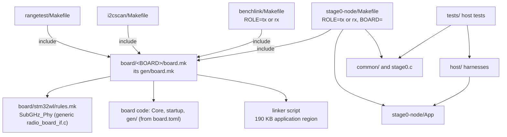

# NUCLEO-WL55JC1 firmware

**The board firmware lives in [`stage0-node/`](stage0-node/README.md).** We've built, flashed and tested both roles on the bench. TX is the transmitter (the sensor node). RX is the receiver (the USB bridge to the gateway). Nobody ran the 24-hour delivery test (H01, [`docs/H01-checklist.md`](../docs/H01-checklist.md)) yet.

## Layout

| Path | What |
|---|---|
| `board/<name>/` | One directory per hardware format (`nucleo-wl55jc`, the NUCLEO-WL55JC1; `wio-e5`, the Seeed Wio-E5 mini TX). `board.toml` holds every hardware fact the station's code uses; `tools/boardgen.py` checks it against ST's pin data and generates `gen/` (the pin and capability headers, the board's make variables, its pin table `gen/pins.md`). Beside it: the board's code from ST's CubeWL template (`Core/`, `startup/`), the linker script and a short `board.mk` (it sets `ROOT`, then includes `gen/board.mk` and `../stm32wl/rules.mk`). The NUCLEO directory also holds the bench OLED driver, `oled_spi1.c`/`.h`. The linker script gives every project a 190 KB application region (pages 0 to 94). Pages 95–127 hold the journal and the node key. `Core/Inc/sys_conf.h` takes `VERBOSE_LEVEL` and `LOW_POWER_DISABLE` from the project's `DEFS`. Adding a board: [`../docs/adding-a-board.md`](../docs/adding-a-board.md). |
| `board/stm32wl/` | What every board shares: the common build rules (`rules.mk`, which each board's `board.mk` includes), `SubGHz_Phy/App` and `SubGHz_Phy/Target` (one generic `radio_board_if.c`, driven by the board's `gen/board_caps.h`). |
| `stage0-node/` | The weather-station firmware, TX and RX roles. It keeps its own `Core/Src/stm32wlxx_it.c` (the flash error-correction hook in the non-maskable interrupt handler, and the HardFault record). |
| `rangetest/` | The bench range-test tool ([`rangetest/README.md`](rangetest/README.md)). |
| `i2cscan/` | The bench I2C tool: bus scan, INA228 and MAX17048 readings ([`i2cscan/README.md`](i2cscan/README.md)). |
| `benchlink/` | The bench telemetry link: the TX sends the power breadboard's readings and the air every 5 s over plain LoRa, the RX prints them, both under a supervised watchdog ([`benchlink/README.md`](benchlink/README.md)). It keeps its own `Core/Src/stm32wlxx_it.c` too: the HardFault and NMI record, without the flash error-correction hook. |
| `common/` | Frame, observation and console code, the power register and ADC conversions (`power_regs.c`, shared by the node, i2cscan and benchlink so the bench and the field read a register the same way), and the WSMP core (`wsmp.c`, which also parses the module record v1.0 of a module board's ID EEPROM) with its generated registry (`wsmp_registry.h` from `wsmp_registry.toml`). The module-port identity code: record calibration (`wsmp_cal.c`), the admission verdict (`wsmp_ident.c`) and the shared rounding helper (`ws_round.h`). Both `.c` files link into the TX firmware (`stage0-node/Makefile`). `mod_reg.c` and `mod_th.c` apply the record calibration, and `port_id.c` runs `wsmp_identify`. The firmware and the host tests share `common/`. |
| `host/` | The host harnesses that run the role modules over a simulated board (`sim_core.c`). The sensor modules run over a simulated I2C bus with device models (`i2c_sim.c`, `i2c_models.c`). |
| `fuzz/` | Host fuzz targets for the input parsers ([`fuzz/README.md`](fuzz/README.md)). |
| `stage0.c`, `test_*.c`, `sim_flash.*` | Portable sensor and policy code, plus the host test drivers that `tests/` runs. |

Each project keeps only its application, its sequencer task list (`Core/Inc/utilities_def.h`) and a short Makefile. The Makefile sets `TARGET`, `APP_SRC`, `DEFS` and `OPT`, then includes `$(BOARD_DIR)/board.mk` (`../board/nucleo-wl55jc/board.mk` for the NUCLEO-only tools).

`stage0.c` and `stage0.h` hold portable core code:

- the SHT45 reply parser with its CRC check (and the SHT4x serial-number parser)
- the I2C recovery waveform
- the link gate
- the failure-run counter
- the `PROVISION` parser
- the stack-scan helpers

The host tests compile them with warnings as errors. The TX firmware links them unchanged.

## Hardware target

- Two ST NUCLEO-WL55JC1 boards: the sensor transmitter and the USB-powered receiver.
- One SHT45 breakout with a PTFE filter: Adafruit 6174. It replaces the older Adafruit 5665 of the starter suggestion.
- The bench station sensors for the TX board: BMP581, LTR390, SHTC3 and a weather meter (cups, vane, rain), read as DATAVANE5K local modules ([`docs/module-protocol.md`](../docs/module-protocol.md), `stage0-node/App/mod_*.c`). The sensors (SHT45, BMP581, LTR390, SHTC3) share I2C2 (PA11 SDA, PA12 SCL) through a passive STEMMA QT hub. The power monitors (the INA228, daisy-chained to the MAX17048) sit on a second STEMMA QT cable (QTM) on the same I2C2 lines. There's no mux on either (`WS_I2C_MUX` 0, `stage0-node/App/i2c_bus.h:19-21`). The wiring is in [`docs/hardware/bench-station-wiring.md`](../docs/hardware/bench-station-wiring.md), and the breadboard map is [`hardware/bench-breadboard-r0/`](../hardware/bench-breadboard-r0/README.md).
- The power system, **phase A**, is the current phase (power telemetry spec [`2026-10-29-power-telemetry-design.md`](../docs/superpowers/specs/2026-10-29-power-telemetry-design.md), sections 1 and 2). It has a 1S3P Li-ion pack (three 2,200 mAh cells in parallel, 6,600 mAh, 3.0 to 4.2 V) and an Adafruit bq24074 charger (#4755, 1.0 A ISET jumper, one VBUS input). It also has the TX inputs below, on the same MCU pins on the bench and in the field. The node firmware reads every one of them (`stage0-node/App/power_acq.c`, `board_inputs.c`, `power_config.h`):

  | Input | Part or pin | Measures |
  |---|---|---|
  | Battery INA228 at 0x40 | shunt in the battery path: pack → CELL+ connector → VIN+, VIN− → BATT connector → the charger's BATT socket (record P3); VBUS on its own sense lead (L_VBUS) to the OUT connector (WAGO_SYS_OUT; record P5); SJ1 (VBUS-to-VIN+) open | battery current (signed, + into the cell, from its CHARGE register), charge counters, load voltage (OUT), die temperature. The firmware computes the energy counters from those charge steps times the gauge's VCELL |
  | MAX17048 at 0x36 | on the CELL+ connector by its own #1131 lead (L_GAUGE_POS), its minus lead unconnected and insulated, ground over STEMMA QT (record P4, M4); never on OUT | the CELL+ node voltage (it includes the pack-lead drop, I × R_pack, about 25–35 mV at a 0.9 A charge; record M4), state of charge, SOC rate |
  | bq24074 ISET | PB1, ADC1_IN5 (A0, CN8.1; morpho alias CN7.28), through 10 kΩ at the charger into the PB1 node, which has 100 nF and 1 MΩ to ground (record M2) | the charger's own charge current, I = 400 × V_ISET ÷ R_ISET, with V_ISET = the pin ÷ the ISET gain. R_ISET is 1 kΩ (R9 behind the closed 1A jumper: ICHG 0.89 A typ; `POWER_R_ISET_OHM 1000U`, `stage0-node/App/power_config.h:87`); the gain is `POWER_ISET_GAIN_PPM` (`:93`, 1 MΩ / 1.01 MΩ, nominal until the per-board fit). Both adopted with change A, read by this workflow from record 7.1 P3; Clint to confirm (design D4/D5) |
  | Charger input | PA10, ADC1_IN6 (CN8.3, A2), through 20 kΩ (two 10 kΩ in series) over 10 kΩ; VIN = the pin × `POWER_VIN_DIVIDER_PPM` / 10⁶ (`power_config.h:99`, nominal 3000000 until the resistors are measured; record M2) | charger input voltage after the sources join (solar or USB-C, not identified) |
  | bq24074 CHG | PB10 (D6, CN9.7; morpho alias CN10.25), internal pull-up, edges on EXTI10 | charging, and the 2 Hz fault flash |
  | bq24074 PGOOD | PB8 (D5, CN9.6; morpho alias CN10.27), internal pull-up | input power good |
  | VREFINT | ADC internal channel | the MCU supply (VDDA) |
  | SHT45 | I2C2 at 0x44 | outside air temperature and humidity |

  **The official wiring** is step 1 of the [build-progression decision record](../docs/superpowers/specs/2026-10-29-build-progression-decisions.md) (breadboard v2, change A, section 4.4): [`benchlink/README.md`](benchlink/README.md), "Wiring", and the [build sheet](../hardware/bench-breadboard-r0/build-sheet.md). The 2026-10-28/29 bench proved the pins but not the shunt in the battery path (spec section 2, exit criteria 3 and 4). The pack sat in the charger's BATT socket then, so the shunt carried no current. PB8 and PB10 are FT_f pins with their pull-ups on, so each must stay below min(VDD, VDDA) + 0.3 V (DS13293 Rev 5, Table 26 note 3). We measured at most 2.9 V.

  No battery, charge or load current goes through a breadboard contact (record P1). The battery path runs through the charger's own JST PH sockets and the CELL+, BATT, OUT and STAR lever connectors. A 0.2 Ω breadboard path once ended 1 A charges early. The gauge's lead lands on CELL+, and the INA228's VBUS sense lead on the OUT connector.
- Phase B (step 1b, not built yet) adds a load INA228 (0x41), a solar INA228 (0x45) and a USB-C INA228 (0x48) upstream of the point where the sources join. The build constant `WS_POWER_PROFILE` (`stage0-node/App/power_config.h`) selects the phase. USB-C is for bench work and occasional backup charging only, never connected together with solar. [`docs/hardware/power-metering.md`](../docs/hardware/power-metering.md) has the rails and addresses.
- Phase C (`WS_POWER_PROFILE` 3) is the TX stack (`hardware/tx-stack-r1`): a BQ25798EVM at 0x6B replaces the bq24074 and the load, solar and USB-C INA228s; the battery INA228 and the MAX17048 stay. `stage0-node/App/charger.c` sets it up (0.9 A, 4.2 V, one cell) at every start and after any chip reset, gates charging on the thermistor, and the `CHARGER` console command prints its registers.

The development boards, their antennas and their USB data cables are the platform of the bench prototype. This link needs no custom boards and no printed fixtures.

## Target integration status

This is the original plan, in order. The status is from 2026-10-13, plus later sensor results. Each finished item points to where it lives.

1. **Done.** We pin the vendor code and the toolchain. `tools/fetch-vendor.sh` pins STM32CubeWL v1.6.0 at commit `f934cd2…` plus the submodule commits. The toolchain is xPack arm-none-eabi-gcc 15.2.1-1.1, pinned by `TOOLCHAIN` in `firmware/board/stm32wl/rules.mk` (the shared build rules that every `board.mk` includes). OpenOCD over ST-LINK flashes the boards.
2. **Done.** The sensor is on I2C2: PA11 = SDA and PA12 = SCL (`stage0-node/App/i2c_bus.c`). A check against UM2592 Rev 4 Tables 17/18 confirmed the pins, and `docs/protocol-stack.md` §3.1 has the wiring. The C code uses the 7-bit address 0x44 (`WS_SHT45_ADDR`), and `i2c_bus.c` shifts it for the HAL. The sensor gave valid readings on 2026-10-14 ([`stage0-node/README.md`](stage0-node/README.md)).
3. **Done in firmware. The hardware check is open.** The firmware uses HAL I2C in interrupt mode with timeouts, and the SHT45 module takes four samples a minute, one every 15 s (`stage0-node/App/mod_th.c`). The bus has stuck-bus recovery (`ws_i2c_recover_step` in `stage0.c`, one step per timer tick in `i2c_bus.c`). A minute without a valid sample gives an explicit invalid reading, and an unplug test passed on hardware on 2026-10-14 (release `bc5e6ede429c`, [`docs/hardware/nucleo-wl55jc-bringup.md`](../docs/hardware/nucleo-wl55jc-bringup.md)). Bus recovery with a real stuck sensor is not tested on hardware.
4. **Done.** AES-128-CCM through ST's Mbed TLS (`common/ws_frame.c`). At boot the firmware checks it against known-answer frames that the host generated (`stage0-node/App/selftest.c` `selftest_kat`). `tests/test_frame.py` checks the same frames. You provision a node over USB with the console command `PROVISION` and the host command `python -m ws0 provision-node`. The durable counter and epoch are in `stage0-node/App/node_store.c`.
5. **Done for the bench prototype.** The flash journal holds at least 609 observations of the version 6 node field set (77 B, about 10.15 hours). Version 5 records on this 30-page ring would give 725 and 12.08 hours, and the version 5 release itself ran 70 pages, 1,725 and 28.75 hours. It keeps each one until an authenticated ACK or NACK arrives, or until the strike rule abandons it. The firmware reserves the boot epoch before it takes a sample ([`stage0-node/README.md`](stage0-node/README.md), "Flash layout and outage capacity"). A reset-during-write test passed, but we put off a true power-cut test.
   - **Open:** the 30-day storage target (H11, 16 MB of external SPI NOR flash).
6. **Done.** The RX bridge prints frames as hex lines and transmits the ACK/NACK of the host (`stage0-node/App/app_rx.c`, host side `ws0/link.py`, `ws0 serve`). The authenticated ACK carries the host UTC time. TX sends the live reading first, then a bounded backlog.
7. **Open.** The bench radio settings are in `stage0-node/App/radio_cfg.h`: 915.0 MHz, 500 kHz bandwidth, SF7 (spreading factor 7), coding rate 4/5, 0 dBm. The spreading factor and power still need tuning for the real placement. The regional configuration, the antennas and the airtime still need confirmation. Bench settings are not a qualified regional configuration.
8. **Built and flashed. The 24-hour delivery test is open.** The binary hashes of each release are in [`stage0-node/RELEASES.md`](stage0-node/RELEASES.md). Nobody ran the checklist in [`docs/H01-checklist.md`](../docs/H01-checklist.md) yet.

## Current measurement preparation

UM2592 documents JP1/I_SoC, and separate measurement arrangements with JP2/I_RF, JP5/I_SYS and related bridges. Check the board revision and the manual before you change jumpers or bridges.

USB input power includes the overhead of the debugger and the development board. It is not a measurement of the pack power of the final station. Record the supply boundary and the jumper and debugger settings with the traces. Normal USB power is correct for the bench prototype.

### What the station measures of its own power

The node measures its power system itself and sends it in every observation (voltages and currents, every minute) and in the health report (slow values, every 15 minutes): the power telemetry spec, sections 3 and 6. The goal is the voltage and current of four rails: battery (signed), solar input, USB-C input and load (the system rail). Which part measures each rail depends on the phase:

| Rail | Phase A (today: one INA228) | Phase B (four INA228s) |
|---|---|---|
| Battery current (+ into the cell) and the charge and energy counters | battery INA228 (0x40), shunt in the battery path | as phase A |
| Battery voltage | MAX17048 on the CELL+ node (record M4; never an INA228 VBUS) | as phase A |
| Load voltage | battery INA228's VBUS, on its sense lead to the OUT connector (record P5) | load INA228 (0x41) VBUS; the battery INA228's VBUS is no longer read |
| Load current | **not measured** (absent from the record) | load INA228 (0x41) |
| Charger input voltage | PA10 divider (the source is not identified) | as phase A, a cross-check of the source rails |
| Solar voltage and current | **not measured** | solar INA228 (0x45), upstream of the join |
| USB-C voltage and current | **not measured** | USB-C INA228 (0x48), upstream of the join |

Phase A cannot tell solar from USB-C: the bq24074 has one input, and no monitor sits upstream of the point where the sources join. The charger input slot exists for that reason, and the firmware never guesses the source. A value that a phase can't measure is absent from the record. A fitted monitor that fails sends INVALID. The full per-phase fill table (phases A and B) is in the power telemetry spec, section 3.2 (every minute) and section 3.3 (every 15 minutes), and in [`docs/hardware/power-metering.md`](../docs/hardware/power-metering.md), section 4.

References:
- https://github.com/STMicroelectronics/STM32CubeWL
- https://www.st.com/en/evaluation-tools/nucleo-wl55jc.html
- https://www.st.com/resource/en/user_manual/um2592-stm32wl-nucleo64-board-mb1389-stmicroelectronics.pdf
- https://sensirion.com/resource/datasheet/sht4x
- https://www.adafruit.com/product/6174
