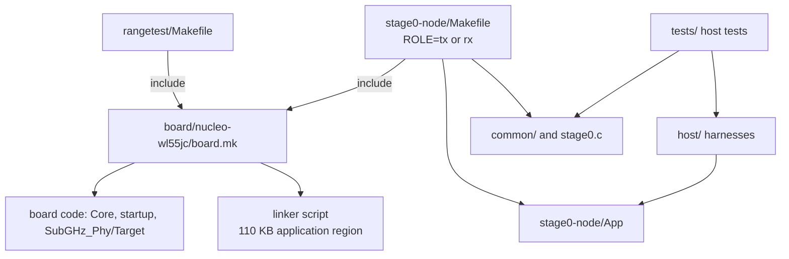

# NUCLEO-WL55JC1 firmware

**The board firmware lives in [`stage0-node/`](stage0-node/README.md).** Both roles are built, flashed and tested on the bench. TX is the transmitter (the sensor node). RX is the receiver (the USB bridge to the gateway). The 24-hour delivery test (H01, [`docs/H01-checklist.md`](../docs/H01-checklist.md)) has NOT RUN.

## Layout

| Path | What |
|---|---|
| `board/nucleo-wl55jc/` | The shared NUCLEO-WL55JC1 board code from ST's CubeWL template (`Core/`, `startup/`, `SubGHz_Phy/Target/`). Also the linker script and `board.mk`. The linker script gives every project a 110 KB application region (pages 0–54). Pages 55–127 hold the journal and the node key. `board.mk` holds the common build rules that each project Makefile includes. `Core/Inc/sys_conf.h` takes `VERBOSE_LEVEL` and `LOW_POWER_DISABLE` from the project's `DEFS`. |
| `stage0-node/` | The weather-station firmware, TX and RX roles. It keeps its own `Core/Src/stm32wlxx_it.c` (the flash error-correction hook in the non-maskable interrupt handler, and the HardFault record). |
| `rangetest/` | The bench range-test tool ([`rangetest/README.md`](rangetest/README.md)). |
| `common/` | Frame, observation and console code, and the WSMP core (`wsmp.c`) with its generated registry (`wsmp_registry.h` from `wsmp_registry.toml`). The firmware and the host tests share it. |
| `host/` | The host harnesses that run the role modules over a simulated board (`sim_core.c`). The sensor modules run over a simulated I2C bus with device models (`i2c_sim.c`, `i2c_models.c`). |
| `fuzz/` | Host fuzz targets for the input parsers ([`fuzz/README.md`](fuzz/README.md)). |
| `stage0.c`, `test_*.c`, `sim_flash.*` | Portable sensor and policy code, plus the host test drivers that `tests/` runs. |

Each project keeps only its application, its sequencer task list (`Core/Inc/utilities_def.h`) and a short Makefile. The Makefile sets `TARGET`, `APP_SRC`, `DEFS` and `OPT`, then includes `../board/nucleo-wl55jc/board.mk`.

`stage0.c` and `stage0.h` hold portable SHT45 code: the reply parser with its CRC check, the I2C recovery waveform, the link gate and the `PROVISION` parser. The host tests compile them with warnings as errors. The TX firmware links them unchanged.

## Hardware target

- Two ST NUCLEO-WL55JC1 boards: the sensor transmitter and the USB-powered receiver.
- One SHT45 breakout with a PTFE filter: Adafruit 6174. It replaces the older Adafruit 5665 of the starter suggestion.
- The bench station sensors for the TX board: BMP581, LTR390, SHTC3, INA228, MAX17048, the bq24074 charger status pins and a weather meter (cups, vane, rain). The firmware reads them as DATAVANE5K local modules ([`docs/module-protocol.md`](../docs/module-protocol.md), `stage0-node/App/mod_*.c`). The wiring is in [`docs/hardware/bench-station-wiring.md`](../docs/hardware/bench-station-wiring.md). The breadboard map is [`hardware/bench-breadboard-r0/`](../hardware/bench-breadboard-r0/README.md).

The development boards, their antennas and their USB data cables are the platform of the bench prototype. This link needs no custom boards and no printed fixtures.

## Target integration status

This is the original plan, in order. The status is from 2026-10-13, with later sensor results added. Each item that is done points to where it lives.

1. **Done.** Vendor code and toolchain are pinned: `tools/fetch-vendor.sh` (STM32CubeWL v1.6.0 at commit `f934cd2…` plus the submodule commits), xPack arm-none-eabi-gcc 15.2.1-1.1 (`stage0-node/Makefile` `TOOLCHAIN`). OpenOCD over ST-LINK flashes the boards.
2. **Done.** The sensor is on I2C2: PA11 = SDA and PA12 = SCL (`stage0-node/App/i2c_bus.c`). A check against UM2592 Rev 4 Tables 17/18 confirmed the pins. The wiring is in `docs/protocol-stack.md` §3.1. The C code uses the 7-bit address 0x44 (`WS_SHT45_ADDR`). `i2c_bus.c` shifts it for the HAL. The sensor gave valid readings on 2026-10-14 ([`stage0-node/README.md`](stage0-node/README.md)).
3. **Done in firmware. The hardware check is open.** The firmware uses HAL I2C in interrupt mode with timeouts. The SHT45 module takes four samples a minute, one every 15 s (`stage0-node/App/mod_th.c`). The bus has stuck-bus recovery (`ws_i2c_recover_step` in `stage0.c`, one step per timer tick in `i2c_bus.c`). A minute without a valid sample gives an explicit invalid reading. An unplug test passed on hardware on 2026-10-14 (release `bc5e6ede429c`, [`docs/hardware/nucleo-wl55jc-bringup.md`](../docs/hardware/nucleo-wl55jc-bringup.md)). Bus recovery with a real stuck sensor is not tested on hardware.
4. **Done.** AES-128-CCM through ST's Mbed TLS (`common/ws_frame.c`). At boot the firmware checks it against known-answer frames that the host generated (`stage0-node/App/selftest.c` `selftest_kat`). `tests/test_frame.py` checks the same frames. Provisioning over USB: the console command `PROVISION` and the host command `python -m ws0 provision-node`. The durable counter and epoch are in `stage0-node/App/node_store.c`.
5. **Done for the bench prototype.** The flash journal holds at least 1,725 observations of the WSMP bench field set (about 28.7 hours). It keeps each one until an authenticated ACK arrives. The firmware reserves the boot epoch before sampling ([`stage0-node/README.md`](stage0-node/README.md), "Flash layout and outage capacity"). A reset-during-write test passed. A true power-cut test is deferred. **Open:** the 30-day storage target (H11, 16 MB of external SPI NOR flash).
6. **Done.** The RX bridge prints frames as hex lines and transmits the ACK/NACK of the host (`stage0-node/App/app_rx.c`, host side `ws0/link.py`, `ws0 serve`). The authenticated ACK carries the host UTC time. TX sends the live reading first, then a bounded backlog.
7. **Open.** The bench radio settings are in `stage0-node/App/radio_cfg.h`: 915.0 MHz, 500 kHz bandwidth, spreading factor 7, coding rate 4/5, 0 dBm. The spreading factor and power still need tuning for the real placement. The regional configuration, the antennas and the airtime still need confirmation. Bench settings are not a qualified regional configuration.
8. **Built and flashed. The 24-hour delivery test is open.** The binary hashes of each release are in [`stage0-node/RELEASES.md`](stage0-node/RELEASES.md). Nobody has run the checklist in [`docs/H01-checklist.md`](../docs/H01-checklist.md) yet.

## Current measurement preparation

UM2592 documents JP1/I_SoC, and separate measurement arrangements with JP2/I_RF, JP5/I_SYS and related bridges. Verify the board revision and the manual before you change jumpers or bridges.

USB input power includes the overhead of the debugger and the development board. It is not a measurement of the pack power of the final station. Record the supply boundary and the jumper and debugger settings with the traces. Normal USB power is correct for the bench prototype.

References:
- https://github.com/STMicroelectronics/STM32CubeWL
- https://www.st.com/en/evaluation-tools/nucleo-wl55jc.html
- https://www.st.com/resource/en/user_manual/um2592-stm32wl-nucleo64-board-mb1389-stmicroelectronics.pdf
- https://sensirion.com/resource/datasheet/sht4x
- https://www.adafruit.com/product/6174
