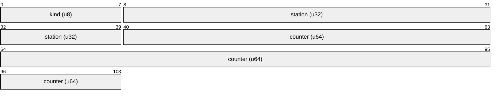
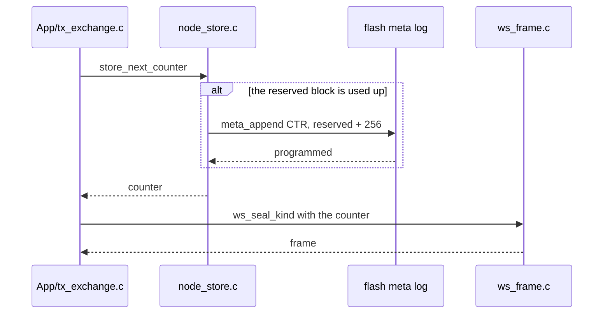
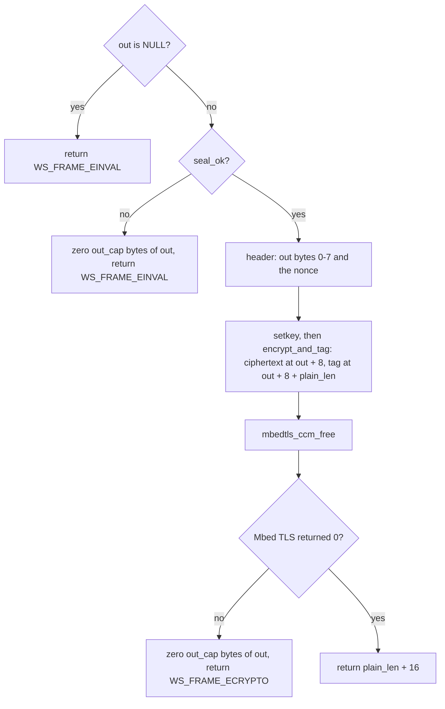
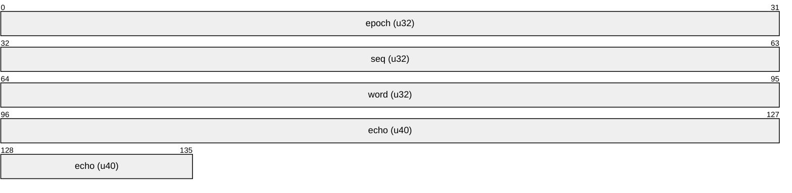
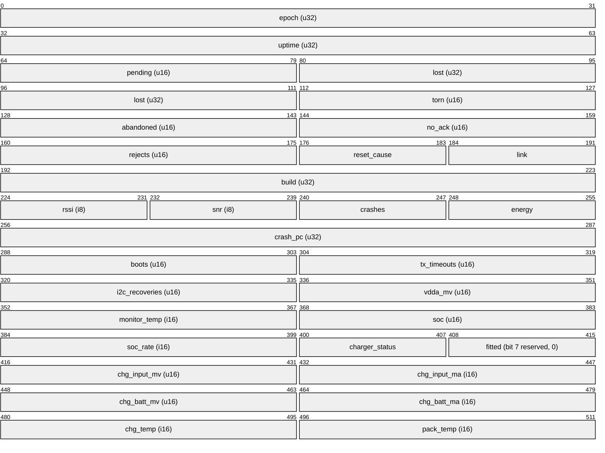

# ws_frame: the radio frame format

`ws_frame.c` seals and opens the frames that the transmitting node (the TX node) exchanges with the
gateway over LoRa. The frames use AES-128 in CCM mode (counter with CBC-MAC). The file builds the
8-byte clear header, the 13-byte CCM nonce and the 8-byte tag. It also opens ACK and NACK replies,
packs the health report and computes the key check value. The gateway builds the same bytes in
`ws0/protocol.py`. `docs/protocol-design.md` sections 3 and 4 define the format.

This document is the source. `tools/tangle.py` generates `ws_frame.c` from the code chunks below.
The repository also holds the generated file, so the build, the static analysers, the fuzzer and the
host tests read ordinary C. Edit this file, then regenerate and check it:

```sh
python3 tools/tangle.py firmware/common/ws_frame.lit.md                            # write ws_frame.c
python3 tools/tangle.py --check firmware/common/ws_frame.lit.md                    # committed .c == tangle
python3 tools/tangle.py --weave /tmp/ws_frame.html firmware/common/ws_frame.lit.md # render
```

A chunk is a fenced ` ```c {#name} ` block. A line `<<name>>` inside a chunk includes chunk
`name`. Chunks appear in reading order. The root chunk (section 8) puts them in C order.

## 1. Guarantees

| Property | Guarantee | Checked by |
|---|---|---|
| Range | the code refuses a station, counter, kind or length that its field cannot hold. It never truncates | `test_counter_and_station_limits`, `fuzz_reply`, `obs_ok` in `App/selftest.c` |
| Refusal | every refusal after the `out` check leaves all `out_cap` bytes of `out` zero | `test_counter_and_station_limits`, `fuzz_reply` |
| Agreement | a sealed frame equals `ws0/protocol.py` `seal()` and the design document's construction byte for byte | `test_known_answer_vectors`, `test_vectors_follow_the_spec`, `test_random_agreement_both_directions`, `test_selftest_vectors` |
| Opening | only an authentic 33-byte ACK or NACK for the caller's station opens. The function writes the outputs only then | `test_reply_rejections`, `fuzz_reply`, `reply_ok` in `App/selftest.c` |
| Health report | `ws_diag_pack` writes exactly the 64 bytes of `ws0/protocol.py` `pack_diag`; bit 7 of byte 51 (the fitted byte) always 0 | `test_diag_plaintext_matches_python`, `test_diag_layout_matches_the_spec`, `test_diagnostic_frame_agreement` |
| Key check value | the first 3 bytes of AES-128-ECB(key, zero block). ECB is the electronic codebook mode | `test_key_check_value` |

The tests named here are in `tests/test_frame.py` unless the table names another file.

## 2. Frame layout

Every frame is a clear header, a ciphertext and a tag. Every integer is big-endian. The header is
8 bytes (`WS_HEADER_LEN`). CCM also authenticates the header as the additional authenticated data
(AAD). The ciphertext of n bytes and the 8-byte tag (`WS_TAG_LEN`) follow the header. The diagram
shows the header bits, most significant bit first:


| Offset | Bytes | Field | Constant (`ws_frame.h`) |
|---:|---:|---|---|
| 0 | 1 | version 6 in bits 7–4, kind in bits 3–0: 0x61 OBS, 0x62 ACK, 0x63 NACK, 0x64 DIAG | `WS_FRAME_VERSION`, `WS_FRAME_BYTE0(kind)` |
| 1 | 2 | station, 1–65535 | `WS_STATION_BYTES`, `WS_STATION_MAX` |
| 3 | 5 | transmission counter, 1 to 2^40 − 1 | `WS_COUNTER_OFF`, `WS_COUNTER_BYTES`, `WS_COUNTER_MAX` |
| 8 | n | CCM ciphertext of the kind's plaintext | |
| 8 + n | 8 | CCM tag, M = 8 | `WS_TAG_LEN` |

| Kind | Value | Direction | Plaintext | Frame |
|---|---:|---|---|---:|
| `WS_KIND_OBS` | 1 | node to gateway | observation (`ws_obs.c`) | 16 + n |
| `WS_KIND_ACK` | 2 | gateway to node | reply, 17 B (section 5) | 33 |
| `WS_KIND_NACK` | 3 | gateway to node | reply, 17 B (section 5) | 33 |
| `WS_KIND_DIAG` | 4 | node to gateway | health report, 64 B (section 7) | 80 |

A frame is at most `WS_FRAME_MAX` (255) bytes, one LoRa payload. The header and tag take
`WS_FRAME_OVERHEAD` (16), which leaves at most 239 plaintext bytes.

The file's own constants size the key, the AES block and the nonce:

```c {#constants}
#define KEY_BITS (WS_KEY_LEN * CHAR_BIT)
#define AES_BLOCK_LEN 16
/* CCM nonce: kind u8, station u32, counter u64. */
#define NONCE_STATION_BYTES 4
#define NONCE_COUNTER_BYTES 8
#define NONCE_LEN (1 + NONCE_STATION_BYTES + NONCE_COUNTER_BYTES)
_Static_assert(NONCE_LEN == 13, "CCM with a 2-byte length field takes a 13-byte nonce (15 - L)");
```

A CCM nonce of 13 bytes leaves 2 bytes for the CCM message-length field (15 − 13). Two bytes count
up to 65535 plaintext bytes, more than a 255-byte frame needs.

## 3. Header, nonce and AAD

### Layout

`header` writes the 8 header bytes (section 2) and the 13 nonce bytes from the same three integers.
The nonce bits, most significant bit first:



The nonce holds the kind as a whole byte, without the version. It widens the station to 4 bytes
and the counter to 8 bytes with leading zeros. `ws0/protocol.py` builds the same nonce with
`NONCE.pack(kind, station, counter)`.

The AAD is the 8 header bytes. CCM authenticates them in the clear, so a changed version, kind,
station or counter fails the tag.

### Why the nonce is built from the integers

The nonce is a function of (kind, station, counter) only. `header` never copies header bytes into
it, for two reasons:

- The nonce does not depend on how the header packs its fields. A change to the header widths
  cannot change which triples give which nonces.
- `header` writes each integer into a field that holds it. The 5-byte header field would truncate a
  counter of 2^40 or more. `seal_ok` refuses such a counter before `header` runs (section 4). On
  the reply path the counter comes from 5 frame bytes, so it always fits.

```c {#header}
/* Writes the header (also the AAD) and the nonce. The nonce comes from the integers, not from
 * the header bytes. The callers refuse a counter that the 5-byte field cannot hold. The nonce
 * must not depend on how the header packs the fields. */
static void header(uint8_t h[WS_HEADER_LEN], uint8_t nonce[NONCE_LEN], uint8_t kind, uint32_t station, uint64_t counter) {
 uint8_t *p = ws_write_u8(h, WS_FRAME_BYTE0(kind));
 p = ws_write_be(p, station, WS_STATION_BYTES);
 (void)ws_write_be(p, counter, WS_COUNTER_BYTES);
 p = ws_write_u8(nonce, kind);
 p = ws_write_be(p, station, NONCE_STATION_BYTES);
 (void)ws_write_be(p, counter, NONCE_COUNTER_BYTES);
}
```

The cursor writers (`ws_be.h`) return the position after each field, so the layout is the order of
the calls.

### Nonce uniqueness

Under one key, the code must seal each (kind, station, counter) triple at most once. `ws_seal_kind`
keeps no state. It trusts the caller for uniqueness and checks only the range.

| Side | Kinds | Counter source | Durable before use |
|---|---|---|---|
| Node | OBS, DIAG | `store_next_counter` (`App/node_store.c`), called by `App/tx_exchange.c` before each seal | reserves blocks of 256 counters in the flash meta log before it returns one |
| Gateway | ACK, NACK | `Nonces.next` (`ws0/protocol.py`) | commits the new counter to its SQLite database in an immediate transaction before it returns it |

On the node, the counter reaches flash before the seal:



The two sides use separate counter spaces. The kind byte in the nonce keeps them apart. For
example, node counter 5 sealed as OBS and gateway counter 5 sealed as ACK give different nonces.
OBS and DIAG share the node's counter. ACK and NACK share the gateway's counter. Thus no allocator
issues a counter value twice within one space.

A counter must be durable before use. Otherwise a reset between seal and reservation lets the next
boot issue the same counter again. A repeated counter is fatal for CCM.

Here's why. CCM encrypts in counter mode, and its keystream depends only on the key and the nonce.
Two frames under one nonce share keystream. The exclusive OR (XOR) of their ciphertexts is the XOR
of their plaintexts. If you know the plaintext of one frame, you can read the other.
`docs/protocol-design.md` section 3.2 counts nonce reuse as a total loss of security.

The version is in the AAD but not in the nonce. So each protocol version uses a new key
(`docs/protocol-design.md` section 3.2). For version 6, the release procedure in section 4 of the
power telemetry design WIPEs the node and provisions a new key. No counter used under the previous
format meets that key.

## 4. Sealing

### Refusals

`seal_ok` decides what `ws_seal_kind` may seal. Its checks short-circuit in order, so its
comparison `plain_len + WS_FRAME_OVERHEAD > out_cap` runs only for a `plain_len` that cannot
overflow. `ws_seal_kind` computes `len = plain_len + WS_FRAME_OVERHEAD` up front, for any
`plain_len`. That's harmless: C defines unsigned wrap, and the function uses `len` only after
`seal_ok` passes.

```c {#seal-ok}
/* Returns 1 if ws_seal_kind can seal these arguments: a plaintext that fits the frame and the
 * output, a valid station and counter, and a kind that the node or the gateway seals. */
static int seal_ok(uint32_t station, uint8_t kind, uint64_t counter, const uint8_t *plain, uint32_t plain_len, uint32_t out_cap) {
 if(plain_len>WS_FRAME_MAX-WS_FRAME_OVERHEAD || plain_len+WS_FRAME_OVERHEAD>out_cap || (!plain && plain_len)) return 0;
 if(station==0 || station>WS_STATION_MAX || counter==0 || counter>WS_COUNTER_MAX) return 0;
 return kind>=WS_KIND_OBS && kind<=WS_KIND_DIAG;
}
```

| Condition | Return | `out` afterwards |
|---|---|---|
| `out` is NULL | `WS_FRAME_EINVAL` (-1) | no buffer |
| `plain_len` above 239 (`WS_FRAME_MAX − WS_FRAME_OVERHEAD`) | `WS_FRAME_EINVAL` | `out_cap` zero bytes |
| `plain_len + 16` above `out_cap` | `WS_FRAME_EINVAL` | `out_cap` zero bytes |
| `plain` is NULL and `plain_len` is not 0 | `WS_FRAME_EINVAL` | `out_cap` zero bytes |
| station 0 or above 65535 | `WS_FRAME_EINVAL` | `out_cap` zero bytes |
| counter 0 or above 2^40 − 1 | `WS_FRAME_EINVAL` | `out_cap` zero bytes |
| kind not 1–4 | `WS_FRAME_EINVAL` | `out_cap` zero bytes |
| Mbed TLS `setkey` or `encrypt_and_tag` fails | `WS_FRAME_ECRYPTO` (-4) | `out_cap` zero bytes |

`seal_ok` refuses counter 0 because neither allocator issues it. Both start at 1.

The zeroed output protects a caller that ignores the return code. A refused call leaves no stale
frame from an earlier call in `out`. A failed cipher call leaves no header with a partial
ciphertext. A zero buffer starts with byte 0, which is version 0. The receiving bridge (the RX
bridge) and the gateway drop it. The wipe covers `out_cap` bytes, so `out_cap` must be the real
size of `out`.

### Seal

`ws_seal_kind` writes the header into `out`. Then it encrypts `plain` into `out` after the header
and writes the tag after the ciphertext. The AAD is the first 8 bytes of `out`, the header that the
function just wrote.



```c {#seal-kind}
int ws_seal_kind(const uint8_t key[WS_KEY_LEN], uint32_t station, uint8_t kind, uint64_t counter,
 const uint8_t *plain, uint32_t plain_len, uint8_t *out, uint32_t out_cap) {
 uint8_t nonce[NONCE_LEN]; mbedtls_ccm_context ccm; int rc;
 uint32_t len=plain_len+WS_FRAME_OVERHEAD;
 if(!out) return WS_FRAME_EINVAL;
 /* Every refusal wipes the whole output buffer. A caller that ignores the result then cannot
    send a stale or half-built frame. */
 if(!seal_ok(station,kind,counter,plain,plain_len,out_cap)) {
  mbedtls_platform_zeroize(out,out_cap);
  return WS_FRAME_EINVAL;
 }
 header(out,nonce,kind,station,counter);
 mbedtls_ccm_init(&ccm);
 rc=mbedtls_ccm_setkey(&ccm,MBEDTLS_CIPHER_ID_AES,key,KEY_BITS);
 if(!rc) rc=mbedtls_ccm_encrypt_and_tag(&ccm,plain_len,nonce,NONCE_LEN,out,WS_HEADER_LEN,
  plain,out+WS_HEADER_LEN,out+WS_HEADER_LEN+plain_len,WS_TAG_LEN);
 mbedtls_ccm_free(&ccm);
 if(rc) { mbedtls_platform_zeroize(out,out_cap); return WS_FRAME_ECRYPTO; }
 return (int)len;
}
```

`mbedtls_ccm_free` clears the key schedule in `ccm` on both paths. The code uses
`mbedtls_platform_zeroize`, not `memset`. The compiler may delete a `memset` of memory that nothing
reads again.

## 5. Opening a reply

### Reply plaintext

ACK and NACK carry the same 17-byte plaintext (`WS_REPLY_PLAIN_LEN`, `docs/protocol-design.md`
section 4). The plaintext bits, most significant bit first:



| Offset | Bytes | Field | ACK | NACK |
|---:|---:|---|---|---|
| 0 | 4 | epoch | of the record answered | of the record answered |
| 4 | 4 | seq | of the record answered | of the record answered |
| 8 | 4 | word | host UTC, or 0 when the gateway measured its own clock as wrong | reason: 1 `WS_NACK_COLLISION`, 2 `WS_NACK_INVALID` |
| 12 | 5 | echo | the observation counter answered | the observation counter answered |

The header counter of a reply is the gateway's counter. `echo` is the node's counter of the frame
that the reply answers.

```c {#reply-unpack}
/* The reply plaintext: epoch u32, seq u32, word u32 (UTC or NACK reason), echo u40. */
static void reply_unpack(const uint8_t plain[WS_REPLY_PLAIN_LEN], uint32_t *epoch, uint32_t *seq, uint32_t *word, uint64_t *echo) {
 const uint8_t *p = ws_read_be32(plain, epoch);
 p = ws_read_be32(p, seq);
 p = ws_read_be32(p, word);
 (void)ws_read_be(p, echo, WS_COUNTER_BYTES);
}
```

### Checks

`ws_open_reply` runs its checks in this order and stops at the first failure:


Step 3 checks an argument, not the frame, so it returns `WS_FRAME_EINVAL`. Step 4 rebuilds the
header from the frame's kind, the caller's station and the frame's counter. It compares bytes 0 to 2
(version, kind and station, `WS_COUNTER_OFF` bytes). Step 5 uses the frame's 8 header bytes as the
AAD.

Steps 1 to 4 need no key and run no cipher. A reply for another station fails at step 4. Step 4 does
not compare the counter bytes. `ws_open_reply` reads them from the frame and encodes them again, so
they match by construction. The nonce for step 5 comes from the same `header` call. It holds the
node's own station, so the tag can pass only for a frame sealed for this station.

A failed `mbedtls_ccm_setkey` also returns `WS_FRAME_EAUTH`. The caller cannot tell it from a bad
tag.

On success the function writes `kind`, `counter`, `epoch`, `seq`, `word` and `echo`. On failure it
writes none of them. It zeroes the plaintext buffer on every path that reaches the cipher.

```c {#open-reply}
int ws_open_reply(const uint8_t key[WS_KEY_LEN], uint32_t station, const uint8_t *frame, uint32_t len,
 uint8_t *kind, uint64_t *counter, uint32_t *epoch, uint32_t *seq, uint32_t *word, uint64_t *echo) {
 uint8_t expect[WS_HEADER_LEN], nonce[NONCE_LEN], plain[WS_REPLY_PLAIN_LEN]; mbedtls_ccm_context ccm; int rc;
 if(len!=WS_ACK_FRAME_LEN) return WS_FRAME_EINVAL;
 int k=ws_frame_kind(frame,len);
 if(k!=WS_KIND_ACK && k!=WS_KIND_NACK) return WS_FRAME_EHEADER;
 if(station==0 || station>WS_STATION_MAX) return WS_FRAME_EINVAL;   /* the caller's station, not the frame's */
 uint64_t ctr=ws_get_be64(frame+WS_COUNTER_OFF,WS_COUNTER_BYTES);
 header(expect,nonce,(uint8_t)k,station,ctr);
 if(memcmp(expect,frame,WS_COUNTER_OFF)) return WS_FRAME_EHEADER; /* version, kind, station */
 mbedtls_ccm_init(&ccm);
 rc=mbedtls_ccm_setkey(&ccm,MBEDTLS_CIPHER_ID_AES,key,KEY_BITS);
 if(!rc) rc=mbedtls_ccm_auth_decrypt(&ccm,WS_REPLY_PLAIN_LEN,nonce,NONCE_LEN,frame,WS_HEADER_LEN,
  frame+WS_HEADER_LEN,plain,frame+WS_HEADER_LEN+WS_REPLY_PLAIN_LEN,WS_TAG_LEN);
 mbedtls_ccm_free(&ccm);
 if(!rc) { *kind=(uint8_t)k; *counter=ctr; reply_unpack(plain,epoch,seq,word,echo); }
 mbedtls_platform_zeroize(plain,sizeof plain);
 return rc?WS_FRAME_EAUTH:WS_FRAME_OK;
}
```

## 6. Key check value

`ws_key_check` encrypts one zero block with AES-128-ECB under the key. It returns the first 3 bytes
(`WS_KCV_LEN`). The node and the gateway compute the value from the same key. Equal values show
equal keys, and the key itself stays hidden. The function zeroes the whole AES block before it
returns, so only those 3 bytes leave it.

| Key | Check value |
|---|---|
| `00 01 02 … 0f` (the self-test key) | `c6a13b` (AES-128 of the zero block under the self-test key, checked in `tests/test_frame.py` against Python's AES) |

Users:

- `store_config_write` and `store_config_load` (`App/node_store.c`) store the value with the key
  and compare it on load. A mismatch means that the stored key changed after the node wrote it.
- `App/tx_console.c` prints the value as `kcv=` in `#status`, for comparison with the gateway's
  value.

The function returns the Mbed TLS code. It writes `out` only when that code is 0.

```c {#key-check}
int ws_key_check(const uint8_t key[WS_KEY_LEN], uint8_t out[WS_KCV_LEN]) {
 uint8_t block[AES_BLOCK_LEN]; mbedtls_aes_context aes; int rc;
 mbedtls_aes_init(&aes);
 rc=mbedtls_aes_setkey_enc(&aes,key,KEY_BITS);
 if(!rc) { const uint8_t zero[AES_BLOCK_LEN]={0}; rc=mbedtls_aes_crypt_ecb(&aes,MBEDTLS_AES_ENCRYPT,zero,block); }
 mbedtls_aes_free(&aes);
 if(!rc) memcpy(out,block,WS_KCV_LEN);
 mbedtls_platform_zeroize(block,sizeof block);   /* only 3 bytes of AES(key, 0) may leave */
 return rc;
}
```

## 7. Health report

`ws_diag_pack` writes the 64-byte health report plaintext (kind `WS_KIND_DIAG`,
`WS_DIAG_PLAIN_LEN`) from a `ws_diag_t`. The order of the writes sets the offsets.

The length never changes. The RX bridge checks it exactly (`ws_console.c`, `WS_DIAG_FRAME_LEN` 80), and
so does the gateway (`PLAIN_LENGTHS`). The first 32 bytes keep their version 5 layout. Bytes 32 to
63 are new in version 6 (power telemetry design, `docs/superpowers/specs/2026-10-29-power-telemetry-design.md`
section 6.1). The plaintext bits, most significant bit first:



| Offset | Bytes | Type | `ws_diag_t` field | Contents | None code |
|---:|---:|---|---|---|---|
| 0 | 4 | u32 | `epoch` | boot epoch | — |
| 4 | 4 | u32 | `uptime` | seconds since boot | — |
| 8 | 2 | u16 | `pending` | journal records not yet acknowledged | — |
| 10 | 4 | u32 | `lost` | journal lost total | — |
| 14 | 2 | u16 | `torn` | torn slots | — |
| 16 | 2 | u16 | `abandoned` | abandoned total | — |
| 18 | 2 | u16 | `no_ack` | missed ACKs since boot | — |
| 20 | 2 | u16 | `rejects` | rejected replies since boot | — |
| 22 | 1 | u8 | `reset_cause` | reset cause code | — |
| 23 | 1 | u8 | `link` | link state | — |
| 24 | 4 | u32 | `build` | first 4 bytes of the release commit hash | — |
| 28 | 1 | i8 | `rssi` | received signal strength (RSSI) of the last authentic ACK, signed dBm | `WS_SIGNAL_NONE` (−128) |
| 29 | 1 | i8 | `snr` | signal-to-noise ratio (SNR) of the last authentic ACK, signed dB | `WS_SIGNAL_NONE` (−128) |
| 30 | 1 | u8 | `crashes` | crash record count | — |
| 31 | 1 | u8 | `energy` | energy state (`docs/protocol-design.md` section 5.2) | — |
| 32 | 4 | u32 | `crash_pc` | PC of the last crash since power-up | `WS_CRASH_PC_NONE` (0); 0xFFFFFFFF = the stacked frame was not trusted |
| 36 | 2 | u16 | `boots` | boots since power-up, saturating | — |
| 38 | 2 | u16 | `tx_timeouts` | radio TX timeouts since boot, saturating | — |
| 40 | 2 | u16 | `i2c_recoveries` | I2C bus recoveries started since boot, saturating | — |
| 42 | 2 | u16 | `vdda_mv` | MCU supply VDDA, mV (from VREFINT) | `WS_U16_NONE` (0xFFFF) |
| 44 | 2 | i16 | `monitor_temp` | power-monitor die temperature, 0.1 °C, the hottest fitted monitor | `WS_I16_NONE` (−32768) |
| 46 | 2 | u16 | `soc` | gauge state of charge, 1/256 % (may exceed 100 % near full) | `WS_U16_NONE` |
| 48 | 2 | i16 | `soc_rate` | gauge state-of-charge rate, 0.1 %/h, + while charging | `WS_I16_NONE` |
| 50 | 1 | u8 | `charger_status` | charger status byte (table below) | `WS_CHARGER_NONE` (0xFF) |
| 51 | 1 | u8 | `fitted` | the sources this build has, `WS_FIT_*` bits (table below); written as `fitted & WS_FIT_DEFINED` | — |
| 52 | 2 | u16 | `chg_input_mv` | charger-reported input voltage, mV | `WS_U16_NONE` |
| 54 | 2 | i16 | `chg_input_ma` | charger-reported input current, 1 mA, + into the charger | `WS_I16_NONE` |
| 56 | 2 | u16 | `chg_batt_mv` | charger-reported battery voltage, mV | `WS_U16_NONE` |
| 58 | 2 | i16 | `chg_batt_ma` | charger-reported charge current, 1 mA, + into the cell | `WS_I16_NONE` |
| 60 | 2 | i16 | `chg_temp` | charger die temperature, 0.1 °C | `WS_I16_NONE` |
| 62 | 2 | i16 | `pack_temp` | pack temperature, 0.1 °C | `WS_I16_NONE` |

Each field names the quantity, not the part that measures it. A slot that a build or a phase
can't fill carries its none code. The design's fill table (section 3.3) says which phase fills
which slot.

Signed none codes are the type's minimum, as `WS_SIGNAL_NONE` is for the i8 signal
fields. Unsigned ones are all ones, except `crash_pc`. Its none code is 0 (`WS_CRASH_PC_NONE`),
and 0xFFFFFFFF there means the stacked crash frame was not trusted. The gateway reads every none
code as `null`.

The fitted byte tells the two reasons for a none code apart, as absent and INVALID do in the
observation (design section 5.3). If a slot's bit is set, the build has a source for that slot, so a
none code there is a sensor fault. If the bit is clear, this build doesn't measure the slot:

| Bit | Macro | Slots |
|---|---|---|
| 0 | `WS_FIT_MCU_SUPPLY` | `vdda_mv` |
| 1 | `WS_FIT_MONITOR_TEMP` | `monitor_temp` |
| 2 | `WS_FIT_GAUGE` | `soc`, `soc_rate` |
| 3 | `WS_FIT_CHARGER_STATUS` | `charger_status` bits 0–2 (power good, charging, fault) |
| 4 | `WS_FIT_CHARGER_REGS` | `charger_status` stage and active input, `chg_input_mv`, `chg_input_ma`, `chg_batt_mv`, `chg_temp` |
| 5 | `WS_FIT_CHARGE_CURRENT` | `chg_batt_ma` |
| 6 | `WS_FIT_PACK_TEMP` | `pack_temp` |
| 7 | — | reserved, 0 (`WS_FIT_DEFINED` is 0x7F) |

Phases A and B set bits 0, 1, 2, 3 and 5 (0x2F). Phase C sets the bits of the parts it has.

The charger status byte (`WS_CHG_*` in `ws_frame.h`, design section 6.3):

| Bits | Macro | Meaning |
|---|---|---|
| 0 | `WS_CHG_POWER_GOOD` | input power good |
| 1 | `WS_CHG_CHARGING` | charging |
| 2 | `WS_CHG_FAULT` | fault |
| 3–5 | `WS_CHG_STAGE(s)`, `WS_CHG_STAGE_MASK` | 0 not reported, 1 pre-charge or trickle, 2 constant current, 3 constant voltage, 4 top-off, 5 terminated, 6 not charging, 7 reserved |
| 6–7 | `WS_CHG_INPUT(i)`, `WS_CHG_INPUT_MASK` | active input: 0 not reported (`WS_CHG_INPUT_NOT_REPORTED`), 1 solar (`WS_CHG_INPUT_SOLAR`), 2 USB-C (`WS_CHG_INPUT_USB_C`), 3 no input (`WS_CHG_INPUT_NO_INPUT`: the charger reports that neither input powers it) |

The input codes don't name the charger's VAC pins. Phase C firmware (`App/charger.c`) maps the pins
to codes. On the current `hardware/tx-stack-r1` wiring, USB goes to VIN1 (VAC1) of the TI BQ25798EVM
and solar goes to VIN2 (VAC2): only VAC1 present is USB-C, only VAC2 present is solar, both present is
"not reported" (the registers don't say which one powers it).

**Canonical rules.** The node never sends a non-canonical report:

- Bit 7 of the fitted byte is 0. `ws_diag_pack` writes `fitted & WS_FIT_DEFINED`, so no value of
  `fitted` can break the rule.
- A charger status byte other than `WS_CHARGER_NONE` never has stage 7. In phases A and B,
  `charger_status` in `App/power_acq.c` builds the byte with stage 0. Then `diag_power` in
  `App/tx_exchange.c` replaces any stage-7 byte with `WS_CHARGER_NONE` before it packs the report.
- Every active input code 0 to 3 is canonical. The 2026-10-29 amendment turned code 3 from
  reserved into "no input". So phase C can report a charger with no input without a protocol change.
  0xFF stays "no status" because its stage is 7.

Nothing answers a health report. If the gateway gets a report that breaks a rule, it keeps every
other value (`diag_problems` in `ws0/protocol.py`):

- For fitted bit 7, it logs a warning.
- For an invalid status byte, it stores the charger keys as `null` and logs a warning.

More rules for the packer:

- Each `ws_diag_t` field has its wire width, so the function truncates nothing. The caller clamps
  the counts. The design saturates 16-bit counters at `0xFFFF`.
- The signed fields are cast to their unsigned width, which writes their two's-complement bytes.
  `WS_SIGNAL_NONE` (`INT8_MIN`) goes out as `0x80`, `WS_I16_NONE` (`INT16_MIN`) as `0x8000`.

```c {#diag-pack}
/* Field order and widths: docs/protocol-design.md section 4, the power telemetry design section
   6.1 and ws0/protocol.py DIAG. Byte 51 is the fitted byte; its reserved bit 7 is always 0. */
void ws_diag_pack(const ws_diag_t *d, uint8_t out[WS_DIAG_PLAIN_LEN]) {
 uint8_t *p = ws_write_be32(out, d->epoch);
 p = ws_write_be32(p, d->uptime);
 p = ws_write_be16(p, d->pending);
 p = ws_write_be32(p, d->lost);
 p = ws_write_be16(p, d->torn);
 p = ws_write_be16(p, d->abandoned);
 p = ws_write_be16(p, d->no_ack);
 p = ws_write_be16(p, d->rejects);
 p = ws_write_u8(p, d->reset_cause);
 p = ws_write_u8(p, d->link);
 p = ws_write_be32(p, d->build);
 p = ws_write_u8(p, (uint8_t)d->rssi);
 p = ws_write_u8(p, (uint8_t)d->snr);
 p = ws_write_u8(p, d->crashes);
 p = ws_write_u8(p, d->energy);
 p = ws_write_be32(p, d->crash_pc);
 p = ws_write_be16(p, d->boots);
 p = ws_write_be16(p, d->tx_timeouts);
 p = ws_write_be16(p, d->i2c_recoveries);
 p = ws_write_be16(p, d->vdda_mv);
 p = ws_write_be16(p, (uint16_t)d->monitor_temp);
 p = ws_write_be16(p, d->soc);
 p = ws_write_be16(p, (uint16_t)d->soc_rate);
 p = ws_write_u8(p, d->charger_status);
 p = ws_write_u8(p, (uint8_t)(d->fitted & WS_FIT_DEFINED));   /* byte 51: canonical, bit 7 clear */
 p = ws_write_be16(p, d->chg_input_mv);
 p = ws_write_be16(p, (uint16_t)d->chg_input_ma);
 p = ws_write_be16(p, d->chg_batt_mv);
 p = ws_write_be16(p, (uint16_t)d->chg_batt_ma);
 p = ws_write_be16(p, (uint16_t)d->chg_temp);
 (void)ws_write_be16(p, (uint16_t)d->pack_temp);
}
```

## 8. The file

The generated file orders the chunks for C. The order is: includes, constants, the header and nonce
builder, the seal path, the reply path, the key check value and the health report.

```c {#ws_frame.c}
#include "ws_frame.h"
#include <string.h>
#include "ws_be.h"
#include "mbedtls/aes.h"
#include "mbedtls/ccm.h"
#include "mbedtls/platform_util.h"

<<constants>>

<<header>>

<<seal-ok>>

<<seal-kind>>

<<reply-unpack>>

<<open-reply>>

<<key-check>>

<<diag-pack>>
```

## 9. Tests

`tests/test_frame.py` builds `ws_frame.c` as a host library and calls it through `ctypes`. It
compares the C output with `ws0/protocol.py`. It also compares it with a frame built directly from
the design document with the `AESCCM` class of the `cryptography` library.

| Test | What it checks |
|---|---|
| `test_vectors_follow_the_spec` | the OBS, ACK and NACK known-answer vectors start with 0x61–0x63 and follow the design document's construction |
| `test_version_6_byte0` | C seals kinds 1–4 with byte 0 = 0x61–0x64, matching the design's construction. Python's `frame_kind` reads them and rejects the version 5 byte 0. C refuses a version 5 ACK, authentic under its own header, as `WS_FRAME_EHEADER`, and so does Python `unseal`. Python `unseal` also refuses a version 5 health report, and a 32-byte health report has the wrong length for it |
| `test_known_answer_vectors` | C and Python seal and open the vectors to the same bytes and values |
| `test_random_agreement_both_directions` | 300 random keys, stations and counters: C seals what Python seals, and C opens what Python seals |
| `test_counter_and_station_limits` | the C code refuses station 0 and 65536, counter 0, 2^40 and 2^64 − 1, kinds 0, 5 and 15, and a 256-byte frame. After a station or counter refusal the C buffer is all zero (`fuzz_reply` checks it for every refusal) |
| `test_reply_rejections` | a wrong tag, station, key, kind, length or version fails. A NACK with its kind byte changed to ACK should fail the tag, but the test doesn't check that yet: it changes byte 0 to 0x52 (a version 5 ACK), which fails on the version first |
| `test_diagnostic_frame_agreement` | a sealed 80-byte health report frame matches Python and the design's construction, and `unseal` in `ws0/protocol.py` does not accept it as an observation |
| `test_diag_plaintext_matches_python` | `ws_diag_pack` equals `pack_diag` field by field for zeros, maxima, minima, none codes and 200 random reports. Each member sits at its spec offset. Bit 7 of byte 51 is 0 whatever `fitted` holds |
| `test_key_check_value` | the check value equals AES-ECB of a zero block, `c6a13b` for the self-test key |
| `test_selftest_vectors` (`FirmwareTables`) | the byte arrays in `App/selftest.c` are `selftest_frames()`, the one source of the vectors, in the layout that `python -m tests.test_frame --kat` prints |
| `test_diag_mirror_matches_the_header` (`FirmwareTables`) | the test's `ctypes` mirror has the members of `ws_diag_t` in `ws_frame.h`, in order and with their types |
| `test_diag_layout_matches_the_spec` (`FirmwareTables`) | `DIAG` and the none codes are the design's 64-byte table, and `ws_frame.h` defines `WS_FRAME_VERSION` 6, `WS_DIAG_PLAIN_LEN` 64 and the none codes |
| `test_pack_diag_by_name`, `test_diag_canonical_rules` (`FirmwareTables`) | `pack_diag` defaults and refusals. `diag_problems` flags fitted bit 7 and stage 7 and is empty when canonical. Active input 3 decodes as `no_input` |

`firmware/fuzz/fuzz_reply.c` passes arbitrary bytes to `ws_open_reply`, and `tests/test_fuzz.py`
(`test_reply`) runs it. Only the two genuine self-test frames may open.

The fuzzer then seals with a station, counter, kind and plaintext that it chooses. It biases the
station and the counter to 0, 1, each limit and one past it. The kind is 0 to 5, so two invalid
kinds occur. The fuzzer expects this:

- A value out of range returns a negative code. It also leaves all of `out` zero, and that
  includes 8 bytes past any frame.
- An accepted value gives the design document's header and length.
- An ACK or NACK for station 1 with a 17-byte plaintext opens to the same values.

`selftest_kat` (`App/selftest.c`) is the known-answer test. It runs on the TX board at boot
(`App/app_tx.c`). It seals the observation vector and checks that `ws_seal_kind` refuses counter
2^40. It tries to open the ACK, a tampered ACK and the NACK. `#status` reports the result as `kat=`.

The version byte is in the AAD, so a version change changes every tag. You regenerate the vectors
from one source, `selftest_frames()` in `tests/test_frame.py`. Run
`.venv/bin/python -m tests.test_frame --kat` and it prints the three arrays for `selftest.c`. A TX
board whose vectors don't match its `WS_FRAME_VERSION` fails `kat=` and doesn't transmit.

```sh
.venv/bin/python -m unittest tests.test_frame tests.test_fuzz tests.test_tangle
```
