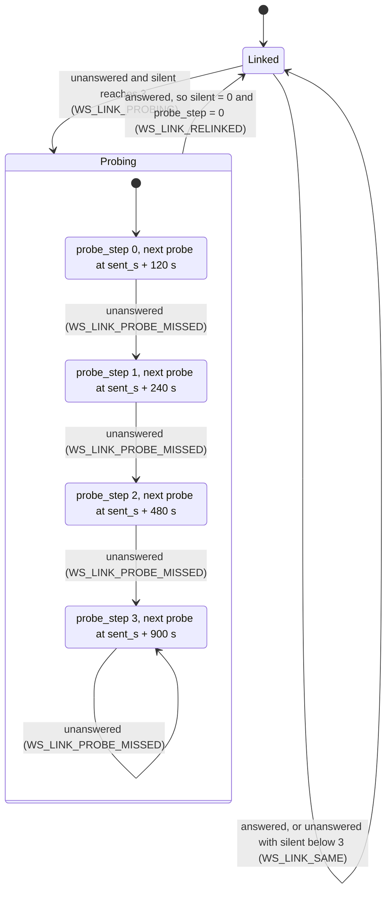
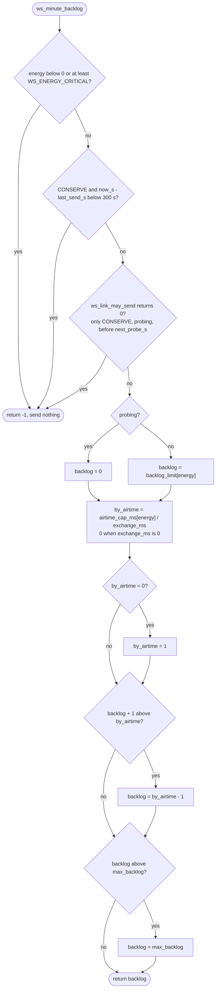
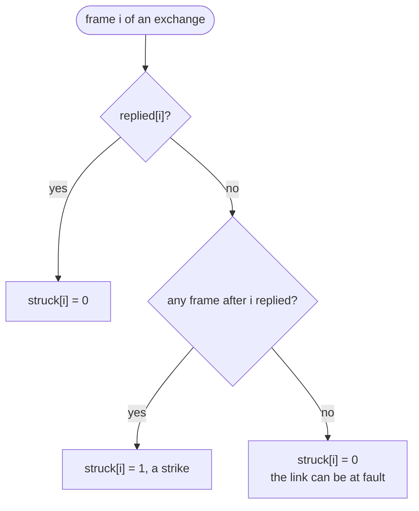
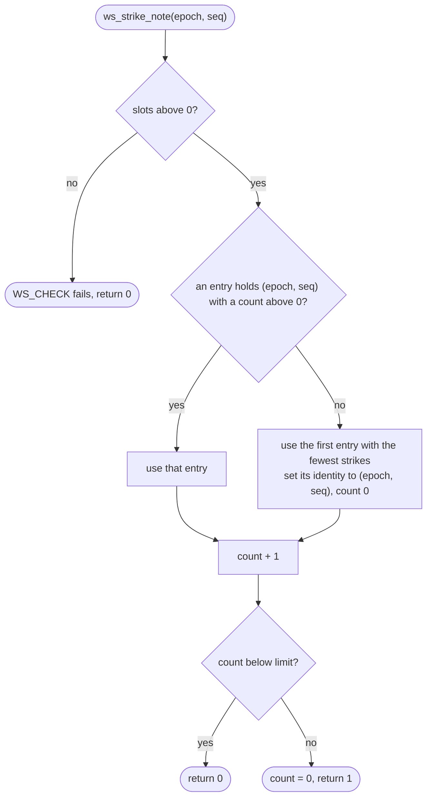

# ws_policy: the transmitting node's transmission policy

`ws_policy.c` decides, once a minute, whether the transmitting node (TX node) transmits. It also
decides how many backlog frames follow the live reading. It tracks the link state from the
gateway's replies. It counts strikes against records that the gateway keeps refusing. Each function
is pure. `App/tx_policy.c` holds the state, feeds these functions from the journal and the clock,
and acts on their results.

This document is the source. `tools/tangle.py` generates `ws_policy.c` from the code chunks below.
The repository also holds the generated file, so the build, the static analysers and the host tests
read ordinary C. Edit this file, then regenerate and check:

```sh
python3 tools/tangle.py firmware/common/ws_policy.lit.md                       # write ws_policy.c
python3 tools/tangle.py --check                                                # CI: committed .c == tangle
python3 tools/tangle.py --weave /tmp/ws_policy.html firmware/common/ws_policy.lit.md   # render
```

A chunk is a fenced ` ```c {#name} ` block. A line `<<name>>` inside a chunk includes chunk
`name`. The chunks appear in reading order. The root chunk (section 7) puts them in C order.

The policy itself is `docs/radio-energy-policy.md` (approved 2026-10-12). This file implements its
numbers. Section 9 of that document lists six numbered decisions, and this file cites them as
"decision 1" to "decision 6". The bench prototype has no battery or solar hardware. So
`energy_state()` in `App/tx_policy.c` always returns `WS_ENERGY_NORMAL`.

## 1. Behaviour

| Function | Result | Checked by (`firmware/test_tx_policy.c`) |
|---|---|---|
| `ws_energy_name` | `"surplus"`, `"normal"`, `"conserve"`, `"critical"`, or `"?"` out of range | `main` |
| `ws_lora_airtime_ms` | time on air in ms, rounded up, at most 1 ms above Semtech's formula | `airtime` |
| `ws_link_minute` | the link change after one exchange (`WS_LINK_*`) | `link` |
| `ws_link_probe_interval` | the current back-off step, s | `link` |
| `ws_minute_backlog` | -1: send nothing. Else the number of backlog frames after the live reading | `minute` |
| `ws_strike_targets` | which frames of an exchange earn a strike | `strike_targets` |
| `ws_strike_note` | 1 when a record reaches the strike limit, else 0 | `strikes` |
| `ws_strike_forget` | clears a record's strikes | `strikes` |

Times are seconds of the node's monotonic real-time clock (RTC, `App/clock.h`). The code compares
times by unsigned or signed difference, so a clock wrap does not change a decision.

## 2. Energy states

Energy is a `WS_ENERGY_*` code from `ws_obs.h`, in this order: `SURPLUS`, `NORMAL`, `CONSERVE`,
`CRITICAL`. Three arrays hold one entry per state, indexed by the code:

| State | `energy_name` | `backlog_limit` (frames per minute) | `airtime_cap_ms` (radio time per minute) |
|---|---|---|---|
| `WS_ENERGY_SURPLUS` (0) | `surplus` | `WS_BACKLOG_MAX` (20) | 15000 |
| `WS_ENERGY_NORMAL` (1) | `normal` | 5 | 5000 |
| `WS_ENERGY_CONSERVE` (2) | `conserve` | 0 | 2000 |
| `WS_ENERGY_CRITICAL` (3) | `critical` | 0 | 0 |

The caps are decision 3. `CRITICAL` never reaches the arrays in `ws_minute_backlog`, because the
energy gate refuses it first (section 5). Its entries exist so that each array has one entry per
state. The `_Static_assert` fails the build if a new state has no entry in an array.

`App/tx_policy.c` asserts `WS_BACKLOG_MAX <= MAX_QUEUE - 1`. So the send queue holds the live
reading plus the largest backlog.

```c {#energy-tables}
/* Per energy state, in WS_ENERGY_* order: backlog frames and radio time per minute. */
static const char *const energy_name[] = { "surplus", "normal", "conserve", "critical" };
static const uint8_t backlog_limit[] = { WS_BACKLOG_MAX, 5, 0, 0 };
static const uint16_t airtime_cap_ms[] = { 15000, 5000, 2000, 0 };
#define ENERGY_STATES (sizeof energy_name / sizeof energy_name[0])
_Static_assert(ENERGY_STATES == WS_ENERGY_CRITICAL + 1 && sizeof backlog_limit == ENERGY_STATES &&
               sizeof airtime_cap_ms / sizeof airtime_cap_ms[0] == ENERGY_STATES, "one entry per energy state");
```

`ws_energy_name` gives the console and the `#link` messages a name for a code. A code out of
range gives `"?"`, so the function never reads outside the array.

```c {#energy-name}
const char *ws_energy_name(int energy)
{
 return energy >= 0 && energy < (int)ENERGY_STATES ? energy_name[energy] : "?";
}
```

## 3. LoRa time on air

`ws_lora_airtime_ms` computes Semtech's time on air for an explicit header and the CRC on. The
sources are the SX1261/2 datasheet, section 6.1.4, and Semtech application note AN1200.13.

```text
T_sym    = 2^SF / BW
preamble = (n_preamble + 4.25) T_sym
payload  = 8 + max(ceil((8 PL - 4 SF + 28 + 16 CRC) / (4 (SF - 2 DE))), 0) (CR + 4)   symbols
DE       = 1 when T_sym > 16 ms (low data rate optimisation), else 0
```

| Symbol | Meaning | Argument |
|---|---|---|
| `SF` | spreading factor, 7 to 12 | `sf` |
| `BW` | bandwidth, Hz | `bw_hz` |
| `PL` | payload length, bytes | `payload` |
| `CR` | coding rate index: 1 to 4 means 4/5 to 4/8 | `cr` |
| `CRC` | 1 when the packet carries a CRC (always 1 here) | — |
| `DE` | 1 when low data rate optimisation (LDRO) is on | computed |
| `T_sym` | the time of one symbol | computed |
| `n_preamble` | preamble length, symbols | `preamble` |

The function counts in quarter symbols. So the 4.25 symbols of sync word and start of frame are an
integer (17 quarters). `symbol_us_x_bw` is `T_sym` in µs times the bandwidth, `10^6 << SF`. It fits
32 bits up to SF12 (4.096 × 10^9). The division by the bandwidth comes last, in 64 bits, so the
calculation loses no precision before it. The result is the truncated ms plus 1, so it is never
below the exact time.

| Constant | Value | Meaning |
|---|---|---|
| `LORA_SF_MIN`, `LORA_SF_MAX` | 7, 12 | spreading factors the formula accepts |
| `LORA_BW_MIN_HZ` | 7800 | narrowest LoRa bandwidth |
| `LORA_CR_MAX` | 4 | coding rate 4/8 |
| `LDRO_SYMBOL_US` | 16000 | symbol time above which DE = 1 |
| `HEADER_FIXED_BITS`, `CRC_BITS` | 28, 16 | the formula's +28 and 16 CRC |
| `PAYLOAD_FIXED_SYMBOLS` | 8 | the formula's leading 8 |
| `SYNC_QUARTERS` | 17 | 4.25 symbols |
| `AIRTIME_UNKNOWN_MS` | 60000 | result for arguments outside the formula's range |

An argument out of range fails a `WS_CHECK` (`firmware/common/ws_check.h`). The function then
returns `AIRTIME_UNKNOWN_MS`, one whole minute. Each cap in section 2 is below 60000 ms, so
`ws_minute_backlog` then allows the live reading only. The check also prevents a division by zero
when `sf` is 2 and `DE` is 1.

```c {#airtime-constants}
/* Semtech time on air (SX1261/2 datasheet section 6.1.4, AN1200.13), explicit header, CRC on:
 *   T_sym = 2^SF / BW, preamble = (n_preamble + 4.25) T_sym,
 *   payload = 8 + max(ceil((8 PL - 4 SF + 28 + 16 CRC) / (4 (SF - 2 DE))), 0) (CR + 4) symbols.
 * The code counts in quarter symbols, so the 4.25 stays an integer. */
#define LORA_SF_MIN 7U
#define LORA_SF_MAX 12U
#define LORA_BW_MIN_HZ 7800U
#define LORA_CR_MAX 4U              /* 4/8 */
#define LDRO_SYMBOL_US 16000U       /* low data rate optimisation is on above this symbol time */
#define HEADER_FIXED_BITS 28        /* the formula's +28 */
#define CRC_BITS 16
#define PAYLOAD_FIXED_SYMBOLS 8U
#define SYNC_QUARTERS 17U           /* 4.25 symbols of sync word and start of frame */
#define QUARTERS 4U
#define US_PER_MS 1000U
#define US_PER_S 1000000UL
#define AIRTIME_UNKNOWN_MS 60000U   /* a whole minute: room for the live reading only */
```

### Worked example

`radio_cfg.h` sets spreading factor 7 (SF7), 500 kHz, an 8-symbol preamble and coding rate 4/5
(`cr` = 1). `firmware/test_tx_policy.c` pins the time of this build's 51-byte observation frame at
these settings to 26 ms. It pins a 42-byte frame to 22 ms.

| Step | Value |
|---|---|
| `symbol_us_x_bw` | 10^6 << 7 = 128 000 000 |
| `T_sym` | 128 000 000 / 500 000 = 256 µs, so DE = 0 |
| `num` | 8 × 51 − 4 × 7 + 28 + 16 = 424 |
| `den` | 4 × (7 − 0) = 28 |
| `blocks` | ceil(424 / 28) = 16 |
| `quarters` | (8 × 4 + 17) + 4 × (8 + 16 × 5) = 49 + 352 = 401 |
| time | 401 × 128 000 000 / 500 000 = 102 656 quarter-µs, / 4000 = 25 ms truncated |
| result | 25 + 1 = **26 ms** (formula: 25.664 ms) |

The same steps give 18 ms for the 33-byte ACK (`WS_ACK_FRAME_LEN`). The default field set gives a
35-byte plaintext and 16 bytes of frame overhead. So `OBS_FRAME_MAX` is the 51-byte frame above.

`App/tx_policy.c` (`policy_init`) adds the observation airtime, the ACK airtime and
`TURNAROUND_MS` (300 ms) into `exchange_ms`. `exchange_ms` is the radio time of one answered
exchange. With a 51-byte observation, it is 26 + 18 + 300 = 344 ms.

The test's second fixed value covers DE = 1. 10 bytes at SF12 and 125 kHz give 992 ms (formula:
991.2 ms). The test also compares the function with a floating-point copy of the formula. It
covers SF7 to SF12, all three bandwidths and payloads of 0 to 255 bytes.

```c {#airtime}
uint32_t ws_lora_airtime_ms(uint32_t payload, uint32_t sf, uint32_t bw_hz, uint32_t preamble, uint32_t cr)
{
 /* The arguments are radio_cfg.h's constants. Outside the formula's range, the function returns
    the cautious AIRTIME_UNKNOWN_MS. It never divides by zero. */
 if (!WS_CHECK(sf >= LORA_SF_MIN && sf <= LORA_SF_MAX && bw_hz >= LORA_BW_MIN_HZ && cr >= 1 && cr <= LORA_CR_MAX))
  return AIRTIME_UNKNOWN_MS;
 uint32_t symbol_us_x_bw = US_PER_S << sf;                           /* T_sym in us, times BW */
 uint32_t de = symbol_us_x_bw / bw_hz > LDRO_SYMBOL_US ? 1 : 0;
 int32_t num = CHAR_BIT * (int32_t)payload - 4 * (int32_t)sf + HEADER_FIXED_BITS + CRC_BITS;
 int32_t den = 4 * ((int32_t)sf - 2 * (int32_t)de);
 int32_t blocks = num > 0 ? (num + den - 1) / den : 0;
 uint32_t quarters = (preamble * QUARTERS + SYNC_QUARTERS) + QUARTERS * (PAYLOAD_FIXED_SYMBOLS + (uint32_t)blocks * (cr + 4));
 return (uint32_t)(((uint64_t)quarters * symbol_us_x_bw / bw_hz) / (QUARTERS * US_PER_MS)) + 1;
}
```

## 4. Link state

`ws_link` holds the link state. `App/tx_policy.c` keeps one `ws_link`. Its `policy_exchange_end`
calls `ws_link_minute` at the end of each exchange. `answered` is 1 if the gateway answered any
frame of that exchange. `sent_s` is the start of the exchange (`last_send_s`, on the minute grid).

| Field | Meaning |
|---|---|
| `probing` | 0: linked. 1: probing |
| `silent` | unanswered exchanges in a row. An answer resets it |
| `probe_step` | index into `probe_interval_s` |
| `next_probe_s` | earliest time of the next probe in `CONSERVE` |

### Transitions

`WS_LINK_K_SILENT` is 3 (`ws_policy.h`, decision 1). One or two unanswered exchanges are normal
packet loss, and the link stays linked.

| Before | `answered` | After | Result |
|---|---|---|---|
| linked | 1 | linked, `silent` = 0 | `WS_LINK_SAME` |
| linked | 0, `silent` + 1 < 3 | linked | `WS_LINK_SAME` |
| linked | 0, `silent` + 1 = 3 | probing, step 0, next probe `sent_s` + 120 | `WS_LINK_PROBING` |
| probing | 0 | probing, step + 1 (at most 3), next probe `sent_s` + interval | `WS_LINK_PROBE_MISSED` |
| probing | 1 | linked, `silent` = 0, step 0 | `WS_LINK_RELINKED` |

The state diagram shows the same transitions. Inside Probing, each state is one back-off step. Each
transition into a step sets `next_probe_s` to `sent_s` plus that step's interval.



`App/tx_policy.c` (`link_report`) prints `#link` lines from the result. `WS_LINK_RELINKED` and
`WS_LINK_PROBING` also make the next health report due, because the report carries the link state.

### Back-off

The back-off applies only in `CONSERVE` (section 5). `SURPLUS` and `NORMAL` send the live reading
every minute while probing, so the node relinks within a minute. The step still advances in those
states, and `link_report` uses it only for its messages.

| `probe_step` | Interval after an unanswered exchange |
|---|---|
| 0 | 120 s |
| 1 | 240 s |
| 2 | 480 s |
| 3 | 900 s (the maximum, decision 2: 15 minutes) |

```c {#probe-steps}
static const uint16_t probe_interval_s[] = { 120, 240, 480, 900 };
#define PROBE_STEPS (sizeof probe_interval_s / sizeof probe_interval_s[0])
```

```c {#link-minute}
int ws_link_minute(ws_link *l, int answered, uint32_t sent_s)
{
 if (answered) {
  int was_probing = l->probing;
  l->probing = 0; l->silent = 0; l->probe_step = 0;
  return was_probing ? WS_LINK_RELINKED : WS_LINK_SAME;
 }
 l->silent++;
 if (!l->probing && l->silent < WS_LINK_K_SILENT) return WS_LINK_SAME;
 int started = !l->probing;
 if (started) { l->probing = 1; l->probe_step = 0; }
 else if (l->probe_step + 1U < PROBE_STEPS) l->probe_step++;
 l->next_probe_s = sent_s + probe_interval_s[l->probe_step];
 return started ? WS_LINK_PROBING : WS_LINK_PROBE_MISSED;
}
```

`ws_link_probe_interval` reads the current step. `ws_link_minute` never moves `probe_step` past
`PROBE_STEPS - 1`. Only a corrupted `ws_link` can hold a larger value. Such a value fails a
`WS_CHECK`, and the function returns the longest interval.

```c {#probe-interval}
uint32_t ws_link_probe_interval(const ws_link *l)
{
 /* ws_link_minute keeps probe_step below PROBE_STEPS. Past it, return the longest interval. */
 return probe_interval_s[WS_CHECK(l->probe_step < PROBE_STEPS) ? l->probe_step : PROBE_STEPS - 1U];
}
```

## 5. What a minute may send

`App/tx_policy.c` (`policy_minute_backlog`) calls `ws_minute_backlog` at the start of each
minute's exchange. On a result of 0 or more, it sets `last_send_s` to now. On a result of -1, the
node sends nothing, and the reading stays in the journal.

### Gates, in the order the code applies them

| # | Gate | Effect |
|---|---|---|
| 1 | `energy` < 0 or ≥ `WS_ENERGY_CRITICAL` | -1. An unknown code never transmits |
| 2 | `CONSERVE` and `now_s - last_send_s` < 300 | -1 |
| 3 | `ws_link_may_send` (`firmware/stage0.c`) is 0 | -1. Only `CONSERVE` while probing, before `next_probe_s` |
| 4 | probing | backlog = 0: a probe is the live reading |
| 5 | linked | backlog = `backlog_limit[energy]` |
| 6 | airtime: `by_airtime` = `airtime_cap_ms[energy] / exchange_ms`, at least 1 | backlog ≤ `by_airtime` − 1 |
| 7 | the send queue | backlog ≤ `max_backlog` |



`minute_may_send` holds gates 1 to 3. Each gate can only lower the result. So the stricter of the
energy state and the link state wins.

`CONSERVE_INTERVAL_S` (300 s) is the reporting interval in `CONSERVE` (decision 5). It implements
the spec's rule that `CONSERVE` sends a report at most every 5 minutes (R02).

```c {#conserve-interval}
#define CONSERVE_INTERVAL_S 300U   /* spec rule R02: CONSERVE reports every 5 minutes */
```

`ws_link_may_send` takes the time to the next probe as a signed difference,
`(int32_t)(next_probe_s - now_s)`. So a probe time just after a clock wrap is still in the future
(test: `wrap` in `minute`).

```c {#minute-may-send}
/* The energy and link gates: may this minute send at all? */
static int minute_may_send(int energy, const ws_link *l, uint32_t now_s, uint32_t last_send_s)
{
 if (energy < 0 || energy >= WS_ENERGY_CRITICAL) return 0;
 if (energy == WS_ENERGY_CONSERVE && now_s - last_send_s < CONSERVE_INTERVAL_S) return 0;
 return ws_link_may_send(energy, l->probing, (int32_t)(l->next_probe_s - now_s));
}
```

### The airtime budget

`exchange_ms` is the radio time of one answered exchange. The live reading always fits. An
exchange longer than the cap still gives `by_airtime` = 1 and a backlog of 0. An `exchange_ms` of
0 (no estimate) gives the same result. A failed exchange costs more than `exchange_ms`. But the
drain in `App/tx_exchange.c` sends one more frame after a miss (`FRAMES_AFTER_MISS`) and then
stops. So the budget counts answered exchanges only.

With the 344 ms exchange of section 3:

| State | Cap / 344 ms | Backlog limit | Queue (`MAX_QUEUE - 1`) | Result |
|---|---|---|---|---|
| `SURPLUS` | 43 frames | 20 | 20 | 20 |
| `NORMAL` | 14 frames | 5 | 20 | 5 |
| `CONSERVE` | 5 frames | 0 | 20 | 0, at most every 300 s |

At SF7 the per-state limit binds, not the airtime. At SF12 the airtime binds.
`docs/radio-energy-policy.md` section 6 computes 4 exchanges in the 5 s `NORMAL` cap.

```c {#minute-backlog}
int ws_minute_backlog(int energy, const ws_link *l, uint32_t now_s, uint32_t last_send_s, uint32_t exchange_ms,
                      unsigned max_backlog)
{
 if (!minute_may_send(energy, l, now_s, last_send_s)) return -1;
 unsigned backlog = l->probing ? 0U : backlog_limit[energy];          /* a probe is the live reading */
 unsigned by_airtime = exchange_ms ? airtime_cap_ms[energy] / exchange_ms : 0;
 if (by_airtime == 0) by_airtime = 1;                                  /* the live reading always fits */
 if (backlog + 1 > by_airtime) backlog = by_airtime - 1;
 if (backlog > max_backlog) backlog = max_backlog;
 return (int)backlog;
}
```

## 6. Strikes

The gateway can keep refusing a record. Such a record would stay at the head of the backlog for as
long as it stays in the journal. Strikes find such a record, and the node then abandons it.

### When a record gets a strike

A record gets a strike when its frame gets no reply and a frame sent **after** it in the same
exchange gets a reply. The later reply shows that the link worked at that time. So the missing
reply points at the record. A reply to an earlier frame shows nothing, because on a weak link the
next frame can fail to arrive. So the drain sends one more frame after a miss. That frame lets the
node identify a refused record (`FRAMES_AFTER_MISS` in `App/tx_exchange.c`).



`ws_strike_targets` scans the exchange from the last frame to the first. `later` becomes 1 at the
first reply that it meets. So `struck[i]` is 1 exactly when frame `i` got no reply and a frame after
it did.

| `replied` | `struck` |
|---|---|
| 1 0 1 0 0 | 0 1 0 0 0 |
| 1 0 | 0 0 (no frame after the miss got a reply) |
| 0 0 1 | 1 1 0 |

```c {#strike-targets}
void ws_strike_targets(const uint8_t *replied, unsigned n, uint8_t *struck)
{
 int later = 0;   /* 1 when a frame after i got a reply */
 /* bound: n frames (the exchange's queue, MAX_QUEUE) */
 for (unsigned i = n; i-- > 0;) { struck[i] = (uint8_t)(!replied[i] && later); later |= replied[i]; }
}
```

### The strike table

The table key is the record's identity (epoch, seq), not its journal slot. The journal reuses a slot
after its ring wraps. A record can also leave the journal while its entry stays. An entry with a
count of 0 is free, and `same_record` never matches it.

```c {#same-record}
static int same_record(const ws_strike *s, uint32_t epoch, uint32_t seq) { return s->n && s->epoch == epoch && s->seq == seq; }
```

`ws_strike_note` adds one strike:



A free entry has 0 strikes, so `ws_strike_note` takes a free entry first. In a full table, the new
record replaces the record with the fewest strikes, and that record's count is lost.

`App/tx_policy.c` uses 6 slots (`STRIKE_SLOTS`) and a limit of 10 (`STRIKE_LIMIT`). On a result of
1, its `strike` function looks up the record by identity. If the record is still pending, `strike`
acknowledges it in the journal. Then it adds 1 to the abandoned total and prints `#abandon`.

```c {#strike-note}
int ws_strike_note(ws_strike *t, unsigned slots, uint32_t epoch, uint32_t seq, unsigned limit)
{
 unsigned use = slots, low = 0;
 if (!WS_CHECK(slots > 0)) return 0;   /* no table, so no strike */
 for (unsigned i = 0; i < slots; i++) {
  if (same_record(&t[i], epoch, seq)) { use = i; break; }
  if (t[i].n < t[low].n) low = i;
 }
 if (use == slots) { use = low; t[use].epoch = epoch; t[use].seq = seq; t[use].n = 0; }
 if (++t[use].n < limit) return 0;
 t[use].n = 0;
 return 1;
}
```

`ws_strike_forget` clears the strikes of one identity. `App/tx_policy.c` calls it for each frame of
an exchange that got a reply. `App/tx_exchange.c` calls it for each authentic ACK of a record.

```c {#strike-forget}
void ws_strike_forget(ws_strike *t, unsigned slots, uint32_t epoch, uint32_t seq)
{
 for (unsigned i = 0; i < slots; i++)
  if (same_record(&t[i], epoch, seq)) t[i].n = 0;
}
```

## 7. The file

The generated file orders the chunks for C. The tables and constants come first. Then each
function comes after the constants that it uses.

```c {#ws_policy.c}
#define WS_CHECK_FILE 11
#include "ws_policy.h"
#include "stage0.h"
#include "ws_obs.h"
#include "ws_check.h"
#include <limits.h>

<<energy-tables>>
<<conserve-interval>>
<<probe-steps>>

<<energy-name>>

<<airtime-constants>>
<<airtime>>

<<link-minute>>

<<probe-interval>>

<<minute-may-send>>

<<minute-backlog>>

<<same-record>>

<<strike-note>>

<<strike-forget>>

<<strike-targets>>
```

## 8. Tests

`firmware/test_tx_policy.c` takes its expected values from `docs/radio-energy-policy.md` and from
Semtech's formula, not from the code under test:

| Test | What it checks |
|---|---|
| `airtime` | The formula over SF7–SF12, three bandwidths and payloads 0–255. 51 bytes at SF7/500 kHz give 26 ms, 42 bytes 22 ms. 10 bytes at SF12/125 kHz give 992 ms |
| `link` | Two silent minutes stay linked. The third starts probing. The back-off is 240, 480, 900, 900 s. A reply relinks and resets the count |
| `minute` | The backlog per state (20, 5, 0). `CRITICAL` and unknown codes send nothing. The 300 s `CONSERVE` interval. Probing sends the live reading only. The airtime cap, `max_backlog` and a clock wrap |
| `strike_targets` | the three `replied` patterns of section 6, and an empty exchange |
| `strikes` | The 10th strike returns 1 and restarts the count. Identity keys. Forget. A full table replaces the entry with the fewest strikes |
| `main` | `ws_energy_name` |

`tests/test_stage0.py` (`test_tx_transmission_policy`) builds the test with `firmware/stage0.c`
under the address and undefined-behaviour sanitizers (ASan, UBSan) and runs it.
`firmware/test_policy.c` (`test_bus_recovery_waveform_and_link_gate`) tests `ws_link_may_send`.

`tests/test_tx_machine.py` runs the node firmware against a simulated radio and checks the policy
end to end:

| Test | What it checks |
|---|---|
| `test_three_silent_minutes_mean_probing_with_no_backlog_until_a_reply` | probing after 3 silent minutes, the live reading every minute, relink, then 1 + 5 frames |
| `test_strikes_need_an_answer_after_the_missed_record` | 10 strikes abandon a refused record |
| `test_a_lone_refused_record_is_retried_never_abandoned_by_luck` | a record with no frame after it gets no strike |
| `test_no_strikes_while_nothing_is_answered` | an exchange without a reply strikes nothing |
| `test_a_missed_reply_allows_one_more_frame_then_stops_the_drain` | the drain sends one frame after a miss, then stops |

```sh
.venv/bin/python -m unittest tests.test_stage0 tests.test_tx_machine tests.test_tangle
```
