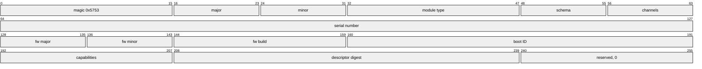
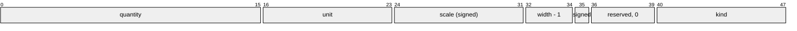
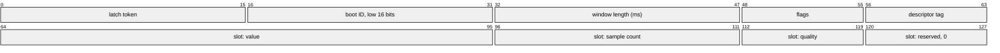

# wsmp: the WSMP core

`wsmp.c` packs and checks the data blocks of WSMP, the Weather Station Module Protocol
(`docs/module-protocol.md`). A module gives its identity, its descriptors and one snapshot each
minute. The station reads them, and this file turns the bytes into structures and back. It also
checks the descriptors against the registry (`wsmp_registry.h`), computes CRC-32C and the radio
budget, and maps quality codes.

The file has no state, no HAL call and no heap. The station uses it now. The remote module adapter
will use the same file later, so both ends of the cable share one implementation.

This document is the source. `tools/tangle.py` generates `wsmp.c` from the code chunks below. The
header `wsmp.h` is a plain file. Edit this file, then regenerate and check:

```sh
python3 tools/tangle.py firmware/common/wsmp.lit.md            # write wsmp.c
python3 tools/tangle.py --check firmware/common/wsmp.lit.md    # committed .c == tangle
```

## 1. Guarantees

| Property | Guarantee | Checked by |
|---|---|---|
| Layout | every block has the byte layout of WSMP section 6. Every integer is big-endian | `test_snapshot_round_trip_matches_the_wsmp_layout`, `test_identity_refuses_bad_magic_and_major` |
| Refusal | an unpack function refuses a reserved bit, a bad magic, a wrong major version, a zero serial and a channel count out of range. It returns a negative `WSMP_E*` code | `test_snapshot_refuses_a_set_reserved_byte`, `test_identity_refuses_bad_magic_and_major`, `fuzz_wsmp` |
| Registry | `wsmp_desc_check` accepts exactly the descriptors of the registry entry. It refuses each case of WSMP-D7 with its own code | `test_desc_check_accepts_the_registry_entry`, `test_desc_check_refuses_each_wsmp_d7_case` |
| Round trip | unpack, then pack, gives back the same bytes for every accepted block | `test_snapshot_round_trip_matches_the_wsmp_layout`, `fuzz_wsmp` |
| Budget | the value bytes are the sum of the air widths. The quality bytes are 2 bits a channel, rounded up to a byte | `test_budget_bytes_for_the_bench_station` |

The tests are in `tests/test_wsmp_core.py`. The fuzz target is `firmware/fuzz/fuzz_wsmp.c`.

## 2. Constants

The descriptor packs its air width, its sign and 4 reserved bits into one byte. The width takes the
top 3 bits as width − 1. The sign takes the next bit.

```c {#constants}
#define DESC_WIDTH_SHIFT 5U
#define DESC_WIDTH_MASK  0x07U
#define DESC_SIGNED_BIT  0x10U
#define DESC_RESERVED    0x0FU
#define BYTE_BITS        8U
#define QUALITY_BITS     2U
#define CRC32C_POLY      0x82F63B78UL   /* the reflected Castagnoli polynomial */
#define CRC32C_INIT      0xFFFFFFFFUL
#define TEXT_PAD         0U
```

## 3. Identity block

The identity block is 32 bytes. Section 6.1 of WSMP gives the fields. The pack function writes them
in order with the cursor helpers of `ws_be.h`, so the order of the calls is the layout:



```c {#identity}
void wsmp_pack_identity(const wsmp_identity *id, uint8_t out[WSMP_IDENTITY_LEN])
{
  uint8_t *p = ws_write_be16(out, WSMP_MAGIC);
  p = ws_write_u8(p, WSMP_VERSION_MAJOR);
  p = ws_write_u8(p, WSMP_VERSION_MINOR);
  p = ws_write_be16(p, id->type);
  p = ws_write_u8(p, id->schema);
  p = ws_write_u8(p, id->channels);
  p = ws_write_be(p, id->serial, sizeof id->serial);
  p = ws_write_u8(p, id->fw_major);
  p = ws_write_u8(p, id->fw_minor);
  p = ws_write_be16(p, id->fw_build);
  p = ws_write_be32(p, id->boot_id);
  p = ws_write_be16(p, id->caps);
  p = ws_write_be32(p, id->desc_digest);
  memset(p, 0, (size_t)(out + WSMP_IDENTITY_LEN - p));
}
```

The unpack function refuses a block that the station must not admit (WSMP-I1): a wrong magic, a
different major version, a channel count outside 1 to 8, or a zero serial. A higher minor version is
accepted (WSMP-V2). The reserved bytes are not checked, because a later minor version may use them.

```c {#identity-unpack}
int wsmp_unpack_identity(const uint8_t in[WSMP_IDENTITY_LEN], wsmp_identity *id)
{
  uint32_t v;
  uint64_t serial;
  if (ws_get_be16(in) != WSMP_MAGIC) return WSMP_EMAGIC;
  if (in[2] != WSMP_VERSION_MAJOR) return WSMP_EVERSION;
  id->type = ws_get_be16(in + 4);
  id->schema = in[6];
  id->channels = in[7];
  (void)ws_read_be(in + 8, &serial, sizeof serial);
  id->serial = serial;
  id->fw_major = in[16];
  id->fw_minor = in[17];
  id->fw_build = ws_get_be16(in + 18);
  (void)ws_read_be32(in + 20, &v);
  id->boot_id = v;
  id->caps = ws_get_be16(in + 24);
  (void)ws_read_be32(in + 26, &v);
  id->desc_digest = v;
  if (id->channels == 0 || id->channels > WSMP_MAX_CHANNELS || id->serial == 0) return WSMP_ELEN;
  return WSMP_OK;
}
```

## 4. Descriptor block

The descriptor block holds eight descriptors of 6 bytes. A module with fewer channels leaves the
rest zero. Each descriptor is:



```c {#desc}
void wsmp_pack_desc(const wsmp_desc *d, unsigned n, uint8_t out[WSMP_DESC_BLOCK_LEN])
{
  memset(out, 0, WSMP_DESC_BLOCK_LEN);
  uint8_t *p = out;
  for (unsigned i = 0; i < n && i < WSMP_MAX_CHANNELS; i++)
  {
    uint8_t form = (uint8_t)(((d[i].width - 1U) & DESC_WIDTH_MASK) << DESC_WIDTH_SHIFT);
    if (d[i].is_signed) form |= DESC_SIGNED_BIT;
    p = ws_write_be16(p, d[i].quantity);
    p = ws_write_u8(p, d[i].unit);
    p = ws_write_u8(p, (uint8_t)d[i].scale);
    p = ws_write_u8(p, form);
    p = ws_write_u8(p, d[i].kind);
  }
}
```

The unpack function reads `n` descriptors. A reserved bit in any of them, or a non-zero byte in a
descriptor after the last channel, is `WSMP_ERESERVED`. The registry check comes later, in
`wsmp_desc_check`.

```c {#desc-unpack}
static int zero(const uint8_t *p, size_t n)
{
  for (size_t i = 0; i < n; i++)
    if (p[i]) return 0;
  return 1;
}

int wsmp_unpack_desc(const uint8_t in[WSMP_DESC_BLOCK_LEN], unsigned n, wsmp_desc *d)
{
  if (n > WSMP_MAX_CHANNELS) return WSMP_ELEN;
  for (unsigned i = 0; i < n; i++)
  {
    const uint8_t *p = in + i * WSMP_DESC_LEN;
    if (p[4] & DESC_RESERVED) return WSMP_ERESERVED;
    d[i] = (wsmp_desc){ .quantity = ws_get_be16(p), .unit = p[2], .scale = (int8_t)p[3],
                        .width = (uint8_t)(((p[4] >> DESC_WIDTH_SHIFT) & DESC_WIDTH_MASK) + 1U),
                        .is_signed = (p[4] & DESC_SIGNED_BIT) != 0, .kind = p[5] };
  }
  return zero(in + n * WSMP_DESC_LEN, (size_t)(WSMP_MAX_CHANNELS - n) * WSMP_DESC_LEN) ? WSMP_OK : WSMP_ERESERVED;
}
```

## 5. The registry check

`wsmp_desc_check` applies WSMP-D7. It first checks each descriptor by itself: a known quantity and
kind, the canonical unit, a scale of −6 to +6 and a width of 1 to 4 bytes. Then it compares the
channel list with the registry entry of the module type. The entry must exist, have the same schema
and the same number of channels, and list the same quantity and kind in each position.

The registry tables come from `wsmp_registry.h` as initializers. This file holds the one copy of
each, so every user of the lookups shares it.

```c {#registry}
static const uint8_t unit_of[WSMP_UNIT_OF_COUNT] = WSMP_UNIT_OF_INIT;
static const wsmp_type_entry types[WSMP_TYPE_COUNT] = WSMP_TYPES_INIT;

uint8_t wsmp_canonical_unit(uint16_t quantity) { return quantity < WSMP_UNIT_OF_COUNT ? unit_of[quantity] : 0U; }

const wsmp_type_entry *wsmp_type(uint16_t type)
{
  for (unsigned i = 0; i < WSMP_TYPE_COUNT; i++)   /* bound: WSMP_TYPE_COUNT entries */
    if (types[i].type == type) return &types[i];
  return NULL;
}
```

```c {#desc-check}
static int desc_one_ok(const wsmp_desc *d)
{
  uint8_t unit = wsmp_canonical_unit(d->quantity);
  if (unit == 0 || d->kind == 0 || d->kind > WSMP_KIND_MAX) return WSMP_ECODE;
  if (d->unit != unit) return WSMP_EUNIT;
  if (d->scale > WSMP_SCALE_MAX || d->scale < -WSMP_SCALE_MAX) return WSMP_ESCALE;
  if (d->width == 0 || d->width > WSMP_WIDTH_MAX) return WSMP_ELEN;
  return WSMP_OK;
}

int wsmp_desc_check(const wsmp_desc *d, unsigned n, uint16_t type, uint8_t schema)
{
  if (n > WSMP_MAX_CHANNELS) return WSMP_ELEN;
  for (unsigned i = 0; i < n; i++)
  {
    int rc = desc_one_ok(&d[i]);
    if (rc != WSMP_OK) return rc;
  }
  const wsmp_type_entry *t = wsmp_type(type);
  if (!t || t->schema != schema || t->channels != n) return WSMP_ETYPE;
  for (unsigned i = 0; i < n; i++)
    if (d[i].quantity != t->ch[i].quantity || d[i].kind != t->ch[i].kind) return WSMP_ETYPE;
  return WSMP_OK;
}
```

## 6. Snapshot block

The snapshot is the 8-byte header and eight slots of 8 bytes:



```c {#snapshot}
void wsmp_pack_snapshot(const wsmp_snapshot *s, uint8_t out[WSMP_SNAPSHOT_LEN])
{
  uint8_t *p = ws_write_be16(out, s->token);
  p = ws_write_be16(p, s->boot16);
  p = ws_write_be16(p, s->window_ms);
  p = ws_write_u8(p, s->flags);
  p = ws_write_u8(p, s->desc_tag);
  for (unsigned i = 0; i < WSMP_MAX_CHANNELS; i++)
  {
    p = ws_write_be32(p, s->slot[i].value);
    p = ws_write_be16(p, s->slot[i].count);
    p = ws_write_u8(p, s->slot[i].quality);
    p = ws_write_u8(p, 0);
  }
}
```

The unpack function refuses an undefined flag bit and a non-zero reserved byte in any slot.

```c {#snapshot-unpack}
int wsmp_unpack_snapshot(const uint8_t in[WSMP_SNAPSHOT_LEN], wsmp_snapshot *s)
{
  if (in[6] & (uint8_t)~WSMP_FLAGS_DEFINED) return WSMP_ERESERVED;
  s->token = ws_get_be16(in);
  s->boot16 = ws_get_be16(in + 2);
  s->window_ms = ws_get_be16(in + 4);
  s->flags = in[6];
  s->desc_tag = in[7];
  for (unsigned i = 0; i < WSMP_MAX_CHANNELS; i++)
  {
    const uint8_t *p = in + WSMP_SNAPSHOT_HEAD_LEN + i * WSMP_SLOT_LEN;
    uint32_t v;
    if (p[7]) return WSMP_ERESERVED;
    (void)ws_read_be32(p, &v);
    s->slot[i] = (wsmp_slot){ .value = v, .count = ws_get_be16(p + 4), .quality = p[6] };
  }
  return WSMP_OK;
}
```

## 7. CRC-32C, quality, budget and text

The descriptor digest is CRC-32C (the Castagnoli polynomial, as iSCSI uses it) over the descriptor
block. The bitwise form costs no table in flash. The check value of the ASCII digits "123456789" is
`0xE3069283`.

```c {#crc32c}
uint32_t wsmp_crc32c(const uint8_t *p, size_t n)
{
  uint32_t crc = CRC32C_INIT;
  for (size_t i = 0; i < n; i++)
  {
    crc ^= p[i];
    for (unsigned b = 0; b < BYTE_BITS; b++) crc = (crc >> 1) ^ (CRC32C_POLY & (0U - (crc & 1U)));
  }
  return ~crc;
}
```

The radio carries 2 bits of quality (WSMP section 9). "Warming up" becomes "partial", and "sensor
fault" or an unknown code becomes "missing".

```c {#quality}
uint8_t wsmp_quality_air(uint8_t quality)
{
  static const uint8_t air[] = { WSMP_QUAL_GOOD, WSMP_QUAL_PARTIAL, WSMP_QUAL_SUSPECT, WSMP_QUAL_MISSING,
                                 WSMP_QUAL_PARTIAL, WSMP_QUAL_MISSING };
  return quality < sizeof air ? air[quality] : (uint8_t)WSMP_QUAL_MISSING;
}
```

The radio budget (WSMP-A1) counts the air width of each value and 2 quality bits for each channel.

```c {#budget}
unsigned wsmp_values_bytes(const wsmp_desc *d, unsigned n)
{
  unsigned bytes = 0;
  for (unsigned i = 0; i < n && i < WSMP_MAX_CHANNELS; i++) bytes += d[i].width;
  return bytes;
}

unsigned wsmp_quality_bytes(unsigned channels)
{
  return (channels * QUALITY_BITS + BYTE_BITS - 1U) / BYTE_BITS;
}
```

Text in the metadata block uses only `A–Z a–z 0–9 space . _ -` (WSMP-M1). The text ends at the first
zero byte, and every byte after it must be zero too.

```c {#text}
static int text_char_ok(uint8_t c)
{
  return (c >= 'A' && c <= 'Z') || (c >= 'a' && c <= 'z') || (c >= '0' && c <= '9') || c == ' ' || c == '.' ||
         c == '_' || c == '-';
}

int wsmp_text_ok(const uint8_t *p, size_t n)
{
  size_t i = 0;
  while (i < n && p[i] != TEXT_PAD)   /* bound: n bytes */
  {
    if (!text_char_ok(p[i])) return 0;
    i++;
  }
  return zero(p + i, n - i);
}
```

## 8. The file

```c {#wsmp.c}
#include "wsmp.h"
#include <string.h>
#include "ws_be.h"

<<constants>>

<<identity>>

<<identity-unpack>>

<<desc>>

<<desc-unpack>>

<<registry>>

<<desc-check>>

<<snapshot>>

<<snapshot-unpack>>

<<crc32c>>

<<quality>>

<<budget>>

<<text>>
```
