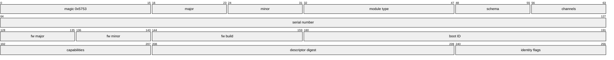
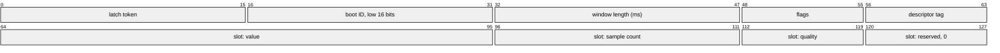
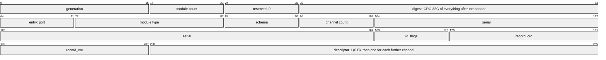

# wsmp: the WSMP core

`wsmp.c` packs and checks the data blocks of WSMP, the Weather Station Module Protocol
(`docs/module-protocol.md`). A module gives the station its identity, its descriptors and one
snapshot each minute. This file turns those bytes into structures and back. It also does these jobs:

- It checks the descriptors against the registry.
- It parses and packs the module record v1.0 from a module board's ID EEPROM
  (`docs/firmware-current-design.md` section 6.9).
- It computes CRC-32C and the radio budget.
- It maps quality codes.

`tools/wsmp_registry.py` generates the registry header `wsmp_registry.h` from `wsmp_registry.toml`.

The file has no state, no HAL call and no heap. The station uses it now. Later the remote module
adapter will use the same file, so both ends of the cable share one implementation.

This document is the source. `tools/tangle.py` generates `wsmp.c` from the code chunks below. The
header `wsmp.h` is a plain file. Edit this file, then regenerate and check:

```sh
python3 tools/tangle.py firmware/common/wsmp.lit.md            # write wsmp.c
python3 tools/tangle.py --check firmware/common/wsmp.lit.md    # committed .c == tangle
```

## 1. Guarantees

| Property | Guarantee | Checked by |
|---|---|---|
| Layout | every block has the byte layout of WSMP section 6. Every integer is big-endian | `test_snapshot_round_trip_matches_the_wsmp_layout`, `test_identity_refuses_bad_magic_and_major` |
| Refusal | an unpack function refuses a reserved bit, an undefined flag bit, a bad magic, a wrong major version, a zero serial and a channel count out of range. It returns a negative `WSMP_E*` code | `test_snapshot_refuses_a_set_reserved_byte`, `test_snapshot_refuses_an_undefined_flag`, `test_identity_refuses_bad_magic_and_major`, `test_identity_refuses_0_or_9_channels`, `fuzz_wsmp` |
| Registry | `wsmp_desc_check` accepts exactly the descriptors of the registry entry. With `wsmp_unpack_desc`, which finds a set reserved bit, it refuses each case of WSMP-D7 with its own code | `test_desc_check_accepts_the_registry_entry`, `test_desc_check_refuses_each_wsmp_d7_case`, `test_desc_check_refuses_widths_kinds_and_counts_out_of_range` |
| Round trip | unpack, then pack, gives back the same bytes for every accepted snapshot, descriptor block and descriptor set. For an identity block it gives back every byte except byte 3 (the WSMP minor), which pack always writes as this station's minor | `test_snapshot_round_trip_matches_the_wsmp_layout`, `fuzz_wsmp`, `fuzz_set` |
| Budget | the value bytes are the sum of the air widths. The quality bytes are 2 bits a channel, rounded up to a byte. `WSMP_RADIO_BUDGET` is 60 and the version is 1.1 | `test_budget_bytes_for_the_bench_station`, `test_version_1_1_and_radio_budget_60` |
| Quality | each snapshot quality maps to its 2-bit radio code. "Not fitted" (6) and an unknown code map to "missing" | `test_quality_air_table`, `test_not_fitted_is_quality_6_and_missing_on_the_radio` |
| CRC and text | CRC-32C gives the standard check value. Metadata text passes only the WSMP-M1 characters | `test_crc32c_known_vector`, `test_text_ok_charset` |
| Identity flags | the identity block carries the identity flags in register 0x000F. Unpack refuses a set reserved bit (2–3, 8–15) with `WSMP_ERESERVED` | `test_identity_flags_at_register_0x000f`, `test_identity_refuses_reserved_id_flag_bits`, `fuzz_wsmp` |
| Descriptor set | `wsmp_unpack_set` accepts exactly the layout of WSMP section 11.1 with the identity entry (serial, `id_flags`, `record_crc`). It refuses each fault of section 9 with its own code. An accepted set packs back to the same bytes. `wsmp_set_check` is the registry check of every module | `tests/test_wsmp_set.py`, `fuzz_set` (`firmware/fuzz/fuzz_set.c`) |
| Module record | `wsmp_record_parse` applies checks 2–6 of the record in the spec's order and returns the first failure as a record status. An accepted record of minor 0 packs back to the same 128 bytes | `tests/test_wsmp_record.py`, `fuzz_record` |

The error codes are:

| Code | Value | Meaning |
|---|---:|---|
| `WSMP_OK` | 0 | the block or the descriptors are accepted |
| `WSMP_EMAGIC` | −1 | the identity magic is not 0x5753 |
| `WSMP_EVERSION` | −2 | the WSMP major version is not 1 |
| `WSMP_ECODE` | −3 | an unknown quantity, or a kind of 0 or above `WSMP_KIND_MAX` |
| `WSMP_EUNIT` | −4 | the unit is not the canonical unit of the quantity |
| `WSMP_ESCALE` | −5 | the scale is outside −6 to +6 |
| `WSMP_ERESERVED` | −6 | a reserved bit or byte is set, or an undefined flag bit |
| `WSMP_ETYPE` | −7 | an unknown module type, a different schema, or a channel list that differs from the entry. In a descriptor set it also means ports that are not strictly increasing. In `wsmp_set_check` it means a serial namespace that is not its source, or a module type seen twice |
| `WSMP_ELEN` | −8 | a width outside 1 to 4, a channel count outside 1 to 8, or a zero serial. Also a descriptor set of the wrong length, or with too many modules or channels |
| `WSMP_EDIGEST` | −9 | a descriptor set whose digest does not match its entries |

The record parser returns a record status (`WSMP_REC_*`) instead, because the status goes to the
gateway in the identity flags. Section 8 below covers the statuses, and the enum is in `wsmp.h`.

The tests are in `tests/test_wsmp_core.py`, `tests/test_wsmp_set.py` and `tests/test_wsmp_record.py`.
The fuzz targets are `firmware/fuzz/fuzz_wsmp.c`, `firmware/fuzz/fuzz_set.c` and
`firmware/fuzz/fuzz_record.c`.

## 2. Constants

The descriptor packs its air width, its sign and 4 reserved bits into one byte. The width goes in
the top 3 bits as width − 1. The sign goes in the next bit.

```c {#constants}
#define DESC_WIDTH_SHIFT 5U
#define DESC_WIDTH_MASK  0x07U
#define DESC_SIGNED_BIT  0x10U
#define DESC_RESERVED    0x0FU
#define BYTE_BITS        8U
#define QUALITY_BITS     2U
#define CRC32C_POLY      0x82F63B78UL   /* the reflected Castagnoli polynomial */
#define CRC32C_INIT      0xFFFFFFFFUL
#define TEXT_PAD         0U
#define ID_FLAGS_RESERVED 0xFF0CU   /* identity flags: bits 2-3 and 8-15 */
```

## 3. Identity block

The identity block is 32 bytes. Section 6.1 of WSMP gives the fields. The pack function writes them
in order with the cursor helpers of `ws_be.h`, so the order of the calls is the layout:



The identity flags are in register 0x000F. Before the module ports design, that register was
reserved and 0. The flags tell you where the serial came from and what happened to the module
record. The serial source is in bits 0–1, the record status is in bits 4–7, and the rest are 0.
Their low byte goes to the gateway as the descriptor set's `id_flags`. A module without a record
(an on-board module) has 0.

```c {#identity}
void wsmp_pack_identity(const wsmp_identity *id, uint8_t out[WSMP_IDENTITY_LEN])
{
  uint8_t *p = ws_write_be16(out, WSMP_MAGIC);
  p = ws_write_u8(p, WSMP_VERSION_MAJOR);
  p = ws_write_u8(p, WSMP_VERSION_MINOR);
  p = ws_write_be16(p, id->type);
  p = ws_write_u8(p, id->schema);
  p = ws_write_u8(p, id->channels);
  p = ws_write_be(p, id->serial, sizeof id->serial);
  p = ws_write_u8(p, id->fw_major);
  p = ws_write_u8(p, id->fw_minor);
  p = ws_write_be16(p, id->fw_build);
  p = ws_write_be32(p, id->boot_id);
  p = ws_write_be16(p, id->caps);
  p = ws_write_be32(p, id->desc_digest);
  (void)ws_write_be16(p, id->id_flags);
}
```

The unpack function refuses a block that the station must not admit (WSMP-I1). That's a wrong
magic, a different major version, a channel count outside 1 to 8, or a zero serial. It accepts a
higher minor version (WSMP-V2). The reserved bits of the identity flags (2–3 and 8–15) must be 0,
and a set one gives `WSMP_ERESERVED`. That rule is in `docs/firmware-current-design.md` section 6.7,
in the "identity flags" row of the identity block. It means a reason the station doesn't know never
reaches the gateway as a known one.

```c {#identity-unpack}
int wsmp_unpack_identity(const uint8_t in[WSMP_IDENTITY_LEN], wsmp_identity *id)
{
  uint32_t v;
  uint64_t serial;
  if (ws_get_be16(in) != WSMP_MAGIC) return WSMP_EMAGIC;
  if (in[2] != WSMP_VERSION_MAJOR) return WSMP_EVERSION;
  id->type = ws_get_be16(in + 4);
  id->schema = in[6];
  id->channels = in[7];
  (void)ws_read_be(in + 8, &serial, sizeof serial);
  id->serial = serial;
  id->fw_major = in[16];
  id->fw_minor = in[17];
  id->fw_build = ws_get_be16(in + 18);
  (void)ws_read_be32(in + 20, &v);
  id->boot_id = v;
  id->caps = ws_get_be16(in + 24);
  (void)ws_read_be32(in + 26, &v);
  id->desc_digest = v;
  id->id_flags = ws_get_be16(in + 30);
  if (id->channels == 0 || id->channels > WSMP_MAX_CHANNELS || id->serial == 0) return WSMP_ELEN;
  if ((id->id_flags & ID_FLAGS_RESERVED) != 0) return WSMP_ERESERVED;
  return WSMP_OK;
}
```

## 4. Descriptor block

The descriptor block holds eight descriptors of 6 bytes. A module with fewer channels leaves the
rest zero. Each descriptor is:


```c {#desc}
void wsmp_pack_desc(const wsmp_desc *d, unsigned n, uint8_t out[WSMP_DESC_BLOCK_LEN])
{
  memset(out, 0, WSMP_DESC_BLOCK_LEN);
  uint8_t *p = out;
  for (unsigned i = 0; i < n && i < WSMP_MAX_CHANNELS; i++)
  {
    uint8_t form = (uint8_t)(((d[i].width - 1U) & DESC_WIDTH_MASK) << DESC_WIDTH_SHIFT);
    if (d[i].is_signed) form |= DESC_SIGNED_BIT;
    p = ws_write_be16(p, d[i].quantity);
    p = ws_write_u8(p, d[i].unit);
    p = ws_write_u8(p, (uint8_t)d[i].scale);
    p = ws_write_u8(p, form);
    p = ws_write_u8(p, d[i].kind);
  }
}
```

The unpack function reads `n` descriptors. A reserved bit in any of them gives `WSMP_ERESERVED`.
So does a non-zero byte in a descriptor after the last channel. The registry check comes later, in
`wsmp_desc_check`.

```c {#desc-unpack}
static int every(const uint8_t *p, size_t n, uint8_t v)
{
  for (size_t i = 0; i < n; i++)
    if (p[i] != v) return 0;
  return 1;
}

static int zero(const uint8_t *p, size_t n) { return every(p, n, 0); }

int wsmp_unpack_desc(const uint8_t in[WSMP_DESC_BLOCK_LEN], unsigned n, wsmp_desc *d)
{
  if (n > WSMP_MAX_CHANNELS) return WSMP_ELEN;
  for (unsigned i = 0; i < n; i++)
  {
    const uint8_t *p = in + i * WSMP_DESC_LEN;
    if (p[4] & DESC_RESERVED) return WSMP_ERESERVED;
    d[i] = (wsmp_desc){ .quantity = ws_get_be16(p), .unit = p[2], .scale = (int8_t)p[3],
                        .width = (uint8_t)(((p[4] >> DESC_WIDTH_SHIFT) & DESC_WIDTH_MASK) + 1U),
                        .is_signed = (p[4] & DESC_SIGNED_BIT) != 0, .kind = p[5] };
  }
  return zero(in + n * WSMP_DESC_LEN, (size_t)(WSMP_MAX_CHANNELS - n) * WSMP_DESC_LEN) ? WSMP_OK : WSMP_ERESERVED;
}
```

## 5. The registry check

`wsmp_desc_check` applies WSMP-D7. First it checks each descriptor on its own. A descriptor needs a
known quantity and kind, the canonical unit, a scale of −6 to +6 and a width of 1 to 4 bytes.

Then it compares the channel list with the registry entry of the module type. The entry must exist and
have the same schema and the same number of channels. It must also list the same quantity and kind
in each position. If the channel list fails, the result is `WSMP_ETYPE`.

The registry tables come from `wsmp_registry.h` as initializers. This file holds the one copy of
each, so every user of the lookups shares it.

```c {#registry}
static const uint8_t unit_of[WSMP_UNIT_OF_COUNT] = WSMP_UNIT_OF_INIT;
static const wsmp_type_entry types[WSMP_TYPE_COUNT] = WSMP_TYPES_INIT;
static const wsmp_cal_limits cal_limits[WSMP_CAL_COUNT] = WSMP_CAL_INIT;

uint8_t wsmp_canonical_unit(uint16_t quantity) { return quantity < WSMP_UNIT_OF_COUNT ? unit_of[quantity] : 0U; }

const wsmp_type_entry *wsmp_type(uint16_t type)
{
  for (unsigned i = 0; i < WSMP_TYPE_COUNT; i++)   /* bound: WSMP_TYPE_COUNT entries */
    if (types[i].type == type) return &types[i];
  return NULL;
}

const wsmp_cal_limits *wsmp_cal_limits_of(uint16_t quantity)
{
  for (unsigned i = 0; i < WSMP_CAL_COUNT; i++)   /* bound: WSMP_CAL_COUNT entries */
    if (cal_limits[i].quantity == quantity) return &cal_limits[i];
  return NULL;
}
```

The calibration table of record major 1 (`wsmp_cal_limits_of`) is a registry table too. The
generator writes it from the TOML's `[[calibration]]` rows and converts each quantity's physical
range to the channel scale. `wsmp_cal.c` applies it.

```c {#desc-check}
static int desc_one_ok(const wsmp_desc *d)
{
  uint8_t unit = wsmp_canonical_unit(d->quantity);
  if (unit == 0 || d->kind == 0 || d->kind > WSMP_KIND_MAX) return WSMP_ECODE;
  if (d->unit != unit) return WSMP_EUNIT;
  if (d->scale > WSMP_SCALE_MAX || d->scale < -WSMP_SCALE_MAX) return WSMP_ESCALE;
  if (d->width == 0 || d->width > WSMP_WIDTH_MAX) return WSMP_ELEN;
  return WSMP_OK;
}

int wsmp_desc_check(const wsmp_desc *d, unsigned n, uint16_t type, uint8_t schema)
{
  if (n > WSMP_MAX_CHANNELS) return WSMP_ELEN;
  for (unsigned i = 0; i < n; i++)
  {
    int rc = desc_one_ok(&d[i]);
    if (rc != WSMP_OK) return rc;
  }
  const wsmp_type_entry *t = wsmp_type(type);
  if (!t || t->schema != schema || t->channels != n) return WSMP_ETYPE;
  for (unsigned i = 0; i < n; i++)
    if (d[i].quantity != t->ch[i].quantity || d[i].kind != t->ch[i].kind) return WSMP_ETYPE;
  return WSMP_OK;
}
```

## 6. Snapshot block

The snapshot is the 8-byte header and eight slots of 8 bytes:



```c {#snapshot}
void wsmp_pack_snapshot(const wsmp_snapshot *s, uint8_t out[WSMP_SNAPSHOT_LEN])
{
  uint8_t *p = ws_write_be16(out, s->token);
  p = ws_write_be16(p, s->boot16);
  p = ws_write_be16(p, s->window_ms);
  p = ws_write_u8(p, s->flags);
  p = ws_write_u8(p, s->desc_tag);
  for (unsigned i = 0; i < WSMP_MAX_CHANNELS; i++)
  {
    p = ws_write_be32(p, s->slot[i].value);
    p = ws_write_be16(p, s->slot[i].count);
    p = ws_write_u8(p, s->slot[i].quality);
    p = ws_write_u8(p, 0);
  }
}
```

The unpack function refuses an undefined flag bit and a non-zero reserved byte in any slot.

```c {#snapshot-unpack}
int wsmp_unpack_snapshot(const uint8_t in[WSMP_SNAPSHOT_LEN], wsmp_snapshot *s)
{
  if (in[6] & (uint8_t)~WSMP_FLAGS_DEFINED) return WSMP_ERESERVED;
  s->token = ws_get_be16(in);
  s->boot16 = ws_get_be16(in + 2);
  s->window_ms = ws_get_be16(in + 4);
  s->flags = in[6];
  s->desc_tag = in[7];
  for (unsigned i = 0; i < WSMP_MAX_CHANNELS; i++)
  {
    const uint8_t *p = in + WSMP_SNAPSHOT_HEAD_LEN + i * WSMP_SLOT_LEN;
    uint32_t v;
    if (p[7]) return WSMP_ERESERVED;
    (void)ws_read_be32(p, &v);
    s->slot[i] = (wsmp_slot){ .value = v, .count = ws_get_be16(p + 4), .quality = p[6] };
  }
  return WSMP_OK;
}
```

## 7. CRC-32C, quality, budget and text

The descriptor digest is CRC-32C (the Castagnoli polynomial, as iSCSI uses it) over the descriptor
block. The bitwise form needs no table in flash. The check value of the ASCII digits "123456789" is
`0xE3069283`.

```c {#crc32c}
uint32_t wsmp_crc32c(const uint8_t *p, size_t n)
{
  uint32_t crc = CRC32C_INIT;
  for (size_t i = 0; i < n; i++)
  {
    crc ^= p[i];
    for (unsigned b = 0; b < BYTE_BITS; b++) crc = (crc >> 1) ^ (CRC32C_POLY & (0U - (crc & 1U)));
  }
  return ~crc;
}
```

The radio carries 2 bits of quality (WSMP section 9). The snapshot codes and their radio codes are:

| Snapshot | Name | Radio |
|---:|---|---:|
| 0 | good | 0 |
| 1 | partial | 1 |
| 2 | suspect | 2 |
| 3 | missing | 3 |
| 4 | warming up | 1 (partial) |
| 5 | sensor fault | 3 (missing) |
| 6 | not fitted (WSMP 1.1): this hardware build has no source for the channel | 3 (missing) |
| 7–255 | unknown | 3 (missing) |

"Not fitted" (`WSMP_QUAL_NOT_FITTED`) needs no entry in the `air` table below. It's past the end
of the table, so it maps to "missing" like an unknown code. The difference from "missing" holds
only locally and through the catalog map. There a not fitted slot becomes an absent field, and a
missing one becomes INVALID. A receiver of a WSMP radio reading sees both as "missing" (power
telemetry spec `docs/superpowers/specs/2026-10-29-power-telemetry-design.md` section 8.3).

```c {#quality}
uint8_t wsmp_quality_air(uint8_t quality)
{
  static const uint8_t air[] = { WSMP_QUAL_GOOD, WSMP_QUAL_PARTIAL, WSMP_QUAL_SUSPECT, WSMP_QUAL_MISSING,
                                 WSMP_QUAL_PARTIAL, WSMP_QUAL_MISSING };
  return quality < sizeof air ? air[quality] : (uint8_t)WSMP_QUAL_MISSING;
}
```

The radio budget (WSMP-A1) counts the air width of each value and 2 quality bits for each channel.
The station admits minute-class modules while their sum stays within `WSMP_RADIO_BUDGET`, 60 bytes.
That's the planned plaintext (80 B, the journal's per-build limit) minus a 20-byte header (power
telemetry spec section 8.4). The station with the battery and rails modules uses 53 + 6 = 59 bytes.

```c {#budget}
unsigned wsmp_values_bytes(const wsmp_desc *d, unsigned n)
{
  unsigned bytes = 0;
  for (unsigned i = 0; i < n && i < WSMP_MAX_CHANNELS; i++) bytes += d[i].width;
  return bytes;
}

unsigned wsmp_quality_bytes(unsigned channels)
{
  return (channels * QUALITY_BITS + BYTE_BITS - 1U) / BYTE_BITS;
}
```

Text in the metadata block uses only `A–Z a–z 0–9 space . _ -` (WSMP-M1). The text ends at the first
zero byte, and every byte after it must be zero too.

```c {#text}
static int text_char_ok(uint8_t c)
{
  return (c >= 'A' && c <= 'Z') || (c >= 'a' && c <= 'z') || (c >= '0' && c <= '9') || c == ' ' || c == '.' ||
         c == '_' || c == '-';
}

int wsmp_text_ok(const uint8_t *p, size_t n)
{
  size_t i = 0;
  while (i < n && p[i] != TEXT_PAD)   /* bound: n bytes */
  {
    if (!text_char_ok(p[i])) return 0;
    i++;
  }
  return zero(p + i, n - i);
}
```

## 8. Module record v1.0

Every v1 module board (pod) carries a 24LC32-class 4 KB EEPROM at 0x50. On the pods that's an
Adafruit #5146 breakout with a CAT24C32 or equivalent. The first 128 bytes of the EEPROM are the
module record (`docs/firmware-current-design.md` section 6.9, proposed as WSMP section 10.1). The
record gives the module a serial that follows it across ports. It also binds the module to its
sensor and carries the sensor's calibration.

Every integer is big-endian. Major 1 fixes the length at 128 bytes, because the station reads them
in one transfer before it knows anything else.

| Offset | Size | Field | Rule |
|---|---|---|---|
| 0x00 | 4 | magic | `57 53 4D 52` ("WSMR") |
| 0x04 | 1 | format major | 1 |
| 0x05 | 1 | format minor | 0; a higher minor is accepted and its reserved bytes are not checked |
| 0x06 | 2 | record length | 128 |
| 0x08 | 2 | module type | in the registry |
| 0x0A | 1 | board revision | informational |
| 0x0B | 1 | flags | 0 when the minor is 0 |
| 0x0C | 8 | serial | top byte 0x01, low 56 bits neither 0 nor all ones |
| 0x14 | 1 | sensor-bind kind | 0 none, 1 SHT4x serial; 1 exactly on module type 1 (the only part with a readable serial) |
| 0x15 | 3 | reserved | 0 |
| 0x18 | 4 | sensor-bind value | 0 when the kind is 0 |
| 0x1C | 4 | programming time | informational |
| 0x20 | 16 | part number | WSMP-M1 text padded with zero bytes (`wsmp_text_ok`) |
| 0x30 | 16 | reserved | 0 |
| 0x40 | 48 | calibration | 3 entries of 16 bytes |
| 0x70 | 12 | reserved | 0 |
| 0x7C | 4 | CRC-32C | over 0x00–0x7B |

A calibration entry is quantity (2), kind (1, 0 for every kind), reserved (1), calibration revision
(2), reserved (2), offset (s32, at the channel's scale) and gain (u32, ppm). An all-zero entry is
unused.

```c {#record-layout}
#define REC_MAGIC      0x57534D52UL   /* "WSMR" */
#define REC_BLANK      0xFFU          /* an erased EEPROM */
#define REC_NS_SHIFT   56U            /* the serial's top byte is its namespace */
#define REC_SERIAL_LOW 0x00FFFFFFFFFFFFFFULL
#define REC_ENTRY_LEN  16U
#define REC_STATUS_SHIFT 4U
#define REC_SOURCE_MASK  0x03U
#define REC_STATUS_MASK  0x0FU
enum { AT_MAJOR = 0x04, AT_MINOR = 0x05, AT_LENGTH = 0x06, AT_TYPE = 0x08, AT_HW = 0x0A, AT_FLAGS = 0x0B,
       AT_SERIAL = 0x0C, AT_BIND_KIND = 0x14, AT_RESERVED1 = 0x15, AT_BIND = 0x18, AT_PROGRAMMED = 0x1C,
       AT_PART = 0x20, AT_RESERVED2 = 0x30, AT_CAL = 0x40, AT_RESERVED3 = 0x70, AT_CRC = 0x7C };
enum { RESERVED1_LEN = 3, RESERVED2_LEN = 16, RESERVED3_LEN = 12 };
/* In an entry: the reserved byte after the kind, and the two after the revision. */
enum { ENTRY_KIND = 2, ENTRY_RES_A = 3, ENTRY_REVISION = 4, ENTRY_RES_B = 6, ENTRY_RES_C = 7, ENTRY_OFFSET = 8,
       ENTRY_GAIN = 12 };
```

**Checks, in order.** The first failure decides (section 6.9). Check 1 is a read that fails three
times, and it never reaches the parser. The spec's second read after a CRC failure belongs to the
caller, which reads again and parses again.

Checks 2 to 5 examine the bytes before the parser trusts any field. An erased EEPROM (every byte
0xFF) is BLANK. Anything else without the magic, an all-zero one included, is NO_MAGIC. The parser
checks the length before the CRC, because a record of another length has its CRC somewhere else.

```c {#record-head}
static uint8_t record_head(const uint8_t *in)
{
  if (every(in, WSMP_RECORD_LEN, REC_BLANK)) return WSMP_REC_BLANK;
  if (ws_get_be32(in) != REC_MAGIC) return WSMP_REC_NO_MAGIC;
  if (in[AT_MAJOR] != WSMP_RECORD_MAJOR) return WSMP_REC_VERSION;
  if (ws_get_be16(in + AT_LENGTH) != WSMP_RECORD_LEN) return WSMP_REC_MALFORMED;
  if (wsmp_crc32c(in, AT_CRC) != ws_get_be32(in + AT_CRC)) return WSMP_REC_CRC;
  return WSMP_REC_APPLIED;
}
```

Once the CRC holds, `record_fields` reads the fields into the structure:

```c {#record-fields}
static void entry_fields(const uint8_t *p, wsmp_cal_entry *e)
{
  *e = (wsmp_cal_entry){ .quantity = ws_get_be16(p), .kind = p[ENTRY_KIND], .revision = ws_get_be16(p + ENTRY_REVISION),
                         .offset = (int32_t)ws_get_be32(p + ENTRY_OFFSET), .gain = ws_get_be32(p + ENTRY_GAIN) };
}

static void record_fields(const uint8_t *in, wsmp_record *r)
{
  r->minor = in[AT_MINOR];
  r->type = ws_get_be16(in + AT_TYPE);
  r->hw_rev = in[AT_HW];
  r->flags = in[AT_FLAGS];
  r->serial = ws_get_be64(in + AT_SERIAL, sizeof r->serial);
  r->bind_kind = in[AT_BIND_KIND];
  r->bind_value = ws_get_be32(in + AT_BIND);
  r->programmed = ws_get_be32(in + AT_PROGRAMMED);
  memcpy(r->part, in + AT_PART, WSMP_RECORD_PART_LEN);
  for (unsigned i = 0; i < WSMP_RECORD_CAL_N; i++) entry_fields(in + AT_CAL + i * REC_ENTRY_LEN, &r->cal[i]);
  r->crc = ws_get_be32(in + AT_CRC);
}
```

Check 6 covers every structural rule of the table. Any failure here gives MALFORMED. The rules are:

- The serial must be in the record namespace (0x01), with a low part that is neither 0 nor all ones.
- The module type must be in the registry.
- The sensor bind must be a known kind, and it can't have a value without a kind.
- Module type 1 (the SHT45) must have kind 1 (the SHT4x serial), and every other type must not. The
  parts on the other types have no serial the station can read (types 2 and 3 in v1), so the station
  could never confirm a bind there.
- The part number must be WSMP-M1 text. The parser accepts an empty one (16 zero bytes). The design
  says the programming fixture must refuse to write an empty one, but that fixture is a host tool
  that doesn't exist yet (`docs/firmware-current-design.md` section 6.9).
- With minor 0, the flags and every reserved byte must be 0, an entry's reserved bytes included. A
  later minor may give them a meaning, so the parser doesn't check them then.
- A used entry's kind must be 0 or a registry kind, whatever the minor.

This check leaves out the quantity, the revision and the match with the type's channels. Those are
check 7, CAL_REJECTED (`wsmp_cal.c`).

```c {#record-body}
static int serial_ok(uint64_t serial)
{
  uint64_t low = serial & REC_SERIAL_LOW;
  return (serial >> REC_NS_SHIFT) == WSMP_SRC_RECORD && low != 0 && low != REC_SERIAL_LOW;
}

static int bind_ok(const wsmp_record *r)
{
  if (r->bind_kind > WSMP_BIND_SHT4X) return 0;
  if (r->bind_kind == WSMP_BIND_NONE && r->bind_value != 0) return 0;
  return (r->bind_kind == WSMP_BIND_SHT4X) == (r->type == WSMP_T_AIR_TH);
}

static int reserved_ok(const uint8_t *in)
{
  return in[AT_FLAGS] == 0 && zero(in + AT_RESERVED1, RESERVED1_LEN) && zero(in + AT_RESERVED2, RESERVED2_LEN) &&
         zero(in + AT_RESERVED3, RESERVED3_LEN);
}

static int entries_ok(const uint8_t *in, int check_reserved)
{
  for (unsigned i = 0; i < WSMP_RECORD_CAL_N; i++)
  {
    const uint8_t *p = in + AT_CAL + i * REC_ENTRY_LEN;
    if (zero(p, REC_ENTRY_LEN)) continue;   /* unused: skipped before any check */
    if (p[ENTRY_KIND] > WSMP_KIND_MAX) return 0;
    if (check_reserved && (p[ENTRY_RES_A] | p[ENTRY_RES_B] | p[ENTRY_RES_C]) != 0) return 0;
  }
  return 1;
}

static uint8_t record_body(const uint8_t *in, const wsmp_record *r)
{
  int minor0 = r->minor == 0;
  int ok = serial_ok(r->serial) && wsmp_type(r->type) != NULL && bind_ok(r) &&
           wsmp_text_ok(r->part, WSMP_RECORD_PART_LEN) && (!minor0 || reserved_ok(in)) && entries_ok(in, minor0);
  return ok ? (uint8_t)WSMP_REC_APPLIED : (uint8_t)WSMP_REC_MALFORMED;
}

uint8_t wsmp_record_parse(const uint8_t in[WSMP_RECORD_LEN], wsmp_record *r)
{
  uint8_t status = record_head(in);
  if (status != WSMP_REC_APPLIED) return status;
  record_fields(in, r);
  return record_body(in, r);
}
```

The encoder is for the programming fixture (not written yet) and the tests. It writes the layout in
order with the cursor helpers, leaves every reserved byte 0 and writes the CRC last. So an accepted
record of minor 0 packs back to its own bytes.

```c {#record-pack}
static uint8_t *pack_entry(uint8_t *p, const wsmp_cal_entry *e)
{
  p = ws_write_be16(p, e->quantity);
  p = ws_write_u8(p, e->kind);
  p = ws_write_u8(p, 0);
  p = ws_write_be16(p, e->revision);
  p = ws_write_be16(p, 0);
  p = ws_write_be32(p, (uint32_t)e->offset);
  return ws_write_be32(p, e->gain);
}

void wsmp_record_pack(const wsmp_record *r, uint8_t out[WSMP_RECORD_LEN])
{
  memset(out, 0, WSMP_RECORD_LEN);
  uint8_t *p = ws_write_be32(out, REC_MAGIC);
  p = ws_write_u8(p, WSMP_RECORD_MAJOR);
  p = ws_write_u8(p, r->minor);
  p = ws_write_be16(p, WSMP_RECORD_LEN);
  p = ws_write_be16(p, r->type);
  p = ws_write_u8(p, r->hw_rev);
  p = ws_write_u8(p, r->flags);
  p = ws_write_be(p, r->serial, sizeof r->serial);
  p = ws_write_u8(p, r->bind_kind) + RESERVED1_LEN;
  p = ws_write_be32(p, r->bind_value);
  p = ws_write_be32(p, r->programmed);
  memcpy(p, r->part, WSMP_RECORD_PART_LEN);
  p = out + AT_CAL;
  for (unsigned i = 0; i < WSMP_RECORD_CAL_N; i++) p = pack_entry(p, &r->cal[i]);
  ws_put_be32(out + AT_CRC, wsmp_crc32c(out, AT_CRC));
}
```

The identity flags' low byte joins the serial source and the record status. It is the descriptor
set's `id_flags` and the low byte of identity register 0x000F (section 3).

```c {#id-flags}
uint8_t wsmp_id_flags(uint8_t source, uint8_t status)
{
  return (uint8_t)((source & REC_SOURCE_MASK) | (status & REC_STATUS_MASK) << REC_STATUS_SHIFT);
}
```

## 9. Descriptor set

The descriptor set (WSMP section 11.1) is what the station tells the gateway about its modules. It
has one header, then one entry for each module in the layout, in increasing port order. Each entry
has its descriptors right after it. The entry carries the module's identity
(firmware-current-design.md section 6.7, "The serial reaches the gateway"). That's its serial, the
identity flags' low byte and the applied record's CRC-32C. A header is 8 bytes and an entry 18, so a
full set (8 modules, 24 channels) is 8 + 8 × 18 + 24 × 6 = 296 bytes (WSMP-E4).



`id_flags` holds the serial source in bits 0–1 and the record status in bits 4–7 (`wsmp_id_flags`).
Bits 2–3 are reserved. `record_crc` is 0 whenever the station applied no record. The digest covers every
byte after the header, so a set and its digest name each other.

`wsmp_pack_set` writes the set and its digest and returns its length. The caller builds the set from
admitted modules, so it stays within the counts that `wsmp_unpack_set` accepts. A set with more than
8 modules, a channel count outside 1–8 or more than 24 channels is a bug in the caller. The function
checks the counts first (Power of Ten rule 5). If they're out of range, it packs nothing and
returns 0.

```c {#set-pack}
static uint8_t *pack_entry_set(uint8_t *p, const wsmp_set_module *m)
{
  p = ws_write_u8(p, m->port);
  p = ws_write_be16(p, m->type);
  p = ws_write_u8(p, m->schema);
  p = ws_write_u8(p, m->channels);
  p = ws_write_be(p, m->serial, sizeof m->serial);
  p = ws_write_u8(p, m->id_flags);
  p = ws_write_be32(p, m->record_crc);
  uint8_t block[WSMP_DESC_BLOCK_LEN];
  wsmp_pack_desc(m->desc, m->channels, block);
  size_t n = (size_t)m->channels * WSMP_DESC_LEN;
  memcpy(p, block, n);
  return p + n;
}

/* Power of Ten rule 5: the counts bound the writes into out[WSMP_SET_MAX_LEN]. A set outside them is a
   bug of the caller; the recovery is to pack nothing (length 0), which no reader accepts. */
static int set_fits(const wsmp_set *s)
{
  unsigned total = 0;
  if (s->count > WSMP_SET_MODULES_MAX) return 0;
  for (unsigned i = 0; i < s->count; i++)
  {
    if (s->m[i].channels == 0U || s->m[i].channels > WSMP_MAX_CHANNELS) return 0;
    total += s->m[i].channels;
  }
  return total <= WSMP_SET_CHANNELS_MAX;
}

unsigned wsmp_pack_set(const wsmp_set *s, uint8_t out[WSMP_SET_MAX_LEN])
{
  if (!set_fits(s)) return 0;
  uint8_t *p = out + WSMP_SET_HEAD_LEN;
  for (unsigned i = 0; i < s->count; i++) p = pack_entry_set(p, &s->m[i]);
  unsigned len = (unsigned)(p - out);
  uint8_t *h = ws_write_be16(out, s->generation);
  h = ws_write_u8(h, s->count);
  h = ws_write_u8(h, 0U);
  (void)ws_write_be32(h, wsmp_crc32c(out + WSMP_SET_HEAD_LEN, len - WSMP_SET_HEAD_LEN));
  return len;
}
```

`wsmp_unpack_set` reads a set of `len` bytes. It refuses each of these faults with its own code:

| Fault | Code |
|---|---|
| shorter than its header, or not exactly the length its entries give | `WSMP_ELEN` |
| more than 8 modules, a channel count outside 1–8, more than 24 channels in all, a zero serial | `WSMP_ELEN` |
| a non-zero reserved byte, reserved `id_flags` bits 2–3, an undefined record status (9–15), a reserved descriptor bit | `WSMP_ERESERVED` |
| ports not strictly increasing (a port twice, or out of order) | `WSMP_ETYPE` |
| a digest that does not match | `WSMP_EDIGEST` |

A set with no module is valid, because every port may be empty. The registry check is separate
(`wsmp_set_check`, WSMP-E7), so the gateway can store a set that fails it for diagnosis.

```c {#set-unpack}
#define SET_FLAGS_RESERVED 0x0CU                       /* id_flags bits 2-3 */
#define SET_STATUS_MAX     WSMP_REC_SENSOR_CHANGED     /* the last defined record status */

static int unpack_entry_set(const uint8_t **pp, const uint8_t *end, wsmp_set_module *m, unsigned *total)
{
  const uint8_t *p = *pp;
  if ((size_t)(end - p) < WSMP_SET_ENTRY_LEN) return WSMP_ELEN;
  m->port = p[0];
  m->type = ws_get_be16(p + 1);
  m->schema = p[3];
  m->channels = p[4];
  m->serial = ws_get_be64(p + 5, sizeof m->serial);
  m->id_flags = p[13];
  m->record_crc = ws_get_be32(p + 14);
  p += WSMP_SET_ENTRY_LEN;
  if (m->channels == 0U || m->channels > WSMP_MAX_CHANNELS || m->serial == 0U) return WSMP_ELEN;
  *total += m->channels;
  if (*total > WSMP_SET_CHANNELS_MAX) return WSMP_ELEN;
  if ((m->id_flags & SET_FLAGS_RESERVED) != 0U || (m->id_flags >> REC_STATUS_SHIFT) > SET_STATUS_MAX) return WSMP_ERESERVED;
  size_t n = (size_t)m->channels * WSMP_DESC_LEN;
  if ((size_t)(end - p) < n) return WSMP_ELEN;
  uint8_t block[WSMP_DESC_BLOCK_LEN] = { 0 };
  memcpy(block, p, n);
  *pp = p + n;
  return wsmp_unpack_desc(block, m->channels, m->desc);
}

static int unpack_head_set(const uint8_t *in, size_t len, wsmp_set *s)
{
  if (len < WSMP_SET_HEAD_LEN || len > WSMP_SET_MAX_LEN) return WSMP_ELEN;
  s->generation = ws_get_be16(in);
  s->count = in[2];
  s->digest = ws_get_be32(in + 4);
  if (in[3] != 0U) return WSMP_ERESERVED;
  return s->count > WSMP_SET_MODULES_MAX ? WSMP_ELEN : WSMP_OK;
}

int wsmp_unpack_set(const uint8_t *in, size_t len, wsmp_set *s)
{
  int head = unpack_head_set(in, len, s);
  if (head != WSMP_OK) return head;
  const uint8_t *p = in + WSMP_SET_HEAD_LEN, *end = in + len;
  unsigned total = 0;
  for (unsigned i = 0; i < s->count; i++)
  {
    int rc = unpack_entry_set(&p, end, &s->m[i], &total);
    if (rc != WSMP_OK) return rc;
    if (i > 0U && s->m[i].port <= s->m[i - 1U].port) return WSMP_ETYPE;
  }
  if (p != end) return WSMP_ELEN;
  return wsmp_crc32c(in + WSMP_SET_HEAD_LEN, len - WSMP_SET_HEAD_LEN) == s->digest ? WSMP_OK : WSMP_EDIGEST;
}
```

`wsmp_set_check` is the gateway's WSMP-E7 for an unpacked set. Each module must pass the registry
check (WSMP-D7), which returns its own code. Two identity rules of firmware-current-design.md
(section 6.7) give `WSMP_ETYPE`:

- A serial's namespace (its top byte) must be its source (`id_flags` bits 0–1).
- v1 admits at most one module of each type (WSMP-P10 in module-protocol.md, and
  firmware-current-design.md sections 1 and 6.7). So the check refuses a type that shows up twice in
  one set.

```c {#set-check}
static int module_ok_set(const wsmp_set *s, unsigned i)
{
  const wsmp_set_module *m = &s->m[i];
  int rc = wsmp_desc_check(m->desc, m->channels, m->type, m->schema);
  if (rc != WSMP_OK) return rc;
  if ((m->serial >> REC_NS_SHIFT) != (m->id_flags & REC_SOURCE_MASK)) return WSMP_ETYPE;
  for (unsigned j = 0; j < i; j++)
    if (s->m[j].type == m->type) return WSMP_ETYPE;
  return WSMP_OK;
}

int wsmp_set_check(const wsmp_set *s)
{
  for (unsigned i = 0; i < s->count && i < WSMP_SET_MODULES_MAX; i++)
  {
    int rc = module_ok_set(s, i);
    if (rc != WSMP_OK) return rc;
  }
  return WSMP_OK;
}
```

## 10. The file

```c {#wsmp.c}
#include "wsmp.h"
#include <string.h>
#include "ws_be.h"

<<constants>>

<<identity>>

<<identity-unpack>>

<<desc>>

<<desc-unpack>>

<<registry>>

<<desc-check>>

<<snapshot>>

<<snapshot-unpack>>

<<crc32c>>

<<quality>>

<<budget>>

<<text>>

<<record-layout>>

<<record-head>>

<<record-fields>>

<<record-body>>

<<record-pack>>

<<id-flags>>

<<set-pack>>

<<set-unpack>>

<<set-check>>
```
