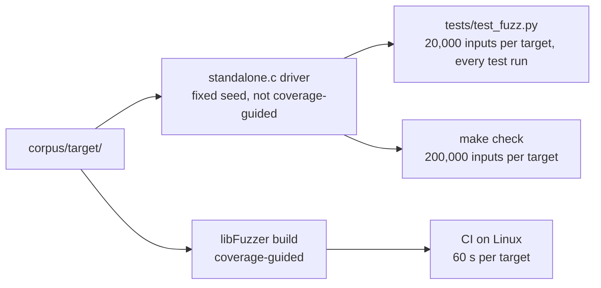

# Fuzzing the node's input parsers

These targets cover the code that reads input from outside the node: radio replies, console lines and sensor module blocks. They give that code malformed input under AddressSanitizer (ASan) and UndefinedBehaviorSanitizer (UBSan). They also check properties that must hold for every input.

| Target | Code under test | Properties beyond "no memory error" |
|---|---|---|
| `reply` | The frame envelope (`firmware/common/ws_frame.c`). `ws_open_reply` gets any bytes from the air. `ws_seal_kind` gets a station, counter, kind and plaintext that the fuzzer chooses, biased to the 16-bit and 40-bit limits. | Nothing opens except the two genuine self-test frames (`corpus/reply/`). The sealer refuses out-of-range values and wipes the output. It never truncates them into the header, because that would repeat a nonce. Accepted frames carry exactly the header of the specification. ACK/NACK frames open again to the same values. |
| `provision` | `ws_parse_provision` (`firmware/stage0.c`): the `PROVISION` arguments. | On success: the station is 1–65,535 (the frame header holds 2 bytes for it). The epoch floor is in range. The key equals the 32 hex digits typed. Only digits come after the optional space. |
| `console` | `ws_line_feed`, `ws_hex_decode`, `ws_host_reply_ok`, `ws_air_frame_ok` (`firmware/common/ws_console.c`), then `ws_parse_provision`. The input is a raw UART byte stream as either board receives it. | Lines are 1–256 bytes with no `\n`/`\r`. The line buffer is cleared after each line. A hex decode is exactly half the line. Only a 33-byte ACK/NACK of protocol version 5 passes the RX check toward the radio. Only valid observation and health-report lengths pass the RX check toward the host. |
| `obs` | `ws_obs_encode` (`firmware/common/ws_obs.c`): any records, with codes biased to the edges, INVALID and CALM. | The encoder accepts exactly the records that an independent copy of the specification's catalog accepts. Accepted records have the length, header and big-endian fields of the specification. |
| `wsmp` | The WSMP core (`firmware/common/wsmp.c`): the unpack functions for the identity, descriptor and snapshot blocks, `wsmp_desc_check` and `wsmp_text_ok`. Byte 0 of the input selects the block. | Each unpack function accepts exactly the blocks that `docs/module-protocol.md` sections 4–6 allow. A re-pack of an accepted block gives the same bytes. `wsmp_desc_check` accepts exactly the registry entry of a module type. The oracle is an independent copy of the specification. |

The boards run the same functions (`App/console.c`, `App/app_rx.c`, `App/tx_console.c`, `App/tx_exchange.c`, `App/wsmp_host.c`).

## Run

```sh
make -C firmware/fuzz check                 # any cc with ASan/UBSan: corpus + 200,000 mutated inputs per target
make -C firmware/fuzz check RUNS=5000000 SEED=7
make -C firmware/fuzz libfuzzer             # coverage-guided; needs clang with libFuzzer (Linux, Homebrew llvm)
firmware/fuzz/build/libfuzzer-console build/new-corpus firmware/fuzz/corpus/console -max_total_time=600
```

Three places run the targets:



`tests/test_fuzz.py` runs the standalone drivers on every test run, with 20,000 mutated inputs each. `WS_FUZZ_RUNS` raises that number. CI also runs each libFuzzer target for 60 s on Linux.

The standalone driver (`standalone.c`) exists because Apple clang does not include libFuzzer. It is not coverage-guided. It mutates the corpus from a fixed seed, so the same `-seed` reproduces a failure.

Two planted bugs showed that the harness works:

- Without the length bound in `ws_hex_decode`, ASan reported a stack overflow within 200,000 inputs for each of three seeds.
- When `ws_open_reply` skipped the tag check, the `reply` property failed at once.

On 2026-10-14, two more planted bugs checked the targets for protocol version 5:

- Without the 2^40 counter check in `ws_seal_kind`, the `reply` property failed within 200,000 inputs.
- A range check with an off-by-one error in `ws_obs.c` made the `obs` property fail. The first version of `obs` missed it, because its oracle called the encoder's own range check. Now `obs` keeps its own copy of the specification's ranges.

When you check a planted bug, delete the built target first. macOS includes GNU Make 3.81, whose timestamps have a 1-second resolution. So Make does not rebuild a file that you edit in the same second as the last build.

Checked on 2026-10-13 with Ubuntu 24.04 and clang 18.1.3: libFuzzer ran 20 s per target, about 36 million inputs in total, and found nothing. The standalone drivers pass under Apple clang 17 and GCC.

## Add a target

1. Write `fuzz_<name>.c` with `LLVMFuzzerTestOneInput`. Use `FUZZ_CHECK` for the properties.
2. In the `Makefile`, add `SRC_<name>` and add the name to `TARGETS`.
3. Put the seeds in `corpus/<name>/`.
4. Add a test method to `tests/test_fuzz.py`.
