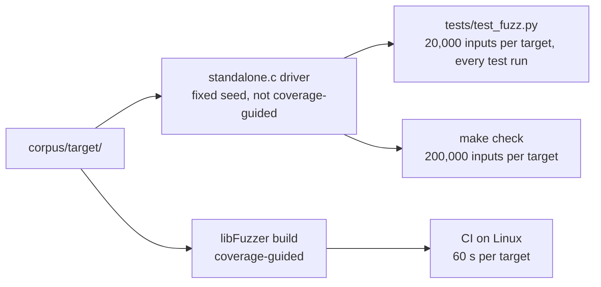

# Fuzzing the node's input parsers

These targets cover the code that reads input from outside the node: radio replies, console lines and sensor module blocks. They give that code malformed input under AddressSanitizer (ASan) and UndefinedBehaviorSanitizer (UBSan). They also check properties that must hold for every input.

| Target | Code under test | Properties beyond "no memory error" |
|---|---|---|
| `reply` | The frame envelope (`firmware/common/ws_frame.c`). `ws_open_reply` gets any bytes from the air. `ws_seal_kind` gets a station, counter, kind and plaintext that the fuzzer chooses, biased to the 16-bit and 40-bit limits. | Nothing opens except the two genuine self-test frames of protocol version 6 (byte 0 = `0x62` and `0x63`, `corpus/reply/`). The sealer refuses out-of-range values and wipes the output. It never truncates them into the header, because that would repeat a nonce. Accepted frames carry exactly the header of the specification (byte 0 = `0x6k`, version 6 and kind *k*). ACK/NACK frames open again to the same values. Seeds: the two version-6 vectors, an ACK at the limits, a counter overflow and a 64-byte health report (an 80-byte frame). |
| `provision` | `ws_parse_provision` (`firmware/stage0.c`): the `PROVISION` arguments. | On success: the station is 1–65,535 (the frame header holds 2 bytes for it). The epoch floor is in range. The key equals the 32 hex digits typed. Only digits come after the optional space. |
| `console` | `ws_line_feed`, `ws_hex_decode`, `ws_host_reply_ok`, `ws_air_frame_ok` (`firmware/common/ws_console.c`), then `ws_parse_provision`. The input is a raw UART byte stream as either board receives it. | Lines are 1–256 bytes with no `\n`/`\r`. The line buffer is cleared after each line. A hex decode is exactly half the line. Only a 33-byte ACK/NACK of protocol version 6 passes the RX check toward the radio. Toward the host, a version-6 frame of the observation or health-report kind passes exactly when its length is valid: an observation of 39–110 bytes (16 + 22 + one 1-byte field up to 16 + 94, every catalog v2 field) or a health report of exactly 80 bytes (16 + 64). Lines decode into a buffer that holds any of them. Seeds: the version-6 ACK line, an 80-byte health report, a 110-byte and a 111-byte observation. |
| `obs` | `ws_obs_encode` and `ws_obs_plain_len` (`firmware/common/ws_obs.c`): any records with a 64-bit field mask, with codes biased to the edges, one past them, INVALID and CALM; and the raw input bytes read as a stored plaintext. | The encoder accepts exactly the records that an independent copy of catalog v2 accepts (34 indexes, 31 = EXT with width 0; power telemetry design sections 5.1 and 5.2): never EXT, a reserved index 34–63 or an empty mask. Accepted records have the length (22 + the 2-byte extension word when a field 32–47 is present + the widths, at most 94), the header, bitmap bit 31 exactly when the extension word follows, and the big-endian fields in index order of the specification; `ws_obs_plain_len` gives that length back. On the raw bytes, `ws_obs_plain_len` follows the EXT rules exactly: EXT with an empty extension bitmap, a reserved extension bit or no field is rejected, an extension-only record is legal. Seeds: the full catalog (a 94-byte record) and one byte short, the current and voltage edges (65,534 and INVALID), extension-only, empty, reserved and bit-48 masks. |
| `wsmp` | The WSMP core (`firmware/common/wsmp.c`): the unpack functions for the identity, descriptor and snapshot blocks, `wsmp_desc_check` and `wsmp_text_ok`. Byte 0 of the input selects the block. | Each unpack function accepts exactly the blocks that `docs/module-protocol.md` sections 4–6 allow (the identity flags' reserved bits 2–3 and 8–15 included: a set one is refused; seeds `identity-flags-*.bin` at each edge). A re-pack of an accepted block gives the same bytes. `wsmp_desc_check` accepts exactly the registry entry of a module type, for registry version 2: types 1–9 (8 battery, 9 power rails) and the units of quantities 1–24 (18–24: V = unit 8, A = unit 9; power telemetry design section 8.1). A re-packed identity carries this station's WSMP minor, 1 (WSMP 1.1, design section 8.3). The oracle is an independent copy of the specification. Seeds: the descriptor blocks of types 1, 8 and 9 and of an unregistered type 10. |
| `record` | The module record v1.0 of a module board's ID EEPROM (`wsmp_record_parse`, `wsmp_record_pack` in `firmware/common/wsmp.c`), its calibration check (`wsmp_cal_check`, `wsmp_cal.c`) and the admission verdict (`wsmp_identify`, `wsmp_ident.c`). Byte 0 bit 0 seals the record with a good CRC, so the later checks are reached; the 8 bytes after the record give the probe and one holder. | The parser returns exactly the status of the ordered checks 2–6 of `docs/superpowers/specs/2026-10-21-sensor-module-ports-design.md` section 6.9, and the calibration check accepts exactly the entries of the frozen table (a (quantity, kind) that is a channel of the type, revision not 0, at any minor). Module types 1–9 of registry version 2 are valid, 10 is not; the probe and the holder land on ports 1–8, the power rails port (`P_RAILS` = 8) included. Sensor-bind kind 1 is accepted on type 1 only. An accepted minor-0 record packs back to the same bytes. The verdict's serial namespace is its source, its `id_flags` are source and status, `record_crc` is the record's CRC exactly when the record is applied (valid, of the probed type, bind confirmed, calibration accepted) and 0 otherwise, and a quarantine is exactly a valid record of another type. The oracle is an independent copy of the specification, with its own CRC-32C. |
| `set` | The WSMP descriptor set (`wsmp_unpack_set`, `wsmp_pack_set` in `firmware/common/wsmp.c`). Byte 0 bit 0 seals the input with a good digest, so the checks before the digest's are reached; the rest is the set. | `wsmp_unpack_set` returns exactly the code of the first fault that an independent copy of `docs/module-protocol.md` section 11.1 (with the identity entry of the sensor module ports design, section 6.7) finds: lengths and counts (`WSMP_ELEN`), reserved bits and undefined record statuses (`WSMP_ERESERVED`), ports not strictly increasing (`WSMP_ETYPE`), the digest (`WSMP_EDIGEST`). An accepted set packs back to the same bytes. The oracle has its own CRC-32C. Seeds: the bench set, a full 296-byte set and the empty set. |

The boards run the same functions (`App/console.c`, `App/app_rx.c`, `App/tx_console.c`, `App/tx_exchange.c`, `App/wsmp_host.c`).

## Run

```sh
make -C firmware/fuzz check                 # any cc with ASan/UBSan: corpus + 200,000 mutated inputs per target
make -C firmware/fuzz check RUNS=5000000 SEED=7
make -C firmware/fuzz libfuzzer             # coverage-guided; needs clang with libFuzzer (Linux, Homebrew llvm)
firmware/fuzz/build/libfuzzer-console build/new-corpus firmware/fuzz/corpus/console -max_total_time=600
```

Three places run the targets:



`tests/test_fuzz.py` runs the standalone drivers on every test run, with 20,000 mutated inputs each. `WS_FUZZ_RUNS` raises that number. CI also runs each libFuzzer target for 60 s on Linux.

The standalone driver (`standalone.c`) exists because Apple clang does not include libFuzzer. It is not coverage-guided. It mutates the corpus from a fixed seed, so the same `-seed` reproduces a failure.

Two planted bugs showed that the harness works:

- Without the length bound in `ws_hex_decode`, ASan reported a stack overflow within 200,000 inputs for each of three seeds.
- When `ws_open_reply` skipped the tag check, the `reply` property failed at once.

On 2026-10-14, two more planted bugs checked the targets for protocol version 5:

- Without the 2^40 counter check in `ws_seal_kind`, the `reply` property failed within 200,000 inputs.
- A range check with an off-by-one error in `ws_obs.c` made the `obs` property fail. The first version of `obs` missed it, because its oracle called the encoder's own range check. Now `obs` keeps its own copy of the specification's ranges.

On 2026-10-22, two planted bugs checked `record`: a reserved range one byte short in `wsmp.c` failed the parse property within 200,000 inputs, and an offset bound off by one in `wsmp_cal.c` failed at the corpus seeds `cal-edges-*.bin` (the mutations alone did not reach an exact bound in 1,000,000 inputs; the seeds hold every bound of the table).

On 2026-10-29, three planted bugs checked the targets for protocol version 6 and registry version 2. Each was planted in a scratch copy of the source outside the repository and built with the target, so the tree under test never changed:

| Planted bug | Target | Result |
|---|---|---|
| `usb_current_ma` (field 33, an extension field) range check one short: highest code 65,533 instead of 65,534 | `obs` | Failed at the seed `power-edges.bin`, and from mutations alone (only the `empty-bitmap.bin` seed) within 200,000 inputs |
| `ws_obs_plain_len` accepts EXT with an empty extension bitmap | `obs` | Failed at the seed `ext-empty.bin`, and from mutations of `kat-trh.bin` alone within 200,000 inputs |
| Registry unit of quantity 22 (solar input current) V instead of A | `wsmp` | Failed at the seed `desc-rails.bin` |

When you check a planted bug, delete the built target first. macOS includes GNU Make 3.81, whose timestamps have a 1-second resolution. So Make does not rebuild a file that you edit in the same second as the last build.

Checked on 2026-10-13 with Ubuntu 24.04 and clang 18.1.3: libFuzzer ran 20 s per target, about 36 million inputs in total, and found nothing. The standalone drivers pass under Apple clang 17 and GCC.

## Add a target

1. Write `fuzz_<name>.c` with `LLVMFuzzerTestOneInput`. Use `FUZZ_CHECK` for the properties.
2. In the `Makefile`, add `SRC_<name>` and add the name to `TARGETS`.
3. Put the seeds in `corpus/<name>/`.
4. Add a test method to `tests/test_fuzz.py`.
