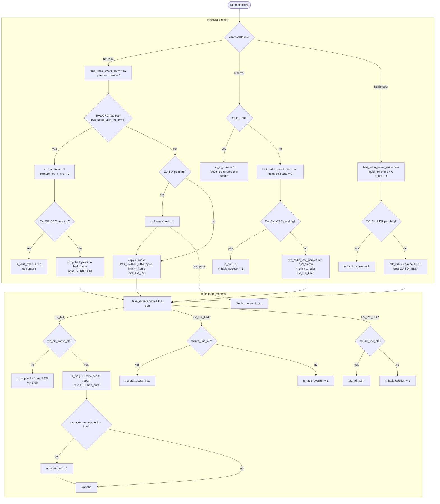
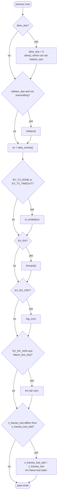
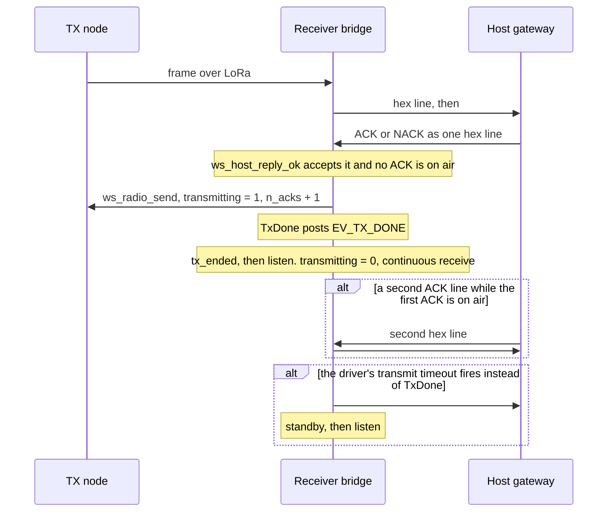
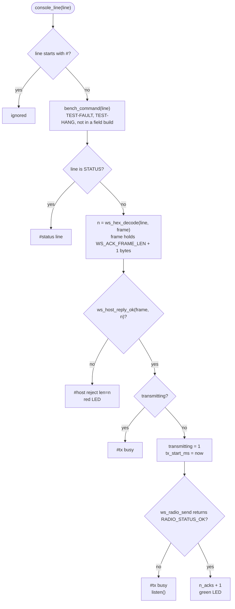
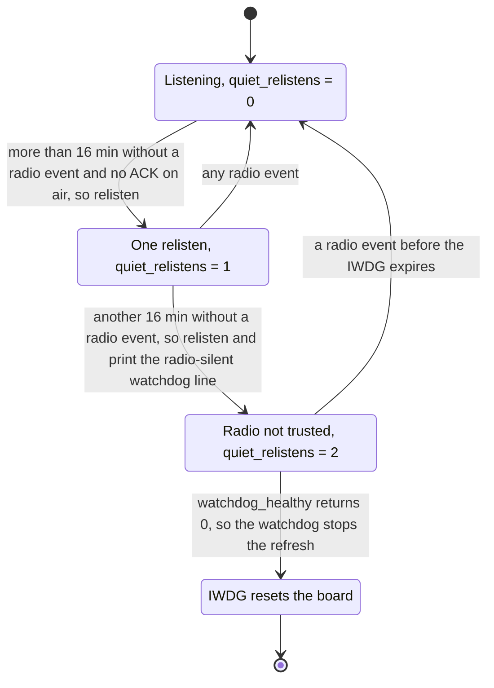
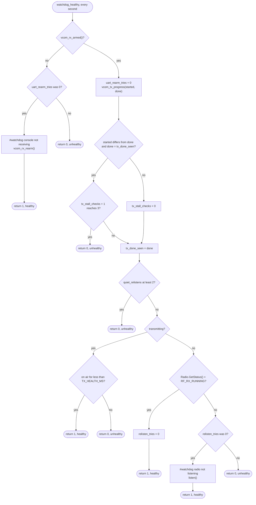

# app_rx: the receiver's radio bridge

`app_rx.c` is the firmware of the indoor receiver (RX). The receiver forwards each valid frame
that it receives as one hex line on the USB console. It transmits each valid acknowledgement (ACK)
or negative acknowledgement (NACK) line that the host sends. The receiver holds no key and decides
nothing. The host is the only ACK authority (`docs/protocol.md`).

This document is the source. `tools/tangle.py` generates `app_rx.c` from the code chunks below. The
repository also holds the generated file, so the build, the static analysers and the host tests read
ordinary C. Edit this file, then regenerate and check:

```sh
python3 tools/tangle.py firmware/stage0-node/App/app_rx.lit.md                       # write app_rx.c
python3 tools/tangle.py --check                                                      # CI: committed .c == tangle
python3 tools/tangle.py --weave /tmp/app_rx.html firmware/stage0-node/App/app_rx.lit.md   # render
```

A chunk is a fenced ` ```c {#name} ` block. A line `<<name>>` inside a chunk includes chunk
`name`. The chunks appear in reading order. The root chunk (section 9) puts them in C order.

## 1. Behaviour

| Input | Action | Checked by (`tests/test_rx_machine.py`) |
|---|---|---|
| a frame that `ws_air_frame_ok` accepts | one lowercase hex line, then `#rx obs` | `test_valid_frames_are_forwarded_once_as_lowercase_hex` |
| any other received frame | `#rx drop`, never forwarded | `test_invalid_frames_are_dropped_not_forwarded` |
| a packet whose payload checksum (CRC) failed | `#rx crc` with every byte, never forwarded | `test_a_crc_failed_packet_is_logged_whole_and_never_forwarded` |
| a header that failed | `#rx hdr` with the channel signal strength (RSSI) | `test_a_header_failure_is_logged_with_the_channel_rssi` |
| a host line that `ws_host_reply_ok` accepts | transmitted once, then the radio listens | `test_a_host_ack_or_nack_is_transmitted_once_then_the_radio_listens` |
| any other host line | `#host reject`, never transmitted | `test_invalid_host_lines_are_rejected_and_never_transmitted` |
| a host line starting with `#` | ignored | `test_comment_lines_are_ignored` |
| `STATUS` | one `#status` line | `test_status` |
| every minute | one `#alive` line, printed by the main loop | `test_alive_is_printed_by_the_main_loop_not_the_timer_interrupt` |
| more than 16 minutes without a radio event | standby, listen again | `test_relisten_after_sixteen_minutes_without_a_radio_event` |
| 2 relistens in a row with no radio event between them | the watchdog resets the board | `test_a_radio_that_hears_nothing_is_eventually_reset` |

The bridge holds no state that a reset loses. So a watchdog reset is the recovery for each fault
that the bridge cannot repair in place.

The generated file opens with the same summary:

```c {#abstract}
/* Indoor receiver (RX): a transparent bridge between the radio and the USB console.
 *
 * Upstream: each received frame that ws_air_frame_ok() accepts goes out as one lowercase hex
 * line. It accepts an observation or a health report of the current version and a valid length.
 * Downstream: each host hex line that ws_host_reply_ok() accepts is transmitted once. It accepts
 * an ACK or a NACK of the current version. The ACK uses the uplink's radio_cfg.h power, spreading
 * factor and bandwidth, so the downlink has the same margin as the uplink. This board holds no
 * key and never acknowledges a frame itself. The host is the only ACK authority (docs/protocol.md).
 * Each other output line starts with '#' and is a diagnostic for the host log. The bridge also
 * logs a failed reception. `#rx crc ... data=<hex>` keeps every received byte when only the
 * payload CRC failed. `#rx hdr rssi=` reports a failed header, which has no payload. */
```

## 2. Console lines

The gateway parses these lines. The formats are the `APP_PRINTF` format strings of this file.

| Line | Printed by | When |
|---|---|---|
| `<hex>` | `forward` (through `hex_print`) | a valid frame |
| `#rx obs rssi=%d snr=%d` | `forward` | after each valid frame |
| `#rx drop len=%u rssi=%d snr=%d` | `forward` | a frame that `ws_air_frame_ok` refused |
| `#rx crc len=%u rssi=%d snr=%d data=%s` | `log_crc` | a payload CRC failure, within the failure-line budget |
| `#rx hdr rssi=%d` | `process` | a header failure, within the failure-line budget |
| `#rx frame-lost total=%u (a valid frame replaced before it was forwarded)` | `process` | the frame-lost count changed |
| `#host reject len=%d` | `console_line` | a host line that `ws_host_reply_ok` refused |
| `#tx busy` | `console_line` | an ACK already on air, or `ws_radio_send` refused |
| `#tx timeout` | `tx_ended` | the driver's transmit timeout fired |
| `#relisten after %u s without a radio event` | `relisten` | radio silence |
| `#watchdog radio silent after %u relistens; reset` | `relisten` | the relisten limit reached |
| `#watchdog console not receiving; re-arming` | `watchdog_healthy` | the console receive is not armed |
| `#watchdog radio not listening; re-arming` | `watchdog_healthy` | the radio is not in receive |
| `#alive uptime=%u forwarded=%u dropped=%u acks=%u diag=%u listening=%d relistens=%u uart_errors=%u stack_peak=%u crc_errors=%u hdr_errors=%u fault_overruns=%u task_peak_us=%u task_peak=%s isr_peak_us=%u isr_peak=%s trace_drops=%u frames_lost=%u` | `alive` | every minute |
| `#status role=rx forwarded=%u dropped=%u acks=%u relistens=%u uart_errors=%u check_fails=%u check_first=%u:%u task_wall_us=%u task_wall=%s` | `console_line` | the host sent `STATUS` |
| `\n#boot role=rx fw=%s reset=%s freq=%u bw=%u sf=%u power=%d` | `SubghzApp_Init` | boot |

Each diagnostic line starts with `#`. A forwarded frame is the only line without `#`.

## 3. Radio callbacks (interrupt context)

ST's SubGHz_Phy driver calls callbacks from the radio interrupt. This file registers five of them
(`app_rx.c:332-336`): RxDone, RxError, RxTimeout, TxDone and TxTimeout. The driver also has CadDone
and FhssChangeChannel, which this receiver doesn't use.

The callbacks copy what they need, count, and post an event bit. They don't print anything. The
main-loop task `process` (section 4) does the rest.

| Callback | Radio event | Event bit | Counts as a radio event |
|---|---|---|---|
| `on_rx_done` | a packet received | `EV_RX`, or `EV_RX_CRC` if the payload CRC failed | yes |
| `on_rx_error` | a payload CRC failure | `EV_RX_CRC` | yes |
| `on_rx_timeout` | a header failure | `EV_RX_HDR` | yes |
| `on_tx_done` | the ACK left the radio | `EV_TX_DONE` | no |
| `on_tx_timeout` | the driver's transmit timer expired | `EV_TX_TIMEOUT` | no |

A radio event sets `last_radio_event_ms` and clears `quiet_relistens` (section 6). A transmission
isn't a radio event, because it proves nothing about the receiver
(`test_a_transmission_is_not_a_radio_event`).

### The path of a received packet

The diagram shows each step from the radio interrupt to the console line. The interrupt half
fills a slot and posts an event bit. The main-loop half takes the bits and prints.



### The received frame

One buffer holds the last frame that passed the radio's CRC check. `forward` checks it as an air
frame later (`ws_air_frame_ok`). The callback writes it, and `take_events` copies it out.

```c {#rx-buffer}
static RadioEvents_t events;
static uint8_t rx_frame[WS_FRAME_MAX];
static uint16_t rx_len;
static int16_t rx_rssi;
static int8_t rx_snr;
```

### Event bits

The events are bits in `pending_ev`, not one event slot. Several events can arrive before `process`
runs, and each one survives. `post` calls `events_post` (`App/events.c`). `events_post` sets the
bits with interrupts masked and schedules the process task. `transmitting` is 1 from the start of
an ACK transmission until `listen` runs again.

```c {#event-bits}
/* Radio events from interrupt context, as bits (App/events.h). Several can arrive before process()
 * runs, and the bits keep each one. A lost TxDone once left `transmitting` set until a reset. */
#define EV_RX         (1U << 0)
#define EV_RX_CRC     (1U << 1)
#define EV_TX_DONE    (1U << 2)
#define EV_TX_TIMEOUT (1U << 3)
#define EV_RX_HDR     (1U << 4)
static volatile uint32_t pending_ev;
static volatile uint8_t transmitting;
```

```c {#post}
static void post(uint32_t ev) { events_post(&pending_ev, ev); }
```

### Failed receptions

Each failure kind has one capture slot. `bad_frame` holds a CRC failure, and `hdr_rssi` holds a
header failure. A slot stays full until `process` takes it. A failure that arrives while its slot
is full adds 1 to `n_crc` or `n_hdr` and to `n_fault_overrun`. The callback doesn't capture it
(`test_failures_before_the_main_loop_runs_are_counted`).

```c {#crc-capture-state}
static uint8_t bad_frame[WS_FRAME_MAX];
static uint8_t bad_len;
static int8_t bad_rssi, bad_snr, hdr_rssi;
static uint32_t n_crc, n_hdr, n_fault_overrun;
static void capture_crc(const uint8_t *payload, uint16_t size, int8_t rssi, int8_t snr);
static uint8_t crc_in_done;   /* RxError for this packet follows its RxDone in this interrupt */
```

### RxDone

ST's hardware abstraction layer (HAL) calls RxDone for a packet whose payload CRC failed. Then it
calls RxError in the same interrupt. `ws_radio_take_crc_error` (`App/radio_cfg.c`) reads and clears
the HAL's CRC flag. The RxDone branch of the diagram above shows the order of operations.

A replaced frame is usually real data loss. It may also be a frame that `forward` would have
dropped, since the air-frame check comes later. `n_frames_lost` counts both. `process` reports it
at once with `#rx frame-lost`
(`test_a_frame_replaced_before_forwarding_is_counted`).

```c {#on-rx-done}
/* cppcheck-suppress constParameterCallback ; ST's RadioEvents_t RxDone signature */
static void on_rx_done(uint8_t *payload, uint16_t size, int16_t rssi, int8_t snr)
{
  last_radio_event_ms = clock_ms(); quiet_relistens = 0;
  /* ST's HAL also calls RxDone for a packet whose payload CRC failed. That packet is a failed
     reception and is never forwarded (stm32wlxx_hal_subghz.c HAL_SUBGHZ_IRQHandler). */
  if (ws_radio_take_crc_error()) { crc_in_done = 1; capture_crc(payload, size, (int8_t)rssi, snr); return; }
  if (pending_ev & EV_RX) n_frames_lost++;   /* this frame replaces one not yet forwarded */
  rx_len = size > sizeof rx_frame ? sizeof rx_frame : size;
  memcpy(rx_frame, payload, rx_len);
  rx_rssi = rssi;
  rx_snr = snr;
  post(EV_RX);
}
```

`capture_crc` fills the CRC slot from the bytes that RxDone passed.

```c {#capture-crc}
/* Failed receptions, from the radio interrupt. A payload CRC failure arrives as RxDone with the
   bytes and the HAL's flag, then as RxError. on_rx_done captures it. Continuous receive never arms
   the hardware receive timer, so RxTimeout is not a timeout. ST's radio.c reports a header error
   as RxTimeout. One capture stays
   until process() prints it. Later failures are counted in n_fault_overrun, not captured. The
   radio stays in continuous receive through both (radio.c), so no callback re-arms it. */
static void capture_crc(const uint8_t *payload, uint16_t size, int8_t rssi, int8_t snr)
{
  n_crc++;
  if (pending_ev & EV_RX_CRC) { n_fault_overrun++; return; }
  bad_len = (uint8_t)(size > sizeof bad_frame ? sizeof bad_frame : size);
  memcpy(bad_frame, payload, bad_len);
  bad_rssi = rssi; bad_snr = snr;
  post(EV_RX_CRC);
}
```

### RxError

RxError follows the RxDone of a CRC failure in the same interrupt. `crc_in_done` removes the
duplicate. The RxError after a captured RxDone clears the flag and does nothing else. An RxError
without that RxDone reads the packet from the radio buffer with `ws_radio_last_packet`
(`test_a_crc_failure_without_rx_done_reads_the_radio_buffer`).

| Case | `n_crc` | Captured | `n_fault_overrun` |
|---|---|---|---|
| RxDone with CRC flag, then RxError, slot free | +1 | bytes from RxDone | — |
| RxDone with CRC flag, then RxError, slot full | +1 | no | +1 |
| RxError alone, slot free | +1 | bytes from the radio buffer | — |
| RxError alone, slot full | +1 | no | +1 |

```c {#on-rx-error}
static void on_rx_error(void)
{
  if (crc_in_done) { crc_in_done = 0; return; }   /* on_rx_done captured this packet */
  /* An RxError without an RxDone before it: read the packet that the radio kept. */
  uint8_t len; int8_t rssi, snr;
  last_radio_event_ms = clock_ms(); quiet_relistens = 0;
  if (pending_ev & EV_RX_CRC) { n_crc++; n_fault_overrun++; return; }
  ws_radio_last_packet(bad_frame, &len, &rssi, &snr);
  n_crc++; bad_len = len; bad_rssi = rssi; bad_snr = snr;
  post(EV_RX_CRC);
}
```

### RxTimeout and the transmit callbacks

In continuous receive, ST's `radio.c` reports a header error as RxTimeout. The callback reads the
channel RSSI right after the failed header. The radio stays in continuous receive through each
failure, so no callback re-arms it.

```c {#on-rx-timeout}
static void on_rx_timeout(void)
{
  last_radio_event_ms = clock_ms(); quiet_relistens = 0;   /* a header error shows that the radio listens */
  n_hdr++;
  if (pending_ev & EV_RX_HDR) { n_fault_overrun++; return; }
  hdr_rssi = ws_radio_rssi_now();   /* the channel right after the failed header */
  post(EV_RX_HDR);
}
```

```c {#on-tx}
static void on_tx_done(void) { post(EV_TX_DONE); }
static void on_tx_timeout(void) { post(EV_TX_TIMEOUT); }
```

## 4. The main-loop task

### Taking the events

`take_events` reads and clears `pending_ev`. It copies the frame and the CRC capture into `got`. It
does all of this with interrupts masked. `forward` prints the copy in `got`, not `rx_frame`. The
mask makes sure a second RxDone can't overwrite `rx_frame` halfway through the copy. With the
mask, the second frame waits for the next pass.

`got` is static because it holds two 255-byte frames.

```c {#take-events}
/* What process() took from the interrupts. Static, because it holds two 255-byte frames. */
static struct {
  uint8_t frame[sizeof rx_frame], bad[sizeof bad_frame];
  uint16_t len; int16_t rssi; int8_t snr;
  uint8_t blen; int8_t brssi, bsnr, hrssi;
} got;

/* Take the pending events and the received frames in one step, with interrupts masked. A second
   RxDone then cannot tear the frame during forwarding. The next pass handles the second frame. */
static uint32_t take_events(void)
{
  uint32_t primask = irq_lock();
  uint32_t ev = pending_ev;
  pending_ev = 0;
  if (ev & EV_RX) { got.len = rx_len; memcpy(got.frame, rx_frame, got.len); got.rssi = rx_rssi; got.snr = rx_snr; }
  if (ev & EV_RX_CRC) { got.blen = bad_len; memcpy(got.bad, bad_frame, got.blen); got.brssi = bad_rssi; got.bsnr = bad_snr; }
  got.hrssi = hdr_rssi;
  irq_unlock(primask);
  return ev;
}
```

### Order of one pass



One pass handles each kind of event (`test_one_main_loop_pass_handles_every_kind_of_event`).
`busymon` times each step separately. So the task's peak in `#alive` names the step that caused
it: `process.alive`, `process.relisten`, `process.listen`, `process.forward` or `process.crc`.

```c {#process}
/* busymon times each step on its own, so the task's peak names the step that caused it. */
static void process(void)
{
  bm_span s;
  if (alive_due) { alive_due = 0; s = busymon_begin(); alive(); busymon_step_end(s, "process.alive"); }   /* can set relisten_due */
  if (relisten_due && !transmitting) { s = busymon_begin(); relisten(); busymon_step_end(s, "process.relisten"); }
  uint32_t ev = take_events();
  if (ev & (EV_TX_DONE | EV_TX_TIMEOUT)) { s = busymon_begin(); tx_ended(ev); busymon_step_end(s, "process.listen"); }
  if (ev & EV_RX) { s = busymon_begin(); forward(); busymon_step_end(s, "process.forward"); }
  if (ev & EV_RX_CRC) { s = busymon_begin(); log_crc(); busymon_step_end(s, "process.crc"); }
  if ((ev & EV_RX_HDR) && failure_line_ok()) APP_PRINTF("#rx hdr rssi=%d\n", got.hrssi);
  if (n_frames_lost != n_frames_lost_told)   /* real data loss: report it now, not only in #alive */
  {
    n_frames_lost_told = n_frames_lost;
    APP_PRINTF("#rx frame-lost total=%u (a valid frame replaced before it was forwarded)\n", (unsigned)n_frames_lost);
  }
}
BUSYMON_TASK(process)
```

### Counters

```c {#counters}
static uint32_t n_forwarded, n_dropped, n_acks;
static uint32_t n_frames_lost, n_frames_lost_told;   /* valid frames replaced before forwarding */
static uint32_t tx_start_ms;
static UTIL_TIMER_Object_t alive_timer;
static uint32_t n_diag;
static uint32_t boot_ms;   /* clock_ms() at boot (App/clock.h) */
static int relisten_tries;
```

### Forwarding

`ws_air_frame_ok` (`firmware/common/ws_console.c`) accepts a frame of the current protocol version
and one of two kinds:

| Kind | Accepted length |
|---|---|
| observation | `WS_FRAME_OVERHEAD + WS_OBS_HEAD_LEN + 1` to `WS_FRAME_OVERHEAD + WS_OBS_PLAIN_ALL` |
| health report (kind `WS_KIND_DIAG`) | exactly `WS_DIAG_FRAME_LEN` |

| Result | Counter | LED | Lines |
|---|---|---|---|
| refused | `n_dropped` | red | `#rx drop` |
| accepted | `n_forwarded` if `hex_print` queued the line, `n_diag` for a health report | blue | hex, then `#rx obs` |

`hex_print` returns 0 when the console queue was full and dropped the line. The bridge doesn't
count that frame as forwarded (`test_forwarded_counts_only_frames_that_reached_the_host`).

```c {#forward}
static void forward(void)
{
  if (!ws_air_frame_ok(got.frame, got.len))
  {
    n_dropped++;
    led_flash(LED_RED, LED_FLASH_MS);
    APP_PRINTF("#rx drop len=%u rssi=%d snr=%d\n", got.len, got.rssi, got.snr);
    return;
  }
  n_diag += ws_frame_kind(got.frame, got.len) == WS_KIND_DIAG;
  led_flash(LED_BLUE, LED_FLASH_MS);
  if (hex_print(got.frame, got.len)) n_forwarded++;   /* a line that the full queue dropped is not forwarded */
  APP_PRINTF("#rx obs rssi=%d snr=%d\n", got.rssi, got.snr);
}
```

### The failure-line budget

A noisy band can produce failures faster than the console carries them. So at most
`FAILURE_LINES_PER_MIN` (20) `#rx crc` and `#rx hdr` lines go out per minute. `alive` resets the
count every minute. Over the budget, `failure_line_ok` adds 1 to `n_fault_overrun` and the bridge
prints nothing. The callbacks have already counted the failure in `n_crc` or `n_hdr`.

```c {#failure-budget}
/* At most this many failure lines (#rx crc, #rx hdr) per minute. A noisy band must not push frames
   out of the console. Over the budget, the bridge counts a failure (fault_overruns) and logs nothing. */
#define FAILURE_LINES_PER_MIN 20U
static uint32_t failure_lines;
```

```c {#failure-line-ok}
/* 1 within this minute's budget of failure lines. Over the budget, count the failure only. */
static int failure_line_ok(void)
{
  if (failure_lines++ < FAILURE_LINES_PER_MIN) return 1;
  n_fault_overrun++;
  return 0;
}
```

`log_crc` prints the whole capture as hex. Its static buffer holds the hex of 255 bytes. So a
255-byte capture is one complete line (`test_a_255_byte_capture_is_one_complete_line`).

```c {#log-crc}
static void log_crc(void)
{
  static char text[WS_HEX_PER_BYTE * sizeof bad_frame + 1];
  if (!failure_line_ok()) return;
  ws_hex_text(got.bad, got.blen, text);
  APP_PRINTF("#rx crc len=%u rssi=%d snr=%d data=%s\n", got.blen, got.brssi, got.bsnr, text);
}
```

## 5. The host ACK downlink

The transmitting node (TX node) sends a frame. The host decides the reply. The bridge only carries
the frame up and the reply down.



### Host lines

The console task calls `console_line` from the main loop for each complete input line.



`ws_hex_decode` returns -1 for a line that is not hex or does not fit the buffer.
`ws_host_reply_ok` accepts exactly `WS_ACK_FRAME_LEN` bytes of kind ACK or NACK. `#host reject`
prints the decoded length, or -1.

Only one ACK is on air at a time. The first ACK's TxDone re-arms the receiver, and that would cut
a second transmission short. So the bridge refuses the second line with `#tx busy`. The node
retries each frame that got no ACK (`test_a_second_ack_line_does_not_cut_the_first_short`).

```c {#console-line}
/* cppcheck-suppress constParameterPointer ; console.h's signature: TX wipes a PROVISION line in place */
void console_line(char *line)
{
  uint8_t frame[WS_ACK_FRAME_LEN + 1];
  static const char *const commands[] = { "STATUS" };
  if (line[0] == '#') return;
  bench_command(line);   /* TEST-FAULT, TEST-HANG (not in a field build) */
  if (ws_cmd_find(commands, 1, line) == 0)
  {
    uint16_t site = ws_check_first();
    APP_PRINTF("#status role=rx forwarded=%u dropped=%u acks=%u relistens=%u uart_errors=%u check_fails=%u check_first=%u:%u "
               "task_wall_us=%u task_wall=%s\n",
               (unsigned)n_forwarded, (unsigned)n_dropped, (unsigned)n_acks, (unsigned)n_relistens, (unsigned)vcom_rx_errors(),
               (unsigned)ws_check_count(), ws_check_site_file(site), ws_check_site_line(site),
               (unsigned)busymon_peak_us(BM_TASK_WALL), busymon_peak_name(BM_TASK_WALL));
    return;
  }
  int n = ws_hex_decode(line, frame, sizeof frame);
  if (!ws_host_reply_ok(frame, n))
  {
    APP_PRINTF("#host reject len=%d\n", n);
    led_flash(LED_RED, LED_FLASH_MS);
    return;
  }
  /* One ACK on air at a time. The first ACK's TxDone re-arms the receiver and would cut a second
     ACK short. The node retries a frame that got no ACK. */
  if (transmitting) { APP_PRINTF("#tx busy\n"); return; }
  transmitting = 1;
  tx_start_ms = clock_ms();
  if (ws_radio_send(frame, WS_ACK_FRAME_LEN) != RADIO_STATUS_OK)
  {
    APP_PRINTF("#tx busy\n");
    listen();
    return;
  }
  n_acks++;
  led_flash(LED_GREEN, LED_FLASH_MS);
}
```

### Listening

`listen` clears `transmitting` and puts the radio in continuous receive. ST's `RadioSend` leaves the
LoRa payload length at the ACK's size. So `ws_radio_rx_full_length` first sets it back to
`WS_FRAME_MAX` (`test_listening_after_an_ack_restores_the_payload_length`).

```c {#listen}
static void listen(void)
{
  transmitting = 0;
  ws_radio_rx_full_length();   /* Radio.Send left the LoRa payload length at the ACK's length */
  ws_radio_rx(0); /* continuous */
}
```

### End of a transmission

The driver's transmit timeout is a software timer, so the chip can still transmit when the timer
fires. So `tx_ended` puts the radio in standby before it listens again
(`test_a_transmit_timeout_stops_the_transmitter_first`).

| Event | Lines | LED | Radio |
|---|---|---|---|
| `EV_TX_DONE` | — | — | `listen` |
| `EV_TX_TIMEOUT` | `#tx timeout` | red | standby, then `listen` |

```c {#tx-ended}
/* The transmission of the host's ACK ended. The driver's transmit timeout is a software timer,
   so the chip can still be transmitting. */
static void tx_ended(uint32_t ev)
{
  if (ev & EV_TX_TIMEOUT) { APP_PRINTF("#tx timeout\n"); led_flash(LED_RED, LED_FLASH_MS); ws_radio_standby(); }
  listen();
}
```

## 6. Radio silence

`Radio.GetStatus()` reports the driver's state, not the chip's state. Only a radio event (section 3)
shows that the radio listens. By design a node is silent for at most 15 minutes. That limit applies
when the node has lost the link and saves energy (PROBING in CONSERVE, `docs/radio-energy-policy.md`).

| Constant | Value | Use |
|---|---|---|
| `SILENCE_RELISTEN_MS` | 16 min | silence that triggers a relisten |
| `QUIET_RELISTEN_LIMIT` | 2 | relistens in a row without a radio event before the health check fails |
| `TX_STALL_CHECKS` | 3 | health checks with console output stalled before the health check fails |
| `ALIVE_PERIOD_MS` | 1 min | period of `#alive` and of the silence test |
| `TX_HEALTH_MS` | `WS_TX_TIMEOUT_MS` (3000 ms) + 2 s = 5 s | longest healthy ACK transmission |

```c {#silence-constants}
/* Radio.GetStatus() reports the driver's own state, not the chip's state. Only a radio event (a
 * frame, a failed reception, a header error) shows that the radio listens. By design a node is
 * silent for at most 15 minutes (PROBING in CONSERVE, docs/radio-energy-policy.md). So 16 silent
 * minutes means a fault: the bridge puts the radio in standby and listens again. If no radio event
 * follows, the bridge does not trust the radio. After QUIET_RELISTEN_LIMIT relistens in a row with
 * no radio event, the health check fails and the watchdog resets the board. The bridge holds no
 * state, so a reset loses nothing. */
#define SILENCE_RELISTEN_MS  (16UL * CLOCK_MS_PER_MIN)
#define QUIET_RELISTEN_LIMIT 2U
#define TX_STALL_CHECKS      3U   /* watchdog health checks with console output stalled */
#define ALIVE_PERIOD_MS      CLOCK_MS_PER_MIN
#define TX_HEALTH_MS         (WS_TX_TIMEOUT_MS + 2UL * CLOCK_MS_PER_S)   /* an ACK on air for longer is stuck */
```

```c {#health-state}
static volatile uint32_t last_radio_event_ms;
static volatile uint32_t quiet_relistens;   /* relistens since the last radio event (each radio event clears it) */
static uint32_t n_relistens;
static volatile uint8_t relisten_due, alive_due;
static void alive(void);
static int uart_rearm_tries;
static uint32_t tx_stall_checks;
static uint32_t tx_done_seen;
```

### Relisten

`alive` runs the silence test once a minute. The test passes when no transmission is on air and
more than `SILENCE_RELISTEN_MS` passed since the last radio event (`ws_silent_for`,
`firmware/stage0.h`). Then `alive` sets `relisten_due`. The test runs at the minute report, so the
first relisten comes at 17 minutes (1020 s). `relisten` then does these steps:

1. It adds 1 to `n_relistens` and to `quiet_relistens`.
2. It prints `#relisten after <s> s without a radio event`.
3. It puts the radio in standby and calls `listen`.
4. It sets `last_radio_event_ms` to now. The next silence starts here, and `quiet_relistens` keeps
   its value.
5. When `quiet_relistens` is at least `QUIET_RELISTEN_LIMIT`, it prints
   `#watchdog radio silent after <n> relistens; reset`.

A radio event clears `quiet_relistens`. Two relistens with no radio event between them make the
health check fail (section 7). Then the watchdog resets the board
(`test_a_radio_that_hears_nothing_is_eventually_reset`). A node that sends every 15 minutes never
causes a relisten (`test_no_relisten_while_a_probing_node_sends_every_15_minutes`).

The diagram shows the value of `quiet_relistens` and the path to the reset. The independent
watchdog (IWDG) is the hardware timer that resets the board after 8 s without a refresh.



```c {#relisten}
/* Radio silence: put the radio in standby, listen again, and count the relisten. The health check
   fails after QUIET_RELISTEN_LIMIT relistens in a row with no radio event between them. */
static void relisten(void)
{
  relisten_due = 0;
  n_relistens++;
  quiet_relistens++;
  APP_PRINTF("#relisten after %u s without a radio event\n", (unsigned)((clock_ms() - last_radio_event_ms) / CLOCK_MS_PER_S));
  ws_radio_standby();
  listen();
  last_radio_event_ms = clock_ms();   /* the next silence starts here, and the quiet count stays */
  if (quiet_relistens >= QUIET_RELISTEN_LIMIT) APP_PRINTF("#watchdog radio silent after %u relistens; reset\n", (unsigned)quiet_relistens);
}
```

### The minute report

The timer callback `on_alive` runs in interrupt context. It only sets `alive_due` and schedules the
process task. `alive` runs in the main loop. It prints `#alive`, resets the failure-line budget and
runs the silence test. The gateway marks the receiver silent after 180 s without `#alive`.
`listening` is 1 when the driver reports receive or a transmission is on air.

```c {#alive}
/* Liveness report for the gateway, which marks the receiver silent after 180 s. The main loop
   prints it. The timer interrupt only asks for it. */
static void alive(void)
{
  APP_PRINTF("#alive uptime=%u forwarded=%u dropped=%u acks=%u diag=%u listening=%d relistens=%u uart_errors=%u stack_peak=%u "
             "crc_errors=%u hdr_errors=%u fault_overruns=%u task_peak_us=%u task_peak=%s isr_peak_us=%u isr_peak=%s trace_drops=%u "
             "frames_lost=%u\n",
             (unsigned)((clock_ms() - boot_ms) / CLOCK_MS_PER_S), (unsigned)n_forwarded, (unsigned)n_dropped, (unsigned)n_acks,
             (unsigned)n_diag, Radio.GetStatus() == RF_RX_RUNNING || transmitting, (unsigned)n_relistens,
             (unsigned)vcom_rx_errors(), (unsigned)stackmon_peak_step(), (unsigned)n_crc, (unsigned)n_hdr, (unsigned)n_fault_overrun,
             (unsigned)busymon_peak_us(BM_TASK), busymon_peak_name(BM_TASK), (unsigned)busymon_peak_us(BM_ISR),
             busymon_peak_name(BM_ISR), (unsigned)ws_trace_drops, (unsigned)n_frames_lost);
  failure_lines = 0;
  if (!transmitting && ws_silent_for(clock_ms(), last_radio_event_ms, SILENCE_RELISTEN_MS)) relisten_due = 1;
}
static void on_alive(void *ctx)
{
  (void)ctx;
  alive_due = 1;
  UTIL_SEQ_SetTask(1U << CFG_SEQ_Task_SubGHz_Phy_App_Process, CFG_SEQ_Prio_0);
}
```

## 7. Watchdog health

The watchdog module (`App/watchdog.c`) calls `watchdog_healthy` every second. It refreshes the 8 s
IWDG only when `watchdog_healthy` returns 1. The checks run in this order. The first check that
decides returns.

| # | Condition | Result |
|---|---|---|
| 1 | console receive not armed, first check | `#watchdog console not receiving; re-arming`, `vcom_rx_rearm`, healthy |
| 1 | console receive not armed, next check | unhealthy |
| 2 | console output started but `done` unchanged for `TX_STALL_CHECKS` (3) checks | unhealthy |
| 3 | `quiet_relistens >= QUIET_RELISTEN_LIMIT` (2) | unhealthy |
| 4 | transmitting | healthy while the ACK is on air for less than `TX_HEALTH_MS` (5 s) |
| 5 | `Radio.GetStatus() == RF_RX_RUNNING` | healthy, and the radio retry count is cleared |
| 6 | radio not in receive, first check | `#watchdog radio not listening; re-arming`, `listen`, healthy |
| 6 | radio not in receive, next check | unhealthy |



The console comes first because it carries the ACK downlink. A stalled console output stops frames
and `#alive` alike. A stall is a trace transfer by direct memory access (DMA) that started and
never finished. Each self-repair gets one try. A check that passes clears its retry count, so a
later fault gets a new try.

| Test | Rule |
|---|---|
| `test_console_not_armed_is_rearmed_once_then_unhealthy` | 1 |
| `test_console_output_stalled_for_three_checks_is_unhealthy` | 2 |
| `test_a_radio_that_hears_nothing_is_eventually_reset` | 3 |
| `test_transmitting_more_than_5_s_is_unhealthy` | 4 |
| `test_radio_not_listening_is_relistened_once_then_unhealthy` | 6 |

```c {#watchdog-healthy}
/* Watchdog health: the radio must listen, or finish a transmission within 5 s. Each fault gets
 * one repair attempt (re-arm) before the watchdog may reset the board. */
int watchdog_healthy(void)
{
  /* The console must receive, because it carries the ACK downlink. Re-arm it once first. */
  if (!vcom_rx_armed())
  {
    if (uart_rearm_tries++ == 0) { APP_PRINTF("#watchdog console not receiving; re-arming\n"); vcom_rx_rearm(); return 1; }
    return 0;
  }
  uart_rearm_tries = 0;
  /* Stalled console output stops frames and #alive alike (a trace DMA transfer that never ended).
     No progress for TX_STALL_CHECKS checks, 1 s apart, makes the board unhealthy. */
  uint32_t started, done;
  vcom_tx_progress(&started, &done);
  if (started != done && done == tx_done_seen) { if (++tx_stall_checks >= TX_STALL_CHECKS) return 0; }
  else tx_stall_checks = 0;
  tx_done_seen = done;
  if (quiet_relistens >= QUIET_RELISTEN_LIMIT) return 0;
  if (transmitting) return clock_ms() - tx_start_ms < TX_HEALTH_MS;
  if (Radio.GetStatus() == RF_RX_RUNNING) { relisten_tries = 0; return 1; }
  if (relisten_tries++ == 0) { APP_PRINTF("#watchdog radio not listening; re-arming\n"); listen(); return 1; }
  return 0;
}
```

## 8. Boot

`SubghzApp_Init` does these steps in order:

1. `stackmon_paint`, `busymon_init`.
2. It registers the five radio callbacks.
3. It sets `boot_ms` and `last_radio_event_ms` to now.
4. `leds_init`, `Radio.Init`, `ws_radio_configure(1)` for continuous receive.
5. It registers the process task.
6. `console_init`.
7. `watchdog_start`, then `fault_boot_note` counts the boot in backup register DR12 (zeroed first
   when the reset cause is power-on, see `fault.h`).
8. It prints `#boot` and calls `fault_report`.
9. It starts the 1-minute alive timer.
10. `listen`, `stackmon_seed`.

`watchdog_start` comes after `console_init`. `vcom_ReceiveInit` waits until the serial port (UART)
is idle. A host that streams without gaps could make that wait longer than the watchdog period.
The `#boot` line starts with a newline. The newline ends any line that a reset cut off
(`test_boot_line_starts_on_a_fresh_line`).

```c {#init}
void SubghzApp_Init(void)
{
  stackmon_paint();
  busymon_init();
  events.RxDone = on_rx_done;
  events.RxError = on_rx_error;
  events.RxTimeout = on_rx_timeout;
  events.TxDone = on_tx_done;
  events.TxTimeout = on_tx_timeout;
  boot_ms = clock_ms();
  last_radio_event_ms = boot_ms;
  leds_init();
  Radio.Init(&events);
  ws_radio_configure(1);
  UTIL_SEQ_RegTask(1U << CFG_SEQ_Task_SubGHz_Phy_App_Process, UTIL_SEQ_RFU, process_timed);
  console_init();
  /* After console_init: vcom_ReceiveInit waits until the UART is idle. A host that streams
     without gaps could make that wait longer than the watchdog period. */
  watchdog_start();
  /* The boot counter (DR12), once a boot and before fault_report; a power-on restarts it. */
  fault_boot_note(watchdog_reset_code() == WS_RESET_POWER);
  /* A leading newline ends any line that a reset cut off, so #boot starts on a new line. */
  APP_PRINTF("\n#boot role=rx fw=%s reset=%s freq=%u bw=%u sf=%u power=%d\n", WS_FW_VERSION, watchdog_reset_cause(),
             (unsigned)WS_RF_FREQUENCY_HZ, (unsigned)WS_LORA_BANDWIDTH, (unsigned)WS_LORA_SF, WS_TX_POWER_DBM);
  fault_report();
  (void)UTIL_TIMER_Create(&alive_timer, ALIVE_PERIOD_MS, UTIL_TIMER_PERIODIC, on_alive, NULL);
  (void)WS_CHECK(UTIL_TIMER_Start(&alive_timer) == UTIL_TIMER_OK);   /* created just above, so not running */
  listen();
  stackmon_seed();
}
```

## 9. The file

The generated file orders the chunks for C. State and constants come first. Then come the
callbacks, the radio helpers, the process task and its steps, the console handler and boot.

```c {#app_rx.c}
<<abstract>>
#define WS_CHECK_FILE 7
#include <string.h>
#include "bench.h"
#include "busymon.h"
#include "clock.h"
#include "console.h"
#include "events.h"
#include "leds.h"
#include "stm32wlxx_hal.h"
#include "watchdog.h"
#include "radio.h"
#include "radio_cfg.h"
#include "stage0.h"
#include "usart_if.h"
#include "stackmon.h"
#include "fault.h"
#include "stm32_seq.h"
#include "stm32_systime.h"
#include "stm32_timer.h"
#include "subghz_phy_app.h"
#include "sys_app.h"
#include "utilities_def.h"
#include "ws_check.h"
#include "ws_frame.h"

<<rx-buffer>>
<<event-bits>>
<<counters>>
<<silence-constants>>
<<health-state>>
<<failure-budget>>
<<post>>
<<crc-capture-state>>
<<on-rx-done>>
<<capture-crc>>
<<on-rx-error>>
<<on-rx-timeout>>
<<on-tx>>

<<listen>>

<<watchdog-healthy>>

<<relisten>>

<<take-events>>

<<tx-ended>>

<<forward>>

<<failure-line-ok>>

<<log-crc>>

<<process>>

<<alive>>

<<console-line>>

<<init>>
```

## 10. Tests

`tests/test_rx_machine.py` compiles `app_rx.c`, `App/console.c` and the shared modules unchanged
against `firmware/host/rx_harness.c`. `rx_harness.c` models ST's SubGHz_Phy in continuous
receive. In that model, a CRC failure shows up as RxDone with the HAL's CRC flag, then RxError. A
header failure shows up as RxTimeout. `rx_harness.c` also models the console UART, the 2 KB trace
FIFO at 115200 baud, and the watchdog's 1 s check and 8 s IWDG. The tests check the bridge through its console output and its
radio calls.

| Group | Tests |
|---|---|
| upstream | `test_boot_listens_in_continuous_receive`, `test_valid_frames_are_forwarded_once_as_lowercase_hex`, `test_invalid_frames_are_dropped_not_forwarded`, `test_a_frame_with_a_kind_above_7_is_not_an_observation`, `test_forwarded_counts_only_frames_that_reached_the_host` |
| failed receptions | `test_a_crc_failed_packet_is_logged_whole_and_never_forwarded`, `test_a_crc_failure_without_rx_done_reads_the_radio_buffer`, `test_a_header_failure_is_logged_with_the_channel_rssi`, `test_a_255_byte_capture_is_one_complete_line`, `test_failures_before_the_main_loop_runs_are_counted` |
| event handling | `test_a_frame_replaced_before_forwarding_is_counted`, `test_one_main_loop_pass_handles_every_kind_of_event`, `test_a_lost_frame_is_told_apart_from_a_skipped_capture` |
| downstream | `test_a_host_ack_or_nack_is_transmitted_once_then_the_radio_listens`, `test_a_frame_arriving_right_after_the_ack_is_received`, `test_a_transmit_timeout_returns_to_listening`, `test_a_refused_send_listens_again`, `test_invalid_host_lines_are_rejected_and_never_transmitted`, `test_a_second_ack_line_does_not_cut_the_first_short`, `test_a_transmit_timeout_stops_the_transmitter_first`, `test_listening_after_an_ack_restores_the_payload_length` |
| host lines | `test_comment_lines_are_ignored`, `test_an_over_long_line_is_discarded_whole`, `test_crlf_line_endings_are_accepted`, `test_a_second_line_while_one_is_pending_is_dropped`, `test_uart_characters_are_lost_while_the_receive_is_not_armed`, `test_the_tail_of_a_dropped_line_is_not_a_line`, `test_a_nul_inside_a_host_line_is_rejected` |
| reports | `test_status`, `test_a_failed_check_is_counted_reported_and_recovered`, `test_test_fault_goes_to_the_fault_handler`, `test_alive_is_printed_by_the_main_loop_not_the_timer_interrupt`, `test_alive_every_minute_with_uptime_in_seconds`, `test_alive_across_the_millisecond_wrap`, `test_boot_line_starts_on_a_fresh_line` |
| silence | `test_relisten_after_sixteen_minutes_without_a_radio_event`, `test_every_kind_of_reception_counts_as_radio_life`, `test_a_transmission_is_not_a_radio_event`, `test_no_relisten_while_transmitting`, `test_no_relisten_while_a_probing_node_sends_every_15_minutes`, `test_a_radio_that_hears_nothing_is_eventually_reset` |
| watchdog | `test_transmitting_more_than_5_s_is_unhealthy`, `test_console_output_stalled_for_three_checks_is_unhealthy`, `test_console_not_armed_is_rearmed_once_then_unhealthy`, `test_radio_not_listening_is_relistened_once_then_unhealthy` |
| everything | `test_six_hours_of_mixed_traffic_keep_every_invariant`: a randomized run against a reference model (`Mixed`), including the 20-line failure budget. Each output line must match the model |

`WS_RX_APP=<path>` builds a modified copy of `app_rx.c` instead, for mutation testing.

```sh
.venv/bin/python -m unittest tests.test_rx_machine tests.test_tangle
```
