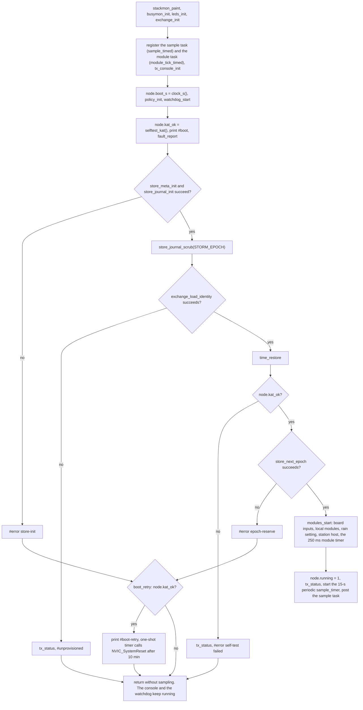
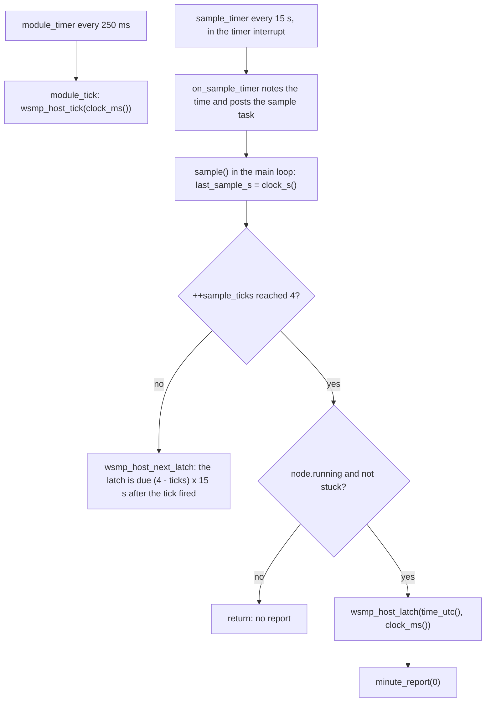
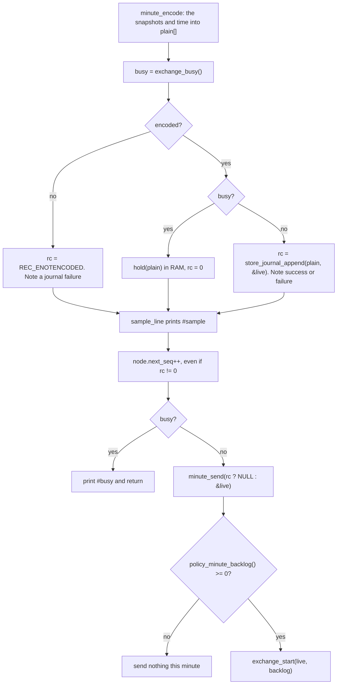
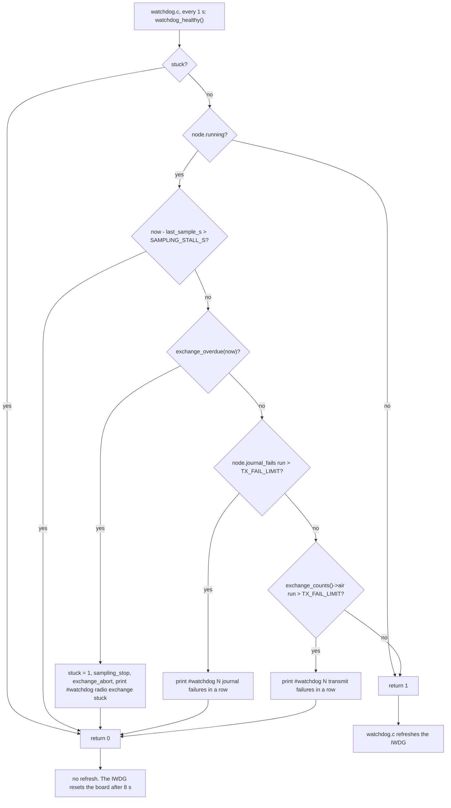

# app_tx: TX node boot, sampling and the minute report

`app_tx.c` boots the transmitting node (the TX node) and runs its sampling. The station's sensors
are WSMP local modules (`docs/module-protocol.md`, DATAVANE5K). Each module samples on its own
schedule, and a 250 ms tick drives them (`wsmp_host.c`). Every 15 s the sample task counts a tick.
The 4th tick latches every module and makes the minute's observation from their snapshots
(`wsmp_catalog_map.c`). The file journals the observation in flash and passes it to the radio
exchange (`tx_exchange.c`). It also tells the watchdog task whether to refresh the watchdog.

This document is the source. `tools/tangle.py` generates `app_tx.c` from the code chunks below. The
repository also holds the generated file, so the build, the static analysers and the host tests read
ordinary C. Edit this file, then regenerate and check:

```sh
python3 tools/tangle.py firmware/stage0-node/App/app_tx.lit.md                           # write app_tx.c
python3 tools/tangle.py --check firmware/stage0-node/App/app_tx.lit.md                   # committed .c == tangle
python3 tools/tangle.py --weave /tmp/app_tx.html firmware/stage0-node/App/app_tx.lit.md  # render
```

A chunk is a fenced ` ```c {#name} ` block. A line `<<name>>` inside a chunk includes chunk `name`.
Chunks appear in reading order. The root chunk (section 7) puts them in C order.

## 1. Behaviour

| Behaviour | Checked by (`tests/test_tx_machine.py`) |
|---|---|
| The 15-s ticks come at 0, 15, 30 and 45 s after boot. The 4th latches every module and makes the report at once | `test_minute_exchange_then_health_report_after_a_gap` |
| The node never writes flash while the radio transmits or receives | every test: `node()` asserts `h_flash_ops_during_radio() == 0` |
| The node holds a reading made during an exchange in RAM. It journals the reading when the radio goes idle | `test_a_reading_made_during_an_exchange_is_journaled_when_the_radio_goes_idle` |
| The node holds at most `HELD_MAX` (2) readings. A third drops the oldest and counts it in `held_lost` | `test_held_readings_keep_the_newest_when_more_minutes_wait` |
| An exchange that outlasts its bound stops the radio and journals the held readings. From then on the watchdog check fails | `test_a_radio_that_never_finishes_trips_the_exchange_bound` |
| More than `TX_FAIL_LIMIT` (10) transmit failures in a row fail the watchdog check. One success clears the run | `test_transmit_failures_in_a_row_trip_the_watchdog_and_a_tx_done_clears_them` |
| A command that stops sampling (reboot, `TEST-FLASH-STORM`) keeps the watchdog check healthy | `test_commanded_reboot_comes_from_a_timer_and_stops_sampling`, `test_flash_storm_stops_sampling_and_exchanges` |
| A module without valid data sends its fields INVALID. A failing or hung sensor never stalls or skips the minute | `test_a_failing_or_hung_sensor_never_stalls_the_minute` |
| The node uses a sequence number once, even when its journal write fails | none (code only: `minute_report`) |
| A boot that fails in storage or in the epoch reservation resets after 10 min. An unprovisioned board or a failed self-test does not reset | none (code only: `boot_ready`, `boot_retry`) |

The generated file opens with a summary:

```c {#abstract}
/* TX node of the bench station: one observation per minute from its WSMP local modules
 * (docs/module-protocol.md, App/wsmp_host.h). The node journals each
 * observation in flash before it transmits it. The journal keeps the record until the gateway
 * sends an authenticated ACK or NACK, or until the strike rule abandons it (ws_policy.h). Each
 * minute sends the live observation first. Then it sends older pending records as the energy and
 * link policy allows (docs/radio-energy-policy.md). Each frame gets a new counter, reserved
 * durably, and one ACK receive window. This file holds boot and the sampling glue. App/tx_node.h
 * lists the other TX modules. */
```

## 2. Boot

### Order of operations

`SubghzApp_Init` runs once at startup. It first does every step that does not depend on stored
state. Then it calls `boot_ready`. Then it starts sampling. Each `boot_ready` check that fails turns
the red LED on, prints one line and stops the boot:



The watchdog starts before the firmware reads storage. Until sampling starts, `node.running` is 0,
so `watchdog_healthy` returns 1 (section 6). A node that fails `boot_ready` therefore stays up with
the console available. The watchdog does not reset it.

### State

`node` holds this boot's identity and run state (`tx_node_t`, `tx_node.h`). Only this file writes
it. The other TX modules read it through `node_state()`. `node_selftest` serves the `KAT` console
command. KAT stands for known-answer test. The self-test checks the observation encoder, the
seal, the opener for the gateway's acknowledgement (ACK) and negative acknowledgement (NACK), and
the counter limit against fixed expected answers (`selftest.h`). `node_selftest` runs the self-test again and stores the result in
`node.kat_ok`. It does not start sampling on a node whose boot stopped at a failed self-test.

```c {#node-state}
/* This boot's identity and run state. Only this file writes it. The other TX modules read it
   through node_state() (docs/power-of-ten.md, rule 6). */
static tx_node_t node;
const tx_node_t *node_state(void) { return &node; }
uint32_t node_uptime_s(void) { return clock_s() - node.boot_s; }
int node_selftest(void) { node.kat_ok = selftest_kat(); return node.kat_ok; }
```

### boot_ready

`boot_ready` returns 1 when the node may sample and transmit. Each check that fails turns the red
LED on, prints one line, and returns 0:

| Step | Call | On failure |
|---|---|---|
| 1 | `store_meta_init`, then `store_journal_init` | `#error store-init`, `boot_retry` |
| 2 | `store_journal_scrub(STORM_EPOCH)` | none. A nonzero count prints `#storm-scrub dropped=N` |
| 3 | `exchange_load_identity` (station and key) | `tx_status`, `#unprovisioned: send PROVISION <station_id> <key>` |
| 4 | `time_restore` | none |
| 5 | `node.kat_ok` (from the self-test in `SubghzApp_Init`) | `tx_status`, `#error self-test failed; not transmitting` |
| 6 | `store_next_epoch(&node.boot_epoch)` | `#error epoch-reserve`, `boot_retry` |

The bench `TEST-FLASH-STORM` load writes records under `STORM_EPOCH` (`tx_console.h`). A power cut
can leave some of them pending. Step 2 acknowledges those records. Step 6 reserves the epoch
durably before the first sample, so the observation identity (epoch, sequence) never repeats.

```c {#boot-ready}
/* Returns 1 if the node may sample and transmit: storage, key, self-test and a durable epoch. */
static int boot_ready(void)
{
  if (store_meta_init() || store_journal_init()) { led_set(LED_RED, 1); APP_PRINTF("#error store-init\n"); boot_retry(); return 0; }
  uint32_t scrubbed = store_journal_scrub(STORM_EPOCH);
  if (scrubbed) APP_PRINTF("#storm-scrub dropped=%u (test slots a power cut left pending)\n", (unsigned)scrubbed);
  if (!exchange_load_identity()) { led_set(LED_RED, 1); tx_status(); APP_PRINTF("#unprovisioned: send PROVISION <station_id> <key>\n"); return 0; }
  time_restore();
  if (!node.kat_ok) { led_set(LED_RED, 1); tx_status(); APP_PRINTF("#error self-test failed; not transmitting\n"); return 0; }
  /* A durable epoch before the first sample keeps every observation identity unique. */
  if (store_next_epoch(&node.boot_epoch)) { led_set(LED_RED, 1); APP_PRINTF("#error epoch-reserve\n"); boot_retry(); return 0; }
  return 1;
}
```

### Boot retry

A storage failure at boot can be transient. `boot_retry` arms a one-shot timer of `BOOT_RETRY_MS`
(10 minutes). The timer callback calls `NVIC_SystemReset`. `boot_retry` prints
`#boot-retry: reset in 600 s`. It does nothing when the self-test failed. An unprovisioned board
never calls it. Both cases need an operator, and a reset does not change them.

```c {#boot-retry-delay}
/* A storage failure at boot can be transient. A reset after 10 minutes retries the boot once. */
#define BOOT_RETRY_MS       (10UL * CLOCK_MS_PER_MIN)
```

```c {#boot-retry}
static void on_boot_retry(void *ctx) { (void)ctx; NVIC_SystemReset(); }

/* A failed self-test needs an operator, not a reset, so it never retries. An unprovisioned board
   never calls this. */
static void boot_retry(void)
{
  if (!node.kat_ok) return;
  APP_PRINTF("#boot-retry: reset in %u s\n", (unsigned)(BOOT_RETRY_MS / CLOCK_MS_PER_S));
  (void)UTIL_TIMER_Create(&boot_retry_timer, BOOT_RETRY_MS, UTIL_TIMER_ONESHOT, on_boot_retry, NULL);
  (void)UTIL_TIMER_Start(&boot_retry_timer);
}
```

### Entry point

```c {#init}
void SubghzApp_Init(void)
{
  stackmon_paint();
  busymon_init();
  leds_init();
  exchange_init();
  UTIL_SEQ_RegTask(1U << CFG_SEQ_Task_Sample, UTIL_SEQ_RFU, sample_timed);
  UTIL_SEQ_RegTask(1U << CFG_SEQ_Task_Sensor, UTIL_SEQ_RFU, module_tick_timed);
  tx_console_init();

  node.boot_s = clock_s();
  policy_init();
  watchdog_start();
  node.kat_ok = selftest_kat();
  APP_PRINTF("#boot role=tx fw=%s reset=%s kat=%s freq=%u bw=%u sf=%u power=%d\n", WS_FW_VERSION,
             watchdog_reset_cause(), node.kat_ok ? "pass" : "FAIL", (unsigned)WS_RF_FREQUENCY_HZ, (unsigned)WS_LORA_BANDWIDTH, (unsigned)WS_LORA_SF, WS_TX_POWER_DBM);
  fault_report();
  if (!boot_ready()) return;
  modules_start();
  node.running = 1;
  last_sample_s = clock_s();
  tx_status();
  (void)UTIL_TIMER_Create(&sample_timer, SAMPLE_PERIOD_MS, UTIL_TIMER_PERIODIC, on_sample_timer, NULL);
  (void)UTIL_TIMER_Start(&sample_timer);
  UTIL_SEQ_SetTask(1U << CFG_SEQ_Task_Sample, CFG_SEQ_Prio_0);
}
```

## 3. Sampling

### From the sample timer to the minute report

Two timers drive sampling. The module timer fires every 250 ms (`WSMP_TICK_MS`). Its task runs one
step of every local module through the station host. The sample timer fires every 15 s. Its 4th
tick latches every module and calls `minute_report` (section 4). The latch never waits for a
sensor. A module that has not finished a sample has one sample fewer in its window. Each of the
other ticks tells the host when the latch is due (`wsmp_host_next_latch`): the host's pre-latch slot
starts 3 s before it, and holds the port modules' samples for their identity checks (sensor module
ports design, section 6.7). The time told is counted from when the timer fired (`sample_fired_ms`,
taken in its interrupt), not from when the task ran: a task that runs late does not move the slot.



### The timers

The sample period is `SAMPLE_PERIOD_MS` (15 000 ms). Every `SAMPLES_PER_REPORT`-th (4th) tick
closes the minute. The product spec (Weather Station v0.2 PRD, section 9) sets this sampling.

```c {#sample-constants}
#define SAMPLE_PERIOD_MS    15000U  /* the minute's ticks; the modules sample on their own (product spec, section 9) */
#define SAMPLES_PER_REPORT  4U
```

```c {#timers}
static UTIL_TIMER_Object_t sample_timer, module_timer, boot_retry_timer;
static uint32_t last_sample_s;   /* the watchdog check reads it as proof of progress */
static volatile uint32_t sample_fired_ms;   /* clock_ms() when the sample timer last fired (its interrupt) */
```

`on_sample_timer` and `on_module_timer` run in the timer interrupt and only post their tasks. The
sequencer runs `sample` and `module_tick` in the main loop. `sample` records `last_sample_s`, which
the watchdog check reads as proof of progress. `BUSYMON_TASK` defines the timed wrappers that
`SubghzApp_Init` registers.

The sample task counts the minute's ticks. `modules_reported` makes the first report print the
`#modules` line. The watchdog check sets `stuck` when an exchange outlasts its bound (section 6).

```c {#sampling-state}
static unsigned sample_ticks;
static int modules_reported;   /* the first report prints the #modules line */
static int stuck;              /* the exchange outlasted its bound. The watchdog resets the board */
```

```c {#sample-timer}
/* Every 15 s; the 4th tick latches every module and makes the minute's report. The other ticks tell the
   station host when that latch is due, counted from when the timer fired, for its pre-latch slot (the
   latch then sets the next itself, a minute after it was due). */
static void sample(void)
{
  last_sample_s = clock_s();
  if (++sample_ticks < SAMPLES_PER_REPORT)
  {
    wsmp_host_next_latch(sample_fired_ms + (SAMPLES_PER_REPORT - sample_ticks) * SAMPLE_PERIOD_MS);
    return;
  }
  sample_ticks = 0;
  if (!node.running || stuck) return;   /* no report after sampling stopped (reboot, storm, stuck radio) */
  wsmp_host_latch(time_utc(), clock_ms());
  minute_report(0);
}
BUSYMON_TASK(sample)

static void module_tick(void) { if (node.running && !stuck) wsmp_host_tick(clock_ms()); }
BUSYMON_TASK(module_tick)

static void on_sample_timer(void *ctx)
{
  (void)ctx;
  sample_fired_ms = clock_ms();   /* the tick's own time: the task may run later */
  UTIL_SEQ_SetTask(1U << CFG_SEQ_Task_Sample, CFG_SEQ_Prio_0);
}
static void on_module_timer(void *ctx) { (void)ctx; UTIL_SEQ_SetTask(1U << CFG_SEQ_Task_Sensor, CFG_SEQ_Prio_0); }
```

### Starting the modules

`modules_start` runs once a boot, after the epoch is reserved. It sets up the board inputs (the cup
counter, the vane ADC, the rain interrupt and the charger pins). Then `local_init(node.boot_epoch,
clock_ms())` starts the modules, which take the boot epoch as their boot ID (WSMP-I2). The rain
module is on only if the stored setting says so (WSMP-P1). The station host starts with every port
Absent, and the 250 ms module timer starts.

```c {#modules-start}
static void modules_start(void)
{
  board_inputs_init();
  local_init(node.boot_epoch, clock_ms());
  mod_rain_set_enabled(store_rain_enabled());
  wsmp_host_init();
  (void)UTIL_TIMER_Create(&module_timer, WSMP_TICK_MS, UTIL_TIMER_PERIODIC, on_module_timer, NULL);
  (void)UTIL_TIMER_Start(&module_timer);
}
```

## 4. The minute report

### Order of operations

`minute_report` runs from `sample` on the minute's 4th tick, right after the latch. `journal_or_hold` decides
between the journal and RAM:



`busymon` times the `journal_or_hold` call as `report.journal` and the `minute_send` call as
`report.send`. A journal append can start a new journal page. That page start erases flash for
about 22 ms.

```c {#minute-report}
/* The minute's report. The node journals it and sends it as the policy allows. If the previous
   minute's exchange still runs, the radio transmits or listens, and no flash write may happen.
   The node then holds the report in RAM. */
static void minute_report(int src)
{
  uint8_t plain[WS_OBS_PLAIN_MAX] = { 0 }; jref_t live; minute_t m;
  int encoded = WS_CHECK(minute_encode(&m, plain));   /* this file's codes always encode */
  int busy = exchange_busy();
  bm_span s = busymon_begin();
  int rc = journal_or_hold(plain, encoded, busy, &live);   /* a new journal page erases ~22 ms */
  busymon_step_end(s, "report.journal");
  sample_line(&m, src, rc, busy);
  node.next_seq++; /* a sequence number is never reused, even after a failed journal write */
  if (busy) { APP_PRINTF("#busy previous exchange still running; reading held until it ends\n"); return; }
  s = busymon_begin();
  minute_send(rc ? NULL : &live);
  busymon_step_end(s, "report.send");
}
```

### Encoding

`minute_encode` fills a `minute_t` and encodes the observation:

| Field | Source |
|---|---|
| `bitmap`, `code[]` | `wsmp_map_obs`: the fields of the modules in the layout (`wsmp_catalog_map.c`) |
| `valid`, `t`, `h`, `samples` | the outside-air module's means and sample count, for `#sample` |
| `utc` | `time_utc()`: 0 while the time is unknown |
| `uptime` | `node_uptime_s()`: always sent. The gateway reconstructs time from it |
| `epoch`, `seq` | `node.boot_epoch`, `node.next_seq` |
| `energy` | `energy_state()` |

A minute without a valid outside-air mean increments `node.sensor_faults`, for any reason (a failing
or absent air module, or its first window). It keeps rising for a dead sensor after its module goes
absent. `MODULES` tells the reasons apart. The function returns 1
only if the encoder wrote exactly the length of the reading's own bitmap (`WS_OBS_PLAIN_LEN`).
`minute_report` wraps the result in `WS_CHECK`, because the map's codes always encode. The journal
slot holds `WS_OBS_PLAIN_MAX` bytes, the widest reading. A record's length comes from its bitmap.

The `ws_obs_t` is `static`. Only the sequencer runs `minute_encode`, and it never re-enters. Its
call chain is the deepest one that `tools/stack_report.py` counts.

```c {#minute-encode}
/* The minute's observation, built from the modules' snapshots. */
typedef struct { int valid, h_valid; int16_t t; uint16_t h; uint32_t utc, uptime; unsigned samples; } minute_t;

/* Builds and encodes the minute's observation into plain (WS_OBS_PLAIN_MAX bytes). Returns 0 if
   it did not encode. */
static int minute_encode(minute_t *m, uint8_t *plain)
{
  wsmp_map_summary sum;
  m->utc = time_utc();
  m->uptime = node_uptime_s(); /* always sent: the gateway reconstructs time from it */
  /* static: only the sequencer runs this, and it never re-enters. It is on the deepest callback
     chain, which tools/stack_report.py counts four times (a 128-byte record would cost ~512 B). */
  static ws_obs_t o;
  o = (ws_obs_t){ .epoch = node.boot_epoch, .seq = node.next_seq, .utc = m->utc, .uptime = m->uptime,
                  .energy = (uint8_t)energy_state() };
  wsmp_map_obs(&o, &sum);
  m->valid = sum.th_valid; m->h_valid = sum.h_valid; m->t = sum.t; m->h = sum.h; m->samples = sum.th_samples;
  if (!m->valid) node.sensor_faults++;
  if (!modules_reported)
  {
    static char line[WSMP_MODULES_LINE_MAX];   /* static: off the deepest callback chain's stack, as o */
    modules_reported = 1;
    (void)wsmp_host_modules_line(line, sizeof line);
    APP_PRINTF("%s\n", line);
  }
  return ws_obs_encode(&o, plain, WS_OBS_PLAIN_MAX) == (int)WS_OBS_PLAIN_LEN(o.bitmap);
}
```


### Journal or hold

`journal_or_hold` writes flash only when the radio is idle. It returns 0 when it journaled or held
the reading. It returns `REC_ENOTENCODED` (-100, outside the `STORE_E*` range) when the reading did
not encode. Otherwise it returns the `STORE_E*` code of the failed append. It updates the journal
failure run (`node.journal_fails`) in every case except a held reading. `held_flush` counts that
append when it happens.

| Encoded | Radio busy | Action | Return | `journal_fails` |
|---|---|---|---|---|
| yes | no | `store_journal_append` into `*live` | the append's code | success or failure |
| yes | yes | `hold` | 0 | unchanged |
| no | no | none | `REC_ENOTENCODED` | failure |
| no | yes | none | `REC_ENOTENCODED` | failure |

```c {#journal-or-hold}
/* Journals the encoded reading now, or holds it while the radio is busy. held_flush() counts a
   held reading's append when the radio goes idle. Returns 0 if it journaled or held the reading.
   Otherwise returns the error: REC_ENOTENCODED or a STORE_E* code. */
#define REC_ENOTENCODED (-100)   /* outside the STORE_E* range */
static int journal_or_hold(const uint8_t *plain, int encoded, int busy, jref_t *live)
{
  int rc = encoded ? 0 : REC_ENOTENCODED;
  if (!rc && busy) hold(plain);
  else if (!rc) rc = store_journal_append(plain, live);
  if (rc || !busy) ws_failrun_note(&node.journal_fails, rc == 0);
  return rc;
}
```

### The #sample line

`sample_line` prints one line per minute:

```text
#sample epoch=E seq=S uptime=U valid=0|1 rc=SRC n=SAMPLES t=T rh=H|- time=synchronized|unknown utc=UTC journal=ok|held|ERROR pending=P lost=L
```

`rc` is always 0. The latch does not wait for a sensor, so no sample code reaches the report. `t` and `rh`
are the outside-air means; `t` is 0 when the minute is not valid. `valid` is the temperature's: the
relative humidity can be missing on its own (a suspect sample leaves only its own channel), so `rh`
is `-` whenever it is missing (and when the minute is not valid), never a 0 that reads as a
measurement. The radio frame marks it missing as before. `pending` and
`lost` come from `store_journal_pending` and `store_journal_lost`.

```c {#sample-line}
#define RH_DIGITS 5U   /* up to 65535 */
#define DECIMAL 10U

/* The line's RH: its decimal value, or "-" when it is missing. */
static const char *rh_text(const minute_t *m, char buf[RH_DIGITS + 1U])
{
  unsigned v = m->h, i = RH_DIGITS;
  if (!m->valid || !m->h_valid) return "-";
  buf[i] = 0;
  for (unsigned k = 0; k < RH_DIGITS; k++)
  {
    buf[--i] = (char)('0' + v % DECIMAL);
    v /= DECIMAL;
    if (v == 0) break;
  }
  return buf + i;
}

static void sample_line(const minute_t *m, int src, int rc, int busy)
{
  char rh[RH_DIGITS + 1U];
  APP_PRINTF("#sample epoch=%u seq=%u uptime=%u valid=%d rc=%d n=%u t=%d rh=%s time=%s utc=%u journal=%s pending=%u lost=%u\n",
             (unsigned)node.boot_epoch, (unsigned)node.next_seq, (unsigned)m->uptime, m->valid, src, m->samples,
             m->valid ? m->t : 0, rh_text(m, rh), m->utc ? "synchronized" : "unknown", (unsigned)m->utc,
             rc ? "ERROR" : busy ? "held" : "ok", (unsigned)store_journal_pending(), (unsigned)store_journal_lost());
}
```

### Sending

`minute_send` asks the policy what this minute may send (`policy_minute_backlog`,
`docs/radio-energy-policy.md`). A return of -1 sends nothing. Any other value starts the exchange
with the live record and that many backlog records. `live` is NULL when the journal append failed.
The exchange then sends backlog only. The policy counts a minute that may send as the last send. So
`minute_send` asks the policy only when no exchange is running.

```c {#minute-send}
/* Sends what this minute may send: the live reading and the backlog that the policy allows. live
   is NULL if its journal append failed. A refused minute's reading stays journaled. */
static void minute_send(const jref_t *live)
{
  if (exchange_busy()) return;   /* journal_or_hold held the reading. Ask the policy only for a sending minute */
  int backlog = policy_minute_backlog();
  if (backlog >= 0) exchange_start(live, (unsigned)backlog);
}
```

## 5. Held readings

### Why a reading waits

The firmware writes flash only with the radio idle (`docs/firmware-event-model.md`). A journal
append can erase a page, and the CPU stalls during a flash erase. A minute can end while the
previous minute's exchange still runs. That minute therefore keeps its encoded reading in `held[]`.
`tx_exchange.c` calls `held_flush` the moment the radio goes idle, before anything else runs. The
next minute sends the journaled reading as backlog.

### HELD_MAX

A normal exchange ends well within its minute. Only a hung radio keeps it busy longer. The watchdog
then resets the board:

| Term | Value | Source |
|---|---|---|
| exchange bound | `(frames + 1) × (3000 + 2000 + 50) ms / 1000 + 5 s`: 116 s with 21 frames | `tx_exchange.c` `exchange_start` |
| watchdog check period | 1 s | `watchdog.c` `CHECK_PERIOD_MS` |
| independent watchdog (IWDG) timeout | 8 s (4000 counts at 500 Hz) | `watchdog.c` `IWDG_RELOAD` |

21 frames is `MAX_QUEUE`: the live record and 20 backlog records. Minute reports come 60 s and
120 s after the exchange starts. So at most `HELD_MAX` (2) readings wait. If one more comes anyway,
`hold` drops the oldest and prints `#error held-lost seq=...`. It increments `node.held_lost` and
keeps the newest.

A reset loses what is held. Those sequence numbers are never sent, and the gateway sees the gap. The
watchdog check prevents this loss for a hung radio. It calls `exchange_abort`, which stops the radio
and calls `held_flush`. Only then does the check start to fail (section 6).

```c {#held-buffer}
/* Readings that a minute produced while the previous minute's exchange still ran. The firmware
 * writes flash only with the radio idle (docs/firmware-event-model.md). Such a reading therefore
 * waits here, encoded. held_flush() journals it the moment the radio goes idle, before anything
 * else runs. The next minute sends it as backlog. A normal exchange ends well within its minute.
 * Only a hung radio keeps it busy longer. The watchdog then resets the board after the exchange
 * outlasts its bound (at most 116 s, with 21 frames) plus the independent watchdog's ~8 s. So at
 * most HELD_MAX minutes can wait. If one more comes anyway, hold() drops the oldest held reading,
 * counts it in held_lost and keeps the newest. A reset loses what is held. Those sequence numbers
 * are never sent, so the gateway sees the gap. */
#define HELD_MAX 2U
```

```c {#held-storage}
static uint8_t held[HELD_MAX][WS_OBS_PLAIN_MAX];
static unsigned held_n;
```

### hold and held_flush

`held_count` returns `held_n`. `hold` makes room before it adds, so `held_n` never exceeds
`HELD_MAX`. If it does, `WS_CHECK` records the failure and `held_count` clamps the count.

```c {#hold}
/* hold() makes room first, so held_n never exceeds HELD_MAX. held_count() clamps a count that did. */
static unsigned held_count(void)
{
  if (!WS_CHECK(held_n <= HELD_MAX)) held_n = HELD_MAX;
  return held_n;
}

static void hold(const uint8_t *plain)
{
  if (held_count() == HELD_MAX)
  {
    node.held_lost++;
    APP_PRINTF("#error held-lost seq=%u (a newer reading replaced it; held_lost=%u)\n", (unsigned)ws_obs_seq(held[0]),
               (unsigned)node.held_lost);
    memmove(held[0], held[1], (HELD_MAX - 1U) * sizeof held[0]);
    held_n--;
  }
  memcpy(held[held_n++], plain, sizeof held[0]);
}
```

`held_flush` appends every held reading, oldest first. Each append updates `node.journal_fails`.
Each append prints `#held journaled seq=S rc=RC pending=P`. `held_flush` then empties the buffer. It
does not keep a reading whose append fails. That reading's `#held` line shows the nonzero `rc`.

```c {#held-flush}
void held_flush(void)
{
  jref_t r;
  for (unsigned i = 0, n = held_count(); i < n; i++)
  {
    int rc = store_journal_append(held[i], &r);
    ws_failrun_note(&node.journal_fails, rc == 0);
    APP_PRINTF("#held journaled seq=%u rc=%d pending=%u\n", (unsigned)ws_obs_seq(held[i]), rc, (unsigned)store_journal_pending());
  }
  held_n = 0;
}
```

## 6. Watchdog health

### Constants

`TX_FAIL_LIMIT` is the longest failure run that still counts as healthy. `ws_failrun_tripped` is
true when the run exceeds it, so the 11th failure in a row trips it. A reset runs `Radio.Init`
again. A minute that the policy chose not to send does not change either run.

```c {#fail-limit}
/* A TX node that keeps failing must not look healthy. Above this many failures in a row, the
 * watchdog resets the board, and the reset runs Radio.Init again. The two runs are journal appends
 * (journal_fails) and transmissions (exchange_counts()->air). Minutes that the policy chose not to
 * send never count. */
#define TX_FAIL_LIMIT       10U
```

`SAMPLING_STALL_S` (150 s) is 10 sample periods without a call to `sample`.

```c {#stall}
#define SAMPLING_STALL_S 150U   /* 10 sample periods without a sample: the sampler stopped */
```

### watchdog_healthy

`watchdog.c` calls `watchdog_healthy` every second. It refreshes the independent watchdog (IWDG)
only when the call returns 1. After 8 s without a refresh, the IWDG resets the board. The checks run
in this order, and the first that matches decides:



Nothing clears `stuck`. `node.running` is 0 when the node does not sample by design. This happens
when the boot stopped, when a commanded reboot is pending, or during a flash storm.

`exchange_overdue` is true when an exchange is busy for longer than its bound (section 5). The check
then does the following, in this order:

1. Set `stuck`. From now on the sample task makes no report, the module tick does nothing, and every
   check returns 0.
2. Call `sampling_stop`: it stops the sample timer and the module timer, so nothing wakes the board
   until the reset.
3. Call `exchange_abort`. It stops the gap and ACK timers, puts the radio in standby and marks the
   exchange idle. Then it calls `held_flush`, which journals the held readings with the radio idle.
4. Print `#watchdog radio exchange stuck; radio stopped, held readings journaled, resetting` and
   return 0.

The IWDG resets the board within 8 s. The reset loses no reading.

```c {#watchdog-healthy}
/* Watchdog health: the node must make real progress, not only run its main loop. */
int watchdog_healthy(void)
{
  uint32_t now = clock_s();
  if (stuck) return 0;
  if (!node.running) return 1;                             /* not sampling by design */
  if (now - last_sample_s > SAMPLING_STALL_S) return 0;       /* sampling stopped */
  if (exchange_overdue(now))                                  /* radio exchange stuck */
  {
    /* Stop sampling and the radio, and journal any held reading with the radio idle. Then the
       watchdog resets the board, and the reset loses no reading. */
    stuck = 1;
    sampling_stop();
    exchange_abort();
    APP_PRINTF("#watchdog radio exchange stuck; radio stopped, held readings journaled, resetting\n");
    return 0;
  }
  if (ws_failrun_tripped(&node.journal_fails, TX_FAIL_LIMIT))
  { APP_PRINTF("#watchdog %u journal failures in a row\n", (unsigned)node.journal_fails.n); return 0; }
  const ws_failrun *air = &exchange_counts()->air;
  if (ws_failrun_tripped(air, TX_FAIL_LIMIT))
  { APP_PRINTF("#watchdog %u transmit failures in a row\n", (unsigned)air->n); return 0; }
  return 1;
}
```

### sampling_stop

The console calls `sampling_stop` for a commanded reboot and for `TEST-FLASH-STORM`. It clears
`node.running` and stops both timers. The watchdog check then stops expecting samples. A module
transfer still on the bus finishes, and nothing reads its result.

```c {#sampling-stop}
void sampling_stop(void)
{
  node.running = 0;
  (void)UTIL_TIMER_Stop(&sample_timer);
  (void)UTIL_TIMER_Stop(&module_timer);
}
```

## 7. The file

The generated file keeps the C order: the includes, the constants, the state, then each function
before its first caller.

```c {#app_tx.c}
<<abstract>>
#define WS_CHECK_FILE 1
#include <string.h>
#include "board_inputs.h"
#include "busymon.h"
#include "clock.h"
#include "fault.h"
#include "leds.h"
#include "node_store.h"
#include "radio_cfg.h"
#include "selftest.h"
#include "mod_rain.h"
#include "stackmon.h"
#include "stage0.h"
#include "stm32_seq.h"
#include "stm32_timer.h"
#include "stm32wlxx_hal.h"
#include "subghz_phy_app.h"
#include "sys_app.h"
#include "tx_console.h"
#include "tx_exchange.h"
#include "tx_node.h"
#include "tx_policy.h"
#include "tx_time.h"
#include "utilities_def.h"
#include "watchdog.h"
#include "ws_be.h"
#include "ws_check.h"
#include "ws_obs.h"
#include "wsmp_catalog_map.h"
#include "wsmp_host.h"
#include "wsmp_local.h"

<<sample-constants>>
<<fail-limit>>
<<boot-retry-delay>>

<<timers>>
<<node-state>>

<<sampling-state>>

<<sampling-stop>>

<<held-buffer>>
<<stall>>
<<held-storage>>


<<hold>>

<<held-flush>>

<<minute-send>>

<<minute-encode>>

<<journal-or-hold>>

<<sample-line>>

<<minute-report>>

<<sample-timer>>

<<watchdog-healthy>>

<<boot-retry>>

<<boot-ready>>

<<modules-start>>

<<init>>
```

## 8. Tests

`tests/test_tx_machine.py` builds `app_tx.c` with the other TX modules and the real `node_store.c`
into a host library. `firmware/host/tx_harness.c` simulates the clock, the timers, the sequencer, the
radio and the flash. The real WSMP modules run on the I2C bus model (`firmware/host/i2c_sim.c` and
`firmware/host/i2c_models.c`) with one simulated SHT45. At its end, every test checks four things.
No flash operation ran while the radio was busy. No test started a running timer again. No radio
command ran without the radio interrupt masked. No `WS_CHECK` failed. Each test without the flash
storm also checks that the main-loop tasks settled.

| Test | What it checks in this file |
|---|---|
| `test_minute_exchange_then_health_report_after_a_gap` | `#boot`, the first `#sample` line with `valid=1 n=3 t=2150 rh=4500`, the `#modules` line, then the first minute's frame |
| `test_a_reading_made_during_an_exchange_is_journaled_when_the_radio_goes_idle` | `journal=held`, the `#busy` line, `#held journaled` after the exchange ends, then the reading sent as backlog |
| `test_held_readings_keep_the_newest_when_more_minutes_wait` | two held readings, a third drops the oldest (`held_lost=1`), the rest journaled oldest first |
| `test_a_radio_that_never_finishes_trips_the_exchange_bound` | the exchange bound to the second, standby radio, held readings journaled, no sampling until the reset |
| `test_transmit_failures_in_a_row_trip_the_watchdog_and_a_tx_done_clears_them` | healthy for 10 failures, unhealthy at the 11th, healthy again after one transmission |
| `test_commanded_reboot_comes_from_a_timer_and_stops_sampling` | no new SHT45 command after `sampling_stop` |
| `test_flash_storm_stops_sampling_and_exchanges` | no `#sample` and a healthy watchdog check while sampling is stopped |
| `test_a_failing_or_hung_sensor_never_stalls_the_minute` | an SHT45 that does not answer its address gives `valid=0 rc=0 n=0`, and the report still comes. Hung transfers give a `#sample` every minute, and the module retries |
| `test_modules_console_line` | `MODULES` prints the state of every port |
| `test_sensor_rain_command_is_stored_and_waits_for_the_radio` | `SENSOR rain on` stores the setting, the rain module is admitted, and the command waits for the exchange |
| `test_three_hours_of_mixed_link_keep_every_invariant` | a healthy watchdog check at every step and a `#sample` every minute |

`tests/test_modules.py` and `tests/test_i2c_bus.py` check the modules and the shared bus on their
own. `tests/test_stage0.py` runs `firmware/test_policy.c`. That test checks `ws_failrun`. The run
trips at the 11th failure, resets on success and saturates.

No host test covers the boot failure paths (`#error store-init`, `#unprovisioned`, `#error self-test
failed`, `#error epoch-reserve`, `#boot-retry`) or `SAMPLING_STALL_S`.

```sh
.venv/bin/python -m unittest tests.test_tx_machine tests.test_modules tests.test_i2c_bus tests.test_stage0 tests.test_tangle
```
