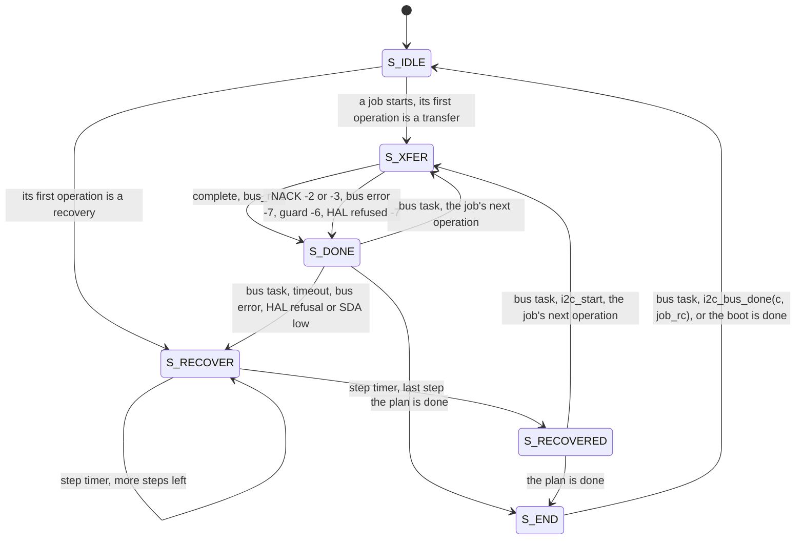

# i2c_bus: the shared I2C bus of the local modules

`i2c_bus.c` drives I2C2 for every local WSMP module of the bench station: the SHT45, BMP581,
LTR390, SHTC3, the INA228 rail monitors and the MAX17048. A module submits one transfer. The bus runs one transfer at a
time, in submission order, and reports each result from the main loop. Nothing waits: every step is
an interrupt or a timer.

The file came out of `sensor.lit.md`, the earlier driver for the SHT45 alone. It keeps that driver's
peripheral setup, its guard timer, its critical sections and its stuck-bus recovery. The difference
is the queue: a transfer now belongs to a client, and the clients take turns.

The bus has two profiles, chosen at build time by `WS_I2C_MUX` (section 11; power telemetry spec
`docs/superpowers/specs/2026-10-29-power-telemetry-design.md`, section 9.1):

| `WS_I2C_MUX` | Topology | The bus |
|---|---|---|
| 0 (**the firmware default**, the official phase A wiring) | a passive STEMMA QT hub, no mux | every client upstream; no mux boot job, no deselect, no phantom check; the record clients (0x50) complete with `I2C_ENACK_ADDR` without bus traffic |
| 1 | the ports board: a TCA9548A at 0x71 | the static channel map below |

Phase 1 of the sensor module ports (`docs/superpowers/specs/2026-10-21-sensor-module-ports-design.md`,
sections 4.3, 6.5 and 6.6) puts an 8-channel I2C multiplexer (a PCA9548 or TCA9548A at 0x71) on the
bus, with each external sensor alone on a channel: a **static channel map**. In the mux profile the
bus selects a client's channel before its transfer and deselects every channel after it, so the
upstream parts (SHTC3, the INA228s, MAX17048) are served only with no channel selected.

This document is the source. `tools/tangle.py` generates `i2c_bus.c` from the code chunks below. The
header `i2c_bus.h` is a plain file.

```sh
python3 tools/tangle.py firmware/stage0-node/App/i2c_bus.lit.md            # write i2c_bus.c
python3 tools/tangle.py --check firmware/stage0-node/App/i2c_bus.lit.md    # committed .c == tangle
```

## 1. Behaviour

| Property | Guarantee | Checked by |
|---|---|---|
| Order | the bus runs one transfer at a time, in submission order | `test_clients_are_served_in_order_one_at_a_time` |
| One result | each submitted transfer gets exactly one `i2c_bus_done`, from the main loop | every test in `tests/test_i2c_bus.py` |
| Refusal | a client with a transfer queued or running gets -1 at once. A transfer that is not one of the five forms also gets -1 | `test_a_second_submit_from_a_busy_client_is_refused`, `test_a_bad_form_is_refused` |
| Guard | a transfer that does not finish within its guard (30 ms, plus 90 µs for each byte on the bus) ends with `I2C_ETIMEOUT`. A completion after it changes nothing | `test_guard_timeout_reports_etimeout`, `test_the_guard_grows_with_the_transfer`, `test_a_completion_after_the_guard_is_ignored`, `test_a_completion_at_the_guard_instant_counts_once` |
| Recovery | after a transfer that can leave the bus stuck (a timeout, a HAL refusal, a bus error, or SDA still low) the bus clocks SDA free, with the client's channel (if any) still selected, and starts the peripheral again before the next transfer. SDA that stays low gives `I2C_ESTUCK` and, in the mux profile, a mux RESET pulse. A clean NACK costs no recovery. A recover-only request reports 0 or `I2C_ESTUCK` | `test_each_failure_has_its_code_and_recovers_the_bus`, `test_held_sda_is_clocked_free_or_reported_stuck`, `test_an_absent_device_costs_no_recovery`, `test_a_recovery_request_clocks_the_bus_and_reports_once` |
| Isolation | a failure of one client's device does not fail the other clients' transfers | `test_unplug_mid_transfer_recovers_and_spares_other_clients` |
| Channels (mux profile) | a port client's transfer is preceded by the mux write of its channel and its read-back, and followed by the deselect (0x00) and its read-back. An upstream client's transfer runs only with every channel deselected. A mux that does not read back gives the port client `I2C_EBUS`, also when only its deselect does not. After a deselect that never read back, each upstream job deselects and checks first, and gets `I2C_EBUS` without its transfer while the read-back fails | `test_a_port_transfer_selects_then_deselects`, `test_upstream_parts_are_served_with_no_channel_selected`, `test_a_mux_that_does_not_read_back_is_a_bus_fault`, `test_a_deselect_that_never_reads_back_fails_the_port_client`, `test_an_upstream_job_deselects_first_while_the_mux_is_not_ok`, `test_an_upstream_job_is_refused_while_the_deselect_does_not_read_back`, `test_an_absent_mux_is_a_bus_fault_for_every_client` |
| Boot (mux profile) | before any client transfer: a mux RESET pulse, mask 0x00 written and read back, then the phantom check: every probe-table address and 0x50, probed with every channel deselected. An address that answers is a phantom: the port client at it is refused (`I2C_ENACK_ADDR`, no bus traffic) for that boot | `test_boot_order`, `test_a_phantom_address_is_removed_for_the_boot` |
| Hub profile | no mux traffic at all: the bus is ready at `i2c_bus_init`, with no boot job; every client is served upstream, whatever its address; a record client's transfer ends with `I2C_ENACK_ADDR` and no bus traffic | `test_a_hub_boot_reads_the_power_parts_and_the_sht45`, `test_a_record_client_is_absent_without_bus_traffic`, `test_a_port_address_is_upstream_and_not_a_phantom` |
| Rail monitors | the four INA228 clients (battery 0x40, load 0x41, solar 0x45, USB-C 0x48) are upstream in both profiles and work side by side | `test_four_ina228_rail_monitors_work_upstream_together` (both profiles), `test_an_ina228_is_never_behind_a_channel` |
| Counters | `i2c_bus_recoveries` counts each recovery started (recover-only requests included), `i2c_bus_stuck` each that ended with SDA still low, `i2c_bus_mux_resets` each mux RESET pulse (the boot's included). Each saturates at 0xFFFF and never touches the bus | `test_one_hang_is_one_recovery`, `test_held_sda_counts_as_stuck`, `test_held_sda_counts_as_stuck_without_a_mux_reset`, `test_the_counters_saturate`, `test_mux_resets_are_counted` |
| Outcomes | `i2c_bus_outcomes` gives, and clears, a bit for each client whose own transfer completed with `I2C_OK` (acked) and a bit for each client whose job ended with any other code (failed), since its previous call. A recover-only request sets neither bit unless it ends `I2C_ESTUCK`; a client may have both. It never touches the bus. TEST-SENSOR-POWER reads it at each PA9 edge (the carrier's port power-cycle test, build-progression record step 3; step 1 exit 9 until 2026-11-02) | `test_outcomes_name_the_clients_that_answered_and_failed` |
| Record reads | a 2-byte word address (the 24LC32A) and up to 128 bytes in one read | `test_a_word_address_read_of_128_bytes` |

A transfer has one of five forms (`i2c_bus.h`):

| Form | Use | HAL call |
|---|---|---|
| write only | a command (SHT45, SHTC3) or a register write | `HAL_I2C_Master_Transmit_IT` |
| read only | the reply after a command | `HAL_I2C_Master_Receive_IT` |
| register read: one address byte, then a read with a repeated start | BMP581, LTR390, INA228, MAX17048 | `HAL_I2C_Mem_Read_IT`, 8-bit address |
| word-address read: two address bytes, high first, then a read with a repeated start | the module record EEPROM (24LC32A) | `HAL_I2C_Mem_Read_IT`, 16-bit address |
| recover only: no bytes | a module that saw a bad checksum (the SHT45 or the SHTC3) | none: the stuck-bus recovery of section 8 |

The completion codes (`i2c_bus.h`) are:

| Code | Value | Meaning |
|---|---:|---|
| `I2C_OK` | 0 | the transfer completed |
| `I2C_ENACK_ADDR` | −2 | no acknowledgment of the address or the command: absent, or not ready |
| `I2C_ENACK_DATA` | −3 | the read failed after the address |
| `I2C_ECRC` | −4 | a bad checksum. A module sets it, the bus never does |
| `I2C_ESTUCK` | −5 | SDA is still low after the recovery |
| `I2C_ETIMEOUT` | −6 | the transfer did not finish within its guard |
| `I2C_EBUS` | −7 | a bus error, lost arbitration, an overrun, a HAL refusal, or a mux that did not take the channel. A bus fault, not an absence |

## 2. Hardware and constants

I2C2 uses PA11 (SDA) and PA12 (SCL) at 100 kHz, as before. PA9 (D9, CN5.2; morpho CN10.19) is
the sensor supply enable, **carrier only**: change C's load switch is deferred to the carrier
(build-progression record section 4.6, dated note 2026-11-02), so on the breadboard (step 1) and the
protoboard (step 2) PA9 is unconnected, the hub's sensors are on the unswitched 3V3, and driving the
pin does nothing. On the carrier PA9 enables the ports' current-limited high-side switches (PORT-5);
the power monitors (the INA228s and the MAX17048) and the SHTC3 are unswitched (PORT-9, M6), so a
PA9 cycle never drops them. The mux RESET line is a board seam
(`i2c_bus_mux_reset_line`, defined in `board_inputs.c`): it is **PB14** (A4, CN8.5 / morpho CN7.36;
build-progression record N5, answering the ports design's "TBD" in section 4.1), active low, a
push-pull output released (high) at boot. It is wired when the mux is (`WS_I2C_MUX=1`), after the
step 2 shield's incoming check shows A4 not tied to SDA. In the hub profile the call does nothing.

The guard grows with the transfer. The base, 30 ms, covers the longest transfer of the first
driver (a 7-byte reply, about 0.8 ms at 100 kHz) and a flash page erase (24.5 ms max), which stalls
the I2C interrupt; ST's timer rounds down to 1/1024 s ticks. Each byte on the bus (9 bit times) adds
90 µs, rounded down to whole ms, so the short transfers keep their 30 ms and a 128-byte record read
(131 bytes, about 12 ms) gets 41 ms, more than the 37 ms it needs with the erase stall.

```c {#constants}
#define SDA_PIN GPIO_PIN_11
#define SCL_PIN GPIO_PIN_12
#define POWER_PIN GPIO_PIN_9   /* PA9 = D9, CN5.2 */
#define I2C_GUARD_MS 30U
#define I2C_BYTE_US 90U        /* one byte and its acknowledge at 100 kHz */
#define US_PER_MS 1000U
#define I2C_IRQ_PRIORITY 2   /* below the radio and the RTC (0), like the console UART */
/* 100 kHz standard mode at PCLK1 = 48 MHz: ST's NUCLEO-WL55JC example value 0x20303E5D (PRESC 2,
   SCLDEL 3, SCLH 0x3E, SCLL 0x5D) with SDADEL 2. The data hold is then SDADEL x tPRESC + tI2CCLK =
   2 x 62.5 ns + 20.8 ns = 146 ns (RM0453 I2C timings), above the 100 ns that the INA228 needs on the
   address MSB when SDA straps A0 or A1 (SBOS904; the USB-C rail at 0x48), far below the 3.45 us
   standard-mode limit. tests/test_i2c_bus.py checks the fields. */
#define I2C_TIMING 0x20323E5DU
#define REG_ADDR_LEN 1U
#define WORD_ADDR_LEN 2U
#define BYTE_BITS 8U
#define HAL_ADDR(a7) ((uint16_t)((a7) << 1))   /* ST's HAL takes the 7-bit address shifted left */
```

## 3. Peripheral setup

The MSP functions are ST's hooks for the clock, the pins and the interrupts. The internal pull-ups
(about 40 kΩ) matter only when every breakout is unplugged. They then hold both lines high, so an
absent sensor reads as a clean address NACK.

```c {#msp}
static I2C_HandleTypeDef hi2c2;

/* cppcheck-suppress constParameterPointer ; ST's HAL callback signature */
void HAL_I2C_MspInit(I2C_HandleTypeDef *hi2c)
{
  if (hi2c->Instance != I2C2) return;
  RCC_PeriphCLKInitTypeDef clk = { .PeriphClockSelection = RCC_PERIPHCLK_I2C2,
                                   .I2c2ClockSelection = RCC_I2C2CLKSOURCE_PCLK1 };
  (void)HAL_RCCEx_PeriphCLKConfig(&clk);   /* selects the I2C2 clock only, so it cannot time out */
  __HAL_RCC_GPIOA_CLK_ENABLE();
  GPIO_InitTypeDef gpio = { .Pin = SDA_PIN | SCL_PIN, .Mode = GPIO_MODE_AF_OD, .Pull = GPIO_PULLUP,
                            .Speed = GPIO_SPEED_FREQ_LOW, .Alternate = GPIO_AF4_I2C2 };
  HAL_GPIO_Init(GPIOA, &gpio);
  __HAL_RCC_I2C2_CLK_ENABLE();
  HAL_NVIC_SetPriority(I2C2_EV_IRQn, I2C_IRQ_PRIORITY, 0);
  HAL_NVIC_SetPriority(I2C2_ER_IRQn, I2C_IRQ_PRIORITY, 0);
  HAL_NVIC_EnableIRQ(I2C2_EV_IRQn);
  HAL_NVIC_EnableIRQ(I2C2_ER_IRQn);
}

/* cppcheck-suppress constParameterPointer ; ST's HAL callback signature */
void HAL_I2C_MspDeInit(I2C_HandleTypeDef *hi2c)
{
  if (hi2c->Instance != I2C2) return;
  HAL_NVIC_DisableIRQ(I2C2_EV_IRQn);
  HAL_NVIC_DisableIRQ(I2C2_ER_IRQn);
  __HAL_RCC_I2C2_CLK_DISABLE();
  HAL_GPIO_DeInit(GPIOA, SDA_PIN | SCL_PIN);
}

static void i2c_start(void)
{
  hi2c2.Instance = I2C2;
  hi2c2.Init.Timing = I2C_TIMING;
  hi2c2.Init.OwnAddress1 = 0;
  hi2c2.Init.AddressingMode = I2C_ADDRESSINGMODE_7BIT;
  hi2c2.Init.DualAddressMode = I2C_DUALADDRESS_DISABLE;
  hi2c2.Init.GeneralCallMode = I2C_GENERALCALL_DISABLE;
  hi2c2.Init.NoStretchMode = I2C_NOSTRETCH_DISABLE;
  /* Both calls fail only for a NULL or busy handle (stm32wlxx_hal_i2c.c). If one fails anyway, the
     HAL refuses the next transfer, and the recovery after it starts the peripheral again. */
  (void)WS_CHECK(HAL_I2C_Init(&hi2c2) == HAL_OK);
  (void)WS_CHECK(HAL_I2CEx_ConfigAnalogFilter(&hi2c2, I2C_ANALOGFILTER_ENABLE) == HAL_OK);
}
```

## 4. The queue

Each client has one transfer record and a flag that says it is queued or running. A FIFO of client
numbers gives the order. The main loop alone touches the queue: modules submit from tasks, and the
bus starts and ends transfers from its task. The interrupts touch only the bus state.

```c {#queue}
typedef struct { const uint8_t *tx; uint8_t *rx; uint8_t addr7, txlen; uint16_t rxlen; } xfer_t;
static xfer_t xfers[I2C_C_COUNT];
static uint8_t busy[I2C_C_COUNT];      /* 1: the client's transfer is queued or running */
static uint8_t fifo[I2C_C_COUNT];
static unsigned fifo_head, fifo_len;

static void fifo_push(enum i2c_client c)
{
  fifo[(fifo_head + fifo_len) % I2C_C_COUNT] = (uint8_t)c;
  fifo_len++;
}

static enum i2c_client fifo_pop(void)
{
  enum i2c_client c = (enum i2c_client)fifo[fifo_head];
  fifo_head = (fifo_head + 1U) % I2C_C_COUNT;
  fifo_len--;
  return c;
}
```

## 5. Channels and jobs

The static channel map of phase 1 (section 4.1 of the ports design): the SHT45 on channel 0, the
LTR390 on channel 1, the BMP581 on channel 2, each with its record EEPROM (0x50, its own client).
The SHTC3, the four INA228 rail monitors and the MAX17048 are upstream of the mux and never on a
port (PORT-9; power telemetry spec section 9.2). The phantom table is the port probe table and the
record EEPROM (section 6.7): no upstream part may answer at them (PORT-15).

`PORT(ch)` and `RECORD(ch)` give the map of the profile (section 11). In the hub profile a port
sensor is upstream like every other part, and a record client has no path at all (`NO_PATH`): there
is no record EEPROM on the hub, so its transfer ends with `I2C_ENACK_ADDR` without bus traffic and
the port module is admitted with `NO_RECORD`, as the ports design allows. The build fails when a
client is added without its entry, since a missing entry would read as channel 0.

The counters (`i2c_bus_recoveries`, `i2c_bus_stuck`, `i2c_bus_mux_resets`) live in the main loop
alone, like the queue, and saturate at 0xFFFF (`count_up`): the health report sends the first
(power telemetry spec section 6.2), the `#status` line all three. Beside them, two client masks
(`acked`, `failed`) collect the outcomes since the last `i2c_bus_outcomes`: `op_done` sets a
client's acked bit when its own transfer (never a mux operation or a recovery) completes with
`I2C_OK`, and `end_job` its failed bit when the job ends with any other code. TEST-SENSOR-POWER
(`tx_console.c`) reads and clears them at each PA9 edge, so each of its lines names the parts that
answered, and those that failed, in the half that just ended: the evidence of the carrier's port
power-cycle test (record step 3; step 1's exit 9 until 2026-11-02).

The bus serves **jobs**. A job is a short plan of operations on the bus: a client's transfer with
the mux operations around it, or the boot sequence. One operation is on the bus at a time, and each
ends in the bus task, which then runs the next one. A job ends in the bus task too, so no completion
ever runs inside `i2c_bus_submit`.

| Job | Plan |
|---|---|
| upstream client | the transfer (or the recovery, for a recover-only request). While the mux is not known to be deselected (`mux_ok` 0): deselect, deselect check, then the transfer |
| port client | select (write the channel's bit), select check (read it back), the transfer or the recovery, deselect (write 0x00), deselect check (read it back) |
| port client at a phantom address | none: `I2C_ENACK_ADDR`, without bus traffic |
| record client in the hub profile (`NO_PATH`) | none: `I2C_ENACK_ADDR`, without bus traffic (a recover-only request is served as upstream) |
| boot | (a mux RESET pulse first) deselect, deselect check, then a zero-length write to each phantom-table address |

A select that fails or does not read back skips the transfer: the client gets `I2C_EBUS` (a port
fault, never an absence), and the deselect still runs. A deselect that fails or does not read back
pulses the mux RESET once and deselects again; if that fails too the job ends with `I2C_EBUS`, and
`mux_ok` is 0 (`i2c_bus_mux_ok`): a channel may still be selected. A port client whose transfer
took still gets `I2C_EBUS` then. While `mux_ok` is 0 every upstream job starts with a deselect and
its read-back, with the same one RESET retry; if the read-back still fails, the upstream client gets
`I2C_EBUS` and its device is never touched, so an upstream part is never served with a port device
joined to the bus. Only a deselect that reads back 0x00 sets `mux_ok` again. Every channel burst
(here one transfer) therefore ends with no channel selected, or with the bus refusing the upstream
parts until it is.

```c {#jobs}
#define UPSTREAM 0xFFU
#define NO_PATH 0xFEU                                              /* the hub: no record EEPROM */
#define PORT(ch) ((uint8_t)(WS_I2C_MUX ? (ch) : UPSTREAM))
#define RECORD(ch) ((uint8_t)(WS_I2C_MUX ? (ch) : NO_PATH))
_Static_assert(I2C_C_COUNT == 12, "a new client needs its channel_of entry");
static const uint8_t channel_of[I2C_C_COUNT] = {
  [I2C_C_SHT45] = PORT(0), [I2C_C_LTR390] = PORT(1), [I2C_C_BMP581] = PORT(2), [I2C_C_SHTC3] = UPSTREAM,
  [I2C_C_INA228] = UPSTREAM, [I2C_C_INA_LOAD] = UPSTREAM, [I2C_C_INA_SOLAR] = UPSTREAM, [I2C_C_INA_USB] = UPSTREAM,
  [I2C_C_MAX17048] = UPSTREAM, [I2C_C_REC_AIR] = RECORD(0), [I2C_C_REC_UVA] = RECORD(1),
  [I2C_C_REC_PRESSURE] = RECORD(2) };
static const uint8_t phantom_addr[I2C_PHANTOM_COUNT] = { 0x44, 0x47, 0x53, 0x50 };

typedef enum { OP_SELECT, OP_SELECT_CHECK, OP_XFER, OP_RECOVER, OP_DESELECT, OP_DESELECT_CHECK, OP_PROBE } op_kind;
typedef enum { JOB_NONE, JOB_BOOT, JOB_CLIENT } job_kind;
#define PLAN_MAX 8U
static op_kind plan[PLAN_MAX];
static unsigned plan_len, plan_at, deselect_at;
static job_kind job;
static int job_rc;                       /* the client's result */
static uint8_t mux_tx, mux_rx, mux_mask, reset_tried, probe_at, phantoms, booted, mux_ok;
static uint16_t n_recoveries, n_stuck, n_mux_resets;   /* since boot, saturating */
static uint16_t acked, failed;           /* clients since the last i2c_bus_outcomes, a bit each */
_Static_assert(I2C_C_COUNT <= 16, "i2c_bus_outcomes has a 16-bit mask: one bit for each client");

static uint16_t count_up(uint16_t n) { return n == UINT16_MAX ? n : (uint16_t)(n + 1U); }

static void plan_add(op_kind k)
{
  if (plan_len < PLAN_MAX) plan[plan_len++] = k;
}

static void plan_start(job_kind k)
{
  job = k; plan_len = 0; plan_at = 0; job_rc = I2C_OK; reset_tried = 0;
}

static void mux_reset_pulse(void)
{
  n_mux_resets = count_up(n_mux_resets);
  i2c_bus_mux_reset_line(1);
  i2c_bus_mux_reset_line(0);   /* the TCA9548A needs 6 ns low: one write after the other is longer */
}

static int is_phantom(uint8_t addr7)
{
  for (unsigned i = 0; i < I2C_PHANTOM_COUNT; i++)
    if ((phantoms >> i & 1U) && phantom_addr[i] == addr7) return 1;
  return 0;
}

static void plan_deselect(void)
{
  deselect_at = plan_len;
  plan_add(OP_DESELECT);
  plan_add(OP_DESELECT_CHECK);
}

static void plan_boot(void)
{
  plan_start(JOB_BOOT);
  mux_reset_pulse();
  plan_deselect();
  for (unsigned i = 0; i < I2C_PHANTOM_COUNT; i++) plan_add(OP_PROBE);
  probe_at = 0;
}

static void plan_client(enum i2c_client c)
{
  const xfer_t *x = &xfers[c];
  op_kind work = x->txlen == 0 && x->rxlen == 0 ? OP_RECOVER : OP_XFER;
  uint8_t ch = channel_of[c];
  plan_start(JOB_CLIENT);
  if (ch == NO_PATH && work == OP_XFER) { job_rc = I2C_ENACK_ADDR; return; }   /* an empty plan */
  if (ch == UPSTREAM || ch == NO_PATH)
  {
    if (!mux_ok) plan_deselect();   /* a deselect that never read back: check it first (never on the hub) */
    plan_add(work);
    return;
  }
  if (work == OP_XFER && is_phantom(x->addr7)) { job_rc = I2C_ENACK_ADDR; return; }   /* an empty plan */
  mux_mask = (uint8_t)(1U << ch);
  plan_add(OP_SELECT);
  plan_add(OP_SELECT_CHECK);
  plan_add(work);
  plan_deselect();
}
```

## 6. State machine



`finish(rc)` is the one way out of `S_XFER`, as in the earlier driver. It runs in a critical
section. The first call that finds `S_XFER` ends the transfer, and a later completion or guard
finds another state and changes nothing. The guard runs in the RTC interrupt (priority 0) and can
preempt the I2C interrupt (priority 2). So when a read completes in the instant its guard expires,
the guard wins and the result is `I2C_ETIMEOUT`.

```c {#states}
typedef enum { S_IDLE, S_XFER, S_DONE, S_RECOVER, S_RECOVERED, S_END } bus_state;
static volatile bus_state st = S_IDLE;
static volatile int bus_rc, recover_rc;
static enum i2c_client cur;            /* the client of the job on the bus */
static xfer_t op;                      /* the transfer on the bus */
static int failed_rc;                  /* the failed transfer's code, reported after the recovery */
static int hal_refused;                /* the HAL refused to start the transfer on the bus */
static UTIL_TIMER_Object_t guard_timer, step_timer;
static ws_i2c_rec rec;

static void post(void) { UTIL_SEQ_SetTask(1U << CFG_SEQ_Task_I2c, CFG_SEQ_Prio_0); }

static void finish(int rc)
{
  uint32_t primask = irq_lock();
  if (st == S_XFER)
  {
    (void)UTIL_TIMER_Stop(&guard_timer);
    bus_rc = rc; st = S_DONE; post();
  }
  irq_unlock(primask);
}
```

The completion callbacks are ST's. Only a NACK (`HAL_I2C_ERROR_AF`) gives a NACK code. During a
read-only transfer it is `I2C_ENACK_DATA`: the device answered its command and then did not deliver.
Otherwise it is `I2C_ENACK_ADDR`, also for a zero-length write (a probe). Any other error (a bus
error, lost arbitration, an overrun) is `I2C_EBUS`: a bus fault (WSMP-P3), which a module must not
take for an absence.

```c {#callbacks}
/* cppcheck-suppress constParameterPointer ; ST's HAL callback signature */
void HAL_I2C_MasterTxCpltCallback(I2C_HandleTypeDef *hi2c) { if (hi2c == &hi2c2) finish(I2C_OK); }
/* cppcheck-suppress constParameterPointer ; ST's HAL callback signature */
void HAL_I2C_MasterRxCpltCallback(I2C_HandleTypeDef *hi2c) { if (hi2c == &hi2c2) finish(I2C_OK); }
/* cppcheck-suppress constParameterPointer ; ST's HAL callback signature */
void HAL_I2C_MemRxCpltCallback(I2C_HandleTypeDef *hi2c) { if (hi2c == &hi2c2) finish(I2C_OK); }
/* cppcheck-suppress constParameterPointer ; ST's HAL callback signature */
void HAL_I2C_ErrorCallback(I2C_HandleTypeDef *hi2c)
{
  if (hi2c != &hi2c2) return;
  if (!(hi2c->ErrorCode & HAL_I2C_ERROR_AF)) finish(I2C_EBUS);
  else finish(op.txlen == 0 && op.rxlen > 0 ? I2C_ENACK_DATA : I2C_ENACK_ADDR);
}
static void on_guard(void *ctx) { (void)ctx; finish(I2C_ETIMEOUT); }

void I2C2_EV_IRQHandler(void);   /* vector table names (startup_stm32wl55jcix.s) */
void I2C2_ER_IRQHandler(void);
void I2C2_EV_IRQHandler(void) { BUSYMON_ISR("I2C2_EV", HAL_I2C_EV_IRQHandler(&hi2c2)); }
void I2C2_ER_IRQHandler(void) { BUSYMON_ISR("I2C2_ER", HAL_I2C_ER_IRQHandler(&hi2c2)); }
```

## 7. Starting an operation

`run_op` starts the plan's next operation, or, when the plan is done, posts the end of the job.
A transfer starts its guard first, so a transfer that never completes still ends. ST's HAL takes
non-const buffers but only reads a transmit buffer. A zero-length write (a probe) sends the address
and a STOP.

```c {#start}
static HAL_StatusTypeDef hal_start(const xfer_t *x)
{
  uint16_t a = HAL_ADDR(x->addr7);
  if (x->rxlen == 0) return HAL_I2C_Master_Transmit_IT(&hi2c2, a, (uint8_t *)(uintptr_t)x->tx, x->txlen);
  if (x->txlen == 0) return HAL_I2C_Master_Receive_IT(&hi2c2, a, x->rx, x->rxlen);
  if (x->txlen == WORD_ADDR_LEN)
    return HAL_I2C_Mem_Read_IT(&hi2c2, a, (uint16_t)((unsigned)x->tx[0] << BYTE_BITS | x->tx[1]), I2C_MEMADD_SIZE_16BIT,
                               x->rx, x->rxlen);
  return HAL_I2C_Mem_Read_IT(&hi2c2, a, x->tx[0], I2C_MEMADD_SIZE_8BIT, x->rx, x->rxlen);
}

static uint32_t guard_ms(const xfer_t *x)
{
  return I2C_GUARD_MS + ((uint32_t)x->txlen + x->rxlen + 1U) * I2C_BYTE_US / US_PER_MS;   /* + the address byte */
}

static void start_xfer(const xfer_t *x)
{
  op = *x;
  st = S_XFER;
  (void)WS_CHECK(UTIL_TIMER_SetPeriod(&guard_timer, guard_ms(x)) == UTIL_TIMER_OK);   /* the timer is stopped */
  (void)WS_CHECK(UTIL_TIMER_Start(&guard_timer) == UTIL_TIMER_OK);                    /* stopped by finish() */
  hal_refused = hal_start(&op) != HAL_OK;
  if (hal_refused) finish(I2C_EBUS);
}

static void recover_begin(void);

static void start_mux(int read)
{
  start_xfer(read ? &(xfer_t){ .rx = &mux_rx, .addr7 = I2C_MUX_ADDR, .rxlen = 1 }
                  : &(xfer_t){ .tx = &mux_tx, .addr7 = I2C_MUX_ADDR, .txlen = 1 });
}

static void run_op(void)
{
  if (plan_at >= plan_len) { st = S_END; post(); return; }
  switch (plan[plan_at])
  {
    case OP_SELECT: mux_tx = mux_mask; start_mux(0); break;
    case OP_DESELECT: mux_tx = 0; start_mux(0); break;
    case OP_SELECT_CHECK: case OP_DESELECT_CHECK: mux_rx = 0xFFU; start_mux(1); break;
    case OP_XFER: start_xfer(&xfers[cur]); break;
    case OP_RECOVER: failed_rc = I2C_OK; recover_begin(); break;
    default: start_xfer(&(xfer_t){ .tx = &mux_tx, .addr7 = phantom_addr[probe_at] }); break;   /* OP_PROBE */
  }
}

static void kick(void)
{
  if (st != S_IDLE || job != JOB_NONE) return;
  if (!booted) plan_boot();
  else if (fifo_len == 0) return;
  else { cur = fifo_pop(); plan_client(cur); }
  run_op();
}

/* The five forms of i2c_bus.h: write, read, a register address and then a read, a word address and
   then a read, or recover only. */
static int form_ok(const uint8_t *tx, uint8_t txlen, const uint8_t *rx, uint16_t rxlen)
{
  if (rxlen == 0) return txlen == 0 || tx != NULL;
  if (txlen == 0) return rx != NULL && rxlen <= I2C_RX_MAX;
  return (txlen == REG_ADDR_LEN || txlen == WORD_ADDR_LEN) && tx && rx && rxlen <= I2C_RX_MAX;
}

int i2c_bus_submit(enum i2c_client c, uint8_t addr7, const uint8_t *tx, uint8_t txlen, uint8_t *rx, uint16_t rxlen)
{
  if ((unsigned)c >= I2C_C_COUNT || !form_ok(tx, txlen, rx, rxlen) || busy[c]) return -1;
  xfers[c] = (xfer_t){ .tx = tx, .rx = rx, .addr7 = addr7, .txlen = txlen, .rxlen = rxlen };
  busy[c] = 1;
  fifo_push(c);
  kick();
  return 0;
}
```

## 8. Stuck-bus recovery

A device reset or unplugged in the middle of a byte can hold SDA low. The recovery takes the pins
over, clocks SCL until SDA is free and sends a real STOP. It is `ws_i2c_recover_step()` in
`firmware/stage0.c`, which `firmware/test_policy.c` tests on the host. One step runs at each tick of
the step timer, so the recovery takes about 15–70 ms and never waits. It runs with the failing
client's channel still selected (step 1 of section 6.6). If SDA stays low, the device on that
channel holds the upstream bus too, through the mux: the mux RESET pulse deselects it in hardware
(step 2), so the upstream parts are back at once, and the client gets `I2C_ESTUCK`. Step 3, the
port's power cycle, and the Faulted state with its back-off do not exist on the breadboard, which
has no port power switch (since 2026-11-02 change C's PA9 switch is deferred to the carrier, record
4.6 dated note). On the carrier PA9 (`i2c_bus_power`, section 10) switches the ports' sensors
together; the power monitors and the SHTC3 are unswitched, so a PA9 cycle never drops them. The
recovery does not cycle it: the power-cycle step stays a no-op until the carrier. In the hub profile there is no mux: SDA that stays low gives `I2C_ESTUCK`
and no pulse.

`recover_begin` counts every recovery it starts (`i2c_bus_recoveries`, the health report's I2C
recoveries since boot), and the bus task counts each one that ends with SDA still low
(`i2c_bus_stuck`). A recovery of a failed transfer and a recover-only request count alike.

```c {#recovery}
static void pin_scl(void *c, int level) { (void)c; HAL_GPIO_WritePin(GPIOA, SCL_PIN, level ? GPIO_PIN_SET : GPIO_PIN_RESET); }
static void pin_sda(void *c, int level) { (void)c; HAL_GPIO_WritePin(GPIOA, SDA_PIN, level ? GPIO_PIN_SET : GPIO_PIN_RESET); }
static int pin_read_sda(void *c) { (void)c; return HAL_GPIO_ReadPin(GPIOA, SDA_PIN) == GPIO_PIN_SET; }
static const ws_i2c_pins pins = { 0, pin_scl, pin_sda, pin_read_sda, 0 };

static void on_step(void *ctx)
{
  (void)ctx;
  int rc = ws_i2c_recover_step(&rec, &pins);
  if (rc > 0) { (void)WS_CHECK(UTIL_TIMER_Start(&step_timer) == UTIL_TIMER_OK); return; }
  recover_rc = rc; st = S_RECOVERED; post();
}

static void recover_begin(void)
{
  n_recoveries = count_up(n_recoveries);
  (void)HAL_I2C_DeInit(&hi2c2);   /* fails only for a NULL handle. The code below takes the pins over anyway */
  /* An abandoned transfer can leave its interrupt pending and its handler set. Neither may run on
     the re-initialised peripheral. */
  HAL_NVIC_ClearPendingIRQ(I2C2_EV_IRQn); HAL_NVIC_ClearPendingIRQ(I2C2_ER_IRQn);
  hi2c2.XferISR = NULL;
  HAL_GPIO_WritePin(GPIOA, SDA_PIN | SCL_PIN, GPIO_PIN_SET);
  GPIO_InitTypeDef gpio = { .Pin = SDA_PIN | SCL_PIN, .Mode = GPIO_MODE_OUTPUT_OD, .Pull = GPIO_PULLUP,
                            .Speed = GPIO_SPEED_FREQ_LOW };
  HAL_GPIO_Init(GPIOA, &gpio);
  st = S_RECOVER;
  ws_i2c_recover_begin(&rec, &pins);
  (void)WS_CHECK(UTIL_TIMER_Start(&step_timer) == UTIL_TIMER_OK);
}
```

## 9. The bus task

The bus task runs in the main loop. After a failure that can leave the bus stuck (a guard timeout,
a bus error, a HAL refusal, or SDA still low) it first recovers the bus. A clean NACK costs no
recovery: an absent module answers every probe with one, and the bus is free afterwards. Then
`op_done` takes the operation's result into the job and runs the next operation.

`end_job` frees the client before it calls `i2c_bus_done`, so the module can submit its next
transfer from the completion. Then `kick` starts the next job in the queue.

```c {#task}
static void end_job(void)
{
  job_kind was = job;
  enum i2c_client c = cur;
  job = JOB_NONE;
  st = S_IDLE;
  if (was == JOB_BOOT) booted = 1;
  else
  {
    busy[c] = 0;
    if (job_rc != I2C_OK) failed |= (uint16_t)(1U << c);
    i2c_bus_done(c, job_rc);
  }
  kick();
}

/* A mux write, or its read-back: 1 when it took. */
static int mux_took(op_kind k, int rc)
{
  if (rc != I2C_OK) return 0;
  if (k == OP_SELECT_CHECK) return mux_rx == mux_mask;
  return k != OP_DESELECT_CHECK || mux_rx == 0U;
}

static void mux_done(op_kind k, int rc)
{
  int is_select = k == OP_SELECT || k == OP_SELECT_CHECK;
  if (mux_took(k, rc)) { if (k == OP_DESELECT_CHECK) mux_ok = 1; return; }
  if (is_select) { job_rc = I2C_EBUS; plan_at = deselect_at; return; }   /* never the transfer */
  if (reset_tried) { mux_ok = 0; job_rc = I2C_EBUS; plan_at = plan_len; return; }   /* the job ends: no second RESET */
  reset_tried = 1;
  mux_reset_pulse();
  plan_at = deselect_at;
}

static void op_done(int rc)
{
  op_kind k = plan[plan_at++];
  if (k == OP_XFER || k == OP_RECOVER)
  {
    job_rc = rc;
    if (k == OP_XFER && rc == I2C_OK) acked |= (uint16_t)(1U << cur);   /* the part itself answered */
  }
  else if (k == OP_PROBE) { if (rc == I2C_OK) phantoms |= (uint8_t)(1U << probe_at); probe_at++; }
  else mux_done(k, rc);
  run_op();
}

/* A recovery that ended with SDA still low. Step 2 (mux profile): the mux lets the upstream bus go. */
static void note_stuck(void)
{
  n_stuck = count_up(n_stuck);
  if (WS_I2C_MUX) mux_reset_pulse();
}

static int may_be_stuck(int rc)
{
  return rc == I2C_ETIMEOUT || rc == I2C_EBUS || hal_refused || HAL_GPIO_ReadPin(GPIOA, SDA_PIN) != GPIO_PIN_SET;
}

static void bus_task(void)
{
  if (st == S_END) { end_job(); return; }
  if (st == S_DONE)
  {
    if (bus_rc != I2C_OK && may_be_stuck(bus_rc)) { failed_rc = bus_rc; recover_begin(); return; }
    op_done(bus_rc);
  }
  else if (WS_CHECK(st == S_RECOVERED))   /* the task is posted only with S_DONE, S_RECOVERED or S_END */
  {
    i2c_start();
    if (recover_rc) note_stuck();
    op_done(recover_rc ? I2C_ESTUCK : failed_rc);
  }
}
BUSYMON_TASK(bus_task)
```

## 10. Initialisation, power and status

`i2c_bus_init` creates the timers, registers the task and starts the peripheral. It also drives PA9
high, so the sensor supply is on by default. `i2c_bus_power` only writes the pin: the bench command
TEST-SENSOR-POWER (`tx_console.c`, the carrier's port power-cycle test) is its one caller, and leaves PA9 high. A
switched sensor that is off answers no address, a clean NACK that costs no recovery. In the mux profile the boot job starts at once: the mux
RESET pulse, the deselect and its read-back, and the phantom check, before any client transfer. A
client may submit at any time; its transfer waits in the queue until the boot job is done. In the hub
profile there is no boot job: the bus is ready, and no channel can be selected (`mux_ok` 1), as soon
as `i2c_bus_init` returns.

```c {#init}
void i2c_bus_power(int on) { HAL_GPIO_WritePin(GPIOA, POWER_PIN, on ? GPIO_PIN_SET : GPIO_PIN_RESET); }

void i2c_bus_init(void)
{
  (void)UTIL_TIMER_Create(&guard_timer, I2C_GUARD_MS, UTIL_TIMER_ONESHOT, on_guard, NULL);
  (void)UTIL_TIMER_Create(&step_timer, 1, UTIL_TIMER_ONESHOT, on_step, NULL);
  UTIL_SEQ_RegTask(1U << CFG_SEQ_Task_I2c, UTIL_SEQ_RFU, bus_task_timed);
  GPIO_InitTypeDef gpio = { .Pin = POWER_PIN, .Mode = GPIO_MODE_OUTPUT_PP, .Pull = GPIO_NOPULL,
                            .Speed = GPIO_SPEED_FREQ_LOW };
  __HAL_RCC_GPIOA_CLK_ENABLE();
  HAL_GPIO_WritePin(GPIOA, POWER_PIN, GPIO_PIN_SET);
  HAL_GPIO_Init(GPIOA, &gpio);
  i2c_start();
  booted = (uint8_t)(WS_I2C_MUX == 0);   /* the hub: nothing to boot */
  mux_ok = booted;
  kick();   /* the boot job (the mux profile) */
}

int i2c_bus_ready(void) { return booted; }
int i2c_bus_mux_ok(void) { return mux_ok; }
uint8_t i2c_bus_phantoms(void) { return phantoms; }
uint16_t i2c_bus_recoveries(void) { return n_recoveries; }
uint16_t i2c_bus_stuck(void) { return n_stuck; }
uint16_t i2c_bus_mux_resets(void) { return n_mux_resets; }

void i2c_bus_outcomes(uint16_t *was_acked, uint16_t *was_failed)
{
  *was_acked = acked;
  *was_failed = failed;
  acked = 0;
  failed = 0;
}
```

## 11. Profiles: hub or mux

`WS_I2C_MUX` (`i2c_bus.h`, default 0) is the one switch. Both profiles compile the same code; the
constant only changes the channel map (section 5), the boot (section 10) and the step 2 pulse
(section 8).

| | Hub (`WS_I2C_MUX` 0, the default) | Mux (`WS_I2C_MUX` 1) |
|---|---|---|
| Hardware | the official phase A wiring on I2C2: the SHT45 on a passive STEMMA QT hub on the unswitched 3V3; the battery INA228 (0x40) and the MAX17048 (0x36) on a second QT cable, also from the unswitched 3V3 (QTM; build-progression record 4.6, PORT-9). PA9 (`POWER_PIN`) is unconnected on the bench (change C's switch is deferred to the carrier, 2026-11-02) | the ports board: a TCA9548A at 0x71, a sensor and its record EEPROM on each channel |
| Boot job | none: `i2c_bus_ready` is 1 when `i2c_bus_init` returns | RESET pulse, deselect, read-back, phantom check |
| Port sensors (SHT45, LTR390, BMP581) | upstream, at their own addresses | on channels 0, 1, 2 |
| Record clients (0x50) | `I2C_ENACK_ADDR`, no bus traffic: modules admitted with `NO_RECORD` | read on the port's channel |
| SHTC3, INA228 rail monitors, MAX17048 | upstream | upstream, with every channel deselected |
| Phantom check | none (`i2c_bus_phantoms` 0) | at boot |
| SDA stuck after a recovery | `I2C_ESTUCK` | `I2C_ESTUCK` and a mux RESET pulse |
| `i2c_bus_mux_ok`, `i2c_bus_mux_resets` | 1, 0 | as the mux reads back; the pulses |

The target build takes the default; `make ROLE=tx OPT='-Os -DWS_I2C_MUX=1'` builds the mux profile
(the Makefile has no separate hook for extra defines; `OPT` reaches every compile). The host bus
model follows the same define (`firmware/host/i2c_sim.c`): with 0 it has no mux and puts every device
upstream. The existing host builds (`tests/toolchain.py` `wsmp_sources()`, `tests/test_tx_machine.py`)
pass `-DWS_I2C_MUX=1` so their record and mux tests keep the ports board; `wsmp_sources(mux=0)` is the
hub variant for the new tests.

## 12. The file

```c {#i2c_bus.c}
#define WS_CHECK_FILE 12
#include "i2c_bus.h"
#include "busymon.h"
#include "events.h"
#include "stage0.h"
#include "stm32_seq.h"
#include "stm32_timer.h"
#include "stm32wlxx_hal.h"
#include "utilities_def.h"
#include "ws_check.h"

<<constants>>

<<msp>>

<<queue>>

<<jobs>>

<<states>>

<<callbacks>>

<<start>>

<<recovery>>

<<task>>

<<init>>
```
