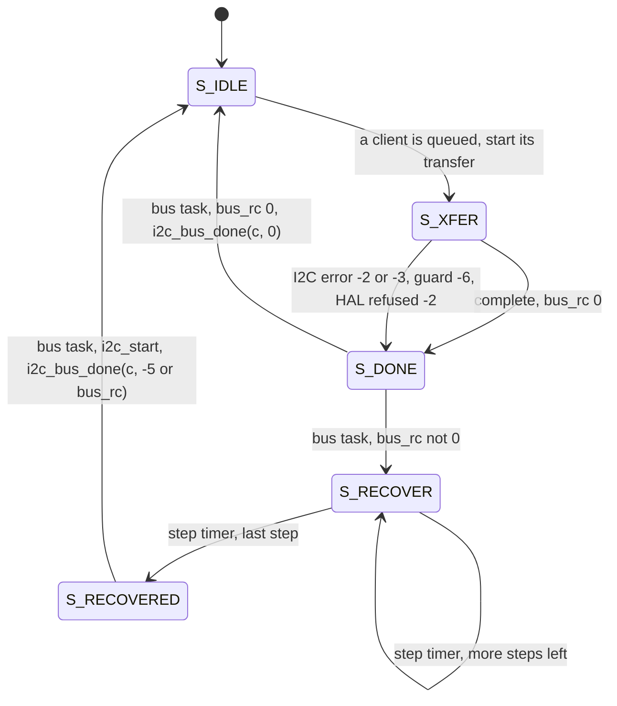

# i2c_bus: the shared I2C bus of the local modules

`i2c_bus.c` drives I2C2 for every local WSMP module of the bench station: the SHT45, BMP581,
LTR390, SHTC3, INA228 and MAX17048. A module submits one transfer. The bus runs one transfer at a
time, in submission order, and reports each result from the main loop. Nothing waits: every step is
an interrupt or a timer.

The file came out of `sensor.lit.md`, the earlier driver for the SHT45 alone. It keeps that driver's
peripheral setup, its guard timer, its critical sections and its stuck-bus recovery. The difference
is the queue: a transfer now belongs to a client, and the clients take turns.

This document is the source. `tools/tangle.py` generates `i2c_bus.c` from the code chunks below. The
header `i2c_bus.h` is a plain file.

```sh
python3 tools/tangle.py firmware/stage0-node/App/i2c_bus.lit.md            # write i2c_bus.c
python3 tools/tangle.py --check firmware/stage0-node/App/i2c_bus.lit.md    # committed .c == tangle
```

## 1. Behaviour

| Property | Guarantee | Checked by |
|---|---|---|
| Order | the bus runs one transfer at a time, in submission order | `test_clients_are_served_in_order_one_at_a_time` |
| One result | each submitted transfer gets exactly one `i2c_bus_done`, from the main loop | every test in `tests/test_i2c_bus.py` |
| Refusal | a client with a transfer queued or running gets -1 at once | `test_a_second_submit_from_a_busy_client_is_refused` |
| Guard | a transfer that does not finish within 30 ms ends with `I2C_ETIMEOUT`. A completion after it changes nothing | `test_guard_timeout_reports_etimeout`, `test_a_completion_after_the_guard_is_ignored` |
| Recovery | after a transfer that can leave the bus stuck (a timeout, a HAL refusal, or SDA still low) the bus clocks SDA free and starts the peripheral again before the next transfer. SDA that stays low gives `I2C_ESTUCK`. A clean NACK costs no recovery | `test_each_failure_has_its_code_and_recovers_the_bus`, `test_held_sda_is_clocked_free_or_reported_stuck`, `test_an_absent_device_costs_no_recovery` |
| Isolation | a failure of one client's device does not fail the other clients' transfers | `test_unplug_mid_transfer_recovers_and_spares_other_clients` |

A transfer has one of three forms (`i2c_bus.h`):

| Form | Use | HAL call |
|---|---|---|
| write only | a command (SHT45, SHTC3) or a register write | `HAL_I2C_Master_Transmit_IT` |
| read only | the reply after a command | `HAL_I2C_Master_Receive_IT` |
| register read: one address byte, then a read with a repeated start | BMP581, LTR390, INA228, MAX17048 | `HAL_I2C_Mem_Read_IT` |
| recover only: no bytes | a module that saw a bad checksum (the SHT45) | none: the stuck-bus recovery of section 7 |

## 2. Hardware and constants

I2C2 uses PA11 (SDA) and PA12 (SCL) at 100 kHz, as before. PA9 switches the sensor supply on the
protoboard. On the breadboard PA9 is not connected.

```c {#constants}
#define SDA_PIN GPIO_PIN_11
#define SCL_PIN GPIO_PIN_12
#define POWER_PIN GPIO_PIN_9
/* No transfer completes later than this. The longest is a 7-byte reply, ~0.8 ms at 100 kHz. The
   guard is longer than a flash page erase (24.5 ms max), which stalls the I2C interrupt. ST's timer
   rounds down to 1/1024 s ticks. */
#define I2C_GUARD_MS 30
#define I2C_IRQ_PRIORITY 2   /* below the radio and the RTC (0), like the console UART */
/* 100 kHz standard mode at PCLK1 = 48 MHz (same value as ST's NUCLEO-WL55JC I2C examples). */
#define I2C_TIMING 0x20303E5DU
#define REG_ADDR_LEN 1U
#define HAL_ADDR(a7) ((uint16_t)((a7) << 1))   /* ST's HAL takes the 7-bit address shifted left */
```

## 3. Peripheral setup

The MSP functions are ST's hooks for the clock, the pins and the interrupts. The internal pull-ups
(about 40 kΩ) matter only when every breakout is unplugged. They then hold both lines high, so an
absent sensor reads as a clean address NACK.

```c {#msp}
static I2C_HandleTypeDef hi2c2;

/* cppcheck-suppress constParameterPointer ; ST's HAL callback signature */
void HAL_I2C_MspInit(I2C_HandleTypeDef *hi2c)
{
  if (hi2c->Instance != I2C2) return;
  RCC_PeriphCLKInitTypeDef clk = { .PeriphClockSelection = RCC_PERIPHCLK_I2C2,
                                   .I2c2ClockSelection = RCC_I2C2CLKSOURCE_PCLK1 };
  (void)HAL_RCCEx_PeriphCLKConfig(&clk);   /* selects the I2C2 clock only, so it cannot time out */
  __HAL_RCC_GPIOA_CLK_ENABLE();
  GPIO_InitTypeDef gpio = { .Pin = SDA_PIN | SCL_PIN, .Mode = GPIO_MODE_AF_OD, .Pull = GPIO_PULLUP,
                            .Speed = GPIO_SPEED_FREQ_LOW, .Alternate = GPIO_AF4_I2C2 };
  HAL_GPIO_Init(GPIOA, &gpio);
  __HAL_RCC_I2C2_CLK_ENABLE();
  HAL_NVIC_SetPriority(I2C2_EV_IRQn, I2C_IRQ_PRIORITY, 0);
  HAL_NVIC_SetPriority(I2C2_ER_IRQn, I2C_IRQ_PRIORITY, 0);
  HAL_NVIC_EnableIRQ(I2C2_EV_IRQn);
  HAL_NVIC_EnableIRQ(I2C2_ER_IRQn);
}

/* cppcheck-suppress constParameterPointer ; ST's HAL callback signature */
void HAL_I2C_MspDeInit(I2C_HandleTypeDef *hi2c)
{
  if (hi2c->Instance != I2C2) return;
  HAL_NVIC_DisableIRQ(I2C2_EV_IRQn);
  HAL_NVIC_DisableIRQ(I2C2_ER_IRQn);
  __HAL_RCC_I2C2_CLK_DISABLE();
  HAL_GPIO_DeInit(GPIOA, SDA_PIN | SCL_PIN);
}

static void i2c_start(void)
{
  hi2c2.Instance = I2C2;
  hi2c2.Init.Timing = I2C_TIMING;
  hi2c2.Init.OwnAddress1 = 0;
  hi2c2.Init.AddressingMode = I2C_ADDRESSINGMODE_7BIT;
  hi2c2.Init.DualAddressMode = I2C_DUALADDRESS_DISABLE;
  hi2c2.Init.GeneralCallMode = I2C_GENERALCALL_DISABLE;
  hi2c2.Init.NoStretchMode = I2C_NOSTRETCH_DISABLE;
  /* Both calls fail only for a NULL or busy handle (stm32wlxx_hal_i2c.c). If one fails anyway, the
     HAL refuses the next transfer, and the recovery after it starts the peripheral again. */
  (void)WS_CHECK(HAL_I2C_Init(&hi2c2) == HAL_OK);
  (void)WS_CHECK(HAL_I2CEx_ConfigAnalogFilter(&hi2c2, I2C_ANALOGFILTER_ENABLE) == HAL_OK);
}
```

## 4. The queue

Each client has one transfer record and a flag that says it is queued or running. A FIFO of client
numbers gives the order. The main loop alone touches the queue: modules submit from tasks, and the
bus starts and ends transfers from its task. The interrupts touch only the bus state.

```c {#queue}
typedef struct { const uint8_t *tx; uint8_t *rx; uint8_t addr7, txlen, rxlen; } xfer_t;
static xfer_t xfers[I2C_C_COUNT];
static uint8_t busy[I2C_C_COUNT];      /* 1: the client's transfer is queued or running */
static uint8_t fifo[I2C_C_COUNT];
static unsigned fifo_head, fifo_len;

static void fifo_push(enum i2c_client c)
{
  fifo[(fifo_head + fifo_len) % I2C_C_COUNT] = (uint8_t)c;
  fifo_len++;
}

static enum i2c_client fifo_pop(void)
{
  enum i2c_client c = (enum i2c_client)fifo[fifo_head];
  fifo_head = (fifo_head + 1U) % I2C_C_COUNT;
  fifo_len--;
  return c;
}
```

## 5. State machine



`finish(rc)` is the one way out of `S_XFER`, as in the earlier driver. It runs in a critical
section. The first call that finds `S_XFER` ends the transfer, and a later completion or guard
finds another state and changes nothing. The guard runs in the RTC interrupt (priority 0) and can
preempt the I2C interrupt (priority 2). So when a read completes in the instant its guard expires,
the guard wins and the result is `I2C_ETIMEOUT`.

```c {#states}
typedef enum { S_IDLE, S_XFER, S_DONE, S_RECOVER, S_RECOVERED } bus_state;
static volatile bus_state st = S_IDLE;
static volatile int bus_rc, recover_rc;
static enum i2c_client cur;            /* the client of the transfer on the bus */
static int failed_rc;                  /* the failed transfer's code, reported after the recovery */
static int hal_refused;                /* the HAL refused to start the transfer on the bus */
static UTIL_TIMER_Object_t guard_timer, step_timer;
static ws_i2c_rec rec;

static void post(void) { UTIL_SEQ_SetTask(1U << CFG_SEQ_Task_I2c, CFG_SEQ_Prio_0); }

static void finish(int rc)
{
  uint32_t primask = irq_lock();
  if (st == S_XFER)
  {
    (void)UTIL_TIMER_Stop(&guard_timer);
    bus_rc = rc; st = S_DONE; post();
  }
  irq_unlock(primask);
}
```

The completion callbacks are ST's. An error during a read-only transfer is `I2C_ENACK_DATA`: the
device answered its command and then did not deliver. Every other error is `I2C_ENACK_ADDR`.

```c {#callbacks}
/* cppcheck-suppress constParameterPointer ; ST's HAL callback signature */
void HAL_I2C_MasterTxCpltCallback(I2C_HandleTypeDef *hi2c) { if (hi2c == &hi2c2) finish(I2C_OK); }
/* cppcheck-suppress constParameterPointer ; ST's HAL callback signature */
void HAL_I2C_MasterRxCpltCallback(I2C_HandleTypeDef *hi2c) { if (hi2c == &hi2c2) finish(I2C_OK); }
/* cppcheck-suppress constParameterPointer ; ST's HAL callback signature */
void HAL_I2C_MemRxCpltCallback(I2C_HandleTypeDef *hi2c) { if (hi2c == &hi2c2) finish(I2C_OK); }
/* cppcheck-suppress constParameterPointer ; ST's HAL callback signature */
void HAL_I2C_ErrorCallback(I2C_HandleTypeDef *hi2c)
{
  if (hi2c == &hi2c2) finish(xfers[cur].txlen == 0 ? I2C_ENACK_DATA : I2C_ENACK_ADDR);
}
static void on_guard(void *ctx) { (void)ctx; finish(I2C_ETIMEOUT); }

void I2C2_EV_IRQHandler(void);   /* vector table names (startup_stm32wl55jcix.s) */
void I2C2_ER_IRQHandler(void);
void I2C2_EV_IRQHandler(void) { BUSYMON_ISR("I2C2_EV", HAL_I2C_EV_IRQHandler(&hi2c2)); }
void I2C2_ER_IRQHandler(void) { BUSYMON_ISR("I2C2_ER", HAL_I2C_ER_IRQHandler(&hi2c2)); }
```

## 6. Starting a transfer

`kick` starts the next queued transfer when the bus is idle. A transfer without bytes asks for the
recovery alone, and its result is 0 or `I2C_ESTUCK`. Otherwise the guard starts first, so a transfer
that never completes still ends. ST's HAL takes non-const buffers but only reads a transmit buffer.

```c {#start}
static HAL_StatusTypeDef hal_start(const xfer_t *x)
{
  uint16_t a = HAL_ADDR(x->addr7);
  if (x->rxlen == 0) return HAL_I2C_Master_Transmit_IT(&hi2c2, a, (uint8_t *)(uintptr_t)x->tx, x->txlen);
  if (x->txlen == 0) return HAL_I2C_Master_Receive_IT(&hi2c2, a, x->rx, x->rxlen);
  return HAL_I2C_Mem_Read_IT(&hi2c2, a, x->tx[0], I2C_MEMADD_SIZE_8BIT, x->rx, x->rxlen);
}

static void recover_begin(void);

static void kick(void)
{
  if (st != S_IDLE || fifo_len == 0) return;
  cur = fifo_pop();
  if (xfers[cur].txlen == 0 && xfers[cur].rxlen == 0) { failed_rc = I2C_OK; recover_begin(); return; }
  st = S_XFER;
  (void)WS_CHECK(UTIL_TIMER_Start(&guard_timer) == UTIL_TIMER_OK);   /* stopped by finish() */
  hal_refused = hal_start(&xfers[cur]) != HAL_OK;
  if (hal_refused) finish(I2C_ENACK_ADDR);
}

/* The four forms of i2c_bus.h: write, read, a register address and then a read, or recover only. */
static int form_ok(const uint8_t *tx, uint8_t txlen, const uint8_t *rx, uint8_t rxlen)
{
  if (rxlen == 0) return txlen == 0 || tx != NULL;
  if (txlen == 0) return rx != NULL;
  return txlen == REG_ADDR_LEN && tx && rx;
}

int i2c_bus_submit(enum i2c_client c, uint8_t addr7, const uint8_t *tx, uint8_t txlen, uint8_t *rx, uint8_t rxlen)
{
  if ((unsigned)c >= I2C_C_COUNT || !form_ok(tx, txlen, rx, rxlen) || busy[c]) return -1;
  xfers[c] = (xfer_t){ .tx = tx, .rx = rx, .addr7 = addr7, .txlen = txlen, .rxlen = rxlen };
  busy[c] = 1;
  fifo_push(c);
  kick();
  return 0;
}
```

## 7. Stuck-bus recovery

A device reset or unplugged in the middle of a byte can hold SDA low. The recovery takes the pins
over, clocks SCL until SDA is free and sends a real STOP. It is `ws_i2c_recover_step()` in
`firmware/stage0.c`, which `firmware/test_policy.c` tests on the host. One step runs at each tick of
the step timer, so the recovery takes about 15–70 ms and never waits.

```c {#recovery}
static void pin_scl(void *c, int level) { (void)c; HAL_GPIO_WritePin(GPIOA, SCL_PIN, level ? GPIO_PIN_SET : GPIO_PIN_RESET); }
static void pin_sda(void *c, int level) { (void)c; HAL_GPIO_WritePin(GPIOA, SDA_PIN, level ? GPIO_PIN_SET : GPIO_PIN_RESET); }
static int pin_read_sda(void *c) { (void)c; return HAL_GPIO_ReadPin(GPIOA, SDA_PIN) == GPIO_PIN_SET; }
static const ws_i2c_pins pins = { 0, pin_scl, pin_sda, pin_read_sda, 0 };

static void on_step(void *ctx)
{
  (void)ctx;
  int rc = ws_i2c_recover_step(&rec, &pins);
  if (rc > 0) { (void)WS_CHECK(UTIL_TIMER_Start(&step_timer) == UTIL_TIMER_OK); return; }
  recover_rc = rc; st = S_RECOVERED; post();
}

static void recover_begin(void)
{
  (void)HAL_I2C_DeInit(&hi2c2);   /* fails only for a NULL handle. The code below takes the pins over anyway */
  /* An abandoned transfer can leave its interrupt pending and its handler set. Neither may run on
     the re-initialised peripheral. */
  HAL_NVIC_ClearPendingIRQ(I2C2_EV_IRQn); HAL_NVIC_ClearPendingIRQ(I2C2_ER_IRQn);
  hi2c2.XferISR = NULL;
  HAL_GPIO_WritePin(GPIOA, SDA_PIN | SCL_PIN, GPIO_PIN_SET);
  GPIO_InitTypeDef gpio = { .Pin = SDA_PIN | SCL_PIN, .Mode = GPIO_MODE_OUTPUT_OD, .Pull = GPIO_PULLUP,
                            .Speed = GPIO_SPEED_FREQ_LOW };
  HAL_GPIO_Init(GPIOA, &gpio);
  st = S_RECOVER;
  ws_i2c_recover_begin(&rec, &pins);
  (void)WS_CHECK(UTIL_TIMER_Start(&step_timer) == UTIL_TIMER_OK);
}
```

## 8. The bus task

The bus task runs in the main loop. It reports a good transfer at once, and a clean NACK too: an
absent module answers every probe with one, and the bus is free afterwards. After a failure that can
leave the bus stuck (the guard ended it, the HAL refused it, or SDA is still low) it first recovers
the bus, then reports the failure. `deliver` frees the client before it calls
`i2c_bus_done`, so the module can submit its next transfer from the completion. Then `kick` starts
the next transfer in the queue.

```c {#task}
static void deliver(int rc)
{
  enum i2c_client c = cur;
  busy[c] = 0;
  st = S_IDLE;
  i2c_bus_done(c, rc);
  kick();
}

static int may_be_stuck(int rc)
{
  return rc == I2C_ETIMEOUT || hal_refused || HAL_GPIO_ReadPin(GPIOA, SDA_PIN) != GPIO_PIN_SET;
}

static void bus_task(void)
{
  if (st == S_DONE)
  {
    if (bus_rc != I2C_OK && may_be_stuck(bus_rc)) { failed_rc = bus_rc; recover_begin(); return; }
    deliver(bus_rc);
  }
  else if (WS_CHECK(st == S_RECOVERED))   /* the task is posted only with S_DONE or S_RECOVERED */
  {
    i2c_start();
    deliver(recover_rc ? I2C_ESTUCK : failed_rc);
  }
}
BUSYMON_TASK(bus_task)
```

## 9. Initialisation and power

`i2c_bus_init` creates the timers, registers the task and starts the peripheral. It also drives PA9
high, so the sensor supply is on by default.

```c {#init}
void i2c_bus_power(int on) { HAL_GPIO_WritePin(GPIOA, POWER_PIN, on ? GPIO_PIN_SET : GPIO_PIN_RESET); }

void i2c_bus_init(void)
{
  (void)UTIL_TIMER_Create(&guard_timer, I2C_GUARD_MS, UTIL_TIMER_ONESHOT, on_guard, NULL);
  (void)UTIL_TIMER_Create(&step_timer, 1, UTIL_TIMER_ONESHOT, on_step, NULL);
  UTIL_SEQ_RegTask(1U << CFG_SEQ_Task_I2c, UTIL_SEQ_RFU, bus_task_timed);
  GPIO_InitTypeDef gpio = { .Pin = POWER_PIN, .Mode = GPIO_MODE_OUTPUT_PP, .Pull = GPIO_NOPULL,
                            .Speed = GPIO_SPEED_FREQ_LOW };
  __HAL_RCC_GPIOA_CLK_ENABLE();
  HAL_GPIO_WritePin(GPIOA, POWER_PIN, GPIO_PIN_SET);
  HAL_GPIO_Init(GPIOA, &gpio);
  i2c_start();
}
```

## 10. The file

```c {#i2c_bus.c}
#define WS_CHECK_FILE 12
#include "i2c_bus.h"
#include "busymon.h"
#include "events.h"
#include "stage0.h"
#include "stm32_seq.h"
#include "stm32_timer.h"
#include "stm32wlxx_hal.h"
#include "utilities_def.h"
#include "ws_check.h"

<<constants>>

<<msp>>

<<queue>>

<<states>>

<<callbacks>>

<<start>>

<<recovery>>

<<task>>

<<init>>
```
