# node_store: durable node state

`node_store.c` keeps the durable state of the transmitting node (the TX node) in the internal flash
of the STM32WL55. That state is the provisioning record (station id and AES key), the monotonic
values, the rain module setting and the journal. The monotonic values are the boot epoch, the
transmission counter and the lost and abandoned totals. The journal holds the observations that the gateway has not acknowledged
yet. Every function in the file tolerates a power cut at any flash operation.

This document is the source. `tools/tangle.py` generates `node_store.c` from the code chunks below.
The repository also holds the generated file, so the build, the static analysers and the host tests
read ordinary C. Edit this file, then regenerate and check:

```sh
python3 tools/tangle.py firmware/stage0-node/App/node_store.lit.md                     # write node_store.c
python3 tools/tangle.py --check                                                      # CI: committed .c == tangle
python3 tools/tangle.py --weave /tmp/node_store.html firmware/stage0-node/App/node_store.lit.md   # render
```

A chunk is a fenced ` ```c {#name} ` block. A line `<<name>>` inside a chunk includes chunk
`name`. Chunks appear in reading order. The root chunk (section 8) puts them in C order.

## 1. Guarantees

After a power cut at any flash operation, followed by a reboot:

| State | Guarantee | Checked by (`firmware/test_store.c`) |
|---|---|---|
| Provisioning | the record last written completely, or none | `config_wrong`, `config_lost` |
| Epoch, counter | never at or below a value already returned | `epoch_repeat`, `counter_repeat` |
| Lost, abandoned totals | never lower than a value already reported | `lost_decreased`, `abandoned_decreased` |
| Journal | an acknowledged record is not pending again. The lost total counts every pending record that disappears | `acked_returned`, `pending_uncounted` |
| WIPE | an interrupted WIPE never leaves an unprovisioned board with pending records | `wipe_journal_survives` |
| Flash use | no program over a double-word that is not erased | `sim_violation` |

The radio frames use AES-128 in CCM mode (AES-CCM). The counter is the AES-CCM nonce, under a key
that survives reflashing and WIPE (section 7). A repeated counter under one key breaks the
confidentiality and the authenticity of both frames. So the counter guarantee has no exceptions.
The other guarantees bound data loss.

## 2. Flash model

The STM32WL55JC has 128 pages of 2 KB in a single bank (reference manual RM0453, section 3.3). The
flash stores an error-correcting code (ECC) with each double-word. `firmware/sim_flash.c` models
the operations that this file uses:

| Operation | Effect | After a cut during it |
|---|---|---|
| Erase one page (~22 ms) | every double-word reads `0xFFFF FFFF FFFF FFFF` | some double-words erased, some old, some unreadable |
| Program one double-word (~82 µs) | 8 bytes, 8-byte aligned, once per erase | the old (erased) value, the new value, or a torn value |
| Program zeros over written data | allowed (RM0453, an exception to the PROGERR rule) | as above |
| Read one double-word | the value | a torn double-word fails the ECC check. The non-maskable interrupt (NMI) handler sets `ws_flash_ecc_fault`, and the read returns nonzero |

A read therefore has three outcomes: erased, a value, or unreadable. Every decision below states
what it does with an unreadable double-word.

Page map (`flash_layout.h`):

| Pages | Contents |
|---|---|
| 0–54 | firmware (110 KB, the linker script enforces the limit) |
| 55–124 | journal, a ring of 70 pages |
| 125, 126 | meta log A and B |
| 127 | provisioning record |

## 3. Recovery rules

Two rules cover every record:

1. **Commit word last.** A record is complete when its commit double-word holds its value. The
   writer programs that double-word after all others. A cut leaves nothing, data without a commit,
   or a torn double-word. Boot treats all three as "record absent".
2. **Maximum of readable values.** The log stores a monotonic value as records that only raise it.
   Boot takes the maximum over every readable record, so a lost record lowers nothing that the
   store has already returned. The store persists every value before it returns it (section 5).

The generated file opens with the same summary:

```c {#abstract}
/* Power-fail-safe node state in internal flash.
 *
 * Each record ends with one commit double-word, which the writer programs after the data.
 * An interrupted write therefore leaves nothing, an uncommitted slot, or a double-word with an
 * uncorrectable error-correcting code (ECC) fault. NMI_Handler reports that fault through
 * ws_flash_ecc_fault. Boot reads all three as "not present".
 * Monotonic values only increase: recovery takes the maximum of all readable records.
 * This file does not call the hardware abstraction layer (HAL). Flash goes through the
 * ws_flash_* primitives (flash_layout.h): App/flash_stm32wl.c on the board,
 * firmware/sim_flash.c in tests/test_store_powercut.py.
 * node_store.lit.md holds the design, the layouts and the power-cut argument. This file is
 * generated from it. */
```

### Return codes

Every function returns `STORE_OK` (0) or a negative `STORE_E*` code from `node_store.h`.
Callers only test for nonzero. The value appears in `#error` lines.

| Code | Value | Meaning |
|---|---|---|
| `STORE_EFLASH` | -1 | a program or erase failed, or `prog64` or `erase_page` refused the address |
| `STORE_ENODATA` | -2 | no valid record (erased, unreadable or not committed), or a search found no match |
| `STORE_EKEY` | -3 | the key check value cannot be computed, or does not match |
| `STORE_ERANGE` | -4 | station id or meta value out of range |
| `STORE_EEXISTS` | -5 | the provisioning page is not erased |
| `STORE_EEXHAUSTED` | -6 | no epoch or counter left |
| `STORE_EINVAL` | -7 | a `jref_t` that this file did not issue (`WS_CHECK` records the site) |
| `STORE_ENOTREADY` | -16 | init has not succeeded |

### Flash access

`rd64` returns 0 and sets `*bad` on an ECC fault. `bad` stays set, so a caller can read several
double-words and test once. `n_ecc` counts faults since boot (`store_ecc_faults()`). A nonzero
count after boot means that a cut tore a double-word.

```c {#erased}
#define ERASED 0xFFFFFFFFFFFFFFFFULL
/* Header, station, check-value and commit double-words: a 32-bit tag in the high half, a 32-bit
   value in the low half. */
static uint64_t dw_make(uint32_t hi, uint32_t lo) { return (uint64_t)hi << 32 | lo; }
static uint32_t dw_hi(uint64_t w) { return (uint32_t)(w >> 32); }
static uint32_t dw_lo(uint64_t w) { return (uint32_t)w; }
/* The address of double-word pos of a record or page that starts at base. */
static uint32_t dw_addr(uint32_t base, uint32_t pos) { return base + pos * WS_DW_BYTES; }
```

```c {#flash-primitives}
/* ---- flash primitives (flash_layout.h) ---- */
static uint32_t n_ecc;
static uint64_t rd64(uint32_t addr, int *bad) {
 uint64_t v;
 if (ws_flash_read64(addr, &v)) { n_ecc++; if (bad) *bad = 1; return 0; }
 return v;
}
<<write-guards>>
```

`prog64` and `erase_page` refuse a misaligned program or any address outside pages 55–127. The
refusal goes through `WS_CHECK` (`firmware/common/ws_check.h`). It returns `STORE_EFLASH`, the same
code as a failed flash operation, which every caller handles. Only a bug in this file can produce a
wrong address. The check stops such a bug from erasing firmware pages.

```c {#write-guards}
/* Every write stays inside the node-state pages (journal, meta and config, flash_layout.h).
   No write reaches the firmware below them. A bad address or page fails like a flash error. */
#define STORE_PAGE_FIRST WS_STATE_FIRST
#define STORE_PAGE_END WS_FLASH_PAGES
static int prog64(uint32_t addr, uint64_t v) {
 if (!WS_CHECK(addr >= WS_PAGE_ADDR(STORE_PAGE_FIRST) && addr < WS_PAGE_ADDR(STORE_PAGE_END) && addr % WS_DW_BYTES == 0))
  return STORE_EFLASH;
 return ws_flash_prog64(addr, v) ? STORE_EFLASH : STORE_OK;
}
static int erase_page(uint32_t page) {
 if (!WS_CHECK(page >= STORE_PAGE_FIRST && page < STORE_PAGE_END)) return STORE_EFLASH;
 return ws_flash_erase(page) ? STORE_EFLASH : STORE_OK;
}
```

The mutators need the RAM state that a successful `store_meta_init` or `store_journal_init` built.
Without it they return `STORE_ENOTREADY` (`node_store.h`) and write nothing. So a failed boot scan
cannot lead to appends at a stale position.

```c {#ready-flags}
/* The mutators refuse to run on RAM state that no successful init built. Otherwise they
   could append at a stale position. */
static uint8_t meta_ready, journal_ready;
```

## 4. Provisioning record

Page 127 holds one record of four double-words. A position is a double-word index:
`CFG_ID_POS` is 0, `CFG_KEY_POS` is 1 and 2, and `CFG_KCV_POS` is 3. Each row of the diagram is
one double-word, most significant bit on the left:


`dw_addr(page address, position)` gives the address of a position. `dw_make`, `dw_hi` and `dw_lo`
build and split the tag-and-value double-words.

```c {#config-constants}
#define CFG_MAGIC  0x57534331UL /* "WSC1" */
#define CFG_MAGIC2 0x4B435631UL /* "KCV1" */
#define CFG_KEY_DWORDS (WS_KEY_LEN / WS_DW_BYTES)
enum { CFG_ID_POS, CFG_KEY_POS, CFG_KCV_POS = CFG_KEY_POS + CFG_KEY_DWORDS, CFG_DWORDS };
_Static_assert(WS_KEY_LEN % WS_DW_BYTES == 0, "the key fills whole double-words");
/* The 3-byte key check value as the low bits of a 32-bit number, big-endian like its hex form. */
static uint32_t kcv_value(const uint8_t kcv[WS_KCV_LEN]) { return (uint32_t)ws_get_be64(kcv, WS_KCV_LEN); }
```

### Write

`store_config_write` programs the key, then the check value, then the station double-word. The
station double-word is the commit word:

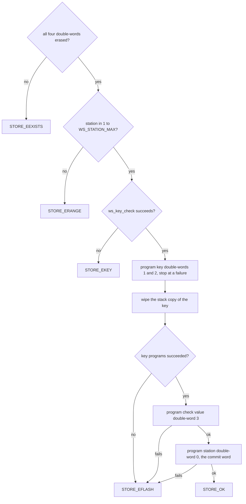

A cut at each point gives this load result:

| Cut | Station double-word | `store_config_load` returns |
|---|---|---|
| before the station double-word | erased | `STORE_ENODATA` (not provisioned) |
| during the station double-word | unreadable | `STORE_ENODATA` |
| after the station double-word | programmed | the record |

`STORE_EEXISTS` means that a double-word of the record is not erased. The flash cannot program it
again, so WIPE must erase the page first.

```c {#config-write}
/* 1 if every double-word of the record is erased (a programmed one cannot be programmed again). */
static int cfg_erased(uint32_t a) {
 for (uint32_t i = 0; i < CFG_DWORDS; i++) if (rd64(dw_addr(a, i), 0) != ERASED) return 0;
 return 1;
}
int store_config_write(uint32_t station, const uint8_t key[WS_KEY_LEN], uint8_t kcv[WS_KCV_LEN]) {
 uint32_t a = WS_PAGE_ADDR(WS_CONFIG_PAGE); uint64_t k[CFG_KEY_DWORDS]; int rc = STORE_OK;
 if (!cfg_erased(a)) return STORE_EEXISTS; /* WIPE must erase the page first */
 if (station == 0 || station > WS_STATION_MAX) return STORE_ERANGE;
 if (ws_key_check(key, kcv)) return STORE_EKEY;
 memcpy(k, key, sizeof k);
 for (uint32_t i = 0; i < CFG_KEY_DWORDS && !rc; i++) rc = prog64(dw_addr(a, CFG_KEY_POS + i), k[i]);
 ws_wipe(k, sizeof k);
 /* The station double-word goes last because it commits the record. */
 if (rc || prog64(dw_addr(a, CFG_KCV_POS), dw_make(CFG_MAGIC2, kcv_value(kcv))) ||
     prog64(dw_addr(a, CFG_ID_POS), dw_make(CFG_MAGIC, station))) return STORE_EFLASH;
 return STORE_OK;
}
```

### Load

`store_config_load` checks the record in this order:

1. Every double-word is readable and both magics match. Otherwise it returns `STORE_ENODATA`.
2. The recomputed key check value (`ws_key_check`) equals the stored one. Otherwise it returns
   `STORE_EKEY`, because the key changed after it was written.
3. The station id is in range. Otherwise it returns `STORE_ERANGE`.

The function zeroes the key buffer on every failure. On success it also fills `kcv_out` with the
check value. The console prints that value for comparison with the gateway's value.

```c {#config-load}
/* ---- provisioning ---- */
int store_config_load(uint32_t *station, uint8_t key[WS_KEY_LEN], uint8_t kcv_out[WS_KCV_LEN]) {
 uint32_t a = WS_PAGE_ADDR(WS_CONFIG_PAGE); int bad = 0; uint8_t kcv[WS_KCV_LEN]; uint64_t k[CFG_KEY_DWORDS];
 uint64_t id = rd64(dw_addr(a, CFG_ID_POS), &bad), check = rd64(dw_addr(a, CFG_KCV_POS), &bad);
 for (uint32_t i = 0; i < CFG_KEY_DWORDS; i++) k[i] = rd64(dw_addr(a, CFG_KEY_POS + i), &bad);
 memcpy(key, k, WS_KEY_LEN); ws_wipe(k, sizeof k);
 int rc = bad || dw_hi(id) != CFG_MAGIC || dw_hi(check) != CFG_MAGIC2 ? STORE_ENODATA
        : ws_key_check(key, kcv) || dw_lo(check) != kcv_value(kcv) ? STORE_EKEY
        : dw_lo(id) == 0 || dw_lo(id) > WS_STATION_MAX ? STORE_ERANGE : STORE_OK;
 if (rc) { ws_wipe(key, WS_KEY_LEN); return rc; }
 *station = dw_lo(id);
 memcpy(kcv_out, kcv, WS_KCV_LEN);
 return STORE_OK;
}
```

## 5. Meta log

### Format

Pages 125 and 126 hold an append-only log of 64-bit records. Double-word 0 of a page is the header.
Positions 1–255 hold records. A record is one double-word, so it is its own commit word. The first
row of the diagram is the header, and the second row is one record:

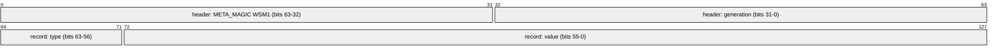

| Type | Name | Value |
|---|---|---|
| `0xE1` | `META_EPOCH` | highest boot epoch reserved, or the epoch floor |
| `0xC2` | `META_CTR` | highest counter reserved (inclusive) |
| `0xD1` | `META_LOST` | cumulative records overwritten while pending |
| `0xD2` | `META_ABAND` | cumulative records abandoned after a NACK or at the strike limit |
| `0xA1` | `META_RAIN` | the rain module setting: bit 0 is "on" (WSMP-P1). Each change writes the next value |

The strike limit is in `ws_policy.h`. A record gets a strike when it stays unanswered while a later
frame of the same exchange gets an answer.

```c {#meta-constants}
#define META_MAGIC 0x57534D31UL /* "WSM1" */
#define META_EPOCH 0xE1U
#define META_CTR   0xC2U
#define META_LOST  0xD1U /* cumulative journal overflow losses */
#define META_ABAND 0xD2U /* cumulative abandoned records (NACK / strike limit) */
#define META_RAIN  0xA1U /* the rain module setting: bit 0 on, latest wins through a rising value */
#define META_TYPE_SHIFT 56U                                  /* type: bits 63-56, value: bits 55-0 */
#define META_VALUE_MAX ((1ULL << META_TYPE_SHIFT) - 1U)
#define META_DWORDS (WS_PAGE_SIZE / WS_DW_BYTES)
#define META_FIRST_POS 1U   /* position 0 is the page header */
#define META_FIRST_GEN 1U
#define CTR_BLOCK 256U
static uint64_t meta_word(uint32_t type, uint64_t value) { return (uint64_t)type << META_TYPE_SHIFT | value; }
```

RAM state: the active page, the next free position and the generation, and the five maxima
(epoch, counter reservation, lost total, abandoned total and rain setting).
`ctr_next` is the next counter to return. It stays at or below `ctr_reserved + 1`, because the log
reserves counters in blocks (see "Reserve before use").

```c {#meta-state}
/* ---- monotonic meta log ---- */
static uint32_t meta_active, meta_pos, meta_gen;
static uint32_t max_epoch;
static uint64_t ctr_reserved, ctr_next;
static uint32_t lost_total, abandoned_total;
static uint32_t rain_setting;
```

### Boot

`meta_absorb` raises a maximum from one record and ignores unknown types. The lost and abandoned
totals are 32-bit in RAM. `raise32` ignores a value above `0xFFFFFFFF` and does not truncate it.

```c {#meta-absorb}
/* A 32-bit total only moves up, and only to a value that fits. */
static void raise32(uint32_t *total, uint64_t val) {
 if (val > *total && val <= UINT32_MAX) *total = (uint32_t)val;
}
/* Folds one readable meta record into the RAM maxima. It ignores unknown types. */
static void meta_absorb(uint64_t v) {
 uint64_t val = v & META_VALUE_MAX;
 switch (v >> META_TYPE_SHIFT) {
 case META_EPOCH: raise32(&max_epoch, val); break;
 case META_CTR: if (val > ctr_reserved) ctr_reserved = val; break;
 case META_LOST: raise32(&lost_total, val); break;
 case META_ABAND: raise32(&abandoned_total, val); break;
 case META_RAIN: raise32(&rain_setting, val); break;
 default: break;
 }
}
```

`meta_scan` reads a page header and every position. A page without a readable "WSM1" header is not
a meta page. An unreadable record adds no value but still counts as used, because the flash cannot
program a torn double-word again. `*last` is the last position that is not erased. Appends continue
after it.

```c {#meta-scan}
static int meta_scan(uint32_t page, uint32_t *gen, uint32_t *last) {
 uint32_t a = WS_PAGE_ADDR(page); int bad = 0;
 uint64_t h = rd64(a, &bad);
 if (bad || dw_hi(h) != META_MAGIC) return STORE_ENODATA;
 *gen = dw_lo(h); *last = 0;
 for (uint32_t i = META_FIRST_POS; i < META_DWORDS; i++) {
  int b = 0; uint64_t v = rd64(dw_addr(a, i), &b);
  if (!b && v == ERASED) continue;
  *last = i; /* an unreadable double-word still occupies its position */
  if (!b) meta_absorb(v);
 }
 return STORE_OK;
}
```

`store_meta_init` scans both pages into the same maxima and then picks the active page:

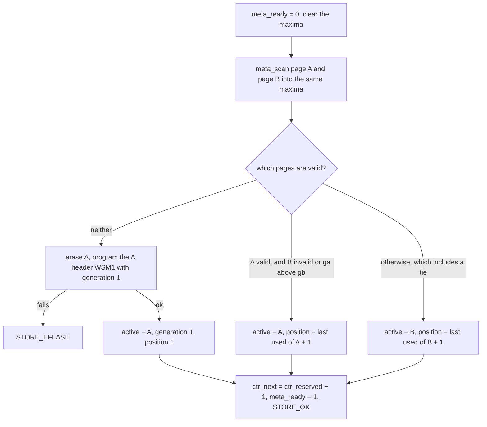

During a compaction both pages can be valid. The maxima over both pages are correct then too.
`ctr_next` starts at `ctr_reserved + 1`. This skips any counters of the last block that the node
used before the reset.

```c {#meta-init}
int store_meta_init(void) {
 uint32_t ga = 0, gb = 0, la = 0, lb = 0;
 int va, vb;
 meta_ready = 0;
 max_epoch = 0; ctr_reserved = 0; lost_total = 0; abandoned_total = 0; rain_setting = 0;
 va = meta_scan(WS_META_PAGE_A, &ga, &la) == STORE_OK;
 vb = meta_scan(WS_META_PAGE_B, &gb, &lb) == STORE_OK;
 if (!va && !vb) {
  if (erase_page(WS_META_PAGE_A) || prog64(WS_PAGE_ADDR(WS_META_PAGE_A), dw_make(META_MAGIC, META_FIRST_GEN))) return STORE_EFLASH;
  meta_active = WS_META_PAGE_A; meta_gen = META_FIRST_GEN; meta_pos = META_FIRST_POS;
 } else if (va && (!vb || ga > gb)) {
  meta_active = WS_META_PAGE_A; meta_gen = ga; meta_pos = la + 1;
 } else {
  meta_active = WS_META_PAGE_B; meta_gen = gb; meta_pos = lb + 1;
 }
 ctr_next = ctr_reserved + 1; /* skips any counter that the node may have used before the reset */
 meta_ready = 1;
 return STORE_OK;
}
```

Both meta pages can become unreadable while the provisioning record survives. The counter then
restarts at 1 under the existing key. The design accepts this risk, because only a layout change
can cause it. A layout change gives the board a WIPE and a new key
(`docs/runbook-moving-boards.md`, "Changing the flash layout"), so no layout-version field is
necessary.

### Append

`meta_append` returns `STORE_ERANGE` for a value over `META_VALUE_MAX` (56 bits). It compacts when
the active page is full. It returns `STORE_EFLASH` if the compaction or the program fails. Callers
pass its code through. A failed program still consumes its position, because the double-word may
be torn.

```c {#meta-append}
static int meta_append(uint32_t type, uint64_t value) {
 if (value > META_VALUE_MAX) return STORE_ERANGE;
 if (meta_pos >= META_DWORDS && meta_compact()) return STORE_EFLASH;
 int rc = prog64(dw_addr(WS_PAGE_ADDR(meta_active), meta_pos), meta_word(type, value));
 meta_pos++; /* a failed program may have torn the double-word: never reuse it */
 return rc ? STORE_EFLASH : STORE_OK;
}
```

### Compaction

When the active page is full, `meta_compact` writes the five maxima as new records into the other
page. Then it makes that page active with the next generation:

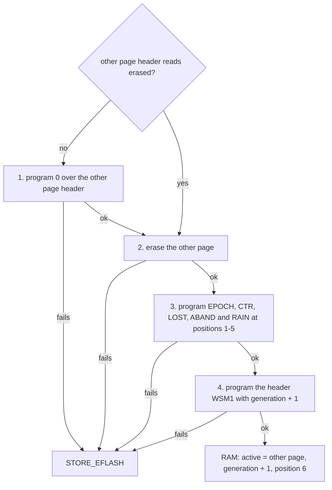

A cut after each step leaves these pages for the next boot:

| After step | Other page at boot | Active page at boot |
|---|---|---|
| 1 | not a meta page | valid, all values |
| 2 | not a meta page | valid, all values |
| 3 | not a meta page (no header) | valid, all values |
| 4 | valid, higher generation | valid, older generation |

A cut at steps 1–3 leaves the current page authoritative, and the next append compacts again. After
step 4 the maxima over both pages are unchanged.

Step 1 matters because the other page holds the previous generation with a valid header. An erase
with the header in place let a cut leave the header readable over partially erased records. Boot
then took maxima from junk. A counter above 2^40 disables the node permanently, because WIPE keeps
the counter. Step 1 programs zeros over the header, which the flash allows over written data. This
makes the page invalid before the erase starts. The test model's partial erases leave each
double-word old, erased or unreadable, never an altered value. So the sweeps exercise the step
order, but they cannot reproduce the original failure.

```c {#meta-compact}
/* Compacts into the other page. It writes that page's header last, so a cut compaction
   leaves the current page authoritative. The other page still carries an older valid header.
   The code zeroes that header first, which the flash allows over written data. A cut during
   the erase then cannot leave half-erased values under a header that boot trusts. */
static int meta_compact(void) {
 uint32_t other = meta_active == WS_META_PAGE_A ? WS_META_PAGE_B : WS_META_PAGE_A;
 uint32_t a = WS_PAGE_ADDR(other);
 const uint64_t rec[] = { meta_word(META_EPOCH, max_epoch), meta_word(META_CTR, ctr_reserved),
                          meta_word(META_LOST, lost_total), meta_word(META_ABAND, abandoned_total),
                          meta_word(META_RAIN, rain_setting) };
 int bad = 0;
 if (rd64(a, &bad) != ERASED && prog64(a, 0)) return STORE_EFLASH;
 if (erase_page(other)) return STORE_EFLASH;
 for (uint32_t k = 0; k < sizeof rec / sizeof rec[0]; k++) if (prog64(dw_addr(a, META_FIRST_POS + k), rec[k])) return STORE_EFLASH;
 if (prog64(a, dw_make(META_MAGIC, meta_gen + 1))) return STORE_EFLASH;
 meta_active = other; meta_gen++; meta_pos = META_FIRST_POS + sizeof rec / sizeof rec[0];
 return STORE_OK;
}
```

An unreadable header reads as 0 with `bad` set. 0 is not `ERASED`, so step 1 also zeroes an
unreadable header.

### Reserve before use

Every caller appends first and changes RAM only after the append succeeds. So RAM never holds a
value that the next boot would not restore. The error sweep (section 9) found one exception.
`store_note_abandoned` raised `abandoned_total` before the append. A failed program then made the
reported total fall after the next reboot. The fix has a regression test,
`test_bug_failed_abandon_note_lowers_total_after_reboot`.

**Epoch.** `store_next_epoch` reserves one epoch per boot, before sampling. The observation
identity is (epoch, sequence). The function returns `STORE_EEXHAUSTED` one below
`STORE_EPOCH_RESERVED` (`UINT32_MAX`, `node_store.h`). That reserved epoch is `STORM_EPOCH`. The
bench flash storm test (`TEST-FLASH-STORM`) writes its records under it, and the boot scrub
acknowledges them.

```c {#next-epoch}
int store_next_epoch(uint32_t *epoch) {
 if (!meta_ready) return STORE_ENOTREADY;
 /* A real boot never gets STORE_EPOCH_RESERVED. The bench storm test uses that epoch, and the
    boot scrub acknowledges its records. */
 if (max_epoch >= STORE_EPOCH_RESERVED - 1U) return STORE_EEXHAUSTED;
 int rc = meta_append(META_EPOCH, (uint64_t)max_epoch + 1);
 if (rc) return rc;
 *epoch = ++max_epoch;
 return STORE_OK;
}
```

**Epoch floor.** After a WIPE the gateway supplies a floor above every epoch that it has stored for
the station. `store_epoch_floor` accepts a floor at or below the current epoch and changes nothing.

```c {#epoch-floor}
/* After a WIPE, the gateway supplies a floor above every epoch it has stored. New observation
   identities then cannot collide with stored ones. The epoch only moves up. */
int store_epoch_floor(uint32_t floor) {
 if (!meta_ready) return STORE_ENOTREADY;
 if (floor <= max_epoch) return STORE_OK;
 int rc = meta_append(META_EPOCH, floor);
 if (rc) return rc;
 max_epoch = floor;
 return STORE_OK;
}
```

**Abandoned total.** The node adds 1 for each record that the gateway refused with a NACK or that
the strike limit dropped.

```c {#abandoned}
int store_note_abandoned(void) {
 if (!meta_ready) return STORE_ENOTREADY;
 int rc = meta_append(META_ABAND, (uint64_t)abandoned_total + 1);
 if (rc) return rc;
 abandoned_total++;
 return STORE_OK;
}
uint32_t store_abandoned_total(void) { return abandoned_total; }
```

**Rain setting.** The rain gauge is a bare switch, so the station cannot detect it (WSMP-P1). The
operator turns the rain module on and off with a console command, and the node keeps the setting.
The meta log keeps only maxima, so the setting is a rising value whose bit 0 is "on". A change
writes the next value, which has the other parity. Recovery takes the highest value, which is the
last one written. A cut write leaves the old value or the new one, never another. The same setting
again writes nothing.

```c {#rain}
int store_rain_set(int on) {
 if (!meta_ready) return STORE_ENOTREADY;
 if ((rain_setting & 1U) == (on ? 1U : 0U)) return STORE_OK;
 if (rain_setting == UINT32_MAX) return STORE_EEXHAUSTED;
 int rc = meta_append(META_RAIN, (uint64_t)rain_setting + 1);
 if (rc) return rc;
 rain_setting++;
 return STORE_OK;
}
int store_rain_enabled(void) { return (int)(rain_setting & 1U); }
```

**Counter.** One record per transmission would fill a meta page every 255 frames. So the log
reserves blocks of `CTR_BLOCK` (256), and `store_next_counter` returns counters from RAM within the
block. A reset discards the rest of the block, because init starts at `ctr_reserved + 1`. The loss
is at most 255 of 2^40 counters. The frame header carries 40 bits (`WS_COUNTER_MAX`). Past that
limit the function returns `STORE_EEXHAUSTED` permanently and does not truncate. A failed
reservation returns its error and no counter.

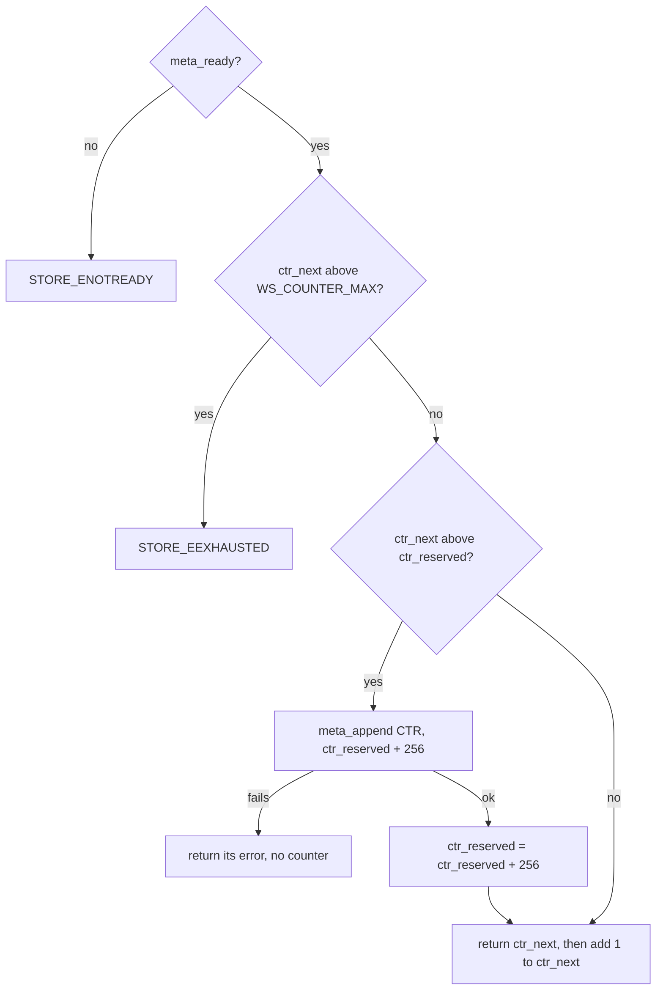

```c {#next-counter}
int store_next_counter(uint64_t *counter) {
 if (!meta_ready) return STORE_ENOTREADY;
 /* The header carries 40 bits. It would truncate a larger counter and repeat a nonce. */
 if (ctr_next > WS_COUNTER_MAX) return STORE_EEXHAUSTED;
 if (ctr_next > ctr_reserved) {
  uint64_t upto = ctr_reserved + CTR_BLOCK;
  int rc = meta_append(META_CTR, upto);
  if (rc) return rc; /* no durable reservation, no counter */
  ctr_reserved = upto;
 }
 *counter = ctr_next++;
 return STORE_OK;
}
```

## 6. Journal

### Format

Pages 55–124 form a ring of `WS_JOURNAL_PAGES` pages. The host sweeps build the ring with 3 pages
so that it wraps. Each page has an 8-byte header followed by fixed-size slots. In the default build
(the version 6 node field set, `WS_F_WSMP_BENCH`: a 77-byte plaintext at most) a 2048-byte page
holds 21 slots of 96 bytes and leaves 24 bytes unused:


The page header, most significant bit on the left:


A slot in the default build, one double-word per row:

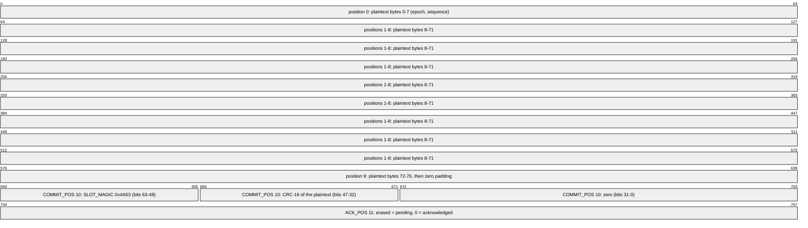

The plaintext takes `JOURNAL_PLAIN_DW` double-words, zero-padded. The slot size follows the build's
field set (`node_fields.h`): its widest record, `WS_OBS_PLAIN_MAX`, not the whole catalog. A shorter
record of the same build sits zero-padded in the same slot. The board's ring keeps 24 hours of the
build's widest record (the check below), which caps a node build at 80 bytes of plaintext (a 96-byte
slot, 21 slots a page, 69 x 21 = 1,449 records; a 96-byte frame). Every catalog v2 field together
is 94 bytes, a 112-byte slot and only 18 slots a page (1,242 records, 20.7 hours): the RX bridge and
the gateway accept such a record, but no node build sends one. The host tests build that geometry
too, with a shrunken ring. The low byte of the header magic is the slot
size. So a page written with another slot size reads as "not a journal page". The low 32 bits of
the header are the page sequence. Each newly opened page gets the next sequence. The head is the
page with the highest sequence.

```c {#journal-constants}
#define JPG_MAGIC  (0x57534A00UL | JOURNAL_SLOT_BYTES) /* "WSJ" + slot size: another layout is ignored */
#define SLOT_MAGIC 0x4A53U
#define JOURNAL_FIRST_SEQ 1U   /* page sequence 0 marks "not a journal page" */
```

```c {#geometry}
/* Geometry the on-flash format depends on (node_store.h). Positions are double-words in a slot. */
#define SLOT_BYTES JOURNAL_SLOT_BYTES
#define COMMIT_POS JOURNAL_PLAIN_DW
#define ACK_POS (COMMIT_POS + 1U)
```

Compile-time checks tie the format to `node_fields.h` and `flash_layout.h`:

```c {#geometry-checks}
_Static_assert(SLOT_BYTES == (ACK_POS + 1U) * WS_DW_BYTES && COMMIT_POS * WS_DW_BYTES >= WS_OBS_PLAIN_MAX,
               "slot = plaintext rounded to double-words + commit + ack double-words");
_Static_assert(SLOT_BYTES <= UINT8_MAX, "the slot size fits in the page magic's low byte");
_Static_assert(JOURNAL_SLOTS_PER_PAGE >= 1U && JOURNAL_HDR_BYTES + JOURNAL_SLOTS_PER_PAGE * SLOT_BYTES <= WS_PAGE_SIZE,
               "journal slots fit in one page");
_Static_assert(WS_OBS_ID_LEN <= WS_DW_BYTES, "a record's identity is in its first double-word");
_Static_assert((uint64_t)WS_STATE_FIRST * WS_PAGE_SIZE >= WS_FIRMWARE_BYTES, "node state sits above the firmware region");
_Static_assert(WS_JOURNAL_FIRST + WS_JOURNAL_PAGES == WS_META_PAGE_A && WS_META_PAGE_A < WS_META_PAGE_B &&
               WS_META_PAGE_B < WS_CONFIG_PAGE && WS_CONFIG_PAGE == WS_FLASH_PAGES - 1U,
               "journal, meta and config pages are distinct, in order, and end at the last page");
_Static_assert(WS_JOURNAL_PAGES >= 2U, "the journal ring has at least two pages");
#ifdef WS_JOURNAL_DEFAULT
/* The board's ring keeps 24 h of this build's widest record (WS_OBS_PLAIN_MAX, from WS_NODE_FIELDS).
   One page is always being recycled, so it does not count. This is the per-build ceiling: a field
   set above 80 B of plaintext (a 96 B frame) does not compile. */
_Static_assert((WS_JOURNAL_PAGES - 1U) * JOURNAL_SLOTS_PER_PAGE >= 24U * 60U,
               "the journal keeps 24 hours of the build's widest record");
#endif
_Static_assert(WS_JOURNAL_PAGES <= UINT16_MAX && JOURNAL_SLOTS_PER_PAGE <= UINT16_MAX, "jref_t page and slot are 16-bit");
```

### Slot states

The store programs a slot at most twice after an erase of its page. The append programs the data
and the commit word. The acknowledgement programs zero into the ACK double-word. Opening the page
again (`journal_new_page`) erases every slot.

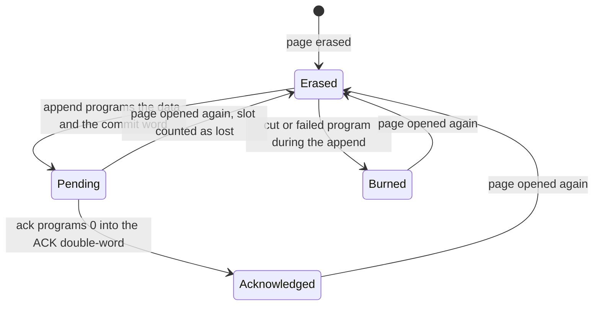

The journal never reuses a burned slot before its page is erased. Boot classifies each slot from
flash:

| Data and commit | ACK double-word | Boot state |
|---|---|---|
| all erased | erased | blank |
| readable, commit matches the plaintext | erased | pending |
| readable, commit matches the plaintext | not erased, or unreadable | acknowledged |
| any unreadable, or commit does not match | any | burned (counted by `store_journal_burned()`) |

The commit word holds the slot magic and a CRC-16 (cyclic redundancy check) of the plaintext. Boot
compares its upper 32 bits with `slot_commit_word(plain) >> 32`. A partial page erase can leave a
commit word over data that did not survive, or the reverse. The CRC catches that case.

An unreadable ACK double-word counts as acknowledged. The ACK program starts only after the
gateway's authenticated ACK arrived, so the gateway already stored the record. A pending state
would make the node send the record again.

```c {#crc}
#define CRC16_INIT 0xFFFFU   /* CRC-16/CCITT-FALSE */
#define CRC16_POLY 0x1021U
#define CRC16_TOP  0x8000U
static uint16_t crc16(const uint8_t *d, unsigned n) {
 uint16_t c = CRC16_INIT;
 /* bound: n bytes (WS_OBS_PLAIN_MAX from the only caller), CHAR_BIT bits each */
 while (n--) {
  c ^= (uint16_t)(*d++ << CHAR_BIT);
  for (int b = 0; b < CHAR_BIT; b++) c = (c & CRC16_TOP) ? (uint16_t)(c << 1 ^ CRC16_POLY) : (uint16_t)(c << 1);
 }
 return c;
}
/* The commit double-word: the high half is the slot magic (bits 31-16) and the plaintext's CRC
   (bits 15-0). The low half is zero. */
static uint64_t slot_commit_word(const uint8_t plain[WS_OBS_PLAIN_MAX]) {
 return dw_make((uint32_t)SLOT_MAGIC << 16 | crc16(plain, WS_OBS_PLAIN_MAX), 0);
}
```

The Makefile builds `node_store.c` with `-fno-optimize-crc`. Without it GCC 15 replaces this loop
and `ws_crc8` with 768 B of lookup tables, for code that runs a few times a minute.

### RAM state

Boot rebuilds the RAM state from flash. It holds `page_seq[p]` (0 means not a journal page), one
pending bit per slot of the ring, and the head position. `n_lost` and `n_burned` count since boot.
The persisted lost total is `lost_total` in the meta log. A `jref_t` (page, slot) names a slot.
Only this file creates them, and the public functions that take one check its range.

```c {#journal-state}
/* ---- journal ---- */
static uint32_t page_seq[WS_JOURNAL_PAGES];
static uint8_t pending[(JOURNAL_CAPACITY + CHAR_BIT - 1) / CHAR_BIT];   /* one bit per slot */
static uint32_t head, head_slot, n_pending, n_lost, n_burned;
```

```c {#journal-helpers}
static uint32_t slot_index(jref_t r) { return (uint32_t)r.page * JOURNAL_SLOTS_PER_PAGE + r.slot; }
static int is_pending(uint32_t i) { return pending[i / CHAR_BIT] >> (i % CHAR_BIT) & 1U; }
static void set_pending(uint32_t i, int on) {
 uint8_t bit = (uint8_t)(1U << (i % CHAR_BIT));
 if (on) pending[i / CHAR_BIT] |= bit; else pending[i / CHAR_BIT] &= (uint8_t)~bit;
}
static uint32_t slot_addr(uint32_t page, uint32_t slot) {
 return WS_PAGE_ADDR(WS_JOURNAL_FIRST + page) + JOURNAL_HDR_BYTES + slot * SLOT_BYTES;
}
```

### Append

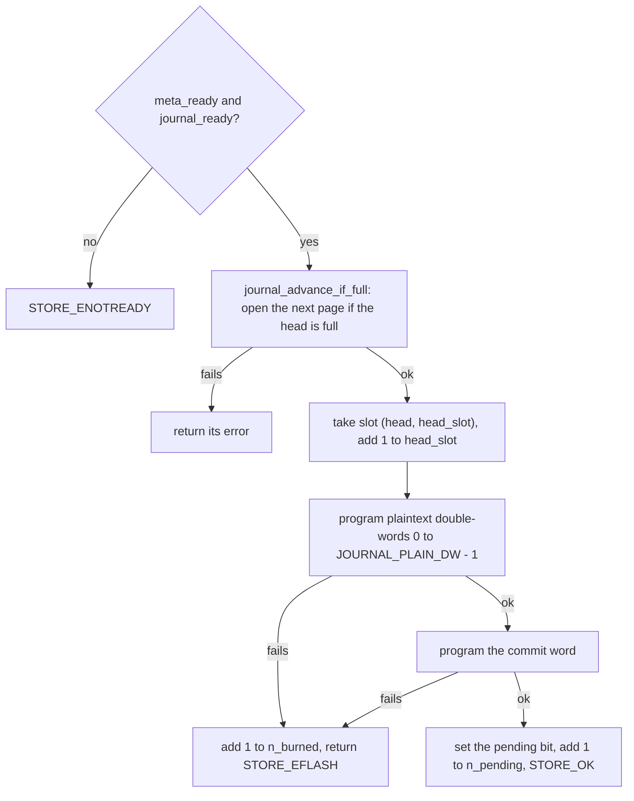

The append consumes the slot before any program. A failed program therefore leaves a burned slot,
which the journal never reuses. The append needs `meta_ready`, because opening a page can persist
the lost total.

```c {#journal-append}
int store_journal_append(const uint8_t plain[WS_OBS_PLAIN_MAX], jref_t *ref) {
 uint64_t d[JOURNAL_PLAIN_DW] = { 0 };
 if (!meta_ready || !journal_ready) return STORE_ENOTREADY; /* a wrap persists the lost total */
 int rc = journal_advance_if_full();
 if (rc) return rc;
 uint32_t a = slot_addr(head, head_slot);
 ref->page = (uint16_t)head; ref->slot = (uint16_t)head_slot;
 head_slot++; /* consumed even if programming fails: never reuse a possibly torn slot */
 memcpy(d, plain, WS_OBS_PLAIN_MAX);
 for (uint32_t k = 0; k < JOURNAL_PLAIN_DW; k++)
  if (prog64(dw_addr(a, k), d[k])) { n_burned++; return STORE_EFLASH; }
 if (prog64(dw_addr(a, COMMIT_POS), slot_commit_word(plain))) { n_burned++; return STORE_EFLASH; }
 set_pending(slot_index(*ref), 1); n_pending++;
 return STORE_OK;
}
```

### Opening a page

The page after the head is the oldest. When the ring is full, that page still holds pending
records, and opening it destroys them. `journal_new_page` counts them before the erase:

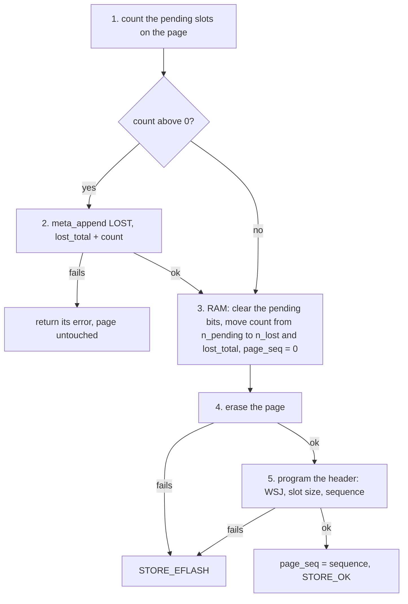

The caller passes the sequence: the previous head's sequence + 1, or 1 for the first page.

A cut between steps 2 and 4 over-counts. The records remain, and the total already includes them.
The sweep records this as `note_lost_back`, because over-counting is allowed. A cut during steps
4–5 leaves a page with its old header and some old slots, or with no readable header. Boot repairs
it (next section). The error sweep found that the step-2 failure path was missing. The code ignored
a failed `meta_append(META_LOST)` and erased the page. It lost records that the total never
counted. The regression test is `test_bug_failed_lost_persist_still_erases_page`.

```c {#journal-new-page}
static int journal_new_page(uint32_t page, uint32_t seq) {
 uint32_t dropped = 0;
 for (uint32_t s = 0; s < JOURNAL_SLOTS_PER_PAGE; s++) dropped += (uint32_t)is_pending(page * JOURNAL_SLOTS_PER_PAGE + s);
 /* persist the loss before the page is reused. On failure keep the page and its records. */
 int rc = dropped ? meta_append(META_LOST, (uint64_t)lost_total + dropped) : STORE_OK;
 if (rc) return rc;
 for (uint32_t s = 0; s < JOURNAL_SLOTS_PER_PAGE; s++) set_pending(page * JOURNAL_SLOTS_PER_PAGE + s, 0);
 n_pending -= dropped; n_lost += dropped; lost_total += dropped;
 page_seq[page] = 0;
 if (erase_page(WS_JOURNAL_FIRST + page) || prog64(WS_PAGE_ADDR(WS_JOURNAL_FIRST + page), dw_make(JPG_MAGIC, seq))) return STORE_EFLASH;
 page_seq[page] = seq;
 return STORE_OK;
}
```

`journal_advance_if_full` opens the next page only when the head is full. Append and init both
call it.

```c {#journal-advance}
/* Opens a fresh page after the head once the head is full (append, and init after a cut). */
static int journal_advance_if_full(void) {
 if (head_slot < JOURNAL_SLOTS_PER_PAGE) return STORE_OK;
 uint32_t next = (head + 1) % WS_JOURNAL_PAGES;
 int rc = journal_new_page(next, page_seq[head] + 1);
 if (rc) return rc;
 head = next; head_slot = 0;
 return STORE_OK;
}
```

### Boot

`journal_find_head` reads every page header. The head is the page with the highest sequence, or
the later page on a tie. A page with an unreadable or foreign header is not a journal page.

```c {#journal-find-head}
/* Reads every page header into page_seq (0: not a journal page) and points head at the
   highest sequence, the later page on a tie. Returns 0 when no page is a journal page. */
static int journal_find_head(void) {
 uint32_t best = 0; int found = 0;
 for (uint32_t p = 0; p < WS_JOURNAL_PAGES; p++) {
  int bad = 0; uint64_t h = rd64(WS_PAGE_ADDR(WS_JOURNAL_FIRST + p), &bad);
  page_seq[p] = !bad && dw_hi(h) == JPG_MAGIC ? dw_lo(h) : 0;
  if (page_seq[p] && page_seq[p] >= best) { best = page_seq[p]; head = p; found = 1; }
 }
 return found;
}
```

`journal_scan_slot` classifies one slot (table above). `journal_scan_page` returns one past the
last slot that is not blank. On the head page the next append goes there, after any burned slot.

```c {#journal-scan-slot}
/* Boot scan of one slot. Returns 0 if the slot is blank, else 1. It counts a slot with torn or
   unreadable data as burned, and a committed slot without an ACK as pending. */
static int journal_scan_slot(uint32_t p, uint32_t s) {
 uint32_t a = slot_addr(p, s); int bad_data = 0, bad_ack = 0, erased = 1; uint64_t d[COMMIT_POS + 1], ack;
 for (uint32_t k = 0; k <= COMMIT_POS; k++) { d[k] = rd64(dw_addr(a, k), &bad_data); erased &= d[k] == ERASED; }
 ack = rd64(dw_addr(a, ACK_POS), &bad_ack);
 if (!bad_data && !bad_ack && erased && ack == ERASED) return 0;
 uint8_t plain[WS_OBS_PLAIN_MAX]; memcpy(plain, d, sizeof plain);
 /* A torn ACK word (ECC fault) means a cut stopped the ACK program after the gateway stored
    the record. So the slot counts as acknowledged. */
 if (bad_data || dw_hi(d[COMMIT_POS]) != dw_hi(slot_commit_word(plain))) n_burned++;
 else if (!bad_ack && ack == ERASED) { set_pending(p * JOURNAL_SLOTS_PER_PAGE + s, 1); n_pending++; }
 return 1;
}
/* Scans the slots of a journal page. Returns one past the last used slot (0 if none). */
static uint32_t journal_scan_page(uint32_t p) {
 uint32_t last_used = 0;
 for (uint32_t s = 0; s < JOURNAL_SLOTS_PER_PAGE; s++) if (journal_scan_slot(p, s)) last_used = s + 1;
 return last_used;
}
```

`store_journal_init` rebuilds the RAM state:

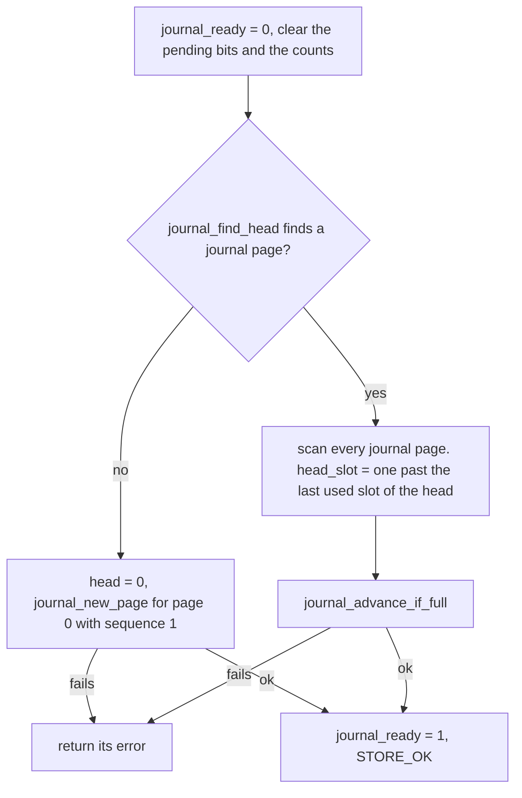

The last step fixes the first bug that the power-cut sweep found. Its regression test is
`test_bug_interrupted_recycle_resurrects_acked_record`. If the head page is full, a cut may have
stopped the recycle of the next page during its erase. That cut can erase an ACK double-word while
the data and the commit word of the record survive. The slot then reads as pending, and the node
sends an acknowledged record again. So init finishes the recycle (`journal_advance_if_full`) before
it trusts that page. If the head is not full, the next page was never recycled, so its slots are as
written.

```c {#journal-init}
int store_journal_init(void) {
 journal_ready = 0;
 memset(pending, 0, sizeof pending); n_pending = n_lost = n_burned = 0;
 if (!journal_find_head()) {
  head = 0; head_slot = 0;
  int rc = journal_new_page(0, JOURNAL_FIRST_SEQ);
  if (rc) return rc;
  journal_ready = 1;
  return STORE_OK;
 }
 for (uint32_t p = 0; p < WS_JOURNAL_PAGES; p++) {
  if (!page_seq[p]) continue;
  uint32_t last_used = journal_scan_page(p);
  if (p == head) head_slot = last_used;
 }
 /* A full head means that a cut may have stopped the next page's recycle during its erase.
    That erase can clear an ACK word and keep its record. Finish the recycle first. */
 int rc = journal_advance_if_full();
 if (rc) return rc;
 journal_ready = 1;
 return STORE_OK;
}
```

### Read and acknowledge

`store_journal_read` returns `STORE_ENODATA` if any plaintext double-word is unreadable. The caller
prints `#error journal-read` and moves to the next record.

```c {#journal-read}
/* A jref_t comes only from this file (append, oldest, find): always a slot of the journal. */
static int ref_in_journal(jref_t r) { return r.page < WS_JOURNAL_PAGES && r.slot < JOURNAL_SLOTS_PER_PAGE; }
int store_journal_read(jref_t ref, uint8_t plain[WS_OBS_PLAIN_MAX]) {
 if (!WS_CHECK(ref_in_journal(ref))) return STORE_EINVAL;
 uint32_t a = slot_addr(ref.page, ref.slot); int bad = 0; uint64_t d[JOURNAL_PLAIN_DW];
 for (uint32_t k = 0; k < JOURNAL_PLAIN_DW; k++) d[k] = rd64(dw_addr(a, k), &bad);
 if (bad) return STORE_ENODATA;
 memcpy(plain, d, WS_OBS_PLAIN_MAX);
 return STORE_OK;
}
```

`store_journal_ack` programs zero into the ACK double-word, then clears the pending bit. If the
program fails, the record stays pending and the node sends it again. The gateway removes the
duplicate. If the function cleared the bit first, RAM could drop a record that flash still holds
as pending. The next boot would then send it anyway. An ACK for a slot that is not pending returns
0 and writes nothing.

```c {#journal-ack}
int store_journal_ack(jref_t ref) {
 if (!journal_ready) return STORE_ENOTREADY;
 if (!WS_CHECK(ref_in_journal(ref))) return STORE_EINVAL;   /* before it indexes pending[] */
 uint32_t i = slot_index(ref);
 if (!is_pending(i)) return STORE_OK;
 if (prog64(dw_addr(slot_addr(ref.page, ref.slot), ACK_POS), 0)) return STORE_EFLASH;
 set_pending(i, 0); n_pending--;
 return STORE_OK;
}
```

### Pending records

`store_journal_oldest` returns pending records oldest first. It goes through the pages from the one
after the head to the head, and through the slots of a page in order. `except` excludes the record
that the exchange already holds.

```c {#journal-oldest}
/* Appends page p's pending refs, in slot order and skipping 'except', to out[n..max). */
static unsigned page_pending(uint32_t p, jref_t *out, unsigned n, unsigned max, const jref_t *except) {
 for (uint32_t s = 0; s < JOURNAL_SLOTS_PER_PAGE && n < max; s++) {
  jref_t r = { (uint16_t)p, (uint16_t)s };
  if (!is_pending(slot_index(r))) continue;
  if (except && except->page == r.page && except->slot == r.slot) continue;
  out[n++] = r;
 }
 return n;
}
unsigned store_journal_oldest(jref_t *out, unsigned max, const jref_t *except) {
 unsigned n = 0;
 if (!journal_ready) return 0;
 for (uint32_t k = 1; k <= WS_JOURNAL_PAGES && n < max; k++) {
  uint32_t p = (head + k) % WS_JOURNAL_PAGES; /* oldest page first, head page last */
  if (page_seq[p]) n = page_pending(p, out, n, max, except);
 }
 return n;
}
```

The identity of a record is (epoch, sequence), the first 8 bytes of the plaintext, big-endian.
`next_pending_match` searches the pending slots for an identity and compares against flash. A slot
whose first double-word is unreadable never matches. `store_journal_find` matches the epoch and the
sequence. `store_journal_scrub` matches the epoch only.

```c {#journal-find}
/* Shared by find and scrub. Finds the next pending slot, from index *i on, that reads back
   without an ECC fault and whose identity matches. The identity is the plaintext's first
   WS_OBS_ID_LEN bytes: the epoch, then the sequence. With any_seq set, only the epoch counts.
   Returns 1 with the slot's ref and *i just past the slot. Returns 0 when no such slot is left. */
static int next_pending_match(uint32_t epoch, int any_seq, uint32_t seq, uint32_t *i, jref_t *ref) {
 uint8_t want[WS_OBS_ID_LEN];
 ws_put_be32(want, epoch); ws_put_be32(want + WS_OBS_EPOCH_LEN, seq);
 for (uint32_t k = *i; k < JOURNAL_CAPACITY; k++) {
  if (!is_pending(k)) continue;
  jref_t r = { (uint16_t)(k / JOURNAL_SLOTS_PER_PAGE), (uint16_t)(k % JOURNAL_SLOTS_PER_PAGE) };
  int bad = 0; uint64_t d0 = rd64(slot_addr(r.page, r.slot), &bad);
  if (!bad && !memcmp(&d0, want, any_seq ? WS_OBS_EPOCH_LEN : WS_OBS_ID_LEN)) { *ref = r; *i = k + 1; return 1; }
 }
 return 0;
}
int store_journal_find(uint32_t epoch, uint32_t seq, jref_t *ref) {
 uint32_t i = 0;
 if (!journal_ready) return STORE_ENOTREADY;
 return next_pending_match(epoch, 0, seq, &i, ref) ? STORE_OK : STORE_ENODATA;
}
```

`store_journal_scrub` acknowledges every pending record of one epoch. Boot calls it with
`STORM_EPOCH` to drop the records of the bench storm test. Each match moves `i` past its slot, and
the search finds no slot at or past `JOURNAL_CAPACITY`. So the loop runs at most `JOURNAL_CAPACITY`
times. This satisfies rule 2 of the Power of Ten coding rules (`docs/power-of-ten.md`).
`tools/loop_bounds.py` reads the `bound:` comment.

```c {#journal-scrub}
uint32_t store_journal_scrub(uint32_t marker)
{
 uint32_t n = 0, i = 0; jref_t r;
 if (!journal_ready) return 0;
 /* Only slots without an ECC fault match. The ack clears the bit of slot r, which the search
    has already passed. Each match moves i past its slot. No match exists at or past
    JOURNAL_CAPACITY. Therefore: */
 /* bound: at most JOURNAL_CAPACITY passes */
 while (next_pending_match(marker, 1, 0, &i, &r))
  if (store_journal_ack(r) == 0) n++;
 return n;
}
```

The console, `#sample` and the health report (DIAG) read these accessors. Only the lost total
persists across boots.

```c {#accessors}
uint32_t store_journal_pending(void) { return n_pending; }
uint32_t store_journal_lost(void) { return lost_total; } /* cumulative, persisted */
uint32_t store_journal_burned(void) { return n_burned; }
uint32_t store_ecc_faults(void) { return n_ecc; }
uint64_t store_counter_next(void) { return ctr_next; }
```

## 7. WIPE

`store_wipe` erases the journal and the provisioning record. It never erases the meta log. So the
counter, the epoch and the totals keep rising for the life of the board. The first version erased
both meta pages, which restarted the counter at 1. A new PROVISION command with the same key then
repeated nonces. A key first used under this firmware can follow the board across WIPEs. A key used
under older firmware, or on another board, cannot (`docs/runbook-moving-boards.md`).

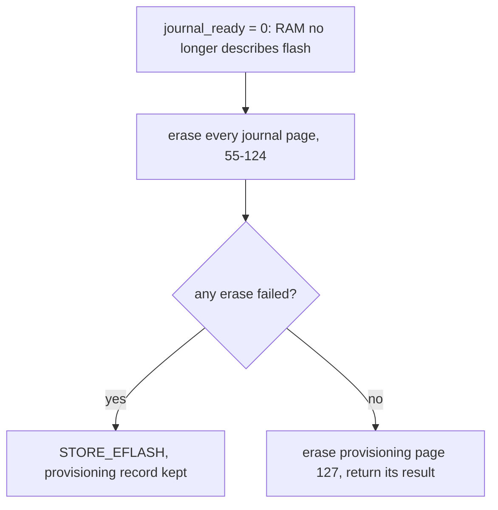

`store_wipe` tries every journal page, even after a failure. It erases the provisioning page last.
The board is unprovisioned only from that erase on. The first version erased the provisioning page
first. A cut after that erase left an unprovisioned board with pending records. Those records went
out under the identity of the next PROVISION. The regression test is
`test_bug_interrupted_wipe_leaves_journal_on_unprovisioned_board`. Now a failed journal erase keeps
the record, so the board stays provisioned. The operator does not see `#wipe ok` and runs WIPE
again. An interrupted WIPE can leave acknowledged records pending again
(`note_acked_back_after_interrupted_wipe`). WIPE makes no promise until it reports success.

```c {#wipe}
/* WIPE erases the key and the journal but never the meta log: the counter (the AES-CCM
 * nonce), the boot epoch and the lost/abandoned totals keep rising for the life of the board. */
int store_wipe(void) {
 int rc = STORE_OK;
 journal_ready = 0; /* RAM no longer describes flash: call store_journal_init again */
 for (uint32_t p = 0; p < WS_JOURNAL_PAGES; p++) rc |= erase_page(WS_JOURNAL_FIRST + p);
 if (rc) return STORE_EFLASH; /* keep the key: an unprovisioned board must not carry old records */
 return erase_page(WS_CONFIG_PAGE);
}
```

## 8. The file

The generated file orders the chunks for C. Constants and compile-time checks come first. Then
come flash access, provisioning, the meta log and the journal, each after the state it uses.

```c {#node_store.c}
<<abstract>>
#define WS_CHECK_FILE 5
#include "node_store.h"
#include <limits.h>
#include <string.h>
#include "ws_be.h"
#include "ws_check.h"
#include "ws_frame.h"

<<erased>>
<<config-constants>>
<<meta-constants>>
<<journal-constants>>

<<geometry>>
<<geometry-checks>>

<<flash-primitives>>

<<ready-flags>>

<<config-load>>
<<config-write>>

<<meta-state>>

<<meta-absorb>>
<<meta-scan>>
<<meta-compact>>
<<meta-append>>
<<meta-init>>
<<next-epoch>>
<<epoch-floor>>
<<abandoned>>

<<rain>>

<<next-counter>>

<<journal-state>>

<<journal-helpers>>
<<crc>>
<<journal-new-page>>
<<journal-advance>>
<<journal-find-head>>
<<journal-scan-slot>>
<<journal-init>>
<<journal-append>>
<<journal-read>>
<<journal-ack>>
<<journal-oldest>>
<<journal-find>>
<<accessors>>

<<journal-scrub>>

<<wipe>>
```

## 9. Tests

`firmware/test_store.c` runs a scripted workload over `firmware/sim_flash.c`. The workload
provisions, reserves boot epochs and counter blocks, and appends and acknowledges journal records.
It also abandons records, changes the rain setting, compacts the meta log twice, wraps the journal
with losses, scrubs the storm epoch and runs WIPE. It runs in three modes:

| Mode | What it does |
|---|---|
| functional | runs the workload once and checks the results |
| sweep (the power-cut sweep) | for each flash operation index: cuts power there once for each outcome that the model has, reboots, and checks every guarantee in section 1. Program outcomes: old, new, torn. Erase outcomes: none, all, two random partial patterns, partial with unreadable double-words |
| errsweep (the error sweep) | for each flash operation index: fails that operation like a hardware abstraction layer (HAL) error, continues the workload, and checks. The failed operation leaves flash unchanged, torn or partially erased |

The tests use three geometries: `full` (the board's 70-page journal), `small` (a 3-page journal, so
the sweeps wrap) and `wide` (the widest field catalog, 3 pages). `tests/test_store_powercut.py`
builds and runs them under AddressSanitizer and UndefinedBehaviorSanitizer. It fails on any
violation that it does not list as a note. It also runs the four `test_bug_*` regressions named
above.

```sh
.venv/bin/python -m unittest tests.test_store_powercut tests.test_tangle
```
