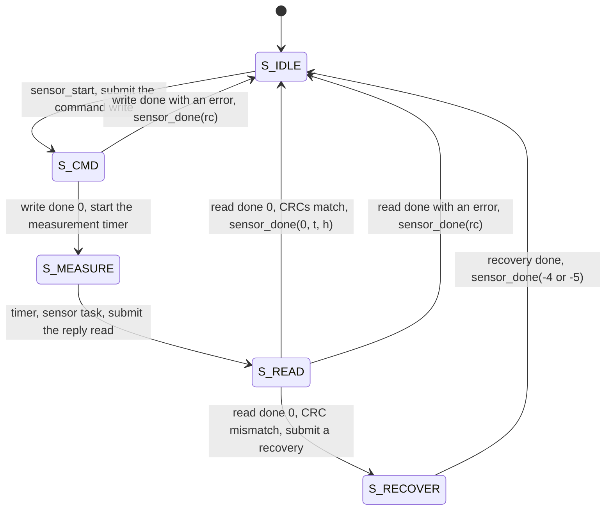

# sensor: the SHT45 driver

`sensor.c` reads temperature and relative humidity from one SHT45 sensor. The sensor is a client of
the shared I2C bus (`i2c_bus.lit.md`), which runs the transfers, their guard timer and the stuck-bus
recovery. `sensor_start` begins a measurement and returns at once. Interrupts, timers and tasks do
every step after that. The main loop reports the result through `sensor_done`. After any failure the
bus frees a stuck bus before the result comes back.

The WSMP air temperature and humidity module (`mod_sht45.c`, plan task 4) replaces this file. Until
then it keeps the interface that `app_tx.c` uses.

This document is the source. `tools/tangle.py` generates `sensor.c` from the code chunks below.

```sh
python3 tools/tangle.py firmware/stage0-node/App/sensor.lit.md            # write sensor.c
python3 tools/tangle.py --check firmware/stage0-node/App/sensor.lit.md    # committed .c == tangle
```

## 1. Behaviour

One measurement is three steps:

1. Write the command 0xFD (`WS_SHT45_MEASURE`) to address 0x44.
2. Wait `WS_SHT45_MEASURE_MS` (11 ms; the sensor needs at most 8.3 ms).
3. Read 6 bytes: the temperature word, its CRC, the humidity word, its CRC.

`sensor_done` gets one of these codes (`sensor.h`):

| Code | Meaning |
|---|---|
| 0 | a reading. Both CRCs match |
| -1 | the previous measurement had not finished (`app_tx.c` reports it) |
| -2 | the address or the command was not acknowledged: no sensor, wiring, or the HAL refused the write |
| -3 | the read was not acknowledged |
| -4 | a CRC mismatch: noise or the cable |
| -5 | SDA still low after the recovery |
| -6 | a transfer did not finish within its 30 ms guard |

## 2. State machine



The measurement timer runs in the RTC interrupt. The bus queue belongs to the main loop, so the
timer only posts the sensor task, and the task submits the read. A CRC mismatch is not a bus
failure, so the bus does not recover by itself. The driver asks for the recovery (the bus form
without bytes), as the earlier driver did after every failure.

```c {#states}
typedef enum { S_IDLE, S_CMD, S_MEASURE, S_READ, S_RECOVER } sensor_state;
static sensor_state st = S_IDLE;
static uint8_t reply[WS_SHT45_REPLY_LEN];
static UTIL_TIMER_Object_t measure_timer;
static const uint8_t command[1] = { WS_SHT45_MEASURE };

static void submit(const uint8_t *tx, uint8_t txlen, uint8_t *rx, uint8_t rxlen)
{
  /* The bus refuses only a busy client or a bad form; this file never makes either. */
  (void)WS_CHECK(i2c_bus_submit(I2C_C_SHT45, WS_SHT45_ADDR, tx, txlen, rx, rxlen) == 0);
}
```

## 3. The steps

`sensor_start` refuses a start while any step runs, including the recovery.

```c {#start}
int sensor_start(void)
{
  if (st != S_IDLE) return -1;
  st = S_CMD;
  submit(command, sizeof command, NULL, 0);
  return 0;
}

static void on_measured(void *ctx) { (void)ctx; UTIL_SEQ_SetTask(1U << CFG_SEQ_Task_Sensor, CFG_SEQ_Prio_0); }

static void sensor_task(void)
{
  if (st != S_MEASURE) return;
  st = S_READ;
  submit(NULL, 0, reply, sizeof reply);
}
BUSYMON_TASK(sensor_task)
```

`i2c_bus_done` is the bus completion (`i2c_bus.h`). The SHT45 is the only bus client of this build,
so every completion is the sensor's.

```c {#done}
static int failed_rc;   /* the code that a recovery after a CRC mismatch reports */

static void report(int rc, int16_t t, uint16_t h)
{
  st = S_IDLE;
  sensor_done(rc, t, h);
}

static void read_done(int rc)
{
  int16_t t = 0; uint16_t h = 0;
  if (rc) { report(rc, 0, 0); return; }
  rc = ws_sht45_parse(reply, &t, &h);
  if (rc == 0) { report(0, t, h); return; }
  failed_rc = rc;
  st = S_RECOVER;
  submit(NULL, 0, NULL, 0);
}

void i2c_bus_done(enum i2c_client c, int rc)
{
  if (!WS_CHECK(c == I2C_C_SHT45)) return;
  if (st == S_CMD && rc == 0) { st = S_MEASURE; (void)WS_CHECK(UTIL_TIMER_Start(&measure_timer) == UTIL_TIMER_OK); }
  else if (st == S_CMD) report(rc, 0, 0);
  else if (st == S_READ) read_done(rc);
  else if (WS_CHECK(st == S_RECOVER)) report(rc ? SENSOR_BUS_STUCK : failed_rc, 0, 0);
}
```

## 4. Initialisation

```c {#init}
void sensor_init(void)
{
  (void)UTIL_TIMER_Create(&measure_timer, WS_SHT45_MEASURE_MS, UTIL_TIMER_ONESHOT, on_measured, NULL);
  UTIL_SEQ_RegTask(1U << CFG_SEQ_Task_Sensor, UTIL_SEQ_RFU, sensor_task_timed);
  i2c_bus_init();
}
```

## 5. The file

```c {#sensor.c}
#define WS_CHECK_FILE 6
#include "sensor.h"
#include <stddef.h>
#include "busymon.h"
#include "i2c_bus.h"
#include "stage0.h"
#include "stm32_seq.h"
#include "stm32_timer.h"
#include "utilities_def.h"
#include "ws_check.h"

<<states>>

<<start>>

<<done>>

<<init>>
```

## 6. Tests

`tests/test_sensor_machine.py` compiles this file and `i2c_bus.c` unchanged with
`firmware/host/sensor_harness.c`, `firmware/host/i2c_sim.c` and `firmware/host/sim_core.c`. The bus
model holds one SHT45 that answers, NACKs, hangs or sends a bad CRC. It can make the HAL refuse the
write and hold SDA low for a chosen number of SCL rising edges. After each test the harness checks
that no read started earlier than 9 ms after the write, that no pin other than SDA was read, and that
no `WS_CHECK` failed.

| Test | What it checks |
|---|---|
| `test_a_reading_after_the_measurement_time` | rc 0, 42.50 °C and 56.50 %RH, `sensor_done` 11–15 ms after the start, two transfers, no recovery |
| `test_each_failure_has_its_code_and_recovers_the_bus` | NACK on write -2, NACK on read -3, bad CRC -4, hang on write or read -6, write refused by the HAL -2. Each runs one recovery, ends within 120 ms, leaves I2C2 ready, and the next measurement returns 0 |
| `test_held_sda_is_clocked_free_or_reported_stuck` | SDA held for 5 clocks: the original code (-2). SDA never released: -5 after 9 pulses and the STOP's rising SCL |
| `test_a_start_while_busy_is_refused_at_once` | `sensor_start` returns -1 while measuring and while recovering |
| `test_a_completion_after_the_guard_is_ignored` | a write that completes after 40 ms: one `sensor_done`, -6 |
| `test_a_completion_at_the_guard_instant_counts_once` | a read that completes, or fails, in the instant its guard expires: one `sensor_done`, -6 |

```sh
.venv/bin/python -m unittest tests.test_sensor_machine tests.test_i2c_bus tests.test_tangle
```
