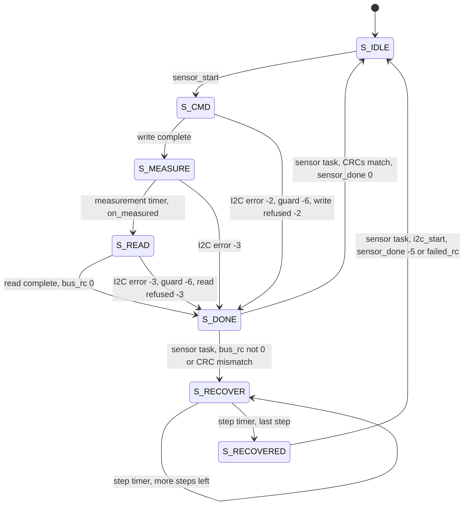
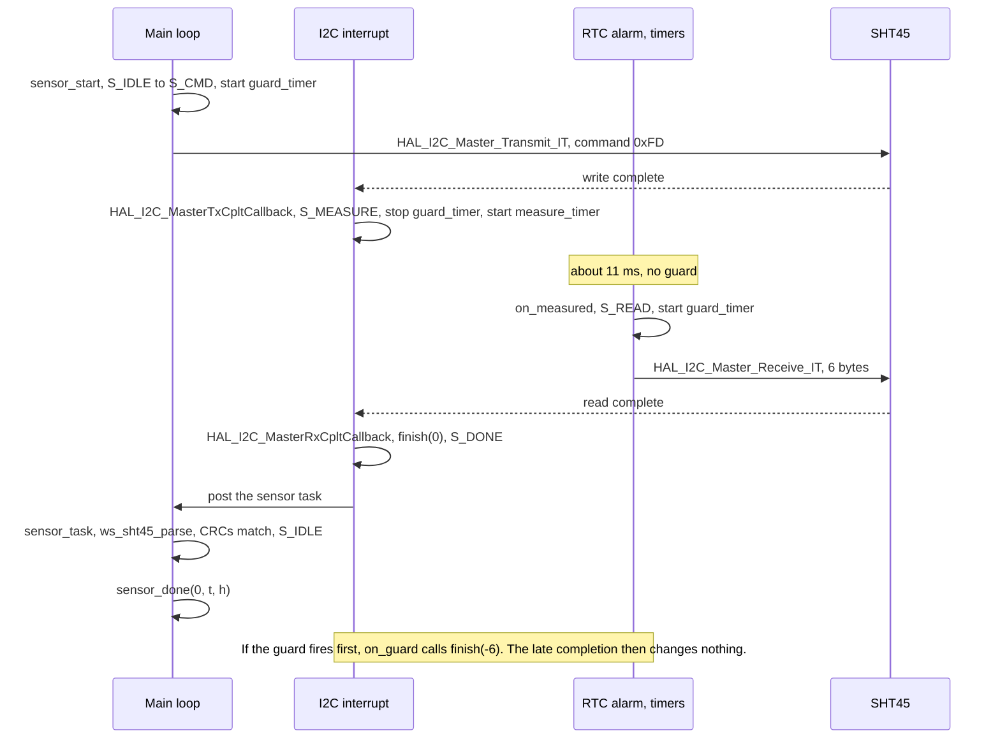
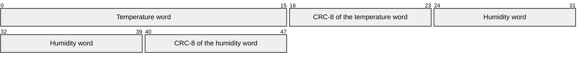
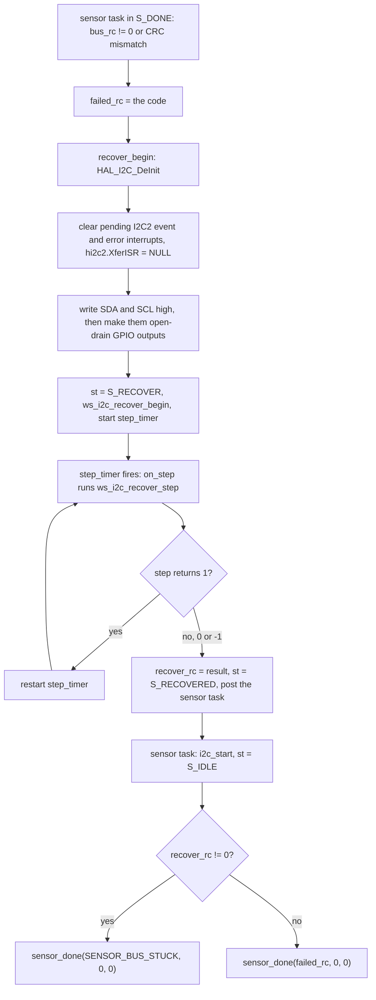
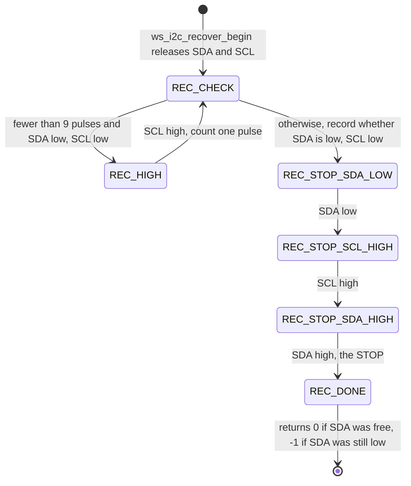

# sensor: the SHT45 driver

`sensor.c` reads temperature and relative humidity from one SHT45 sensor on I2C2 of the STM32WL55.
`sensor_start` begins a measurement and returns at once. Interrupts and timers do every step after
that. The main loop reports the result through `sensor_done`. After any failure the driver frees a
stuck bus before it reports.

This document is the source. `tools/tangle.py` generates `sensor.c` from the code chunks below. The
repository also holds the generated file, so the build, the static analysers and the host tests read
ordinary C. Edit this file, then regenerate and check:

```sh
python3 tools/tangle.py firmware/stage0-node/App/sensor.lit.md                            # write sensor.c
python3 tools/tangle.py --check firmware/stage0-node/App/sensor.lit.md                    # committed .c == tangle
python3 tools/tangle.py --weave /tmp/sensor.html firmware/stage0-node/App/sensor.lit.md   # render
```

A chunk is a fenced ` ```c {#name} ` block. A line `<<name>>` inside a chunk includes chunk
`name`. Chunks appear in reading order. The root chunk (section 9) puts them in C order.

## 1. Behaviour

| Call or event | Result |
|---|---|
| `sensor_init()` | creates the three timers, registers the sensor task, initialises I2C2 |
| `sensor_start()` while idle | returns 0 at once. `sensor_done` runs later, from the main loop |
| `sensor_start()` while a measurement or a recovery runs | returns -1 and changes nothing |
| a good measurement | `sensor_done(0, centi_c, centi_rh)` ~11 ms after the start |
| a failed measurement | the stuck-bus recovery runs, then `sensor_done(rc, 0, 0)`, ~15–100 ms after the start |

Every measurement ends in exactly one `sensor_done` call. `sensor_done` never runs inside
`sensor_start`. The caller defines `sensor_done`: `App/app_tx.c` on the board, the host harness in
tests. The linker resolves the call. It is not a registered function pointer (`sensor.h`).

### Return codes

`sensor.h` defines the codes. `App/app_tx.c` prints the value as `rc=` on `#sample`. The codes use
these terms. A NACK (not-acknowledge) is an I2C byte that the receiver did not acknowledge. ST's HAL
(hardware abstraction layer) is the vendor driver library. A CRC (cyclic redundancy check) is the
check byte after each word of the reply. SDA is the I2C data line and SCL the clock line.

| Code | Value | Cause |
|---|---|---|
| — | 0 | the reply arrived and both CRCs match |
| — | -1 | `sensor_start` refused: the previous measurement had not finished. `App/app_tx.c` reports it as `sensor_done(-1, 0, 0)` |
| `SENSOR_ENACK_ADDR` | -2 | an I2C error during the command write (no sensor at the address, wiring), or `HAL_I2C_Master_Transmit_IT` refused the transfer |
| `SENSOR_ENACK_READ` | -3 | an I2C error after the command write, or `HAL_I2C_Master_Receive_IT` refused the transfer |
| `SENSOR_ECRC` | -4 | `ws_sht45_parse`: a CRC of the reply does not match (noise, cable). Equal to `WS_SHT45_ECRC` |
| `SENSOR_BUS_STUCK` | -5 | the recovery ended with SDA still low. It replaces the original code |
| `SENSOR_TIMEOUT` | -6 | the guard timer expired before the command write or the reply read completed |

On every nonzero code the values are 0.

## 2. Hardware and constants

SDA is PA11 and SCL is PA12 (`sensor.h`, ST's board manual UM2592, Tables 17–18). Both lines are
open-drain at 100 kHz. The breakout board carries 10 kOhm pull-ups.

| Constant | Value | Reason |
|---|---|---|
| `I2C_GUARD_MS` | 30 | a transfer takes ~0.7 ms. A flash page erase (24.5 ms max) stalls the I2C interrupt, so the guard is longer than one erase |
| `SHT45_HAL_ADDR` | `0x44 << 1` | ST's HAL takes the 7-bit address shifted left |
| `I2C_IRQ_PRIORITY` | 2 | below the radio and the real-time clock (RTC) at 0, the same as the console UART |
| `I2C_TIMING` | `0x20303E5D` | 100 kHz at PCLK1 = 48 MHz, the value of ST's NUCLEO-WL55JC examples |

ST's timer server rounds every period down to 1/1024 s ticks. The guard is therefore slightly
shorter than 30 ms.

```c {#constants}
#define SDA_PIN GPIO_PIN_11
#define SCL_PIN GPIO_PIN_12
/* No transfer completes later than this. A command is 2 bytes and a reply 7, ~0.7 ms at 100 kHz.
   The guard is longer than a flash page erase (24.5 ms max), which stalls the I2C interrupt. So an
   erase that overlaps a transfer does not read as a sensor timeout. ST's timer rounds down to
   1/1024 s ticks. */
#define I2C_GUARD_MS 30
#define SHT45_HAL_ADDR ((uint16_t)(WS_SHT45_ADDR << 1))   /* ST's HAL takes the 7-bit address shifted left */
#define I2C_IRQ_PRIORITY 2   /* below the radio and the RTC (0), like the console UART */
/* 100 kHz standard mode at PCLK1 = 48 MHz (same value as ST's NUCLEO-WL55JC I2C examples). */
#define I2C_TIMING 0x20303E5DU
```

`hi2c2` is the one HAL handle. The completion callbacks compare against it, so a callback for
another I2C instance changes nothing.

```c {#handle}
static I2C_HandleTypeDef hi2c2;
```

## 3. Peripheral setup

ST's HAL calls `HAL_I2C_MspInit` from `HAL_I2C_Init` and `HAL_I2C_MspDeInit` from
`HAL_I2C_DeInit`. Both return at once for any instance other than I2C2.

`HAL_I2C_MspInit`, in order:

1. Select PCLK1 as the I2C2 clock.
2. Enable the GPIOA clock.
3. Configure PA11 and PA12 as alternate-function open-drain, with the internal pull-ups.
4. Enable the I2C2 clock.
5. Set the event and error interrupts to priority 2 and enable them.

The internal pull-ups (~40 kOhm) matter only when the breakout is unplugged. They hold both lines
high, so an absent sensor reads as a clean address NACK (-2), not as noise.

`HAL_I2C_MspDeInit` reverses the setup. It disables both interrupts and the I2C2 clock, and it
releases the pins.

```c {#msp}
/* cppcheck-suppress constParameterPointer ; ST's HAL callback signature */
void HAL_I2C_MspInit(I2C_HandleTypeDef *hi2c)
{
  if (hi2c->Instance != I2C2) return;
  RCC_PeriphCLKInitTypeDef clk = { .PeriphClockSelection = RCC_PERIPHCLK_I2C2,
                                   .I2c2ClockSelection = RCC_I2C2CLKSOURCE_PCLK1 };
  (void)HAL_RCCEx_PeriphCLKConfig(&clk);   /* selects the I2C2 clock only, so it cannot time out */
  __HAL_RCC_GPIOA_CLK_ENABLE();
  /* The internal pull-ups (~40 kOhm) matter only when the breakout and its 10 kOhm pull-ups are
     unplugged. They hold both lines high, so an absent sensor reads as a clean address NACK. */
  GPIO_InitTypeDef gpio = { .Pin = SDA_PIN | SCL_PIN, .Mode = GPIO_MODE_AF_OD, .Pull = GPIO_PULLUP,
                            .Speed = GPIO_SPEED_FREQ_LOW, .Alternate = GPIO_AF4_I2C2 };
  HAL_GPIO_Init(GPIOA, &gpio);
  __HAL_RCC_I2C2_CLK_ENABLE();
  HAL_NVIC_SetPriority(I2C2_EV_IRQn, I2C_IRQ_PRIORITY, 0);
  HAL_NVIC_SetPriority(I2C2_ER_IRQn, I2C_IRQ_PRIORITY, 0);
  HAL_NVIC_EnableIRQ(I2C2_EV_IRQn);
  HAL_NVIC_EnableIRQ(I2C2_ER_IRQn);
}

/* cppcheck-suppress constParameterPointer ; ST's HAL callback signature */
void HAL_I2C_MspDeInit(I2C_HandleTypeDef *hi2c)
{
  if (hi2c->Instance != I2C2) return;
  HAL_NVIC_DisableIRQ(I2C2_EV_IRQn);
  HAL_NVIC_DisableIRQ(I2C2_ER_IRQn);
  __HAL_RCC_I2C2_CLK_DISABLE();
  HAL_GPIO_DeInit(GPIOA, SDA_PIN | SCL_PIN);
}
```

`i2c_start` fills the handle and calls `HAL_I2C_Init`. Then it enables the analog filter. Both calls
fail only for a NULL or busy handle. A failure records a `WS_CHECK`, and `i2c_start` continues. The
HAL then refuses the next transfer (-2). The recovery after that transfer calls `i2c_start` again.

```c {#i2c-start}
static void i2c_start(void)
{
  hi2c2.Instance = I2C2;
  hi2c2.Init.Timing = I2C_TIMING;
  hi2c2.Init.OwnAddress1 = 0;
  hi2c2.Init.AddressingMode = I2C_ADDRESSINGMODE_7BIT;
  hi2c2.Init.DualAddressMode = I2C_DUALADDRESS_DISABLE;
  hi2c2.Init.GeneralCallMode = I2C_GENERALCALL_DISABLE;
  hi2c2.Init.NoStretchMode = I2C_NOSTRETCH_DISABLE;
  /* Both calls fail only for a NULL or busy handle (stm32wlxx_hal_i2c.c). If one fails anyway, the
     HAL refuses the next transfer (rc -2). The bus recovery after it initialises the peripheral
     again. */
  (void)WS_CHECK(HAL_I2C_Init(&hi2c2) == HAL_OK);
  (void)WS_CHECK(HAL_I2CEx_ConfigAnalogFilter(&hi2c2, I2C_ANALOGFILTER_ENABLE) == HAL_OK);
}
```

## 4. State machine

One measurement is a chain of interrupts and timers. Nothing in the driver waits. The diagram shows
every transition of `st`. The labels give the event, and the `bus_rc` code where `finish` sets one:



The table gives the same transitions with the context each one runs in and its action. IRQ means
an interrupt handler. The RTC alarm interrupt runs every timer callback.

| From | Event | Runs in | To | Action |
|---|---|---|---|---|
| `S_IDLE` | `sensor_start` | main loop | `S_CMD` | start the guard, start the command write |
| `S_CMD` | write complete (`HAL_I2C_MasterTxCpltCallback`) | I2C IRQ | `S_MEASURE` | stop the guard, start the measurement timer |
| `S_MEASURE` | measurement timer (`on_measured`) | RTC IRQ | `S_READ` | start the guard, start the reply read |
| `S_READ` | read complete (`HAL_I2C_MasterRxCpltCallback`) | I2C IRQ | `S_DONE` | `bus_rc` = 0 |
| `S_CMD` | I2C error (`HAL_I2C_ErrorCallback`) | I2C IRQ | `S_DONE` | `bus_rc` = -2 |
| `S_MEASURE`, `S_READ` | I2C error | I2C IRQ | `S_DONE` | `bus_rc` = -3 |
| `S_CMD`, `S_READ` | guard timer (`on_guard`) | RTC IRQ | `S_DONE` | `bus_rc` = -6 |
| `S_CMD` | `HAL_I2C_Master_Transmit_IT` refuses | main loop | `S_DONE` | `bus_rc` = -2 |
| `S_READ` | `HAL_I2C_Master_Receive_IT` refuses | RTC IRQ | `S_DONE` | `bus_rc` = -3 |
| `S_DONE` | sensor task, `bus_rc` = 0, CRCs match | main loop | `S_IDLE` | `sensor_done(0, t, h)` |
| `S_DONE` | sensor task, `bus_rc` != 0 or CRC mismatch | main loop | `S_RECOVER` | keep the code in `failed_rc`, begin the recovery |
| `S_RECOVER` | step timer (`on_step`), more steps left | RTC IRQ | `S_RECOVER` | one pin step, restart the step timer |
| `S_RECOVER` | step timer, last step | RTC IRQ | `S_RECOVERED` | store the result in `recover_rc` |
| `S_RECOVERED` | sensor task | main loop | `S_IDLE` | `i2c_start`, then `sensor_done` with -5 or `failed_rc` |

Each move into `S_DONE` and `S_RECOVERED` posts the sensor task. The sequencer runs the task in the
main loop, so `sensor_done` never runs in an interrupt.

A good measurement over time, across the three contexts:



```c {#states}
/* One measurement is a chain of interrupts and timers. Nothing waits.
 *   S_CMD:       sensor_start starts the command write (I2C interrupt mode).
 *   S_MEASURE:   the write-complete interrupt starts the measurement timer.
 *   S_READ:      the timer (RTC interrupt) starts the reply read (I2C interrupt mode).
 *   S_DONE:      the read-complete interrupt posts the sensor task.
 *   The sensor task (main loop) checks the CRCs and calls sensor_done(). After a failure it first
 *   runs the stuck-bus recovery (S_RECOVER), one pin step per timer tick (~2-3 ms with ST's timer).
 *   S_RECOVERED: the last step posts the sensor task, which then calls sensor_done().
 * A guard timer bounds S_CMD and S_READ. An I2C error ends either state. finish() is the one way
 * out of a bus state. It runs under a critical section, so a late completion and the guard cannot
 * both count. */
typedef enum { S_IDLE, S_CMD, S_MEASURE, S_READ, S_DONE, S_RECOVER, S_RECOVERED } sensor_state;
static volatile sensor_state st = S_IDLE;
static volatile int bus_rc, recover_rc;
static uint8_t reply[WS_SHT45_REPLY_LEN];
static UTIL_TIMER_Object_t measure_timer, guard_timer, step_timer;
static ws_i2c_rec rec;
```

### Leaving a bus state

`S_CMD`, `S_MEASURE` and `S_READ` are the bus states. `finish(rc)` is the one way out of them.
Inside a critical section it checks the state and stops the guard and the measurement timer. Then it
stores `rc` in `bus_rc`, moves to `S_DONE` and posts the task. In any other state it does nothing.

The first call that finds a bus state ends the measurement. A later completion or guard finds
`S_DONE` or a later state and changes nothing. So one measurement cannot end twice.

```c {#finish}
static void post(void) { UTIL_SEQ_SetTask(1U << CFG_SEQ_Task_Sensor, CFG_SEQ_Prio_0); }

static void finish(int rc)
{
  uint32_t primask = irq_lock();
  if (st == S_CMD || st == S_MEASURE || st == S_READ)
  {
    (void)UTIL_TIMER_Stop(&guard_timer); (void)UTIL_TIMER_Stop(&measure_timer);
    bus_rc = rc; st = S_DONE; post();
  }
  irq_unlock(primask);
}
```

`advance(from, to)` is a compare-and-set of the state under a critical section. It moves to `to` and
returns 1 only if the state is still `from`.

```c {#advance}
/* Compare-and-set of the state. The guard timer (RTC, priority 0) can preempt the I2C interrupt
 * (priority 2). So a step happens only if the state is still the expected one. */
static int advance(sensor_state from, sensor_state to)
{
  uint32_t primask = irq_lock();
  int ok = st == from;
  if (ok) st = to;
  irq_unlock(primask);
  return ok;
}
```

### Interrupt priority

The I2C2 interrupts run at priority 2. The RTC alarm interrupt runs every timer callback. It runs
at priority 0 and can preempt the I2C2 interrupts. The two can be due in the same instant, for
example when a read completes just as its guard expires. The guard then runs first and calls
`finish(SENSOR_TIMEOUT)`. The read-complete callback that follows finds `S_DONE` and does nothing.
An I2C error callback that follows calls `finish`, which also does nothing. The result stays -6.

## 5. Measurement

### Command write

`sensor_start` returns -1 unless the state is `S_IDLE`. Otherwise it moves to `S_CMD` and starts
the guard. Then it starts the one-byte write of `WS_SHT45_MEASURE` (0xFD, high repeatability) in
interrupt mode. If the HAL refuses the write, `finish(SENSOR_ENACK_ADDR)` ends the measurement at
once. The task still reports it later from the main loop. `sensor_start` returns 0 in both cases.

The HAL takes a non-const buffer that it only reads. The cast passes the static `command` array,
which outlives the transfer.

```c {#sensor-start}
int sensor_start(void)
{
  static const uint8_t command[1] = { WS_SHT45_MEASURE };
  if (st != S_IDLE) return -1;
  st = S_CMD;
  (void)WS_CHECK(UTIL_TIMER_Start(&guard_timer) == UTIL_TIMER_OK);   /* stopped by finish() or the write's completion */
  /* ST's HAL takes a non-const buffer but only reads it. The static array outlives the transfer. */
  if (HAL_I2C_Master_Transmit_IT(&hi2c2, SHT45_HAL_ADDR, (uint8_t *)(uintptr_t)command, sizeof command) != HAL_OK) finish(SENSOR_ENACK_ADDR);
  return 0;
}
```

### Measurement wait

The write-complete callback moves `S_CMD` to `S_MEASURE`, stops the guard and starts the
measurement timer. These three actions share one critical section, so the guard cannot fire
between them.

```c {#tx-complete}
/* cppcheck-suppress constParameterPointer ; ST's HAL callback signature */
void HAL_I2C_MasterTxCpltCallback(I2C_HandleTypeDef *hi2c)
{
  if (hi2c != &hi2c2) return;
  /* State change and timers in one critical section: the guard cannot fire in between. */
  uint32_t primask = irq_lock();
  if (st == S_CMD) { st = S_MEASURE; (void)UTIL_TIMER_Stop(&guard_timer); (void)WS_CHECK(UTIL_TIMER_Start(&measure_timer) == UTIL_TIMER_OK); }
  irq_unlock(primask);
}
```

The measurement timer runs `WS_SHT45_MEASURE_MS` (11 ms). The SHT4x datasheet (Table 4) gives
8.3 ms maximum for a high-repeatability measurement. ST's timer rounds down to 1/1024 s ticks and
can start up to one tick late. So the wait is at least ~9.8 ms (`stage0.h`). The guard does not
run during the wait.

### Reply read

`on_measured` moves `S_MEASURE` to `S_READ` with `advance`. It returns if the state has already
left `S_MEASURE`. It then starts the guard and the 6-byte read. If the HAL refuses the read,
`finish(SENSOR_ENACK_READ)` ends the measurement.

The reply holds two 16-bit words, each followed by its CRC-8. The bit numbers count from the first
byte on the bus:



```c {#on-measured}
static void on_measured(void *ctx)
{
  (void)ctx;
  if (!advance(S_MEASURE, S_READ)) return;
  (void)WS_CHECK(UTIL_TIMER_Start(&guard_timer) == UTIL_TIMER_OK);
  if (HAL_I2C_Master_Receive_IT(&hi2c2, SHT45_HAL_ADDR, reply, sizeof reply) != HAL_OK) finish(SENSOR_ENACK_READ);
}
```

### Completions and the guard

| Callback | Condition | Call |
|---|---|---|
| `HAL_I2C_MasterRxCpltCallback` | our handle, state `S_READ` | `finish(0)` |
| `HAL_I2C_ErrorCallback` | our handle | `finish(-2)` in `S_CMD`, `finish(-3)` otherwise |
| `on_guard` | always | `finish(SENSOR_TIMEOUT)` |

An I2C error is a NACK (no sensor at the address, or a sensor not ready) or a bus error. `finish`
ignores every call outside a bus state.

```c {#completions}
/* cppcheck-suppress constParameterPointer ; ST's HAL callback signature */
void HAL_I2C_MasterRxCpltCallback(I2C_HandleTypeDef *hi2c) { if (hi2c == &hi2c2 && st == S_READ) finish(0); }
/* An I2C error: a NACK (no sensor at the address, or a sensor not ready) or a bus error. */
/* cppcheck-suppress constParameterPointer ; ST's HAL callback signature */
void HAL_I2C_ErrorCallback(I2C_HandleTypeDef *hi2c) { if (hi2c == &hi2c2) finish(st == S_CMD ? SENSOR_ENACK_ADDR : SENSOR_ENACK_READ); }
static void on_guard(void *ctx) { (void)ctx; finish(SENSOR_TIMEOUT); }
```

The vector table names the two I2C2 handlers (`startup_stm32wl55jcix.s`). Each one passes control
to ST's HAL handler inside `BUSYMON_ISR`. `BUSYMON_ISR` measures the time spent in the interrupt
(`busymon.h`).

```c {#irq-handlers}
void I2C2_EV_IRQHandler(void);   /* vector table names (startup_stm32wl55jcix.s) */
void I2C2_ER_IRQHandler(void);
void I2C2_EV_IRQHandler(void) { BUSYMON_ISR("I2C2_EV", HAL_I2C_EV_IRQHandler(&hi2c2)); }
void I2C2_ER_IRQHandler(void) { BUSYMON_ISR("I2C2_ER", HAL_I2C_ER_IRQHandler(&hi2c2)); }
```

## 6. Stuck-bus recovery

A sensor reset in the middle of a byte can hold SDA low. `ws_i2c_recover_step` in
`firmware/stage0.c` holds the pin sequence that frees the bus. The sequence follows the I2C-bus
specification (NXP UM10204, section 3.1.16). `sensor.c` supplies the pins and drives the sequence
from a timer.

The whole recovery, from the failed measurement to the report:



### Pins

The three pin functions write SCL, write SDA and read SDA through ST's GPIO HAL. Level 1 releases
an open-drain line. The `wait_us` member is NULL, because the timer provides the wait between
steps.

```c {#pins}
/* Stuck-bus recovery: a sensor reset in the middle of a byte can hold SDA low. The pin sequence
 * clocks SCL until SDA is free, then sends a real STOP. It is ws_i2c_recover_step() in
 * firmware/stage0.c, and firmware/test_policy.c tests it on the host. recover_begin() releases
 * both lines (output register high) before they become outputs. So the takeover never drives SCL
 * low by accident. */
static void pin_scl(void *c, int level) { (void)c; HAL_GPIO_WritePin(GPIOA, SCL_PIN, level ? GPIO_PIN_SET : GPIO_PIN_RESET); }
static void pin_sda(void *c, int level) { (void)c; HAL_GPIO_WritePin(GPIOA, SDA_PIN, level ? GPIO_PIN_SET : GPIO_PIN_RESET); }
static int pin_read_sda(void *c) { (void)c; return HAL_GPIO_ReadPin(GPIOA, SDA_PIN) == GPIO_PIN_SET; }
static const ws_i2c_pins pins = { 0, pin_scl, pin_sda, pin_read_sda, 0 };
```

### The sequence

`ws_i2c_recover_begin` releases both lines and sets the phase to `REC_CHECK`. Each later call of
`ws_i2c_recover_step` does one half-period of SCL:



| Phase | Action | Next phase | Returns |
|---|---|---|---|
| `REC_CHECK` | fewer than 9 pulses and SDA low: SCL low | `REC_HIGH` | 1 |
| `REC_CHECK` | otherwise: record whether SDA is low, SCL low | `REC_STOP_SDA_LOW` | 1 |
| `REC_HIGH` | SCL high, count one pulse | `REC_CHECK` | 1 |
| `REC_STOP_SDA_LOW` | SDA low | `REC_STOP_SCL_HIGH` | 1 |
| `REC_STOP_SCL_HIGH` | SCL high | `REC_STOP_SDA_HIGH` | 1 |
| `REC_STOP_SDA_HIGH` | SDA high: the STOP | `REC_DONE` | 1 |
| `REC_DONE` | none | — | 0 if SDA was free, -1 if SDA was still low |

Nine pulses clock out any byte a device was sending (`WS_I2C_RECOVER_PULSES`, UM10204). The
sequence ends within `WS_I2C_RECOVER_STEPS` (23) steps: 2 per pulse, 4 for the STOP, 1 for the
result.

### One step per timer tick

`on_step` runs one step. While the step returns 1, `on_step` restarts the step timer. When the step
returns 0 or -1, `on_step` stores the result in `recover_rc`, moves to `S_RECOVERED` and posts the
task.

The step timer asks for 1 ms. ST's timer server makes every alarm at least 3 RTC ticks
(`timer_if.c`, `MIN_ALARM_DELAY`), so a step takes ~2–3 ms. The I2C half-period at 100 kHz is
5 us (UM10204, t_LOW >= 4.7 us). A slower clock is valid. A free bus takes 5 steps and a bus
that stays stuck takes 23. So the recovery takes ~15–70 ms.

```c {#on-step}
/* One recovery step per timer tick. The chain ends within WS_I2C_RECOVER_STEPS ticks (stage0.h).
   The timer asks for 1 ms. ST's timer server makes it at least 3 RTC ticks (~2-3 ms, timer_if.c
   MIN_ALARM_DELAY). The I2C half period at 100 kHz is 5 us (UM10204 t_LOW >= 4.7 us). A slower
   clock is valid. The whole recovery takes ~15-70 ms. */
static void on_step(void *ctx)
{
  (void)ctx;
  int rc = ws_i2c_recover_step(&rec, &pins);
  if (rc > 0) { (void)WS_CHECK(UTIL_TIMER_Start(&step_timer) == UTIL_TIMER_OK); return; }
  recover_rc = rc; st = S_RECOVERED; post();
}
```

### Taking the pins over

`recover_begin` runs from the sensor task, in order:

1. Call `HAL_I2C_DeInit`. The peripheral and its interrupts are then off.
2. Clear any pending I2C2 event and error interrupt, and set `hi2c2.XferISR` to NULL. A transfer
   that the guard abandoned can leave both behind. Neither may run on the re-initialised
   peripheral.
3. Write both pins high, then configure them as open-drain GPIO outputs. The output register is
   high before the pins become outputs, so the takeover never drives SCL low.
4. Move to `S_RECOVER`, call `ws_i2c_recover_begin` and start the step timer.

`HAL_I2C_DeInit` fails only for a NULL handle. The driver takes the pins over in either case.

```c {#recover-begin}
static void recover_begin(void)
{
  (void)HAL_I2C_DeInit(&hi2c2);   /* fails only for a NULL handle. The code below takes the pins over anyway */
  /* An abandoned transfer can leave its interrupt pending and its handler set. Neither may run on
     the re-initialised peripheral. */
  HAL_NVIC_ClearPendingIRQ(I2C2_EV_IRQn); HAL_NVIC_ClearPendingIRQ(I2C2_ER_IRQn);
  hi2c2.XferISR = NULL;
  HAL_GPIO_WritePin(GPIOA, SDA_PIN | SCL_PIN, GPIO_PIN_SET);
  GPIO_InitTypeDef gpio = { .Pin = SDA_PIN | SCL_PIN, .Mode = GPIO_MODE_OUTPUT_OD, .Pull = GPIO_PULLUP,
                            .Speed = GPIO_SPEED_FREQ_LOW };
  HAL_GPIO_Init(GPIOA, &gpio);
  st = S_RECOVER;
  ws_i2c_recover_begin(&rec, &pins);
  (void)WS_CHECK(UTIL_TIMER_Start(&step_timer) == UTIL_TIMER_OK);
}
```

## 7. Sensor task

The sequencer runs the task in the main loop. The driver posts the task only in `S_DONE` and
`S_RECOVERED`.

| State | Condition | Action |
|---|---|---|
| `S_DONE` | `bus_rc` = 0 and `ws_sht45_parse` returns 0 | `S_IDLE`, `sensor_done(0, t, h)` |
| `S_DONE` | `bus_rc` != 0, or `ws_sht45_parse` returns -4 | `failed_rc` = the code, `recover_begin` |
| `S_RECOVERED` | `recover_rc` = -1 | `i2c_start`, `S_IDLE`, `sensor_done(SENSOR_BUS_STUCK, 0, 0)` |
| `S_RECOVERED` | `recover_rc` = 0 | `i2c_start`, `S_IDLE`, `sensor_done(failed_rc, 0, 0)` |
| any other | — | `WS_CHECK` records the site, nothing else |

`ws_sht45_parse` (`firmware/stage0.c`) checks the CRC-8 of each word. Then it converts each word
with the datasheet formulas (section 4.6) into 0.01 °C and 0.01 %RH. It clamps relative humidity
to 0–100 %. On a CRC mismatch it leaves the outputs unchanged, so `t` and `h` stay 0.

Every failure runs the recovery, a CRC mismatch included. The task returns the state to `S_IDLE`
before it calls `sensor_done`. So `sensor_done` can start the next measurement.

`BUSYMON_TASK` wraps the task as `sensor_task_timed`, which measures its run time (`busymon.h`).

```c {#sensor-task}
static int failed_rc;   /* the measurement's failure code. The task reports it after the recovery */
static void sensor_task(void)
{
  int16_t t = 0; uint16_t h = 0;
  if (st == S_DONE)
  {
    int rc = bus_rc;
    if (rc == 0) rc = ws_sht45_parse(reply, &t, &h);
    if (rc) { failed_rc = rc; recover_begin(); return; }
    st = S_IDLE;
    sensor_done(0, t, h);
  }
  else if (WS_CHECK(st == S_RECOVERED))   /* the task is posted only with S_DONE or S_RECOVERED */
  {
    i2c_start();
    st = S_IDLE;
    sensor_done(recover_rc ? SENSOR_BUS_STUCK : failed_rc, 0, 0);
  }
}
BUSYMON_TASK(sensor_task)
```

## 8. Initialisation

`sensor_init` creates three one-shot timers. It registers the task with the sequencer and starts
I2C2:

| Timer | Period | Callback |
|---|---|---|
| `measure_timer` | `WS_SHT45_MEASURE_MS` (11 ms) | `on_measured` |
| `guard_timer` | `I2C_GUARD_MS` (30 ms) | `on_guard` |
| `step_timer` | 1 ms (at least 3 RTC ticks) | `on_step` |

```c {#sensor-init}
void sensor_init(void)
{
  (void)UTIL_TIMER_Create(&measure_timer, WS_SHT45_MEASURE_MS, UTIL_TIMER_ONESHOT, on_measured, NULL);
  (void)UTIL_TIMER_Create(&guard_timer, I2C_GUARD_MS, UTIL_TIMER_ONESHOT, on_guard, NULL);
  (void)UTIL_TIMER_Create(&step_timer, 1, UTIL_TIMER_ONESHOT, on_step, NULL);
  UTIL_SEQ_RegTask(1U << CFG_SEQ_Task_Sensor, UTIL_SEQ_RFU, sensor_task_timed);
  i2c_start();
}
```

## 9. The file

The generated file orders the chunks for C. The order is: constants and the handle, the HAL setup
callbacks, the state, the measurement callbacks, the recovery, the task, then the public functions.

```c {#sensor.c}
#define WS_CHECK_FILE 6
#include "sensor.h"
#include "busymon.h"
#include "events.h"
#include "stage0.h"
#include "stm32_seq.h"
#include "stm32_timer.h"
#include "stm32wlxx_hal.h"
#include "utilities_def.h"
#include "ws_check.h"

<<constants>>

<<handle>>

<<msp>>

<<i2c-start>>

<<states>>

<<finish>>

<<advance>>

<<tx-complete>>

<<on-measured>>

<<completions>>

<<irq-handlers>>

<<pins>>

<<on-step>>

<<recover-begin>>

<<sensor-task>>

<<sensor-init>>

<<sensor-start>>
```

## 10. Tests

`tests/test_sensor_machine.py` compiles this file unchanged with `firmware/host/sensor_harness.c`
and `firmware/host/sim_core.c`. The harness models ST's timer rounding (1/1024 s ticks, at least 3
ticks) and the sequencer. It delivers the I2C completions at priority 2, after the RTC alarm. It
models one SHT45 that answers, NACKs, hangs or sends a bad CRC. It can also make the HAL refuse the
write. It can hold SDA low for a chosen number of SCL rising edges. After each test the harness
checks three things. No read started earlier than 9 ms after the write. The driver read no pin
other than SDA. No `WS_CHECK` failed.

| Test | What it checks |
|---|---|
| `test_a_reading_after_the_measurement_time` | rc 0, 42.50 °C and 56.50 %RH, `sensor_done` 11–15 ms after the start, two transfers, no recovery |
| `test_each_failure_has_its_code_and_recovers_the_bus` | NACK on write -2, NACK on read -3, bad CRC -4, hang on write or read -6, write refused by the HAL -2. Each runs one recovery, ends within 120 ms, leaves I2C2 ready, and the next measurement returns 0 |
| `test_held_sda_is_clocked_free_or_reported_stuck` | SDA held for 5 clocks: the original code (-2). SDA never released: -5 after 9 pulses and the STOP's rising SCL |
| `test_a_start_while_busy_is_refused_at_once` | `sensor_start` returns -1 while measuring and while recovering |
| `test_a_completion_after_the_guard_is_ignored` | a write that completes after 40 ms: one `sensor_done`, -6 |
| `test_a_completion_at_the_guard_instant_counts_once` | a read that completes, or fails, in the instant its guard expires: one `sensor_done`, -6 |

`tests/test_stage0.py` runs `firmware/test_policy.c`, which tests the recovery waveform through
`ws_i2c_recover`. SDA free or held for 1 to 9 clocks ends with 0 and exactly one STOP. SDA held for
12 clocks ends with -1. No sequence makes an accidental START.

```sh
.venv/bin/python -m unittest tests.test_sensor_machine tests.test_stage0 tests.test_tangle
```
