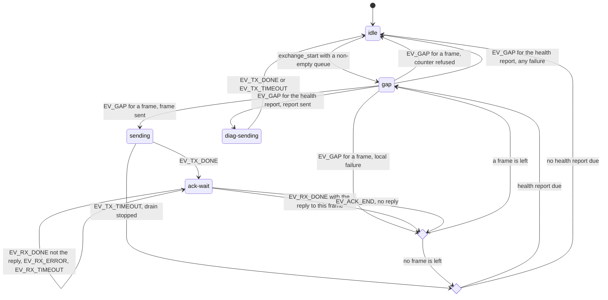
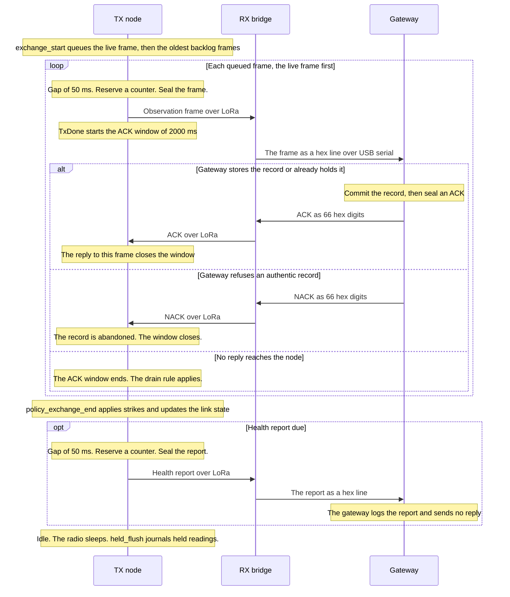
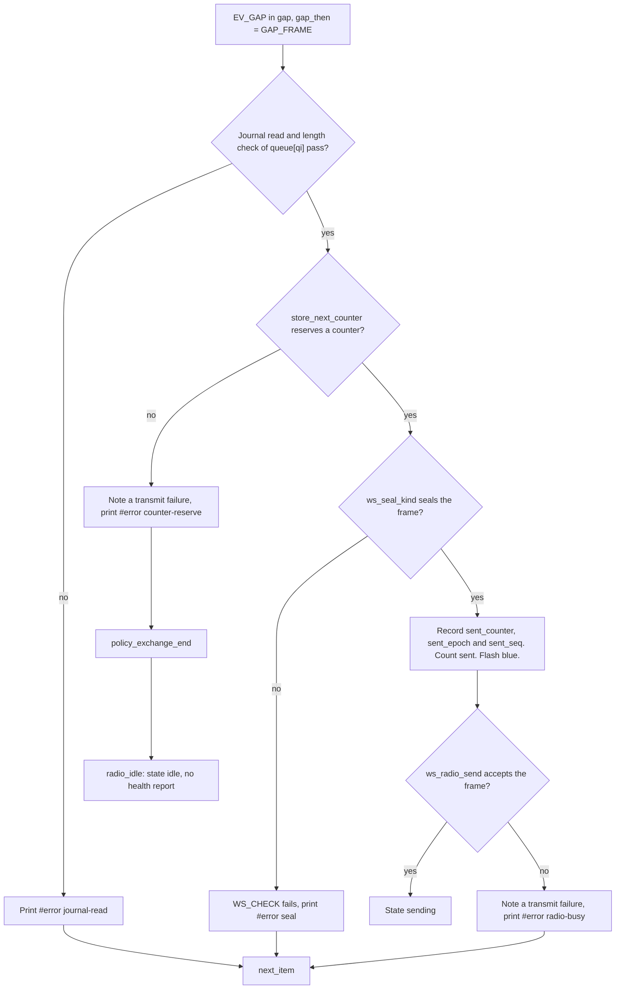
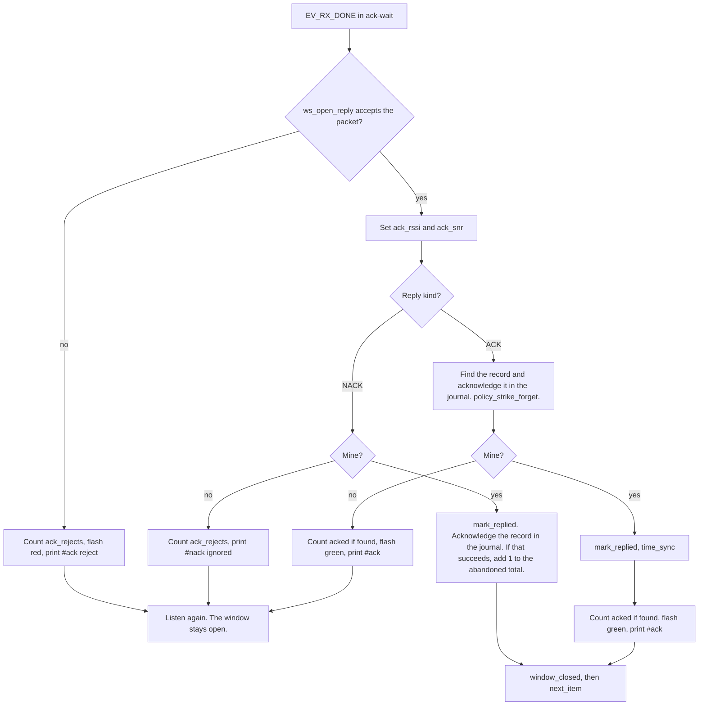
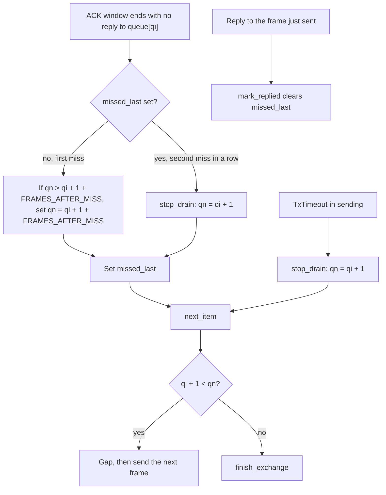

# tx_exchange: the minute's radio exchange

`tx_exchange.c` runs the radio exchange of the transmitting node (the TX node) for one minute. The
TX node sends the live observation first. Then it sends older pending observations, as many as the
transmission policy allows. It seals each frame with a newly reserved counter. After each frame it
listens for an acknowledgement (ACK) during its own ACK window. Last, it sends the health report if
one is due.

One explicit state machine does all of this, and radio events and timer events drive it. This file
holds the AES key, and it's the only module that seals and opens frames with it. `selftest.c` also
seals and opens fixed known-answer frames at boot, but with a test key.

This document is the source. `tools/tangle.py` generates `tx_exchange.c` from the code chunks below.
The repository also holds the generated file, so the build, the static analysers and the host tests
read ordinary C. Edit this file, then regenerate and check:

```sh
python3 tools/tangle.py firmware/stage0-node/App/tx_exchange.lit.md                       # write tx_exchange.c
python3 tools/tangle.py --check                                                          # CI: committed .c == tangle
python3 tools/tangle.py --weave /tmp/tx_exchange.html firmware/stage0-node/App/tx_exchange.lit.md   # render
```

A chunk is a fenced ` ```c {#name} ` block. A line `<<name>>` inside a chunk includes chunk
`name`. The chunks appear in reading order. The root chunk (section 11) puts them in C order.
`docs/firmware-event-model.md` describes the same state machine for the whole firmware.

The other parties in an exchange are the receiving board (the RX bridge) and the gateway. The RX
bridge holds no key. It forwards each frame to the gateway over USB serial. It transmits the ACK or
the negative acknowledgement (NACK) that the gateway seals. `docs/protocol.md` has the frame
layouts and the bridge's line contract.

## 1. Behaviour

| Behaviour | Mechanism | Checked by (`tests/test_tx_machine.py`) |
|---|---|---|
| Every state ends | Each state waits only for an event that is certain to come: TxDone or TxTimeout (`WS_TX_TIMEOUT_MS`, 3000 ms), the ACK window timer (2000 ms) or the gap timer (50 ms) | `test_no_reply_closes_the_window_by_its_own_timeout`, `test_a_transmit_timeout_puts_the_stuck_radio_in_standby` |
| Unexpected events change nothing | The code counts a (state, event) pair outside the table in section 2 in `unexpected` and prints it | `test_every_unlisted_state_event_pair_is_only_counted` |
| Events posted together are all handled | Events are bits. The code handles the lowest bit first. It drops two known races and does not count them | `test_two_events_before_the_main_loop_are_both_handled_in_bit_order` |
| Each frame gets a full window | The code stops the window timer when a reply ends the window | `test_every_frame_gets_its_own_full_window` |
| Damaged or foreign packets do not end the window | The radio listens again until the window timer fires | `test_stray_and_damaged_packets_keep_the_rest_of_the_window`, `test_a_damaged_reply_does_not_end_the_window_early` |
| Only the reply to the frame just sent ends the window or sets the clock | The reply must echo the counter, epoch and sequence of that frame | `test_an_authentic_ack_for_another_frame_keeps_the_window_open`, `test_a_nack_for_another_frame_is_ignored`, `test_only_an_ack_for_the_frame_just_sent_sets_the_clock` |
| No frame without a durable counter | `store_next_counter` must succeed before the code seals a frame | `test_counter_reservations_never_meet_a_busy_radio` (the flash write of the reservation) |
| No flash write while the radio is busy | The code reserves counters in the gap state. `app_tx.c` journals a reading made during an exchange when the radio goes idle | every test (`h_flash_ops_during_radio`), `test_a_reading_made_during_an_exchange_is_journaled_when_the_radio_goes_idle` |
| A failing link sends little | After a missed reply, one more frame goes. Then the drain stops | `test_a_missed_reply_allows_one_more_frame_then_stops_the_drain` |
| A hung radio is detected | The exchange has a time limit. The watchdog check aborts an exchange that passes it | `test_a_radio_that_never_finishes_trips_the_exchange_bound` |
| The health report is complete and cheap | `send_diag` fills all 64 bytes from cached values and counters only, with none codes for what the phase can't fill. The code counts every TxTimeout | `test_the_health_report_carries_every_field_from_cached_values`, `test_every_transmit_timeout_is_counted_and_reported` |

## 2. State machine

### States

| `tx_state` | Name (`STATUS`) | Radio | Waits for |
|---|---|---|---|
| `TX_IDLE` | `idle` | sleep | nothing. `exchange_start` leaves it |
| `TX_GAP` | `gap` | standby or sleep | `EV_GAP` |
| `TX_SENDING` | `sending` | transmitting an observation | `EV_TX_DONE`, `EV_TX_TIMEOUT` |
| `TX_ACK_WAIT` | `ack-wait` | receiving | `EV_RX_DONE`, `EV_RX_ERROR`, `EV_RX_TIMEOUT`, `EV_ACK_END` |
| `TX_DIAG_SENDING` | `diag-sending` | transmitting the health report | `EV_TX_DONE`, `EV_TX_TIMEOUT` |

### Events

| Bit | Event | Name | Source |
|---|---|---|---|
| 0 | `EV_TX_DONE` | `tx-done` | radio TxDone: the frame left |
| 1 | `EV_TX_TIMEOUT` | `tx-timeout` | radio TxTimeout, the 3000 ms software timer of the driver |
| 2 | `EV_RX_DONE` | `rx-done` | radio RxDone with a good payload CRC (cyclic redundancy check) |
| 3 | `EV_RX_TIMEOUT` | `rx-timeout` | radio RxTimeout. ST's `radio.c` reports a header error this way |
| 4 | `EV_RX_ERROR` | `rx-error` | radio RxError: the payload CRC failed |
| 5 | `EV_GAP` | `gap` | `gap_timer`, 50 ms one-shot |
| 6 | `EV_ACK_END` | `ack-end` | `ack_timer`, 2000 ms one-shot: the ACK window is over |

### Transitions

"Next item" means the next queued frame after a gap if one is left, else the end of the exchange.
At the end of the exchange the node sends the health report after a gap if one is due. Else it goes
to `idle`.

| State | Event | Action | Next state |
|---|---|---|---|
| `gap` | `EV_GAP`, frame | read `queue[qi]`, reserve a counter, seal, send | `sending`. Local failure: next item. Counter refused: `idle` |
| `gap` | `EV_GAP`, health report | reserve a counter, seal, send | `diag-sending`. Any failure: `idle` |
| `sending` | `EV_TX_DONE` | clear the transmit failure run, start `ack_timer`, listen | `ack-wait` |
| `sending` | `EV_TX_TIMEOUT` | radio to standby, note a transmit failure, stop the drain | next item (the end of the exchange) |
| `ack-wait` | `EV_RX_DONE`, the reply to this frame | ACK or NACK the record, close the window | next item |
| `ack-wait` | `EV_RX_DONE` other, `EV_RX_ERROR`, `EV_RX_TIMEOUT` | listen again | `ack-wait` |
| `ack-wait` | `EV_ACK_END` | radio to standby, count no reply, apply the drain rule | next item |
| `diag-sending` | `EV_TX_DONE` or `EV_TX_TIMEOUT` | note the transmit result (timeout: radio to standby first) | `idle` |
| any | any other | count `unexpected`, print `#error unexpected` | unchanged |

The diagram shows the same transitions. The two diamonds are "next item" and "end of the
exchange". `exchange_abort` (section 9) can also move any state to `idle`.



### One minute's exchange

The sequence shows one minute with a live frame, backlog frames and a health report.



### Timing constants

| Constant | Value | Use |
|---|---|---|
| `ACK_WINDOW_MS` | 2000 ms | the ACK window, from TxDone |
| `INTER_FRAME_MS` | 50 ms | the gap before every frame, the first one included |
| `EXCHANGE_MARGIN_S` | 5 s | added to the exchange time limit |
| `WS_TX_TIMEOUT_MS` (`radio_cfg.h`) | 3000 ms | the transmit timeout of the driver |

The gap gives the RX bridge time to listen again after it sent its ACK.

The generated file opens with a summary:

```c {#abstract}
/* The minute's radio exchange, one state at a time. docs/firmware-event-model.md has the table.
 * An event that is certain to come ends every state: the radio's TxDone or TxTimeout
 * (WS_TX_TIMEOUT_MS), the ACK window timer or the gap timer. Any other event counts as
 * unexpected. Only an ACK that echoes the counter of the frame just sent sets the clock. */
```

The constants:

```c {#timing}
#define ACK_WINDOW_MS       2000U
#define EXCHANGE_MARGIN_S   5U
#define INTER_FRAME_MS      50U     /* gap before each frame: the RX bridge listens again after its ACK */
```

The health report carries the build id. The Makefile computes it, and the file refuses to build
without it:

```c {#build-id}
/* WS_FW_BUILD_ID is the first 8 hex digits of the release commit (WS_FW_VERSION), or 0 if they
   are not hex or the tree was dirty (power spec section 8.6). The Makefile computes it. */
#ifndef WS_FW_BUILD_ID
#error "WS_FW_BUILD_ID comes from the Makefile"
#endif
```

## 3. State

`tx_state` is the current state. `tx_state_name` gives the name that `STATUS` prints. A
compile-time check keeps one name per state.

```c {#states}
typedef enum { TX_IDLE, TX_GAP, TX_SENDING, TX_ACK_WAIT, TX_DIAG_SENDING, TX_STATES } tx_state_t;
static const char *const tx_state_name[] = { "idle", "gap", "sending", "ack-wait", "diag-sending" };
_Static_assert(sizeof tx_state_name / sizeof tx_state_name[0] == TX_STATES, "one name per state");
static tx_state_t tx_state = TX_IDLE;
```

One gap timer serves both kinds of gap. `gap_then` tells what the gap starts: the next frame or the
health report.

```c {#gap-timer}
static enum { GAP_FRAME, GAP_DIAG } gap_then;   /* what the gap timer starts */
static UTIL_TIMER_Object_t gap_timer;
```

The ACK window has its own timer. The code doesn't use the timeout of ST's driver, because a CRC
error leaves the driver's `RxTimeoutTimer` running, and that timeout leaves the radio receiving. The
radio listens with `ws_radio_rx(0)`, which sets no driver timeout. Every way out of `ack-wait` puts
the radio in standby.

`batch` holds the events of the current `process` pass that aren't handled yet. `events` is the
callback table that the code gives to the radio driver.

```c {#ack-timer}
/* This firmware times the ACK window with its own timer, not with the radio driver's timeout.
   A CRC error leaves ST's RxTimeoutTimer running, and its timeout leaves the radio receiving.
   The radio listens with no driver timeout (ws_radio_rx(0)). ack_timer ends the window, and
   every way out of ack-wait puts the radio in standby first. */
static UTIL_TIMER_Object_t ack_timer;
static uint32_t batch;      /* the events of this process pass not handled yet */
static RadioEvents_t events;
```

Next is the exchange queue. `queue[0..qn)` holds journal references, and `qi` is the index of the
current frame. `replied[i]` records that the gateway answered `queue[i]` with an ACK or a NACK.
`MAX_QUEUE` is 21 (`tx_exchange.h`): the live frame and up to 20 backlog frames.

`exchange_start_s` and `exchange_limit_s` give the watchdog its evidence. `sent_counter`,
`sent_epoch` and `sent_seq` identify the frame just sent. A reply must echo them.

```c {#queue}
static jref_t queue[MAX_QUEUE];
static uint8_t replied[MAX_QUEUE];   /* the gateway answered queue[i] with an ACK or a NACK */
static unsigned qn, qi, live_n;   /* live_n: 1 if queue[0] is the minute's live reading */
static uint32_t exchange_start_s, exchange_limit_s;   /* progress evidence for the watchdog */
static uint64_t sent_counter;
static uint32_t sent_epoch, sent_seq;
```

### Counts

Only this file writes `tx_counts`. Other modules read it through `exchange_counts()`.

| Field | Incremented when |
|---|---|
| `sent` | the code seals an observation frame, before the send (a refused send counts too) |
| `acked` | an authentic ACK names a record that the journal holds |
| `no_ack` | an ACK window ends with no reply |
| `ack_rejects` | a packet fails `ws_open_reply`, or a NACK is not for the frame just sent |
| `unexpected` | an event arrives in a state that does not expect it |
| `air` | a failure run: a refused counter reservation, a refused send or a TxTimeout adds one. A TxDone clears it |
| `tx_timeouts` | every TxTimeout, of an observation (`in_sending`) or of a health report (`in_diag_sending`). It saturates at 0xFFFF and clears only at a reset. The health report carries it (power telemetry design, sections 6.1 and 6.2) and `#counts` shows it |

Only a TxDone proves that the radio works. `watchdog_healthy` (`app_tx.c`) fails when the `air`
run passes `TX_FAIL_LIMIT` (10). The watchdog then resets a radio that accepts sends but never
finishes a frame.

```c {#counts}
/* tx_counts.air is the run of transmit failures in a row. A refused counter reservation, a refused
   Radio.Send or a TxTimeout adds one. Only a TxDone clears the run, because only a TxDone proves
   that the frame left. Failed journal appends have their own run (journal_fails, app_tx.c). */
static tx_counts_t tx_counts;
const tx_counts_t *exchange_counts(void) { return &tx_counts; }
```

`tx_timed_out` is the one handling of a TxTimeout, whichever frame it ended. ST's driver leaves the
radio transmitting after its timeout, so the radio goes to standby first. Then the code notes a
transmit failure, counts the timeout (saturating, so the 16-bit total of the health report never
wraps), flashes the red LED and prints `#error tx-timeout`.

```c {#tx-timed-out}
static void tx_timed_out(void)
{
  ws_radio_standby();               /* the driver's timeout leaves the radio transmitting */
  ws_failrun_note(&tx_counts.air, 0);
  if (tx_counts.tx_timeouts < UINT16_MAX) tx_counts.tx_timeouts++;
  led_flash(LED_RED, LED_FLASH_MS); APP_PRINTF("#error tx-timeout\n");
}
```

## 4. Identity and key

`exchange_load_identity` loads the provisioning record from `node_store.c` once at boot. The key
stays in this file. Other modules see only the station id and the key check value (`kcv`) through
`exchange_identity()`. A failed load leaves `provisioned` at 0.

```c {#identity}
/* The key never leaves this file: data at the smallest scope (docs/power-of-ten.md, rule 6). */
static tx_identity_t identity;
static uint8_t key[WS_KEY_LEN];
int exchange_load_identity(void)
{
  identity.provisioned = store_config_load(&identity.station, key, identity.kcv) == 0;
  return identity.provisioned;
}
const tx_identity_t *exchange_identity(void) { return &identity; }
```

## 5. Events

### Receive buffer

The RxDone callback copies at most `WS_ACK_FRAME_LEN` (33) bytes. `rx_len` keeps the received
size, so `ws_open_reply` still rejects a longer packet by its length. `ack_rssi` and `ack_snr` keep
the signal of the last authentic reply for the health report: the received signal strength (RSSI)
and the signal-to-noise ratio (SNR). They start at `WS_SIGNAL_NONE` (`INT8_MIN`).

```c {#rx-buffer}
/* The code opens only a reply of WS_ACK_FRAME_LEN bytes. rx_len keeps the true received size.
   ws_open_reply checks that length before it reads, so it still rejects and logs a longer packet. */
static uint8_t rx_frame[WS_ACK_FRAME_LEN];
static uint16_t rx_len;
static int16_t rx_rssi;
static int8_t rx_snr;
/* The signal of the last authentic ACK as the node heard it, for the health report
   (docs/protocol-design.md section 4). The uplink signal and the downlink signal can differ. */
static int8_t ack_rssi = WS_SIGNAL_NONE, ack_snr = WS_SIGNAL_NONE;
```

### Event bits

Interrupt and timer callbacks post events as bits into `pending_ev` (`App/events.h`).
`events_post` sets bits with interrupts masked and schedules the process task. So several events
can arrive before the task runs, and the task doesn't lose any of them.

```c {#event-bits}
/* Interrupt and timer callbacks post these events as bits (App/events.h). */
#define EV_TX_DONE    (1U << 0)
#define EV_TX_TIMEOUT (1U << 1)
#define EV_RX_DONE    (1U << 2)
#define EV_RX_TIMEOUT (1U << 3)
#define EV_RX_ERROR   (1U << 4)
#define EV_GAP        (1U << 5)
#define EV_ACK_END    (1U << 6)
#define EV_COUNT      7U
#define EV_ALL        ((1U << EV_COUNT) - 1U)
static const char *const ev_name[EV_COUNT] = { "tx-done", "tx-timeout", "rx-done", "rx-timeout", "rx-error", "gap", "ack-end" };
static volatile uint32_t pending_ev;
```

### Callbacks

Each callback only posts its bit. `on_rx_done` also copies the packet and its signal. For a packet
whose payload CRC failed, ST's hardware abstraction layer (HAL) raises RxDone and then RxError.
`on_rx_done` asks `ws_radio_take_crc_error()` and drops such a packet. Only its `EV_RX_ERROR` is
posted.

```c {#callbacks}
static void post(uint32_t ev) { events_post(&pending_ev, ev); }
static void on_gap(void *ctx) { (void)ctx; post(EV_GAP); }
static void on_ack_end(void *ctx) { (void)ctx; post(EV_ACK_END); }
static void on_tx_done(void) { post(EV_TX_DONE); }
static void on_tx_timeout(void) { post(EV_TX_TIMEOUT); }
static void on_rx_timeout(void) { post(EV_RX_TIMEOUT); }
static void on_rx_error(void) { post(EV_RX_ERROR); }
/* For a packet whose payload CRC failed, ST's HAL raises RxDone and then RxError
   (stm32wlxx_hal_subghz.c, HAL_SUBGHZ_IRQHandler). The code keeps only the RxError. */
/* cppcheck-suppress constParameterCallback ; ST's RadioEvents_t RxDone signature */
static void on_rx_done(uint8_t *payload, uint16_t size, int16_t rssi, int8_t snr)
{
  if (ws_radio_take_crc_error()) return;
  rx_len = size;
  memcpy(rx_frame, payload, size > sizeof rx_frame ? sizeof rx_frame : size);
  rx_rssi = rssi;
  rx_snr = snr;
  post(EV_RX_DONE);
}
```

### The process task

`process` takes all pending bits in one step and handles them lowest bit first. Before the loop it
applies two rules:

| Rule | Why |
|---|---|
| `EV_TX_DONE` and `EV_TX_TIMEOUT` in one batch: drop the timeout | The frame left. ST stops the timeout on TxDone, so no later timeout can come |
| Bits outside `EV_ALL`: `WS_CHECK` fails, and the code drops the bits | Only `post()` sets bits, and only `EV_*` bits |

`batch` is a file variable, so a handler can remove a later bit from the current pass
(`window_closed`, section 7). `BUSYMON_TASK(process)` defines `process_timed`, which times each
pass (`busymon.h`). `exchange_init` registers `process_timed` with the sequencer.

```c {#process}
static void process(void)
{
  batch = events_take(&pending_ev);
  /* A TxTimeout in the same pass as its TxDone is a race, not a bug. The frame left, and ST stops
     the timeout on TxDone, so no later timeout comes. The code drops it, like a stale ack-end. */
  if ((batch & EV_TX_DONE) && (batch & EV_TX_TIMEOUT)) batch &= ~EV_TX_TIMEOUT;
  if (!WS_CHECK(!(batch & ~EV_ALL))) batch &= EV_ALL;   /* only post() sets bits, and only EV_* bits */
  uint32_t bit = 1;
  for (unsigned k = 0; k < EV_COUNT && batch; k++, bit <<= 1)   /* lowest bit first */
    if (batch & bit) { batch &= ~bit; handle(bit); }
}
BUSYMON_TASK(process)
```

`handle` passes one event to the handler of the current state. A handler returns 1 if the state
expects the event, else 0. After a 0, `handle` increments `unexpected` and prints
`#error unexpected event=<name> state=<name>`. Nothing else changes. `idle` expects no event. An
out-of-range `tx_state` fails a `WS_CHECK`, and `handle` resets it to `TX_IDLE`.

```c {#dispatch}
/* Handle one event in one state. A pair that the table does not list is a bug or a stray radio
   callback. The code counts it and prints it, and does nothing else
   (docs/firmware-event-model.md has the full table). */
static void handle(uint32_t ev)
{
  int done = 0;
  switch (tx_state)
  {
    case TX_SENDING: done = in_sending(ev); break;
    case TX_ACK_WAIT: done = in_ack_wait(ev); break;
    case TX_DIAG_SENDING: done = in_diag_sending(ev); break;
    case TX_GAP: done = in_gap(ev); break;
    default: if (!WS_CHECK(tx_state == TX_IDLE)) tx_state = TX_IDLE; break;   /* idle expects no event */
  }
  if (done) return;
  tx_counts.unexpected++;
  APP_PRINTF("#error unexpected event=%s state=%s\n", ev_name[__builtin_ctz(ev)], tx_state_name[tx_state]);
}
```

## 6. Sending frames

### Start

`app_tx.c` calls `exchange_start` once in each minute that may send.

| Step | Action |
|---|---|
| 1 | `WS_CHECK` that no exchange runs. If one runs, return. `app_tx.c` holds the reading instead. Else tell the bench display (`oled_note_exchange`: this minute's airtime starts again, with or without a live reading) |
| 2 | clamp `backlog` to `MAX_QUEUE - 1` (20) with a `WS_CHECK` |
| 3 | queue the live reference first if `live` is not NULL |
| 4 | append the oldest pending records from `store_journal_oldest`, except `live`. Without a live reference the backlog can also use the live slot |
| 5 | reset `qi`, the drain flag (`missed_last`) and `replied[]` |
| 6 | compute the exchange time limit |
| 7 | if the queue is not empty: record the start time and enter `gap` before the first frame. Else stay `idle` |

The exchange time limit assumes the worst case for every frame and for the health report. Each one
uses its full transmit timeout, a full ACK window and a gap:

```text
exchange_limit_s = (qn + 1) * (WS_TX_TIMEOUT_MS + ACK_WINDOW_MS + INTER_FRAME_MS) / 1000 + EXCHANGE_MARGIN_S
                 = (qn + 1) * 5050 ms / 1000 + 5 s
qn = 1:   15 s
qn = 21: 116 s
```

`exchange_overdue(now_s)` is true when an exchange runs and `now_s - exchange_start_s` is more than
`exchange_limit_s`. `watchdog_healthy` (`app_tx.c`) then calls `sampling_stop`, which stops
the sample and module timers. Next it calls `exchange_abort` (section 9) and lets the watchdog reset
the board.

The first frame also waits for the gap. The previous exchange can put the radio to sleep in the same
main-loop pass. The chip needs time to enter sleep before the firmware wakes it.

```c {#exchange-start}
void exchange_start(const jref_t *live, unsigned backlog)
{
  if (!WS_CHECK(!exchange_busy())) return;   /* app_tx.c holds the reading while an exchange runs */
  oled_note_exchange();
  if (!WS_CHECK(backlog <= MAX_QUEUE - 1U)) backlog = MAX_QUEUE - 1U;   /* the room in the queue */
  qn = 0; live_n = live != NULL;
  if (live) queue[qn++] = *live;
  qn += store_journal_oldest(queue + qn, backlog + (live ? 0U : 1U), live);
  qi = 0;
  missed_last = 0;
  memset(replied, 0, sizeof replied);
  /* The time limit allows every frame and the health report a full transmit timeout, a full ACK
     window and a gap. A margin follows. */
  exchange_limit_s = ((qn + 1U) * (WS_TX_TIMEOUT_MS + ACK_WINDOW_MS + INTER_FRAME_MS)) / CLOCK_MS_PER_S + EXCHANGE_MARGIN_S;
  /* The first frame also waits for the gap. The last exchange can put the radio to sleep in this
     main-loop pass, and the chip needs time to enter sleep before the firmware wakes it.
     ST's RadioSleep waited 2 ms (radio_cfg.c, ws_radio_sleep). */
  if (qn) { exchange_start_s = clock_s(); gap_before(GAP_FRAME); }
}
```

### Gap

`gap_before` records what the gap starts and enters `gap`. ST's `UTIL_TIMER_Start` refuses a timer
that is already started. That refusal fails a `WS_CHECK`, but it needs no other recovery, because
the timer that's already started still posts `EV_GAP`.

```c {#gap-before}
/* The gap timer starts the next frame after INTER_FRAME_MS. Nothing waits in the meantime. */
static void gap_before(int then)
{
  gap_then = then; tx_state = TX_GAP;
  (void)WS_CHECK(UTIL_TIMER_Start(&gap_timer) == UTIL_TIMER_OK);   /* refused only if running: its EV_GAP still comes */
}
```

`in_gap` handles `EV_GAP`. For a frame it calls `send_current`. For the health report it calls
`send_diag`. If the report did not go on air, the exchange ends.

```c {#in-gap}
static int in_gap(uint32_t ev)
{
  if (ev != EV_GAP) return 0;
  if (gap_then == GAP_FRAME) send_current();
  else if (!send_diag()) radio_idle();
  return 1;
}
```

### Send the current item

`send_current` reads `queue[qi]` from the journal and checks its plaintext length. The results:

| Outcome | Print | Next |
|---|---|---|
| journal read or length check failed | `#error journal-read` | next item, after a gap |
| `send_obs` returns 1 | | `sending` |
| `send_obs` returns 0 (seal failed, radio refused) | its own `#error` | next item, after a gap |
| `send_obs` returns -1 (counter refused) | `#error counter-reserve` | The policy sees the replies so far. Then the state goes to `idle` at once. No health report goes, because it needs a counter too |

A local failure does not count as a missed reply and does not change the drain. The `WS_CHECK` on
`qi < qn` guards an index. The code calls `gap_before(GAP_FRAME)` only while an item is left.

`send_obs` seals and sends one plaintext. It does these steps in order:

1. Reserve a counter with `store_next_counter`. On failure, note a transmit failure and return -1.
   A frame without a durable counter could repeat an AES-CCM nonce (a number that you must use
   only once with a key).
2. Seal with `ws_seal_kind`. A valid station and counter always seal, so a failure is a `WS_CHECK`
   failure. Return 0.
3. Record the counter, epoch and sequence that a reply must echo. Increment `sent`. Flash the blue
   LED.
4. Call `ws_radio_send`. If the radio accepts the frame, enter `sending`, tell the bench display
   (`oled_note_sent`, below) and return 1. If it refuses, note a transmit failure, print
   `#error radio-busy` and return 0.

The bench display hooks (`App/oled_hooks.h`) tell the bench build's OLED what the exchange does:

- `oled_note_sent` when a frame goes on air (here and in `send_diag`).
- `oled_note_ack` for the ACK to the frame just sent (`on_ack`).
- `oled_note_no_ack` when the frame's window ends empty (`no_reply`), or when a NACK, a transmit
  timeout or `exchange_abort` ends it.

The hooks run here, in the exchange's task. They only note the event and copy the frame. The
display draws from its own task.

The frame that plays the packet burst is the minute's live reading, which is the exchange's first
frame (`qi < live_n`). `live_n` is 1 when `exchange_start` queued a live reading. It's 0 when the
minute has no live reference (its reading didn't encode, or its journal append failed), so the
queue holds backlog only. The code passes every other frame (the backlog, the one more after a
miss, the health report) as `OLED_SENT_BACKLOG` or `OLED_SENT_REPORT`, and the banner only counts
it. So a minute without a live reading plays no burst. A first frame that fails locally gets no
burst that minute.

In the field build the hooks are empty inline functions, and they take only values the exchange
already holds, so they add no code there. (A call such as `store_journal_pending()` as an argument
would still run in the field build.) The `WS_CHECK` sites number their lines (`ws_check.h`), so a
line added above one changes only its line constant in the image.

The counter reservation can write flash. It runs in the gap state, while the radio is in standby
or asleep. The flowchart shows `send_current` and `send_obs` together.



```c {#send-current}
/* Send queue[qi]. After a local failure (journal read, seal, radio busy) the exchange moves to the
 * next item after a gap, as after a sent frame. A refused counter reservation ends the exchange.
 * The policy first sees the replies so far
 * (test_a_refused_counter_reservation_still_reports_the_answers). */
static void send_current(void)
{
  uint8_t plain[WS_OBS_PLAIN_MAX];
  int plen = -1, rc = 0;
  if (!WS_CHECK(qi < qn)) { finish_exchange(); return; }   /* gap_before(GAP_FRAME) runs only with an item left */
  if (store_journal_read(queue[qi], plain) || (plen = ws_obs_plain_len(plain, sizeof plain)) < 0) { APP_PRINTF("#error journal-read\n"); }
  else rc = send_obs(plain, plen);
  if (rc < 0) { policy_exchange_end(queue, replied, qn); radio_idle(); }
  else if (rc == 0) next_item();
}
```

```c {#send-obs}
/* Seal and send one journaled plaintext. Returns 1 when the frame is on air and its TxDone follows.
   Returns 0 for a local failure, and the exchange moves on. Returns -1 when the counter reservation
   is refused, and the exchange ends. */
static int send_obs(const uint8_t *plain, int plen)
{
  uint8_t frame[OBS_FRAME_MAX];
  /* No durable counter, no transmission: a repeated nonce breaks AES-CCM. */
  if (store_next_counter(&sent_counter)) { ws_failrun_note(&tx_counts.air, 0); APP_PRINTF("#error counter-reserve\n"); return -1; }
  int flen = ws_seal_kind(key, identity.station, WS_KIND_OBS, sent_counter, plain, (uint32_t)plen, frame, sizeof frame);
  if (!WS_CHECK(flen >= 0)) { APP_PRINTF("#error seal\n"); return 0; }   /* a valid station and counter always seal */
  sent_epoch = ws_obs_epoch(plain);
  sent_seq = ws_obs_seq(plain);
  tx_counts.sent++; led_flash(LED_BLUE, LED_FLASH_MS);
  if (ws_radio_send(frame, (uint8_t)flen) == RADIO_STATUS_OK)
  { tx_state = TX_SENDING; oled_note_sent(sent_seq, frame, (uint8_t)flen, qi < live_n ? OLED_SENT_LIVE : OLED_SENT_BACKLOG); return 1; }
  ws_failrun_note(&tx_counts.air, 0); APP_PRINTF("#error radio-busy\n");
  return 0;
}
```

### Frame sent

`in_sending` waits for the radio. On TxDone it clears the transmit failure run, starts `ack_timer`
and listens with no driver timeout. On TxTimeout it calls `tx_timed_out` (section 3: standby,
failure noted, timeout counted, red LED, `#error tx-timeout`), tells the bench display the frame got no ACK
(`oled_note_no_ack`) and stops the drain. The exchange then
ends after this frame.

```c {#in-sending}
/* The state handlers return 1 if the state expects the event and handled it, else 0. */
static int in_sending(uint32_t ev)
{
  if (ev == EV_TX_DONE)
  {
    ws_failrun_note(&tx_counts.air, 1);   /* the frame left, so the radio works */
    tx_state = TX_ACK_WAIT;
    (void)WS_CHECK(UTIL_TIMER_Start(&ack_timer) == UTIL_TIMER_OK);   /* refused only if running: it still ends the window */
    ws_radio_rx(0);
    return 1;
  }
  if (ev != EV_TX_TIMEOUT) return 0;
  tx_timed_out(); oled_note_no_ack(sent_seq);   /* the bench display: not ACKed */
  stop_drain(); next_item();
  return 1;
}
```

## 7. The ACK window

`in_ack_wait` handles the window:

| Event | Action |
|---|---|
| `EV_ACK_END` | radio to standby, then `no_reply` |
| `EV_RX_DONE`, `handle_reply` returns 1 | `window_closed`, then the next item |
| `EV_RX_DONE`, `handle_reply` returns 0 | listen again |
| `EV_RX_ERROR` | print `#ack damaged payload; still listening`, listen again |
| `EV_RX_TIMEOUT` | print `#ack damaged header; still listening`, listen again |

After a single reception the radio is in standby, so every "listen again" calls `ws_radio_rx(0)`.
The window keeps its original end. A damaged packet can be a damaged copy of the real ACK, and the
real ACK can still come.

```c {#in-ack-wait}
static int in_ack_wait(uint32_t ev)
{
  if (ev == EV_ACK_END) { ws_radio_standby(); no_reply(1); return 1; }
  if (ev == EV_RX_DONE && handle_reply()) { window_closed(); next_item(); return 1; }
  if (ev != EV_RX_DONE && ev != EV_RX_ERROR && ev != EV_RX_TIMEOUT) return 0;
  /* The packet is not the reply to this frame. It is foreign, forged, the ACK of another frame,
     a payload CRC failure (rx-error) or a header failure (rx-timeout, because ST's radio.c reports
     IRQ_HEADER_ERROR as a timeout). The radio listens until the window ends, so it does not miss
     the real ACK. After one reception the radio is in standby, so the code starts it again. */
  if (ev != EV_RX_DONE) APP_PRINTF("#ack damaged %s; still listening\n", ev == EV_RX_ERROR ? "payload" : "header");
  ws_radio_rx(0);
  return 1;
}
```

`window_closed` stops `ack_timer`. If the timer already fired, the code removes its `EV_ACK_END`
from the current `batch` and from `pending_ev`. The reply already settled that race, so the event
must not count as `unexpected`.

```c {#window-closed}
/* The reply ended the window. Stop the window timer, and drop an ack-end that the timer already
   posted for this pass or the next. That ack-end is a race, not a bug, so `unexpected` keeps
   counting only bugs. */
static void window_closed(void)
{
  (void)UTIL_TIMER_Stop(&ack_timer);
  batch &= ~EV_ACK_END; events_clear(&pending_ev, EV_ACK_END);
}
```

### Opening a reply

`handle_reply` opens `rx_frame` with `ws_open_reply`, which checks length, version, kind, station
and authentication tag. On a failure, `handle_reply` increments `ack_rejects`, flashes the red LED,
prints `#ack reject` and returns 0. An authentic reply sets `ack_rssi` and `ack_snr`, clamped to
-127..127. So a forged frame can't set them. The reply is "mine" when it echoes
`sent_counter`, `sent_epoch` and `sent_seq`. The kind selects `on_nack` or `on_ack`.



```c {#handle-reply}
/* Returns 1 for the authentic reply (ACK or NACK) to the frame just sent, else 0. */
static int handle_reply(void)
{
  reply_t r;
  if (ws_open_reply(key, identity.station, rx_frame, rx_len, &r.kind, &r.ctr, &r.epoch, &r.seq, &r.word, &r.echo))
  {
    tx_counts.ack_rejects++;
    led_flash(LED_RED, LED_FLASH_MS);
    APP_PRINTF("#ack reject len=%u rssi=%d snr=%d\n", rx_len, rx_rssi, rx_snr);
    return 0;
  }
  ack_rssi = clamp8(rx_rssi);   /* only an authentic reply sets these, so a forged frame cannot */
  ack_snr = clamp8(rx_snr);
  int mine = r.echo == sent_counter && r.epoch == sent_epoch && r.seq == sent_seq;
  return r.kind == WS_KIND_NACK ? on_nack(&r, mine) : on_ack(&r, mine);
}
```

`reply_t` holds the opened fields. `mark_replied` sets `replied[qi]` and clears the drain flag.

```c {#reply}
/* The fields of an authentic reply, opened. */
typedef struct { uint64_t ctr, echo; uint32_t epoch, seq, word; uint8_t kind; } reply_t;

/* The gateway answered the frame just sent (queue[qi]). */
static void mark_replied(void)
{
  if (WS_CHECK(qi < MAX_QUEUE)) replied[qi] = 1;
  missed_last = 0;
}
```

`on_ack` acts on any authentic ACK:

| Step | Applies to |
|---|---|
| find the record by (epoch, sequence) and acknowledge it in the journal (`#error journal-ack` on failure) | any ACK |
| `policy_strike_forget`: the strikes of the record end | any ACK |
| `mark_replied` | mine only |
| `time_sync(word)`: set the clock from the time in the ACK | mine only |
| increment `acked` if the journal holds the record | any ACK |
| green LED, print `#ack ... found= time_sync= ...` | any ACK |
| `oled_note_ack`: the bench display shows the ACK's signal | mine only |

`on_ack` returns `mine`. An ACK for another frame commits its record but keeps the window open. A
replayed ACK cannot move the clock. `time_sync` returns 0 for an implausible time (`tx_time.h`).

```c {#on-ack}
/* Any authentic ACK commits its record, wherever the record is in the journal. Only the ACK for the
   frame just sent ends the window or sets the clock, so a replayed ACK cannot move the clock. */
static int on_ack(const reply_t *r, int mine)
{
  jref_t ref;
  int found = store_journal_find(r->epoch, r->seq, &ref) == 0;
  if (found && store_journal_ack(ref)) APP_PRINTF("#error journal-ack\n");
  policy_strike_forget(r->epoch, r->seq);   /* any authentic ACK for a record ends its strikes */
  if (mine) mark_replied();
  int fresh = mine && time_sync(r->word);
  if (found) tx_counts.acked++;
  led_flash(LED_GREEN, LED_FLASH_MS); /* an authentic gateway ACK: the reading is committed */
  APP_PRINTF("#ack epoch=%u seq=%u found=%d time_sync=%d rssi=%d snr=%d pending=%u\n",
             (unsigned)r->epoch, (unsigned)r->seq, found, fresh, rx_rssi, rx_snr,
             (unsigned)store_journal_pending());
  if (mine) oled_note_ack(r->seq, rx_rssi, rx_snr);
  return mine;
}
```

`on_nack` accepts a NACK only for the frame just sent. For another NACK it increments
`ack_rejects`, prints `#nack ignored: not for the frame just sent` and keeps the window open. An
accepted NACK marks the frame replied. If the search finds the record and its journal ACK succeeds,
the abandoned total goes up by one. The code ignores a total that fails to persist, because the
journal acknowledges the record either way. The red LED flashes for `LED_FLASH_LONG_MS` (1000 ms), and the bench display shows the frame as not ACKed (`oled_note_no_ack`).

```c {#on-nack}
/* An authentic NACK is a permanent rejection. The node accepts it only for the frame just sent. */
static int on_nack(const reply_t *r, int mine)
{
  jref_t ref;
  if (!mine) { tx_counts.ack_rejects++; APP_PRINTF("#nack ignored: not for the frame just sent\n"); return 0; }
  mark_replied();
  /* A total that fails to persist is only a count. The journal acknowledges the record either way. */
  if (store_journal_find(r->epoch, r->seq, &ref) == 0 && store_journal_ack(ref) == 0) (void)store_note_abandoned();
  led_flash(LED_RED, LED_FLASH_LONG_MS); oled_note_no_ack(sent_seq);   /* the bench display: not ACKed */
  APP_PRINTF("#nack epoch=%u seq=%u reason=%u abandoned=%u\n", (unsigned)r->epoch, (unsigned)r->seq,
             (unsigned)r->word, (unsigned)store_abandoned_total());
  return 1;
}
```

### No reply

`no_reply` runs when the window ends without a reply. It increments `no_ack`, tells the bench display
(`oled_note_no_ack`), flashes the red LED, prints `#ack none`, applies the drain rule and moves to the next item. The record stays journaled
for a later minute.

```c {#no-reply}
/* No reply came to the frame just sent. Its record stays journaled for a later retry. */
static void no_reply(int flash_red)
{
  tx_counts.no_ack++; oled_note_no_ack(sent_seq);
  if (flash_red) led_flash(LED_RED, LED_FLASH_MS);
  APP_PRINTF("#ack none epoch=%u seq=%u\n", (unsigned)sent_epoch, (unsigned)sent_seq);
  drain_after_miss();
  next_item();
}
```

## 8. Drain and end of exchange

### Drain rule

A missed reply ends the minute's drain after `FRAMES_AFTER_MISS` (1) more frame. The policy gives a
strike to a record that stays unanswered while a later frame of the same exchange gets an answer
(`ws_policy.h`). At the strike limit the policy abandons the record. The one more frame separates
two cases:

| After a miss at `queue[qi]` | Meaning |
|---|---|
| the next frame is answered | The link works, so the gateway refused `queue[qi]`. That record earns a strike |
| the next frame is missed too | The link is failing. The drain stops at once |

`drain_after_miss` implements this rule with `missed_last`. `mark_replied` clears `missed_last`.

| `missed_last` | Action on a miss |
|---|---|
| 0 | cap `qn` at `qi + 1 + FRAMES_AFTER_MISS`, set `missed_last` |
| 1 | `stop_drain`: `qn = qi + 1`, so this frame is the last |

A TxTimeout also calls `stop_drain`. So a failing link doesn't use up the backlog allowance of the
minute.



```c {#drain}
/* A missed reply ends this minute's drain after one more frame. A failing link then does not use up
   the backlog allowance. The one more frame tells a record that the gateway refuses from a lossy
   link (the strike rule, ws_policy.h). If the next frame gets an answer, the missed record earns a
   strike. A second miss in a row, or a transmit failure, ends the drain at once. */
#define FRAMES_AFTER_MISS 1U   /* one more frame after a miss tells a refused record from a lost one */
static int missed_last;   /* the frame before this one got no reply */
static void stop_drain(void) { qn = qi + 1; }
static void drain_after_miss(void)
{
  if (missed_last) stop_drain();
  else if (qn > qi + 1U + FRAMES_AFTER_MISS) qn = qi + 1U + FRAMES_AFTER_MISS;
  missed_last = 1;
}
```

### Next item and end

`next_item` moves to the next queued frame after a gap, or it ends the exchange. `finish_exchange`
passes `queue`, `replied` and `qn` to `policy_exchange_end`, which applies strikes and updates the
link state. Then `finish_exchange` starts the gap before the health report if `policy_diag_due()`
is true. Else it makes the radio idle.

```c {#finish}
static void finish_exchange(void)
{
  policy_exchange_end(queue, replied, qn);
  if (policy_diag_due()) { gap_before(GAP_DIAG); return; }
  radio_idle();
}

static void next_item(void)
{
  if (++qi < qn) { gap_before(GAP_FRAME); return; }
  finish_exchange();
}
```

## 9. Health report and idle

### Health report

The health report (kind 4, `WS_KIND_DIAG`) goes after the minute's exchange. It also goes when the
link is in its probing state, so its link field can report that. It has no journal entry and no ACK window.
`clamp16` saturates totals to the 16-bit fields. `clamp8` keeps a signal value in -127..127,
because `INT8_MIN` means "none".

```c {#clamps}
static uint16_t clamp16(uint32_t v) { return v > UINT16_MAX ? UINT16_MAX : (uint16_t)v; }
static int8_t clamp8(int v) { return (int8_t)(v < -INT8_MAX ? -INT8_MAX : v > INT8_MAX ? INT8_MAX : v); }  /* INT8_MIN means "none" */
```

The report is 64 bytes (`WS_DIAG_PLAIN_LEN`, power telemetry design section 6.1). Its first 32
bytes keep their version 5 values. The other 32 carry the station items and the slow power values.
Every value is a cached one: nothing in the radio path touches I2C or the ADC (design section 6.2).

| Bytes | Values | Source (design section 9.8) |
|---|---|---|
| 0-31 | epoch, uptime, journal and meta totals, `no_ack`, `ack_rejects`, reset cause, link, firmware build ID (`build`, bytes 24-27), crash count, energy state, ACK signal | the node state, `node_store.c`, `tx_counts`, `watchdog.c`, `tx_policy.c`, `WS_FW_BUILD_ID`, `fault_count()` |
| 32 | `crash_pc` | `fault_last_pc()`: 0 without a crash since power-up |
| 36 | `boots` | `fault_boots()` (DR12), clamped to 0xFFFF |
| 38 | `tx_timeouts` | `tx_counts.tx_timeouts`, saturating (section 3) |
| 40 | `i2c_recoveries` | `i2c_bus_recoveries()`, saturating in `i2c_bus.c` |
| 42-63 | VDDA, power-monitor die temperature, SOC and its rate, charger status, the charger-reported values | `mod_power_health()`: the values of the last latch, each with its none code when the phase or a failed source cannot fill it |

`diag_power` copies `mod_power_health()` member by member, because the two structures share names
and none codes (`mod_power.h`). A charger status byte that isn't canonical (stage 7) would be a bug
in `power_acq.c`. If one shows up, the `WS_CHECK` counts it and the report carries "no status"
(0xFF) instead. So the node never sends a non-canonical report.

`fitted` is the profile's `WS_FIT_*` mask (`mod_power.c`). The gateway uses it to tell a slot this
build doesn't measure from a fitted source that failed. `ws_diag_pack` clears its reserved bit 7.

```c {#diag-fill}
static int charger_status_canonical(uint8_t st)
{
  if (st == WS_CHARGER_NONE) return 1;
  return ((st & WS_CHG_STAGE_MASK) >> WS_CHG_STAGE_SHIFT) != WS_CHG_STAGE_RESERVED;   /* inputs 0-3 all valid */
}

/* The slow power values of the last latch (mod_power.c), cached: no bus or ADC access here. */
static void diag_power(ws_diag_t *d)
{
  power_health_t h;
  mod_power_health(&h);
  d->vdda_mv = h.vdda_mv; d->monitor_temp = h.monitor_temp;
  d->soc = h.soc; d->soc_rate = h.soc_rate;
  d->charger_status = WS_CHECK(charger_status_canonical(h.charger_status)) ? h.charger_status : (uint8_t)WS_CHARGER_NONE;
  d->fitted = h.fitted;
  d->chg_input_mv = h.chg_input_mv; d->chg_input_ma = h.chg_input_ma;
  d->chg_batt_mv = h.chg_batt_mv; d->chg_batt_ma = h.chg_batt_ma;
  d->chg_temp = h.chg_temp; d->pack_temp = h.pack_temp;
}

/* The station items (design section 9.8): counters and backup registers, read, never measured. */
static void diag_station(ws_diag_t *d)
{
  d->crash_pc = fault_last_pc();
  d->boots = clamp16(fault_boots());
  d->tx_timeouts = tx_counts.tx_timeouts;
  d->i2c_recoveries = i2c_bus_recoveries();
}
```

`diag_line` prints the `#diag sent` console line. Its first five keys are the version 5 ones, in
their old order, so scripts that read them keep working (design section 9.8). The new keys follow,
named as the `ws_diag_t` members, as raw values with their none codes (`crash_pc` in hex):

```text
#diag sent pending= lost= torn= abandoned= no_ack= crash_pc= boots= tx_timeouts= i2c_recoveries= vdda_mv=
           monitor_temp= soc= soc_rate= charger_status= chg_input_mv= chg_input_ma= chg_batt_mv= chg_batt_ma=
           chg_temp= pack_temp= fitted=
```

(It's one line on the console, wrapped here.) At its longest it is about 345 characters, inside the
640-byte print buffer.

```c {#diag-line}
static void diag_line(const ws_diag_t *d)
{
  APP_PRINTF("#diag sent pending=%u lost=%u torn=%u abandoned=%u no_ack=%u crash_pc=%08x boots=%u tx_timeouts=%u "
             "i2c_recoveries=%u vdda_mv=%u monitor_temp=%d soc=%u soc_rate=%d charger_status=%u chg_input_mv=%u "
             "chg_input_ma=%d chg_batt_mv=%u chg_batt_ma=%d chg_temp=%d pack_temp=%d fitted=%u\n",
             d->pending, (unsigned)d->lost, d->torn, d->abandoned, d->no_ack, (unsigned)d->crash_pc, d->boots,
             d->tx_timeouts, d->i2c_recoveries, d->vdda_mv, d->monitor_temp, d->soc, d->soc_rate, d->charger_status,
             d->chg_input_mv, d->chg_input_ma, d->chg_batt_mv, d->chg_batt_ma, d->chg_temp, d->pack_temp, d->fitted);
}
```

`send_diag` fills the values of the first 32 bytes from the node state, the journal totals, the
meta totals and `tx_counts`. It adds the reset cause, the link state, the firmware build ID
(`WS_FW_BUILD_ID`), the fault count, the energy state and the signal of the last ACK. Then
`diag_station` and `diag_power` fill the rest.

| Step | Failure |
|---|---|
| reserve a counter | note a transmit failure, return 0 |
| seal (`WS_CHECK`) | return 0 |
| `ws_radio_send` | note a transmit failure, return 0 |
| `policy_diag_sent(now)`: the report is no longer due | |
| enter `diag-sending`, `oled_note_sent` (`OLED_SENT_REPORT`: the banner counts it), print `#diag sent`, return 1 | |

A report that failed at any step stays due, so the exchange of the next minute tries again. A
return of 0 ends the exchange (`in_gap`).

```c {#send-diag}
/* The health report (kind 4) goes after the minute's exchange. It goes also while the link is
   probing, so its link field can report "probing". It has no journal entry and no receive window.
   Returns 1 if it went on air. Its TxDone or TxTimeout then ends the exchange. */
static int send_diag(void)
{
  uint8_t plain[WS_DIAG_PLAIN_LEN], frame[WS_DIAG_FRAME_LEN]; uint64_t ctr;
  uint32_t now = clock_s();
  uint32_t crashes = fault_count();
  ws_diag_t d = { .epoch = node_state()->boot_epoch, .uptime = node_uptime_s(), .lost = store_journal_lost(),
                  .build = (uint32_t)WS_FW_BUILD_ID, .pending = clamp16(store_journal_pending()),
                  .torn = clamp16(store_journal_burned()), .abandoned = clamp16(store_abandoned_total()),
                  .no_ack = clamp16(tx_counts.no_ack), .rejects = clamp16(tx_counts.ack_rejects),
                  .reset_cause = (uint8_t)watchdog_reset_code(), .link = (uint8_t)policy_probing(),
                  .crashes = (uint8_t)(crashes > UINT8_MAX ? UINT8_MAX : crashes), .energy = (uint8_t)energy_state(),
                  .rssi = ack_rssi, .snr = ack_snr };
  diag_station(&d);
  diag_power(&d);
  ws_diag_pack(&d, plain);
  if (store_next_counter(&ctr)) { ws_failrun_note(&tx_counts.air, 0); return 0; }
  if (!WS_CHECK(ws_seal_kind(key, identity.station, WS_KIND_DIAG, ctr, plain, sizeof plain, frame, sizeof frame) >= 0)) return 0;
  if (ws_radio_send(frame, sizeof frame) != RADIO_STATUS_OK) { ws_failrun_note(&tx_counts.air, 0); return 0; }
  policy_diag_sent(now);   /* only a report that the radio took. A refused one is due next minute */
  tx_state = TX_DIAG_SENDING; oled_note_sent(0, frame, (uint8_t)sizeof frame, OLED_SENT_REPORT);
  diag_line(&d);
  return 1;
}
```

`in_diag_sending` ends the exchange on TxDone or TxTimeout. A TxDone clears the failure run, so a
report that leaves proves the radio works. A TxTimeout goes through `tx_timed_out`, as in
`in_sending`: standby first, a transmit failure noted and the timeout counted.

```c {#in-diag-sending}
static int in_diag_sending(uint32_t ev)
{
  if (ev != EV_TX_DONE && ev != EV_TX_TIMEOUT) return 0;
  if (ev == EV_TX_DONE) ws_failrun_note(&tx_counts.air, 1);
  else tx_timed_out();
  radio_idle();
  return 1;
}
```

### Idle

`radio_idle` ends the exchange. It sets the state `idle`, puts the radio to sleep and then calls
`held_flush()` (`app_tx.c`). A minute that ended during the exchange could not write flash, so
`app_tx.c` held its reading in RAM (at most `HELD_MAX`, 2). `held_flush` journals the held readings
now, before anything else runs. The next minute sends them as backlog.

```c {#radio-idle}
/* The exchange and any health report in flight are over. The radio sleeps until the next minute,
   and a reading that a minute made in the meantime is journaled now, first. */
static void radio_idle(void) { tx_state = TX_IDLE; ws_radio_sleep(); held_flush(); }
```

`exchange_abort` ends an exchange that passed its time limit. It stops both timers, puts the radio
in standby, enters `idle` and journals the held readings while the radio is in standby. So a
watchdog reset that follows doesn't lose a reading. The bench display shows a live frame that still
waits for its reply as not ACKed (`oled_note_no_ack`). The hook ignores any other frame.

```c {#abort}
/* The exchange passed its worst case, for example because the radio never finishes. Stop the radio,
   then journal any held reading while the radio is idle. A watchdog reset then loses nothing
   (app_tx.c, watchdog_healthy). */
void exchange_abort(void)
{
  (void)UTIL_TIMER_Stop(&gap_timer);
  (void)UTIL_TIMER_Stop(&ack_timer);
  ws_radio_standby();
  tx_state = TX_IDLE;
  oled_note_no_ack(sent_seq);   /* the bench display: not ACKed */
  held_flush();
}
```

The status accessors for `app_tx.c` and the console:

```c {#status}
int exchange_busy(void) { return tx_state != TX_IDLE; }
int exchange_overdue(uint32_t now_s) { return exchange_busy() && now_s - exchange_start_s > exchange_limit_s; }
const char *exchange_state_name(void) { return tx_state_name[tx_state]; }
```

## 10. Init

`exchange_init` runs once at boot:

1. Fill the radio callback table and call `Radio.Init`.
2. Configure the radio (`ws_radio_configure`) and put it to sleep.
3. Register `process_timed` as the sequencer task `CFG_SEQ_Task_SubGHz_Phy_App_Process`.
4. Create the gap timer (50 ms) and the ACK window timer (2000 ms). Both are one-shot timers.

```c {#init}
void exchange_init(void)
{
  events.TxDone = on_tx_done;
  events.TxTimeout = on_tx_timeout;
  events.RxDone = on_rx_done;
  events.RxTimeout = on_rx_timeout;
  events.RxError = on_rx_error;
  Radio.Init(&events);
  ws_radio_configure(0);
  ws_radio_sleep();
  UTIL_SEQ_RegTask(1U << CFG_SEQ_Task_SubGHz_Phy_App_Process, UTIL_SEQ_RFU, process_timed);
  (void)UTIL_TIMER_Create(&gap_timer, INTER_FRAME_MS, UTIL_TIMER_ONESHOT, on_gap, NULL);
  (void)UTIL_TIMER_Create(&ack_timer, ACK_WINDOW_MS, UTIL_TIMER_ONESHOT, on_ack_end, NULL);
}
```

## 11. The file

The generated file puts the chunks in C order: the summary, the includes, the constants, the state,
the event callbacks, then the functions. Each function comes after the functions it calls.

```c {#tx_exchange.c}
<<abstract>>
#define WS_CHECK_FILE 2
#include "tx_exchange.h"
#include <string.h>
#include "busymon.h"
#include "clock.h"
#include "events.h"
#include "fault.h"
#include "i2c_bus.h"
#include "leds.h"
#include "mod_power.h"
#include "oled_hooks.h"
#include "radio.h"
#include "radio_cfg.h"
#include "stm32_seq.h"
#include "stm32_timer.h"
#include "sys_app.h"
#include "tx_node.h"
#include "tx_policy.h"
#include "tx_time.h"
#include "utilities_def.h"
#include "watchdog.h"
#include "ws_be.h"
#include "ws_check.h"

<<timing>>

<<build-id>>

<<states>>
<<gap-timer>>
<<ack-timer>>

<<queue>>
<<counts>>

<<identity>>

<<rx-buffer>>

<<event-bits>>

<<callbacks>>

<<status>>

<<radio-idle>>

<<tx-timed-out>>

<<abort>>

<<gap-before>>

<<clamps>>

<<diag-fill>>

<<diag-line>>

<<send-diag>>

<<finish>>

<<drain>>

<<send-obs>>

<<send-current>>

<<exchange-start>>

<<no-reply>>

<<reply>>

<<on-nack>>

<<on-ack>>

<<handle-reply>>

<<window-closed>>

<<in-sending>>

<<in-ack-wait>>

<<in-diag-sending>>

<<in-gap>>

<<dispatch>>

<<process>>

<<init>>
```

## 12. Tests

`tests/test_tx_machine.py` builds the real `app_tx.c`, `tx_exchange.c` and the other TX node modules
against `firmware/host/tx_harness.c`. `tx_harness.c` simulates these parts:

- the clock, ST's timers and ST's sequencer
- a radio that behaves like ST's driver
- the official phase A I2C bus, a STEMMA QT hub built with `-DWS_I2C_MUX=0`
- on that bus, the SHT45 at 0x44, the battery INA228 at 0x40 and the MAX17048 gauge at 0x36
- the board ADC and charger pin seams
- the flash under the real `node_store.c`

The test build adds the undefined-behaviour sanitizer (UBSan) to the library.
`TxUnderAddressSanitizer` runs the suite again under the address sanitizer (ASan) where the
platform allows the preload of its runtime. At its end, every test also checks these things:

- No flash operation ran while the radio was busy.
- The firmware did not start a timer that was already running.
- No radio command ran without the radio interrupt masked.
- No `WS_CHECK` failed.
- The main-loop tasks settled. Tests of the flash storm skip this check, because the storm task
  posts itself again.

| Area | Tests |
|---|---|
| exchange steps | `test_minute_exchange_then_health_report_after_a_gap`, `test_no_reply_closes_the_window_by_its_own_timeout`, `test_backlog_frames_follow_the_live_one_after_timer_gaps`, `test_every_frame_gets_its_own_full_window` |
| damaged packets, radio timeouts | `test_stray_and_damaged_packets_keep_the_rest_of_the_window`, `test_a_damaged_reply_does_not_end_the_window_early`, `test_a_transmit_timeout_puts_the_stuck_radio_in_standby` |
| events together or unexpected | `test_two_events_before_the_main_loop_are_both_handled_in_bit_order`, `test_every_unlisted_state_event_pair_is_only_counted`, `test_a_failed_check_is_counted_reported_and_recovered` |
| whose reply it is | `test_an_authentic_ack_for_another_frame_keeps_the_window_open`, `test_a_nack_for_another_frame_is_ignored`, `test_a_nack_for_this_frame_abandons_the_record`, `test_only_an_ack_for_the_frame_just_sent_sets_the_clock` |
| flash with the radio idle | `test_counter_reservations_never_meet_a_busy_radio`, `test_flash_commands_wait_for_the_radio_exchange` |
| drain and failures | `test_a_missed_reply_allows_one_more_frame_then_stops_the_drain`, `test_after_a_miss_only_one_more_frame_goes_even_if_it_is_answered`, `test_a_transmit_timeout_stops_the_drain`, `test_a_send_failure_on_a_backlog_frame_moves_on`, `test_a_failed_health_report_ends_the_exchange`, `test_a_health_report_that_leaves_clears_the_transmit_failure_run`, `test_transmit_failures_in_a_row_trip_the_watchdog_and_a_tx_done_clears_them` |
| time limit, held readings | `test_a_radio_that_never_finishes_trips_the_exchange_bound`, `test_a_reading_made_during_an_exchange_is_journaled_when_the_radio_goes_idle`, `test_held_readings_keep_the_newest_when_more_minutes_wait` |
| health report contents | `test_the_health_report_carries_every_field_from_cached_values`, `test_the_health_report_charger_status_and_iset_while_charging`, `test_the_health_report_has_none_codes_for_what_is_not_there`, `test_the_health_report_counts_saturate`, `test_every_transmit_timeout_is_counted_and_reported`, `test_the_health_report_carries_the_i2c_recoveries`. Each test opens its report with `ws0.protocol.unseal` and decodes it with `unpack_diag`. All but `test_every_transmit_timeout_is_counted_and_reported` also check it canonical with `diag_problems`. That test decodes its first report and reads the second report's `tx_timeouts` from the `#diag sent` log line |
| policy | `test_three_silent_minutes_mean_probing_with_no_backlog_until_a_reply`, `test_a_health_report_at_least_every_15_minutes`, `test_strikes_need_an_answer_after_the_missed_record`, `test_a_lone_refused_record_is_retried_never_abandoned_by_luck`, `test_no_strikes_while_nothing_is_answered` |
| randomized | `test_three_hours_of_mixed_link_keep_every_invariant`: 3 h with 5 seeds of lost ACKs, NACKs, junk, CRC and header failures, the ACK of another frame, transmit timeouts and refused sends. The radio state must match the exchange state at every step, and no event can be unexpected |

```sh
.venv/bin/python -m unittest tests.test_tx_machine tests.test_tangle
```
