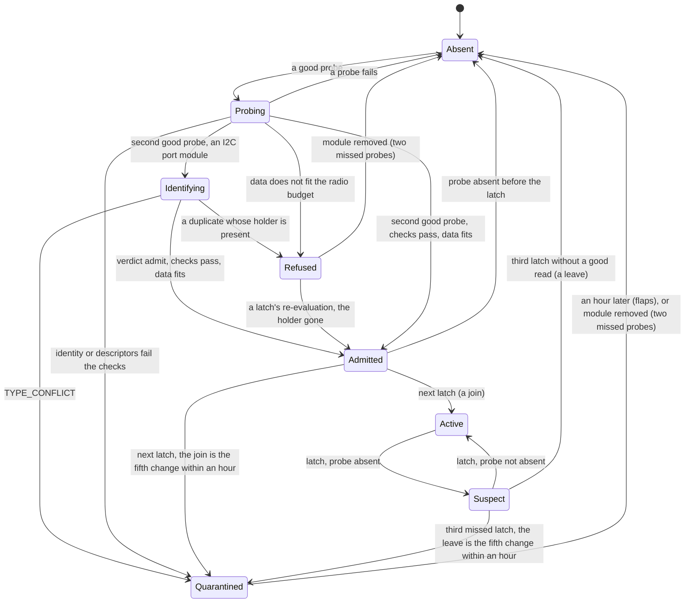

# wsmp_host: the station side of WSMP

`wsmp_host.c` keeps one state for each local port of the bench station. It turns the modules'
probes into presence, admits a module only when its identity and descriptors pass the registry and
its data fits the radio budget, latches every module of the layout once a minute, and removes a
module after three missed latches. It follows section 7 of `docs/module-protocol.md` (DATAVANE5K,
the Weather Station Module Protocol).

This document is the source. `tools/tangle.py` generates `wsmp_host.c` from the code chunks below.
The header `wsmp_host.h` is a plain file.

```sh
python3 tools/tangle.py firmware/stage0-node/App/wsmp_host.lit.md            # write wsmp_host.c
python3 tools/tangle.py --check firmware/stage0-node/App/wsmp_host.lit.md    # committed .c == tangle
```

## 1. Rules

| Rule | Meaning here | Checked by (`tests/test_wsmp_host.py`) |
|---|---|---|
| WSMP-P2, debounce | two good probes in a row admit. Three latches without a good read remove | `test_two_probes_then_admitted_at_next_latch`, `test_three_missed_latches_then_absent`, `test_a_good_read_ends_suspect` |
| WSMP-P3, bus faults | a bus fault makes the quality "missing" and keeps the port in the layout | `test_bus_fault_keeps_layout` |
| WSMP-P4, at the latch | a newly admitted module joins at the next latch | `test_two_probes_then_admitted_at_next_latch` |
| WSMP-P5, budget | the minute-class modules must fit the radio budget. A module that does not fit is refused | `test_admission_refuses_over_budget`, `test_the_health_class_does_not_count_in_the_budget` |
| WSMP-P6, flaps | more than 4 joins and leaves in an hour quarantine the port for an hour | `test_flap_limit_quarantines_for_an_hour` |
| WSMP-D7, I1 | a bad identity, a descriptor digest that does not match, or bad descriptors quarantine the module | `test_bad_descriptor_quarantines`, `test_a_descriptor_digest_that_does_not_match_quarantines` |
| Admission check | `wsmp_host_admit` changes no port state | `test_admit_is_a_check_that_changes_no_port` |
| Console line | `#modules` lists the state of every port, and the verdict of a port refused as a duplicate or quarantined for a type conflict | `test_modules_line_lists_every_port`, `test_a_type_conflict_is_quarantined_until_the_module_is_removed` |
| Identification (ports design, section 6.7) | an I2C port module is identified across steps (App/port_id.c): the record read (3 tries, a CRC failure read once more), the sensor serial, then the verdict order of `wsmp_identify`. Its identity block carries the verdict's serial, identity flags and capabilities, and the boot ID (station epoch << 8 \| the port's admission count); its driver is bound with the applied record's calibration | `Identity` in `tests/test_wsmp_host.py` |
| Duplicates | the holder check (App/port_id.c) ends a gone holder at once and admits the newcomer; a present holder refuses it (`DUP_SERIAL`, `DUP_TYPE`). A refusal is re-evaluated at every latch, after all ports' latches, in port order | `test_a_moved_module_ends_its_gone_holder_at_once`, `test_a_present_holder_refuses_the_newcomer`, `test_a_duplicate_serial_at_boot_the_lower_port_wins_until_it_leaves` |
| Boot hold | the verdicts of the port modules wait until every port module has probed twice (two station-wide 15 s rounds; at most three rounds), then they are decided in port order, so the lower port wins | `test_a_duplicate_serial_at_boot_the_lower_port_wins_until_it_leaves` |
| Removal of a refused or quarantined module | it keeps probing; two missed probes in a row make it Absent | `test_a_refused_port_needs_two_missed_probes_to_be_absent` |

A local module cannot fail a snapshot read: the read is a copy. So a "good read" here is a latch at
which the module's last probe did not report it absent. The snapshot must also unpack and carry the
latch's token. A bus fault (probe -1) counts as a good read,
so WSMP-P3 holds.

## 2. States



A join that quarantines the port goes from Admitted through Active to Quarantined in one latch.
That latch does not latch the port.
For an on-board module (power, enclosure, wind, rain) Identifying (WSMP section 7) happens inside
one step: its blocks are at hand, so the second good probe identifies and decides at once. An I2C
port module (ports 1-3 of the static channel map) is identified across steps, section 4 below.

```c {#constants}
#ifndef WSMP_HOST_BUDGET
#define WSMP_HOST_BUDGET WSMP_RADIO_BUDGET   /* a test build can make it smaller */
#endif
#define GOOD_PROBES 2U
#define MISSED_LATCHES 3U
#define FLAP_CHANGES 5U                    /* the fifth join or leave within the hour quarantines */
#define FLAP_WINDOW_MS 3600000UL
#define QUARANTINE_MS 3600000UL
#define PROBE_ABSENT 0
#define PROBE_PRESENT 1
#define REMOVAL_PROBES 2U                  /* a refused or quarantined module: missed probes in a row */
#define HOLD_ROUNDS 2U                     /* the boot hold: probes of every port module */
#define HOLD_MAX_MS (3UL * WSMP_SAMPLE_MS) /* and at most this long, so a silent driver cannot hold it */
#define BOOT_SHIFT 8U                      /* the boot ID: epoch << 8 | admission count (section 6.7) */
#define COUNT_MASK 0xFFU
#define CAP_RECORD 1U                      /* identity capabilities bit 0: a valid record */
```

```c {#state}
typedef struct {
  uint8_t state, good, missed, timed;          /* timed: a flap quarantine that ends by itself */
  uint8_t values, channels, report_class;      /* the admitted module's share of the radio budget */
  int probe;
  uint16_t probe_seq;
  uint32_t quarantine_until, changes;
  uint32_t change_at[FLAP_CHANGES];            /* the times of the last joins and leaves */
  wsmp_snapshot snap;
  int have_snap;
  /* An I2C port module's identity (section 6.7): */
  uint8_t reason;                              /* the verdict behind Quarantined or Refused (WSMP_V_*) */
  uint8_t holder, checking;                    /* a duplicate's holder port, and its check running */
  uint8_t admissions, missed_probes, rounds;   /* rounds: probes since boot, for the boot hold */
  uint8_t with_record, has_sensor_serial;
  uint64_t serial, rec_serial;
  uint32_t sensor_serial;
} port_t;

static port_t ports[P_COUNT];
static uint16_t token;
static uint8_t hold_over, hold_started;
static uint32_t hold_from;

void wsmp_host_init(void)
{
  memset(ports, 0, sizeof ports);
  token = 0;
  hold_over = hold_started = 0;
}
```

## 3. Admission

`wsmp_host_admit` checks the identity block (WSMP-I1), its digest of the descriptor block, and the
descriptors against the registry (WSMP-D7). It changes no port. `identify` writes the module's share
of the budget only when the module is admitted. A minute-class module's bytes are then added to the
bytes of the minute-class modules that are admitted or in the layout. The total must fit the radio
budget (WSMP-A1). The health-class battery module goes in the health report, so it does not count.

```c {#admit}
static int in_layout(const port_t *s)
{
  return s->state == WH_ADMITTED || s->state == WH_ACTIVE || s->state == WH_SUSPECT;
}

static int fits(enum wsmp_port p, unsigned values, unsigned channels)
{
  for (unsigned q = P_AIR_TH; q < P_COUNT; q++)
  {
    const port_t *s = &ports[q];
    if (q == (unsigned)p || !in_layout(s) || s->report_class != WSMP_RC_MINUTE) continue;
    values += s->values;
    channels += s->channels;
  }
  return values + wsmp_quality_bytes(channels) <= WSMP_HOST_BUDGET;
}

typedef struct { uint8_t values, channels, report_class; } share_t;   /* a module's part of the budget */

static int admission(enum wsmp_port p, const uint8_t id[WSMP_IDENTITY_LEN], const uint8_t desc[WSMP_DESC_BLOCK_LEN],
                     share_t *share)
{
  wsmp_identity ident;
  wsmp_desc d[WSMP_MAX_CHANNELS];
  if (wsmp_unpack_identity(id, &ident) != WSMP_OK || ident.desc_digest != wsmp_crc32c(desc, WSMP_DESC_BLOCK_LEN) ||
      wsmp_unpack_desc(desc, ident.channels, d) != WSMP_OK ||
      wsmp_desc_check(d, ident.channels, ident.type, ident.schema) != WSMP_OK)
    return WH_QUARANTINED;
  const wsmp_type_entry *type = wsmp_type(ident.type);
  if (!type) return WH_QUARANTINED;   /* wsmp_desc_check already found it; this keeps the pointer checked */
  *share = (share_t){ .values = (uint8_t)wsmp_values_bytes(d, ident.channels), .channels = ident.channels,
                      .report_class = type->report_class };
  if (share->report_class == WSMP_RC_MINUTE && !fits(p, share->values, share->channels)) return WH_REFUSED;
  return WH_ADMITTED;
}

int wsmp_host_admit(enum wsmp_port p, const uint8_t id[WSMP_IDENTITY_LEN], const uint8_t desc[WSMP_DESC_BLOCK_LEN])
{
  share_t share;
  return admission(p, id, desc, &share);
}
```

## 4. Probes

The host looks at a port's probe only when the module has probed again (its sequence number moved).

```c {#probes}
static void identify(enum wsmp_port p, port_t *s)
{
  uint8_t id[WSMP_IDENTITY_LEN], desc[WSMP_DESC_BLOCK_LEN];
  share_t share;
  local_identity(p, id, desc);
  s->state = (uint8_t)admission(p, id, desc, &share);
  if (s->state == WH_ADMITTED) { s->values = share.values; s->channels = share.channels; s->report_class = share.report_class; }
  s->timed = 0;
}

/* Absent and Probing: presence builds up, two good probes in a row. A port module is then identified
   across steps (section 4.1); an on-board module at once. */
static void on_probe_presence(enum wsmp_port p, port_t *s)
{
  if (s->probe != PROBE_PRESENT) { s->good = 0; s->state = WH_ABSENT; return; }
  if (s->state == WH_ABSENT) { s->good = 1; s->state = WH_PROBING; return; }
  if (++s->good < GOOD_PROBES) return;
  if (!port_id_is_port(p)) { identify(p, s); return; }
  s->state = WH_IDENTIFYING;
  s->checking = 0;
  port_id_identify(p);
}

/* Admitted, Refused and Quarantined: wait for a removal (or the end of a flap quarantine). A refused
   or quarantined module keeps probing: two missed probes in a row remove it (section 6.7). */
static void on_probe_waiting(port_t *s, uint32_t now_ms)
{
  int ended;
  s->missed_probes = s->probe == PROBE_ABSENT ? (uint8_t)(s->missed_probes + 1U) : 0U;
  if (s->state == WH_ADMITTED) ended = s->probe == PROBE_ABSENT;
  else if (s->state == WH_QUARANTINED && s->timed) ended = (int32_t)(now_ms - s->quarantine_until) >= 0;
  else ended = s->missed_probes >= REMOVAL_PROBES;
  if (!ended) return;
  s->state = WH_ABSENT;
  s->reason = WSMP_V_ADMIT;
  s->missed_probes = 0;
}

static void on_probe(enum wsmp_port p, port_t *s, uint32_t now_ms)
{
  if (s->state == WH_ABSENT || s->state == WH_PROBING) on_probe_presence(p, s);
  else if (s->state == WH_ADMITTED || s->state == WH_REFUSED || s->state == WH_QUARANTINED) on_probe_waiting(s, now_ms);
  /* Active and Suspect: the latch decides */
}

/* The boot hold (section 6.7): the port modules' verdicts wait until each has probed twice since
   boot, two station-wide probe rounds, then they are decided in port order. */
static int boot_held(uint32_t now_ms)
{
  if (hold_over) return 0;
  if (!hold_started) { hold_started = 1; hold_from = now_ms; }
  for (unsigned q = P_AIR_TH; q < P_COUNT; q++)
    if (port_id_is_port((enum wsmp_port)q) && ports[q].rounds < HOLD_ROUNDS && now_ms - hold_from < HOLD_MAX_MS) return 1;
  hold_over = 1;
  return 0;
}

void wsmp_host_tick(uint32_t now_ms)
{
  for (unsigned q = P_AIR_TH; q < P_COUNT; q++)
  {
    port_t *s = &ports[q];
    uint16_t seq;
    local_tick((enum wsmp_port)q, now_ms);
    if (port_id_is_port((enum wsmp_port)q)) port_id_tick((enum wsmp_port)q);
    int probe = local_probe_result((enum wsmp_port)q, &seq);
    if (seq == s->probe_seq) continue;
    s->probe_seq = seq;
    s->probe = probe;
    if (s->rounds < HOLD_ROUNDS) s->rounds++;
    on_probe((enum wsmp_port)q, s, now_ms);
  }
  int held = boot_held(now_ms);
  for (unsigned q = P_AIR_TH; q < P_COUNT; q++)   /* in port order: the lower port decides first */
    if (ports[q].state == WH_IDENTIFYING) identifying((enum wsmp_port)q, &ports[q], held, now_ms);
}
```

### 4.1 Identifying an I2C port module

`App/port_id.c` does the bus work: the record read and the sensor serial, then, for a duplicate, the
holder check, each as steps of the port's driver held in its idle state. When the reads are done
(and the boot hold is over, and no lower port is still identifying, so verdicts are decided in
port order) `decide` runs the verdict order of `wsmp_identify` (section 6.7)
against the modules Admitted, Active or Suspect on the other ports:

| Verdict | Result |
|---|---|
| `TYPE_CONFLICT` | Quarantined until the module is removed |
| `DUP_SERIAL`, `DUP_TYPE` | the holder check on the holder's port. Gone: the holder is ended (Absent, a leave) and the verdict is decided again. Present: Refused, re-evaluated at every latch |
| admit | the registry and budget checks of section 3 with the verdict's identity; once admitted, the driver is bound to the module: a fresh window, the boot ID, the applied record's calibration |

```c {#identify}
static int valid_record(uint8_t status)
{
  return status == WSMP_REC_APPLIED || status == WSMP_REC_CAL_REJECTED || status == WSMP_REC_SENSOR_CHANGED;
}

/* The modules in the layout, each with its serial and type, for wsmp_identify. */
static unsigned holders(wsmp_port_held held[P_COUNT])
{
  unsigned n = 0;
  for (unsigned q = P_AIR_TH; q < P_COUNT; q++)
  {
    const port_t *s = &ports[q];
    if (!in_layout(s)) continue;
    uint16_t type = local_type((enum wsmp_port)q);
    held[n++] = (wsmp_port_held){ .port = (uint8_t)q, .holding = 1, .type = type,
                                  .serial = port_id_is_port((enum wsmp_port)q) ? s->serial : WSMP_LOCAL_SERIAL(q, type) };
  }
  return n;
}

static void admit_verdict(enum wsmp_port p, port_t *s, const wsmp_observed *o, const wsmp_verdict *v, uint32_t now_ms)
{
  uint8_t id[WSMP_IDENTITY_LEN], desc[WSMP_DESC_BLOCK_LEN];
  share_t share;
  uint32_t boot_id = local_boot_epoch() << BOOT_SHIFT | ((s->admissions + 1U) & COUNT_MASK);
  local_set_identity(p, v->serial, v->id_flags, valid_record(v->status) ? (uint16_t)CAP_RECORD : 0U);
  local_identity(p, id, desc);
  s->state = (uint8_t)admission(p, id, desc, &share);
  s->reason = WSMP_V_ADMIT;
  s->timed = 0;
  if (s->state != WH_ADMITTED) return;
  s->values = share.values; s->channels = share.channels; s->report_class = share.report_class;
  s->admissions++;
  s->serial = v->serial;
  s->with_record = (uint8_t)valid_record(v->status);
  s->rec_serial = v->record.serial;
  s->has_sensor_serial = o->has_sensor_serial;
  s->sensor_serial = o->sensor_serial;
  local_bind(p, v->status == WSMP_REC_APPLIED ? &v->record : NULL, boot_id, now_ms);
}

/* A duplicate: the holder check on the holder's port, once its engine is free (else the next tick). */
static void duplicate(port_t *s, const wsmp_verdict *v)
{
  const port_t *h = &ports[v->holder_port];
  s->reason = v->verdict;
  s->holder = v->holder_port;
  if (!port_id_is_port((enum wsmp_port)v->holder_port)) { s->state = WH_REFUSED; return; }   /* on-board: present */
  if (port_id_state((enum wsmp_port)v->holder_port) != PORT_ID_DONE) return;
  const port_id_expect e = { .serial = h->rec_serial, .sensor_serial = h->sensor_serial, .with_record = h->with_record,
                             .has_sensor_serial = h->has_sensor_serial };
  port_id_holder((enum wsmp_port)v->holder_port, &e);
  s->checking = 1;
}

/* The verdict order. recheck: a latch's re-evaluation of a refusal, which starts no holder check. */
static void decide(enum wsmp_port p, port_t *s, int recheck, uint32_t now_ms)
{
  wsmp_observed o;
  wsmp_port_held held[P_COUNT];
  wsmp_verdict v;
  unsigned n = holders(held);   /* fills held before the call reads it */
  port_id_observed(p, &o);
  wsmp_identify(&o, held, n, &v);
  if (v.verdict == WSMP_V_ADMIT) { admit_verdict(p, s, &o, &v, now_ms); return; }
  if (recheck) return;
  if (v.verdict != WSMP_V_TYPE_CONFLICT) { duplicate(s, &v); return; }
  s->state = WH_QUARANTINED;
  s->reason = v.verdict;
  s->timed = 0;
  s->missed_probes = 0;
}

static void end_holder(port_t *h, uint32_t now_ms);

/* 1 while a lower port is still identifying: verdicts are decided in port order. */
static int lower_identifying(enum wsmp_port p)
{
  for (unsigned q = P_AIR_TH; q < (unsigned)p; q++)
    if (ports[q].state == WH_IDENTIFYING) return 1;
  return 0;
}

static void identifying(enum wsmp_port p, port_t *s, int held, uint32_t now_ms)
{
  if (!s->checking)
  {
    if (!held && port_id_state(p) == PORT_ID_DONE && !lower_identifying(p)) decide(p, s, 0, now_ms);
    return;
  }
  if (port_id_state((enum wsmp_port)s->holder) != PORT_ID_DONE) return;
  s->checking = 0;
  if (port_id_holder_result((enum wsmp_port)s->holder) == PORT_ID_PRESENT) { s->state = WH_REFUSED; s->missed_probes = 0; return; }
  end_holder(&ports[s->holder], now_ms);
  decide(p, s, 0, now_ms);
}
```

## 5. The latch

Each latch has a new token (WSMP-L3). A module admitted since the last latch joins now. Each module
of the layout is latched and its snapshot read. A join or a leave is a change of the layout. The
fifth change within an hour quarantines the port for an hour (WSMP-P6).

The order within a latch is fixed (section 6.7): first the state transitions of every port, in port
order; then the re-evaluation of the refused duplicates, in port order. (The identity-check results
come between them with re-identification, a later slice.)

```c {#latch}
static void layout_change(port_t *s, uint32_t now_ms)
{
  memmove(s->change_at, s->change_at + 1, sizeof s->change_at - sizeof s->change_at[0]);
  s->change_at[FLAP_CHANGES - 1U] = now_ms;
  s->changes++;
  if (s->changes < FLAP_CHANGES || now_ms - s->change_at[0] >= FLAP_WINDOW_MS) return;
  s->state = WH_QUARANTINED;
  s->timed = 1;
  s->quarantine_until = now_ms + QUARANTINE_MS;
  s->have_snap = 0;
}

/* A holder found gone (section 6.7): it leaves the layout now, a removal sooner than three missed latches. */
static void end_holder(port_t *h, uint32_t now_ms)
{
  if (!in_layout(h)) return;
  int joined = h->state != WH_ADMITTED;
  h->state = WH_ABSENT;
  h->have_snap = 0;
  h->good = 0;
  h->missed = 0;
  if (joined) layout_change(h, now_ms);
}

static void latch_one(enum wsmp_port p, port_t *s, uint32_t utc, uint32_t now_ms)
{
  uint8_t raw[WSMP_SNAPSHOT_LEN];
  local_latch(p, token, utc, now_ms);
  local_snapshot(p, raw);
  int read_ok = wsmp_unpack_snapshot(raw, &s->snap) == WSMP_OK && s->snap.token == token;
  s->have_snap = read_ok;
  if (read_ok && s->probe != PROBE_ABSENT) { s->state = WH_ACTIVE; s->missed = 0; return; }
  s->state = WH_SUSPECT;
  if (++s->missed < MISSED_LATCHES) return;
  s->state = WH_ABSENT;
  s->have_snap = 0;
  s->good = 0;
  layout_change(s, now_ms);
}

void wsmp_host_latch(uint32_t utc, uint32_t now_ms)
{
  token++;
  for (unsigned q = P_AIR_TH; q < P_COUNT; q++)
  {
    port_t *s = &ports[q];
    if (s->state == WH_ADMITTED) { s->state = WH_ACTIVE; s->missed = 0; layout_change(s, now_ms); }
    if (s->state == WH_ACTIVE || s->state == WH_SUSPECT) latch_one((enum wsmp_port)q, s, utc, now_ms);
  }
  for (unsigned q = P_AIR_TH; q < P_COUNT; q++)
  {
    port_t *s = &ports[q];
    if (s->state == WH_REFUSED && s->reason != WSMP_V_ADMIT) decide((enum wsmp_port)q, s, 1, now_ms);
  }
}
```

## 6. Readings and the console line

```c {#queries}
const wsmp_snapshot *wsmp_host_snapshot(enum wsmp_port p)
{
  const port_t *s = &ports[p];
  return (s->state == WH_ACTIVE || s->state == WH_SUSPECT) && s->have_snap ? &s->snap : NULL;
}

int wsmp_host_state(enum wsmp_port p) { return ports[p].state; }
uint32_t wsmp_host_changes(enum wsmp_port p) { return ports[p].changes; }

/* Appends text at buf + n, truncated to the buffer (len - 1 characters and the terminator); returns
   the new length. */
static unsigned append(char *buf, unsigned len, unsigned n, const char *text)
{
  for (const char *c = text; *c && n + 1U < len; c++) buf[n++] = *c;   /* bound: len - 1 characters */
  buf[n] = 0;
  return n;
}

/* A port's state, or the verdict behind a refusal or a quarantine (section 6.7: console only in v1). */
static const char *state_name(const port_t *s)
{
  static const char *const state[] = { "absent", "probing", "identifying", "admitted", "active", "suspect",
                                       "quarantined", "refused" };
  static const char *const verdict[] = { "", "type_conflict", "dup_serial", "dup_type" };
  int by_verdict = (s->state == WH_REFUSED || s->state == WH_QUARANTINED) && s->reason != WSMP_V_ADMIT;
  return by_verdict ? verdict[s->reason] : state[s->state];
}

unsigned wsmp_host_modules_line(char *buf, unsigned len)
{
  static const char *const name[P_COUNT] = { "", " air_th=", " pressure=", " uva=", " encl_th=", " power=", " wind=", " rain=" };
  if (len == 0) return 0;
  unsigned n = append(buf, len, 0, "#modules");
  for (unsigned q = P_AIR_TH; q < P_COUNT; q++) n = append(buf, len, append(buf, len, n, name[q]), state_name(&ports[q]));
  return n;
}
```

## 7. The file

```c {#wsmp_host.c}
#include "wsmp_host.h"
#include <string.h>
#include "port_id.h"

<<constants>>

<<state>>

<<admit>>

<<identify>>

<<probes>>

<<latch>>

<<queries>>
```
