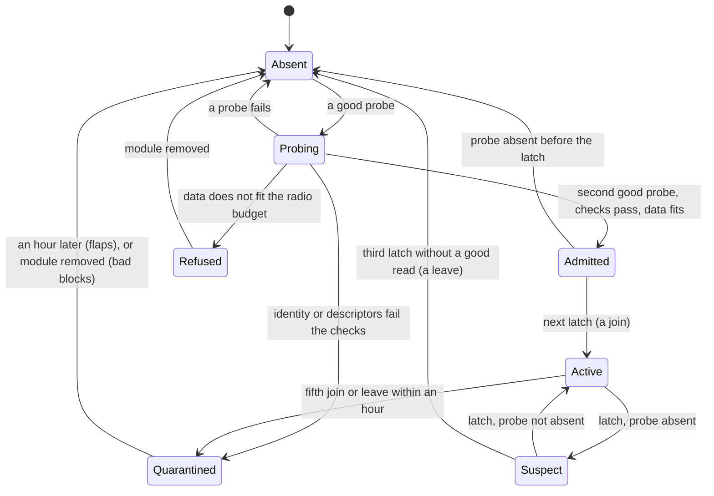

# wsmp_host: the station side of WSMP

`wsmp_host.c` keeps one state for each local port of the bench station. It turns the modules'
probes into presence, admits a module only when its identity and descriptors pass the registry and
its data fits the radio budget, latches every module of the layout once a minute, and removes a
module after three missed latches. It follows section 7 of `docs/module-protocol.md` (DATAVANE5K,
the Weather Station Module Protocol).

This document is the source. `tools/tangle.py` generates `wsmp_host.c` from the code chunks below.
The header `wsmp_host.h` is a plain file.

```sh
python3 tools/tangle.py firmware/stage0-node/App/wsmp_host.lit.md            # write wsmp_host.c
python3 tools/tangle.py --check firmware/stage0-node/App/wsmp_host.lit.md    # committed .c == tangle
```

## 1. Rules

| Rule | Meaning here | Checked by (`tests/test_wsmp_host.py`) |
|---|---|---|
| WSMP-P2, debounce | two good probes in a row admit; three latches without a good read remove | `test_two_probes_then_admitted_at_next_latch`, `test_three_missed_latches_then_absent`, `test_a_good_read_ends_suspect` |
| WSMP-P3, bus faults | a bus fault makes the quality "missing" and keeps the port in the layout | `test_bus_fault_keeps_layout` |
| WSMP-P4, at the latch | a newly admitted module joins at the next latch | `test_two_probes_then_admitted_at_next_latch` |
| WSMP-P5, budget | the minute-class modules must fit the radio budget; a module that does not is refused | `test_admission_refuses_over_budget`, `test_the_health_class_does_not_count_in_the_budget` |
| WSMP-P6, flaps | more than 4 joins and leaves in an hour quarantine the port for an hour | `test_flap_limit_quarantines_for_an_hour` |
| WSMP-D7, I1 | a bad identity or bad descriptors quarantine the module | `test_bad_descriptor_quarantines` |

A local module cannot fail a snapshot read: the read is a copy. So a "good read" here is a latch at
which the module's last probe did not report it absent. A bus fault (probe -1) counts as a good read,
so WSMP-P3 holds.

## 2. States



Identifying (WSMP section 7) happens inside one step here: the blocks of a local module are at hand,
so the second good probe identifies and decides at once.

```c {#constants}
#ifndef WSMP_HOST_BUDGET
#define WSMP_HOST_BUDGET WSMP_RADIO_BUDGET   /* a test build can make it smaller */
#endif
#define GOOD_PROBES 2U
#define MISSED_LATCHES 3U
#define FLAP_CHANGES 5U                    /* the fifth join or leave within the hour quarantines */
#define FLAP_WINDOW_MS 3600000UL
#define QUARANTINE_MS 3600000UL
#define PROBE_ABSENT 0
#define PROBE_PRESENT 1
```

```c {#state}
typedef struct {
  uint8_t state, good, missed, timed;          /* timed: a flap quarantine that ends by itself */
  uint8_t values, channels, report_class;      /* the admitted module's share of the radio budget */
  int probe;
  uint16_t probe_seq;
  uint32_t quarantine_until, changes;
  uint32_t change_at[FLAP_CHANGES];            /* the times of the last joins and leaves */
  wsmp_snapshot snap;
  int have_snap;
} port_t;

static port_t ports[P_COUNT];
static uint16_t token;

void wsmp_host_init(void)
{
  memset(ports, 0, sizeof ports);
  token = 0;
}
```

## 3. Admission

`wsmp_host_admit` checks the identity block (WSMP-I1) and the descriptors against the registry
(WSMP-D7). Then it adds the module's minute-class bytes to those of the modules already in the
layout or admitted, and compares the total with the radio budget (WSMP-A1). The health-class battery
module goes in the health report, so it does not count.

```c {#admit}
static int in_layout(const port_t *s)
{
  return s->state == WH_ADMITTED || s->state == WH_ACTIVE || s->state == WH_SUSPECT;
}

static int fits(enum wsmp_port p, unsigned values, unsigned channels)
{
  for (unsigned q = P_AIR_TH; q < P_COUNT; q++)
  {
    const port_t *s = &ports[q];
    if (q == (unsigned)p || !in_layout(s) || s->report_class != WSMP_RC_MINUTE) continue;
    values += s->values;
    channels += s->channels;
  }
  return values + wsmp_quality_bytes(channels) <= WSMP_HOST_BUDGET;
}

int wsmp_host_admit(enum wsmp_port p, const uint8_t id[WSMP_IDENTITY_LEN], const uint8_t desc[WSMP_DESC_BLOCK_LEN])
{
  wsmp_identity ident;
  wsmp_desc d[WSMP_MAX_CHANNELS];
  if (wsmp_unpack_identity(id, &ident) != WSMP_OK || wsmp_unpack_desc(desc, ident.channels, d) != WSMP_OK ||
      wsmp_desc_check(d, ident.channels, ident.type, ident.schema) != WSMP_OK)
    return WH_QUARANTINED;
  port_t *s = &ports[p];
  s->values = (uint8_t)wsmp_values_bytes(d, ident.channels);
  s->channels = ident.channels;
  s->report_class = wsmp_type(ident.type)->report_class;   /* wsmp_desc_check found the type */
  if (s->report_class == WSMP_RC_MINUTE && !fits(p, s->values, s->channels)) return WH_REFUSED;
  return WH_ADMITTED;
}
```

## 4. Probes

The host looks at a port's probe only when the module has probed again (its sequence number moved).

```c {#probes}
static void identify(enum wsmp_port p, port_t *s)
{
  uint8_t id[WSMP_IDENTITY_LEN], desc[WSMP_DESC_BLOCK_LEN];
  local_identity(p, id, desc);
  s->state = (uint8_t)wsmp_host_admit(p, id, desc);
  s->timed = 0;
}

/* Absent and Probing: presence builds up, two good probes in a row. */
static void on_probe_presence(enum wsmp_port p, port_t *s)
{
  if (s->probe != PROBE_PRESENT) { s->good = 0; s->state = WH_ABSENT; return; }
  if (s->state == WH_ABSENT) { s->good = 1; s->state = WH_PROBING; return; }
  if (++s->good >= GOOD_PROBES) identify(p, s);
}

/* Admitted, Refused and Quarantined: wait for a removal (or the end of a flap quarantine). */
static void on_probe_waiting(port_t *s, uint32_t now_ms)
{
  int ended = s->timed ? (int32_t)(now_ms - s->quarantine_until) >= 0 : s->probe == PROBE_ABSENT;
  if (s->state != WH_QUARANTINED) ended = s->probe == PROBE_ABSENT;
  if (ended) s->state = WH_ABSENT;
}

static void on_probe(enum wsmp_port p, port_t *s, uint32_t now_ms)
{
  if (s->state == WH_ABSENT || s->state == WH_PROBING) on_probe_presence(p, s);
  else if (s->state == WH_ADMITTED || s->state == WH_REFUSED || s->state == WH_QUARANTINED) on_probe_waiting(s, now_ms);
  /* Active and Suspect: the latch decides */
}

void wsmp_host_tick(uint32_t now_ms)
{
  for (unsigned q = P_AIR_TH; q < P_COUNT; q++)
  {
    port_t *s = &ports[q];
    uint16_t seq;
    local_tick((enum wsmp_port)q, now_ms);
    int probe = local_probe_result((enum wsmp_port)q, &seq);
    if (seq == s->probe_seq) continue;
    s->probe_seq = seq;
    s->probe = probe;
    on_probe((enum wsmp_port)q, s, now_ms);
  }
}
```

## 5. The latch

Each latch has a new token (WSMP-L3). A module admitted since the last latch joins now. Each module
of the layout is latched and its snapshot read. A join or a leave is a change of the layout; the
fifth change within an hour quarantines the port for an hour (WSMP-P6).

```c {#latch}
static void layout_change(port_t *s, uint32_t now_ms)
{
  memmove(s->change_at, s->change_at + 1, sizeof s->change_at - sizeof s->change_at[0]);
  s->change_at[FLAP_CHANGES - 1U] = now_ms;
  s->changes++;
  if (s->changes < FLAP_CHANGES || now_ms - s->change_at[0] >= FLAP_WINDOW_MS) return;
  s->state = WH_QUARANTINED;
  s->timed = 1;
  s->quarantine_until = now_ms + QUARANTINE_MS;
  s->have_snap = 0;
}

static void latch_one(enum wsmp_port p, port_t *s, uint32_t utc, uint32_t now_ms)
{
  uint8_t raw[WSMP_SNAPSHOT_LEN];
  local_latch(p, token, utc, now_ms);
  local_snapshot(p, raw);
  int read_ok = wsmp_unpack_snapshot(raw, &s->snap) == WSMP_OK && s->snap.token == token;
  s->have_snap = read_ok;
  if (read_ok && s->probe != PROBE_ABSENT) { s->state = WH_ACTIVE; s->missed = 0; return; }
  s->state = WH_SUSPECT;
  if (++s->missed < MISSED_LATCHES) return;
  s->state = WH_ABSENT;
  s->have_snap = 0;
  s->good = 0;
  layout_change(s, now_ms);
}

void wsmp_host_latch(uint32_t utc, uint32_t now_ms)
{
  token++;
  for (unsigned q = P_AIR_TH; q < P_COUNT; q++)
  {
    port_t *s = &ports[q];
    if (s->state == WH_ADMITTED) { s->state = WH_ACTIVE; s->missed = 0; layout_change(s, now_ms); }
    if (s->state == WH_ACTIVE || s->state == WH_SUSPECT) latch_one((enum wsmp_port)q, s, utc, now_ms);
  }
}
```

## 6. Readings and the console line

```c {#queries}
const wsmp_snapshot *wsmp_host_snapshot(enum wsmp_port p)
{
  const port_t *s = &ports[p];
  return (s->state == WH_ACTIVE || s->state == WH_SUSPECT) && s->have_snap ? &s->snap : NULL;
}

int wsmp_host_state(enum wsmp_port p) { return ports[p].state; }
uint32_t wsmp_host_changes(enum wsmp_port p) { return ports[p].changes; }

/* Appends "<a><b>" at buf + n, truncated to the buffer; returns the new length. */
static unsigned append(char *buf, unsigned len, unsigned n, const char *a, const char *b)
{
  int w = snprintf(buf + n, len - n, "%s%s", a, b);
  if (w < 0) return n;
  return n + (unsigned)w < len ? n + (unsigned)w : len - 1U;
}

unsigned wsmp_host_modules_line(char *buf, unsigned len)
{
  static const char *const name[P_COUNT] = { "", " air_th=", " pressure=", " uva=", " encl_th=", " power=", " wind=", " rain=" };
  static const char *const state[] = { "absent", "probing", "identifying", "admitted", "active", "suspect",
                                       "quarantined", "refused" };
  if (len == 0) return 0;
  unsigned n = append(buf, len, 0, "#modules", "");
  for (unsigned q = P_AIR_TH; q < P_COUNT; q++) n = append(buf, len, n, name[q], state[ports[q].state]);
  return n;
}
```

## 7. The file

```c {#wsmp_host.c}
#include "wsmp_host.h"
#include <stdio.h>
#include <string.h>

<<constants>>

<<state>>

<<admit>>

<<probes>>

<<latch>>

<<queries>>
```
