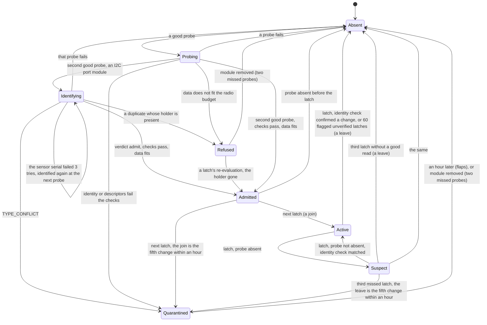

# wsmp_host: the station side of WSMP

`wsmp_host.c` keeps one state for each local port of the bench station. It turns the modules'
probes into presence, admits a module only when its identity and descriptors pass the registry and
its data fits the radio budget, latches every module of the layout once a minute, and removes a
module after three missed latches. It follows section 7 of `docs/module-protocol.md` (DATAVANE5K,
the Weather Station Module Protocol).

This document is the source. `tools/tangle.py` generates `wsmp_host.c` from the code chunks below.
The header `wsmp_host.h` is a plain file.

```sh
python3 tools/tangle.py firmware/stage0-node/App/wsmp_host.lit.md            # write wsmp_host.c
python3 tools/tangle.py --check firmware/stage0-node/App/wsmp_host.lit.md    # committed .c == tangle
```

## 1. Rules

| Rule | Meaning here | Checked by (`tests/test_wsmp_host.py`) |
|---|---|---|
| WSMP-P2, debounce | two good probes in a row admit. Three latches without a good read remove | `test_two_probes_then_admitted_at_next_latch`, `test_three_missed_latches_then_absent`, `test_a_good_read_ends_suspect` |
| WSMP-P3, bus faults | a bus fault makes the quality "missing" and keeps the port in the layout | `test_bus_fault_keeps_layout` |
| WSMP-P4, at the latch | a newly admitted module joins at the next latch | `test_two_probes_then_admitted_at_next_latch` |
| WSMP-P5, budget | the minute-class modules must fit the radio budget (60 B). A module that does not fit is refused | `test_admission_refuses_over_budget`, `test_the_whole_station_fits_the_budget`, `test_no_module_is_health_class` |
| WSMP-P6, flaps | more than 4 joins and leaves in an hour quarantine the port for an hour | `test_flap_limit_quarantines_for_an_hour` |
| WSMP-D7, I1 | a bad identity, a descriptor digest that does not match, or bad descriptors quarantine the module | `test_bad_descriptor_quarantines`, `test_a_descriptor_digest_that_does_not_match_quarantines` |
| Admission check | `wsmp_host_admit` changes no port state | `test_admit_is_a_check_that_changes_no_port` |
| Console line | `#modules` lists the state of every port, and the verdict of a port refused as a duplicate or quarantined for a type conflict. Its longest text, every port with the longest name and the I2C port modules with both counts at 255, is 268 characters for the 8 ports: `WSMP_MODULES_LINE_MAX` (272) holds it and its NUL, and a `_Static_assert` on `LINE_WORST` stops a build where it would not | `test_modules_line_lists_every_port`, `test_the_longest_modules_line_fits`, `test_a_type_conflict_is_quarantined_until_the_module_is_removed` |
| Descriptor set (WSMP section 11.1) | `wsmp_host_set` builds the set of the layout: every port that is Admitted, Active or Suspect, in increasing port order, with the identity entry of firmware-current-design.md (section 6.7): the identity block's serial and `id_flags`, and the applied record's CRC (0 unless the record is applied). The generation is the caller's (WSMP-E1 to E3 come with the journal and radio work). `MODULES` prints one `#ident` line for each module of the set, and `#ident dropped=N` for modules left out (a bug) | `test_the_set_carries_each_modules_identity`, `test_a_cal_rejected_record_has_crc_0`, `test_a_suspect_module_stays_in_the_set`, `test_a_module_whose_blocks_do_not_unpack_is_counted`, `test_a_changed_record_crc_changes_the_set`, `test_the_ident_lines_follow_the_set` |
| Identification (firmware-current-design.md, section 6.7) | an I2C port module is identified across steps (App/port_id.c): the record read (3 tries, a CRC failure read once more), the sensor serial (3 tries), then the verdict order of `wsmp_identify`. A sensor serial that fails its 3 tries is no verdict: the port stays Identifying, counts it (`#modules`: `(incomplete=N)`) and identifies again at its next probe. Its identity block carries the verdict's serial, identity flags and capabilities, and the boot ID (station epoch << 8 \| the port's admission count); its driver is bound with the applied record's calibration | `Identity` in `tests/test_wsmp_host.py` |
| Duplicates | the holder check (App/port_id.c) ends a gone holder at once and admits the newcomer; a present holder refuses it (`DUP_SERIAL`, `DUP_TYPE`). A refusal is re-evaluated at every latch, after all ports' latches, in port order | `test_a_moved_module_ends_its_gone_holder_at_once`, `test_a_present_holder_refuses_the_newcomer`, `test_a_duplicate_serial_at_boot_the_lower_port_wins_until_it_leaves` |
| Boot hold | the verdicts of the port modules wait until every port module has probed twice (two station-wide 15 s rounds; at most three rounds), then they are decided in port order, so the lower port wins | `test_a_duplicate_serial_at_boot_the_lower_port_wins_until_it_leaves` |
| Removal of a refused or quarantined module | it keeps probing; two missed probes in a row make it Absent | `test_a_refused_port_needs_two_missed_probes_to_be_absent` |
| Re-identification (section 6.7, PORT-16, PORT-17) | the pre-latch slot, the identity check of every port module in the layout, the sticky possibly-replugged flag, the unverified counter and the 60-latch timeout (section 5.1) | `Reidentify` in `tests/test_wsmp_host.py` |

A local module cannot fail a snapshot read: the read is a copy. So a "good read" here is a latch at
which the module's last probe did not report it absent. The snapshot must also unpack and carry the
latch's token. A bus fault (probe -1) counts as a good read,
so WSMP-P3 holds.

## 2. States



A join that quarantines the port goes from Admitted through Active to Quarantined in one latch.
That latch does not latch the port.
For an on-board module (battery, rails, enclosure, wind, rain) Identifying (WSMP section 7) happens
inside one step: its blocks are at hand, so the second good probe identifies and decides at once. The
battery (port 5) and rails (port 8) modules are base-board modules fixed by `WS_POWER_PROFILE`: their
probe always reports present, so they join the layout at boot and never leave it, whatever their parts
answer (`docs/superpowers/specs/2026-10-29-power-telemetry-design.md` section 8.5). An I2C
port module (ports 1-3 of the static channel map) is identified across steps, section 4 below.

```c {#constants}
#ifndef WSMP_HOST_BUDGET
#define WSMP_HOST_BUDGET WSMP_RADIO_BUDGET   /* a test build can make it smaller */
#endif
#define GOOD_PROBES 2U
#define MISSED_LATCHES 3U
#define FLAP_CHANGES 5U                    /* the fifth join or leave within the hour quarantines */
#define FLAP_WINDOW_MS 3600000UL
#define QUARANTINE_MS 3600000UL
#define PROBE_ABSENT 0
#define PROBE_PRESENT 1
#define REMOVAL_PROBES 2U                  /* a refused or quarantined module: missed probes in a row */
#define HOLD_ROUNDS 2U                     /* the boot hold: probes of every port module */
#define HOLD_MAX_MS (3UL * WSMP_SAMPLE_MS) /* and at most this long, so a silent driver cannot hold it */
#define BOOT_SHIFT 8U                      /* the boot ID: epoch << 8 | admission count (section 6.7) */
#define COUNT_MASK 0xFFU
#define CAP_RECORD 1U                      /* identity capabilities bit 0: a valid record */
#define COUNT_MAX 255U                     /* the incomplete and unverified counters saturate */
#define DECIMAL 10U
#ifndef WSMP_HOST_SLOT_MS
#define WSMP_HOST_SLOT_MS 3000U            /* the pre-latch slot (section 6.7); a test build can make it 0 */
#endif
#define LATCH_MS 60000UL                   /* the latch period: wsmp_host_latch sets the next one this far on */
#define TIMEOUT_LATCHES 60U                /* flagged and unverified in a row: the port is ended */
#define UNVERIFIED_SHOWN 3U                /* the console shows the unverified run from this many latches */
```

```c {#state}
typedef struct {
  uint8_t state, good, missed, timed;          /* timed: a flap quarantine that ends by itself */
  uint8_t values, channels, report_class;      /* the admitted module's share of the radio budget */
  int probe;
  uint16_t probe_seq;
  uint32_t quarantine_until, changes;
  uint32_t change_at[FLAP_CHANGES];            /* the times of the last joins and leaves */
  wsmp_snapshot snap;
  int have_snap;
  /* An I2C port module's identity (section 6.7): */
  uint8_t reason;                              /* the verdict behind Quarantined or Refused (WSMP_V_*) */
  uint8_t holder, checking;                    /* a duplicate's holder port, and its check running */
  uint8_t admissions, missed_probes, rounds;   /* rounds: probes since boot, for the boot hold */
  uint8_t with_record, has_sensor_serial;
  uint8_t id_wait, incomplete;                 /* an incomplete identification waits for the next probe; how many */
  uint64_t serial, rec_serial;
  uint32_t sensor_serial;
  /* What admission saw, for the identity check before each latch (section 5.1): */
  uint8_t status;                              /* the record status (WSMP_REC_*) */
  uint32_t rec_crc, img_crc;                   /* the record's stored CRC; the CRC-32C of the image read */
  uint8_t replug;                              /* the sticky possibly-replugged flag */
  uint8_t check_on;                            /* this latch's identity check was asked for */
  uint8_t unverified, timeout_run;             /* unverified latches in a row; of them, with the flag set */
} port_t;

static port_t ports[P_COUNT];
static uint16_t token;
static uint8_t hold_over, hold_started;
static uint32_t hold_from;
static uint32_t next_latch;
static uint8_t latch_known, slot_on;

void wsmp_host_init(void)
{
  memset(ports, 0, sizeof ports);
  token = 0;
  hold_over = hold_started = 0;
  latch_known = slot_on = 0;
}
```

## 3. Admission

`wsmp_host_admit` checks the identity block (WSMP-I1), its digest of the descriptor block, and the
descriptors against the registry (WSMP-D7). It changes no port. `identify` writes the module's share
of the budget only when the module is admitted. A minute-class module's bytes are then added to the
bytes of the minute-class modules that are admitted or in the layout. The total must fit the radio
budget (WSMP-A1), `WSMP_RADIO_BUDGET` = 60 B: the planned plaintext (80 B) less a 20-byte header.

No module type is health class (power telemetry design section 8.2). The slow power values (SOC, its
rate, the charger status, die temperatures, VDDA, the charger-reported measurements) reach the health
report through `mod_power_health()`, not through WSMP channels, so nothing here checks a health-class
module against the health report. The `report_class` test below stays for a later health-class type.
The whole station is at the WSMP-P8 limits: 8 modules and 24 minute channels, whose 53 value bytes and
6 quality bytes (59 B) fit the 60 B budget.

| Module (port) | Channels | Value bytes |
|---|---:|---:|
| air temperature and humidity (1) | 2 | 4 |
| pressure (2) | 1 | 2 |
| UVA (3) | 1 | 3 |
| enclosure temperature and humidity (4) | 2 | 4 |
| battery (5) | 6 | 16 |
| wind (6) | 4 | 8 |
| rain (7) | 1 | 2 |
| power rails (8) | 7 | 14 |
| **total** | **24** | **53** + 6 quality = 59 |

```c {#admit}
static int in_layout(const port_t *s)
{
  return s->state == WH_ADMITTED || s->state == WH_ACTIVE || s->state == WH_SUSPECT;
}

static int fits(enum wsmp_port p, unsigned values, unsigned channels)
{
  for (unsigned q = P_AIR_TH; q < P_COUNT; q++)
  {
    const port_t *s = &ports[q];
    if (q == (unsigned)p || !in_layout(s) || s->report_class != WSMP_RC_MINUTE) continue;
    values += s->values;
    channels += s->channels;
  }
  return values + wsmp_quality_bytes(channels) <= WSMP_HOST_BUDGET;
}

typedef struct { uint8_t values, channels, report_class; } share_t;   /* a module's part of the budget */

static int admission(enum wsmp_port p, const uint8_t id[WSMP_IDENTITY_LEN], const uint8_t desc[WSMP_DESC_BLOCK_LEN],
                     share_t *share)
{
  wsmp_identity ident;
  wsmp_desc d[WSMP_MAX_CHANNELS];
  if (wsmp_unpack_identity(id, &ident) != WSMP_OK || ident.desc_digest != wsmp_crc32c(desc, WSMP_DESC_BLOCK_LEN) ||
      wsmp_unpack_desc(desc, ident.channels, d) != WSMP_OK ||
      wsmp_desc_check(d, ident.channels, ident.type, ident.schema) != WSMP_OK)
    return WH_QUARANTINED;
  const wsmp_type_entry *type = wsmp_type(ident.type);
  if (!type) return WH_QUARANTINED;   /* wsmp_desc_check already found it; this keeps the pointer checked */
  *share = (share_t){ .values = (uint8_t)wsmp_values_bytes(d, ident.channels), .channels = ident.channels,
                      .report_class = type->report_class };
  if (share->report_class == WSMP_RC_MINUTE && !fits(p, share->values, share->channels)) return WH_REFUSED;
  return WH_ADMITTED;
}

int wsmp_host_admit(enum wsmp_port p, const uint8_t id[WSMP_IDENTITY_LEN], const uint8_t desc[WSMP_DESC_BLOCK_LEN])
{
  share_t share;
  return admission(p, id, desc, &share);
}
```

## 4. Probes

The host looks at a port's probe only when the module has probed again (its sequence number moved).

```c {#probes}
static void identify(enum wsmp_port p, port_t *s)
{
  uint8_t id[WSMP_IDENTITY_LEN], desc[WSMP_DESC_BLOCK_LEN];
  share_t share;
  local_identity(p, id, desc);
  s->state = (uint8_t)admission(p, id, desc, &share);
  if (s->state == WH_ADMITTED) { s->values = share.values; s->channels = share.channels; s->report_class = share.report_class; }
  s->timed = 0;
}

/* Absent and Probing: presence builds up, two good probes in a row. A port module is then identified
   across steps (section 4.1); an on-board module at once. */
static void on_probe_presence(enum wsmp_port p, port_t *s)
{
  if (s->probe != PROBE_PRESENT) { s->good = 0; s->state = WH_ABSENT; return; }
  if (s->state == WH_ABSENT) { s->good = 1; s->state = WH_PROBING; return; }
  if (++s->good < GOOD_PROBES) return;
  if (!port_id_is_port(p)) { identify(p, s); return; }
  s->state = WH_IDENTIFYING;
  s->checking = 0;
  port_id_identify(p);
}

/* Admitted, Refused and Quarantined: wait for a removal (or the end of a flap quarantine). A refused
   or quarantined module keeps probing: two missed probes in a row remove it (section 6.7). */
static void on_probe_waiting(port_t *s, uint32_t now_ms)
{
  int ended;
  s->missed_probes = s->probe == PROBE_ABSENT ? (uint8_t)(s->missed_probes + 1U) : 0U;
  if (s->state == WH_ADMITTED) ended = s->probe == PROBE_ABSENT;
  else if (s->state == WH_QUARANTINED && s->timed) ended = (int32_t)(now_ms - s->quarantine_until) >= 0;
  else ended = s->missed_probes >= REMOVAL_PROBES;
  if (!ended) return;
  s->state = WH_ABSENT;
  s->reason = WSMP_V_ADMIT;
  s->missed_probes = 0;
}

/* Identifying, after an incomplete identification (section 4.1): the next probe identifies again,
   unless it failed. */
static void on_probe_retry(enum wsmp_port p, port_t *s)
{
  s->id_wait = 0;
  if (s->probe != PROBE_PRESENT) { s->good = 0; s->state = WH_ABSENT; return; }
  port_id_identify(p);
}

static void on_probe(enum wsmp_port p, port_t *s, uint32_t now_ms)
{
  if (s->state == WH_ABSENT || s->state == WH_PROBING) on_probe_presence(p, s);
  else if (s->state == WH_IDENTIFYING && s->id_wait) on_probe_retry(p, s);
  else if (s->state == WH_ADMITTED || s->state == WH_REFUSED || s->state == WH_QUARANTINED) on_probe_waiting(s, now_ms);
  /* Active and Suspect: the latch decides */
}

/* The boot hold (section 6.7): the port modules' verdicts wait until each has probed twice since
   boot, two station-wide probe rounds, then they are decided in port order. */
static int boot_held(uint32_t now_ms)
{
  if (hold_over) return 0;
  if (!hold_started) { hold_started = 1; hold_from = now_ms; }
  for (unsigned q = P_AIR_TH; q < P_COUNT; q++)
    if (port_id_is_port((enum wsmp_port)q) && ports[q].rounds < HOLD_ROUNDS && now_ms - hold_from < HOLD_MAX_MS) return 1;
  hold_over = 1;
  return 0;
}

void wsmp_host_tick(uint32_t now_ms)
{
  slot_tick(now_ms);
  for (unsigned q = P_AIR_TH; q < P_COUNT; q++)
  {
    port_t *s = &ports[q];
    uint16_t seq;
    local_tick((enum wsmp_port)q, now_ms);
    if (port_id_is_port((enum wsmp_port)q)) port_id_tick((enum wsmp_port)q);
    int probe = local_probe_result((enum wsmp_port)q, &seq);
    if (seq == s->probe_seq) continue;
    s->probe_seq = seq;
    s->probe = probe;
    /* A missed probe or a failed sample read of a module in the layout: possibly replugged. */
    if (port_id_is_port((enum wsmp_port)q) && in_layout(s) && probe != PROBE_PRESENT) s->replug = 1;
    if (s->rounds < HOLD_ROUNDS) s->rounds++;
    on_probe((enum wsmp_port)q, s, now_ms);
  }
  int held = boot_held(now_ms);
  for (unsigned q = P_AIR_TH; q < P_COUNT; q++)   /* in port order: the lower port decides first */
    if (ports[q].state == WH_IDENTIFYING) identifying((enum wsmp_port)q, &ports[q], held, now_ms);
}
```

### 4.1 Identifying an I2C port module

`App/port_id.c` does the bus work: the record read and the sensor serial, then, for a duplicate, the
holder check, each as steps of the port's driver held in its idle state. When the reads are done
(and the boot hold is over, and no lower port is still identifying, so verdicts are decided in
port order) `decide` runs the verdict order of `wsmp_identify` (section 6.7)
against the modules Admitted, Active or Suspect on the other ports:

| Verdict | Result |
|---|---|
| `TYPE_CONFLICT` | Quarantined until the module is removed |
| `DUP_SERIAL`, `DUP_TYPE` | the holder check on the holder's port. Gone: the holder is ended (Absent, a leave) and the verdict is decided again. Present: Refused, re-evaluated at every latch |
| admit | the registry and budget checks of section 3 with the verdict's identity; once admitted, the driver is bound to the module: a fresh window, the boot ID, the applied record's calibration |

A read error is not a verdict. When the sensor serial (the SHT45's 0x89) failed its 3 tries back to
back, the identification is incomplete: no verdict is decided, so a module is never `SENSOR_CHANGED`
(and never loses its calibration) because one read failed. The port stays Identifying, counts the
incomplete identification (the `#modules` line shows `(incomplete=N)` after the port's state), and
identifies again at its next probe, or goes Absent if that probe fails. A port waiting so does not
hold the verdicts of the higher ports.

```c {#identify}
static int valid_record(uint8_t status)
{
  return status == WSMP_REC_APPLIED || status == WSMP_REC_CAL_REJECTED || status == WSMP_REC_SENSOR_CHANGED;
}

/* The modules in the layout, each with its serial and type, for wsmp_identify. */
static unsigned holders(wsmp_port_held held[P_COUNT])
{
  unsigned n = 0;
  for (unsigned q = P_AIR_TH; q < P_COUNT; q++)
  {
    const port_t *s = &ports[q];
    if (!in_layout(s)) continue;
    uint16_t type = local_type((enum wsmp_port)q);
    held[n++] = (wsmp_port_held){ .port = (uint8_t)q, .holding = 1, .type = type,
                                  .serial = port_id_is_port((enum wsmp_port)q) ? s->serial : WSMP_LOCAL_SERIAL(q, type) };
  }
  return n;
}

static void admit_verdict(enum wsmp_port p, port_t *s, const wsmp_observed *o, const wsmp_verdict *v, uint32_t now_ms)
{
  uint8_t id[WSMP_IDENTITY_LEN], desc[WSMP_DESC_BLOCK_LEN];
  share_t share;
  uint32_t boot_id = local_boot_epoch() << BOOT_SHIFT | ((s->admissions + 1U) & COUNT_MASK);
  local_set_identity(p, v->serial, v->id_flags, valid_record(v->status) ? (uint16_t)CAP_RECORD : 0U);
  local_identity(p, id, desc);
  s->state = (uint8_t)admission(p, id, desc, &share);
  s->reason = WSMP_V_ADMIT;
  s->timed = 0;
  if (s->state != WH_ADMITTED) return;
  s->values = share.values; s->channels = share.channels; s->report_class = share.report_class;
  s->admissions++;
  s->serial = v->serial;
  s->with_record = (uint8_t)valid_record(v->status);
  s->rec_serial = v->record.serial;
  s->has_sensor_serial = o->has_sensor_serial;
  s->sensor_serial = o->sensor_serial;
  s->status = v->status;
  s->rec_crc = v->record.crc;
  s->img_crc = o->read_ok ? wsmp_crc32c(o->record, WSMP_RECORD_LEN) : 0U;
  s->replug = s->check_on = s->unverified = s->timeout_run = 0;
  local_bind(p, v->status == WSMP_REC_APPLIED ? &v->record : NULL, boot_id, now_ms);
}

/* The identity a port module was admitted with, for its holder check and its identity check. */
static port_id_expect expect_of(const port_t *h)
{
  return (port_id_expect){ .serial = h->rec_serial, .id_serial = h->serial, .sensor_serial = h->sensor_serial,
                           .rec_crc = h->rec_crc, .img_crc = h->img_crc, .with_record = h->with_record,
                           .has_sensor_serial = h->has_sensor_serial, .status = h->status };
}

/* A duplicate: the holder check on the holder's port, once its engine is free (else the next tick). In
   the pre-latch slot the check waits in the engine until the latch (section 5.1). */
static void duplicate(port_t *s, const wsmp_verdict *v)
{
  s->reason = v->verdict;
  s->holder = v->holder_port;
  if (!port_id_is_port((enum wsmp_port)v->holder_port)) { s->state = WH_REFUSED; return; }   /* on-board: present */
  if (port_id_state((enum wsmp_port)v->holder_port) != PORT_ID_DONE) return;
  const port_id_expect e = expect_of(&ports[v->holder_port]);
  port_id_holder((enum wsmp_port)v->holder_port, &e);
  s->checking = 1;
}

/* The verdict order. recheck: a latch's re-evaluation of a refusal, which starts no holder check. */
static void decide(enum wsmp_port p, port_t *s, int recheck, uint32_t now_ms)
{
  wsmp_observed o;
  wsmp_port_held held[P_COUNT];
  wsmp_verdict v;
  unsigned n = holders(held);   /* fills held before the call reads it */
  port_id_observed(p, &o);
  wsmp_identify(&o, held, n, &v);
  if (v.verdict == WSMP_V_ADMIT) { admit_verdict(p, s, &o, &v, now_ms); return; }
  if (recheck) return;
  if (v.verdict != WSMP_V_TYPE_CONFLICT) { duplicate(s, &v); return; }
  s->state = WH_QUARANTINED;
  s->reason = v.verdict;
  s->timed = 0;
  s->missed_probes = 0;
}

static void end_port(port_t *h, uint32_t now_ms);

/* 1 while a lower port is still identifying: verdicts are decided in port order. A port waiting for
   its next probe after an incomplete identification does not count. */
static int lower_identifying(enum wsmp_port p)
{
  for (unsigned q = P_AIR_TH; q < (unsigned)p; q++)
    if (ports[q].state == WH_IDENTIFYING && !ports[q].id_wait) return 1;
  return 0;
}

static void identifying(enum wsmp_port p, port_t *s, int held, uint32_t now_ms)
{
  if (!s->checking)
  {
    if (s->id_wait || port_id_state(p) != PORT_ID_DONE) return;
    if (port_id_incomplete(p))   /* no verdict: identified again at the next probe */
    {
      s->id_wait = 1;
      if (s->incomplete < COUNT_MAX) s->incomplete++;
      return;
    }
    if (!held && !lower_identifying(p)) decide(p, s, 0, now_ms);
    return;
  }
  if (port_id_state((enum wsmp_port)s->holder) != PORT_ID_DONE) return;
  s->checking = 0;
  if (port_id_holder_result((enum wsmp_port)s->holder) == PORT_ID_PRESENT) { s->state = WH_REFUSED; s->missed_probes = 0; return; }
  end_port(&ports[s->holder], now_ms);
  decide(p, s, 0, now_ms);
}
```

## 5. The latch

Each latch has a new token (WSMP-L3). A module admitted since the last latch joins now. Each module
of the layout is latched and its snapshot read. A join or a leave is a change of the layout. The
fifth change within an hour quarantines the port for an hour (WSMP-P6).

The order within a latch is fixed (section 6.7): first the state transitions of every port, in port
order; then the identity-check results (section 5.1), in port order; then the re-evaluation of the
refused duplicates, in port order. The check's outcome is read before the transitions, because two
of them depend on it: a Suspect module whose read was good returns to Active only with a matched
check (an unverified one neither raises nor resets its missed-latch count), and a module whose
flag a matched check clears takes its new boot ID in the snapshot this latch froze, so the window
that may span the replug already carries it. A matched check clears the flag only at a latch whose
read was good: the transition returns the outcome the identity result takes, unverified when the
read failed, so an unplugged module whose check agrees (a READ module's NACK at 0x50) keeps its flag
and boot ID until it is back. An Admitted module whose check confirmed a change does not
join: it ends without a change of the layout.

```c {#latch}
static void layout_change(port_t *s, uint32_t now_ms)
{
  memmove(s->change_at, s->change_at + 1, sizeof s->change_at - sizeof s->change_at[0]);
  s->change_at[FLAP_CHANGES - 1U] = now_ms;
  s->changes++;
  if (s->changes < FLAP_CHANGES || now_ms - s->change_at[0] >= FLAP_WINDOW_MS) return;
  s->state = WH_QUARANTINED;
  s->timed = 1;
  s->quarantine_until = now_ms + QUARANTINE_MS;
  s->have_snap = 0;
}

/* A port ended before its three missed latches: a holder found gone, a confirmed change of identity or
   the timeout (section 6.7). It leaves the layout now; it is probed again as any new module. */
static void end_port(port_t *h, uint32_t now_ms)
{
  if (!in_layout(h)) return;
  int joined = h->state != WH_ADMITTED;
  h->state = WH_ABSENT;
  h->have_snap = 0;
  h->good = 0;
  h->missed = 0;
  h->unverified = 0;
  if (joined) layout_change(h, now_ms);
}

/* A good read (WSMP-P2) ends Suspect only with a matched check; good but unverified, the missed-latch
   count is neither raised nor reset. An on-board module has no check: its outcome is "matched".
   Returns 1 if the latch's read was good. */
static int latch_one(enum wsmp_port p, port_t *s, int outcome, uint32_t utc, uint32_t now_ms)
{
  uint8_t raw[WSMP_SNAPSHOT_LEN];
  local_latch(p, token, utc, now_ms);
  local_snapshot(p, raw);
  int read_ok = wsmp_unpack_snapshot(raw, &s->snap) == WSMP_OK && s->snap.token == token;
  s->have_snap = read_ok;
  int good = read_ok && s->probe != PROBE_ABSENT;
  if (good && s->state == WH_SUSPECT && outcome != PORT_ID_MATCHED) return 1;
  if (good) { s->state = WH_ACTIVE; s->missed = 0; return 1; }
  s->state = WH_SUSPECT;
  if (++s->missed < MISSED_LATCHES) return 0;
  s->state = WH_ABSENT;
  s->have_snap = 0;
  s->good = 0;
  s->unverified = 0;
  layout_change(s, now_ms);
  return 0;
}

/* The outcome of the port's identity check at this latch: unverified if it was not asked for or has not
   finished. An on-board module, or a port not in the layout, has none: "matched". */
static int outcome_of(enum wsmp_port p, const port_t *s)
{
  if (!port_id_is_port(p) || !in_layout(s)) return PORT_ID_MATCHED;
  int r = s->check_on ? port_id_check_result(p) : PORT_ID_UNVERIFIED;
  return r == PORT_ID_CHECKING ? PORT_ID_UNVERIFIED : r;
}

/* A matched check at a good latch clears the flag: the module may have been replugged, so it takes a
   new boot ID (the port's admission count goes up), the snapshot this latch froze included. */
static void new_boot(enum wsmp_port p, port_t *s)
{
  s->admissions++;
  uint32_t boot = local_boot_epoch() << BOOT_SHIFT | (s->admissions & COUNT_MASK);
  local_set_boot(p, boot);
  s->snap.boot16 = (uint16_t)boot;
}

/* Returns the outcome the identity result takes: a latch whose read failed (a missed probe or sample
   read) never matches, so an unplugged module whose check agrees (a READ module's NACK) keeps its flag. */
static int transition(enum wsmp_port p, port_t *s, int outcome, uint32_t utc, uint32_t now_ms)
{
  if (s->state == WH_ADMITTED && outcome != PORT_ID_CHANGED) { s->state = WH_ACTIVE; s->missed = 0; layout_change(s, now_ms); }
  if (s->state != WH_ACTIVE && s->state != WH_SUSPECT) return outcome;
  int good = latch_one(p, s, outcome, utc, now_ms);
  if (outcome == PORT_ID_MATCHED && !good) return PORT_ID_UNVERIFIED;
  if (s->replug && outcome == PORT_ID_MATCHED) new_boot(p, s);
  return outcome;
}

/* The window just frozen is published as missing: every slot. */
static void withhold(port_t *s)
{
  for (unsigned i = 0; i < WSMP_MAX_CHANNELS; i++) s->snap.slot[i] = (wsmp_slot){ .quality = WSMP_QUAL_MISSING };
}

/* The identity-check result of a port module still in the layout (section 5.1). */
static void identity_result(port_t *s, int outcome, uint32_t now_ms)
{
  if (!in_layout(s)) return;
  if (outcome == PORT_ID_CHANGED) { end_port(s, now_ms); return; }
  if (outcome == PORT_ID_MATCHED) { s->replug = 0; s->unverified = 0; s->timeout_run = 0; return; }
  if (s->unverified < COUNT_MAX) s->unverified++;
  if (!s->replug) return;   /* unverified without the flag: published as usual (PORT-17) */
  withhold(s);
  if (++s->timeout_run >= TIMEOUT_LATCHES) end_port(s, now_ms);
}

void wsmp_host_next_latch(uint32_t at_ms)
{
  next_latch = at_ms;
  latch_known = 1;
}

/* When this latch was due: the latch predicted, unless it comes early (before it: the schedule was not
   what was told) or a whole period late; then now. The next is due a period after it, so a sample task
   that runs late does not move the slot. */
static uint32_t due_at(uint32_t now_ms)
{
  uint32_t late = now_ms - next_latch;
  return latch_known && (int32_t)late >= 0 && late < LATCH_MS ? next_latch : now_ms;
}

void wsmp_host_latch(uint32_t utc, uint32_t now_ms)
{
  int outcome[P_COUNT];
  token++;
  for (unsigned q = P_AIR_TH; q < P_COUNT; q++)
  {
    outcome[q] = outcome_of((enum wsmp_port)q, &ports[q]);
    if (!port_id_is_port((enum wsmp_port)q)) continue;
    port_id_check_end((enum wsmp_port)q);   /* the slot ends with the latch */
    port_id_slot((enum wsmp_port)q, 0);
    ports[q].check_on = 0;
  }
  slot_on = 0;
  wsmp_host_next_latch(due_at(now_ms) + LATCH_MS);
  for (unsigned q = P_AIR_TH; q < P_COUNT; q++) outcome[q] = transition((enum wsmp_port)q, &ports[q], outcome[q], utc, now_ms);
  for (unsigned q = P_AIR_TH; q < P_COUNT; q++)
    if (port_id_is_port((enum wsmp_port)q)) identity_result(&ports[q], outcome[q], now_ms);
  for (unsigned q = P_AIR_TH; q < P_COUNT; q++)
  {
    port_t *s = &ports[q];
    if (s->state == WH_REFUSED && s->reason != WSMP_V_ADMIT) decide((enum wsmp_port)q, s, 1, now_ms);
  }
}
```

### 5.1 The pre-latch slot and the identity check

A module can be swapped between two reads without one failed read, and an unplugged module stays
Active until a latch read fails, so admission alone does not see a swap (section 6.7,
"Re-identification"; PORT-16, PORT-17). Every latch is therefore preceded by an identity check of
every Admitted, Active and Suspect port module:

| Rule | Here | Checked by (`Reidentify` in `tests/test_wsmp_host.py`) |
|---|---|---|
| The slot | it starts `WSMP_HOST_SLOT_MS` (3 s) before the next latch, which app_tx.c gives at each sample tick (`wsmp_host_next_latch`, counted from when the sample timer fired) and each latch sets a minute after the latch was due (`due_at`: a late latch keeps the schedule, an early one restarts it from now), and ends with the latch. A latch before its slot has no check: unverified. In it a port-module driver starts no new sample: one that falls due waits until the first tick after the latch, its period's phase kept (`mean_due`). On-board drivers sample as usual | `test_the_slot_keeps_every_windows_sample_count`, `test_no_port_module_sample_starts_in_the_slot_and_the_check_never_splits_one`, `test_a_latch_before_its_slot_is_unverified`, `test_a_late_latch_keeps_the_schedule`, `test_the_next_latch_told_by_the_application_moves_the_slot` |
| Priority | the check begins from the driver's idle state; an identification or a holder check that has not begun waits until the latch, one already running finishes first | `test_the_identity_check_has_priority_over_a_holder_check` |
| The check | against what admission saw (App/port_id.c): changed, matched or unverified (also a check not finished by the latch, which finishes after it and is forgotten). An applied record whose confirming full read is not a valid record is read twice: two that agree (same image, or both NACK) are a change, two that disagree unverified | `test_a_check_that_cannot_finish_by_the_latch_is_unverified`, `test_a_check_still_running_at_the_latch_finishes_after_it_unverified`, `test_an_applied_record_swapped_for_a_blank_eeprom_ends_the_port`, `test_an_applied_record_whose_full_reads_both_nack_ends_the_port`, `test_an_applied_record_whose_full_reads_disagree_is_unverified`, the swap, recalibration, corruption and record tests |
| Changed | the port ends at that latch, its window not published (Absent: no snapshot); it is probed and admitted as any new module | `test_an_sht45_board_swap_ends_the_port_at_the_next_latch`, `test_a_changed_record_crc_with_the_same_serial_is_a_leave_and_a_join` |
| The flag | a missed probe or a failed sample read of a module in the layout sets it, an identity-check read never; while it is set and the check is unverified the window is published as missing; a matched check at a latch whose read is good clears it and gives a new boot ID (a latch whose read failed never matches: `transition`) | `test_a_noticed_replug_is_missing_until_a_matched_check_then_a_new_boot_id`, `test_a_failed_identity_check_read_alone_does_not_set_the_flag`, `test_an_unplugged_read_module_takes_one_new_boot_id_per_replug` |
| Unverified | never moves the port; `#modules` shows `(unverified=N)` from 3 latches in a row; a removal resets it | `test_an_eeprom_that_nacks_intermittently_keeps_the_port_published`, `test_a_module_removed_by_three_missed_latches_shows_no_unverified_count` |
| Timeout | 60 latches in a row flagged and unverified end the port in any state; it rejoins as a new module | `test_a_suspect_module_with_good_reads_and_unverified_checks_times_out_once`, `test_an_active_bmp581_whose_eeprom_dies_then_one_read_fails`, `test_a_match_partway_through_resets_the_timeout_run` |
| Suspect | a good read with an unverified check neither raises nor resets the missed-latch count | `test_miss_good_unverified_miss_good_unverified_miss_removes_the_module` |

The slot is defined from the latch time, not from a sample: sampling is free-running (WSMP-T4). A
module admitted in the slot is checked from its admission on.

```c {#slot}
static int in_slot(uint32_t now_ms)
{
#if WSMP_HOST_SLOT_MS > 0
  return latch_known && (int32_t)(now_ms - (next_latch - WSMP_HOST_SLOT_MS)) >= 0;
#else
  (void)now_ms;
  return 0;
#endif
}

/* Every module tick, before the drivers': the slot's start holds every port-module driver, and each
   module in the layout gets its identity check once a latch. */
static void slot_tick(uint32_t now_ms)
{
  uint8_t slot = (uint8_t)in_slot(now_ms);
  for (unsigned q = P_AIR_TH; q < P_COUNT; q++)
  {
    port_t *s = &ports[q];
    if (!port_id_is_port((enum wsmp_port)q)) continue;
    if (slot != slot_on) port_id_slot((enum wsmp_port)q, slot);
    if (!slot || !in_layout(s) || s->check_on) continue;
    const port_id_expect e = expect_of(s);
    port_id_check((enum wsmp_port)q, &e);
    s->check_on = 1;
  }
  slot_on = slot;
}
```

## 6. Readings and the console line

```c {#queries}
const wsmp_snapshot *wsmp_host_snapshot(enum wsmp_port p)
{
  const port_t *s = &ports[p];
  return (s->state == WH_ACTIVE || s->state == WH_SUSPECT) && s->have_snap ? &s->snap : NULL;
}

int wsmp_host_state(enum wsmp_port p) { return ports[p].state; }
uint32_t wsmp_host_changes(enum wsmp_port p) { return ports[p].changes; }

/* Appends text at buf + n, truncated to the buffer (len - 1 characters and the terminator); returns
   the new length. */
static unsigned append(char *buf, unsigned len, unsigned n, const char *text)
{
  for (const char *c = text; *c && n + 1U < len; c++) buf[n++] = *c;   /* bound: len - 1 characters */
  buf[n] = 0;
  return n;
}

/* The #modules line's longest text (WSMP_MODULES_LINE_MAX, wsmp_host.h): the head and every port's
   label, every port with the longest state or verdict name (NAME_LONGEST), and the I2C port modules
   (port_id_is_port: ports P_AIR_TH to P_UVA) with both counts at their limit, COUNT_MAX. */
#define LINE_HEAD "#modules"
#define NAME_LONGEST "type_conflict"
#define COUNT_LONGEST "(incomplete=255)"   /* "(unverified=255)" is as long */
static const char *const line_label[P_COUNT] = { "", " air_th=", " pressure=", " uva=", " encl_th=", " battery=",
                                                 " wind=", " rain=", " rails=" };   /* LINE_WORST sums them */
#define LINE_WORST (sizeof LINE_HEAD - 1U + sizeof(" air_th=" " pressure=" " uva=" " encl_th=" " battery=" \
                    " wind=" " rain=" " rails=") - 1U + (P_COUNT - 1U) * (sizeof NAME_LONGEST - 1U) \
                    + (P_UVA - P_AIR_TH + 1U) * 2U * (sizeof COUNT_LONGEST - 1U))
_Static_assert(COUNT_MAX == 255U, "COUNT_LONGEST holds the counters' limit");
_Static_assert(LINE_WORST < WSMP_MODULES_LINE_MAX, "the longest #modules line and its terminator fit");

/* A port's state, or the verdict behind a refusal or a quarantine (section 6.7: console only in v1).
   No name is longer than NAME_LONGEST (test_the_longest_modules_line_fits). */
static const char *state_name(const port_t *s)
{
  static const char *const state[] = { "absent", "probing", "identifying", "admitted", "active", "suspect",
                                       "quarantined", "refused" };
  static const char *const verdict[] = { "", NAME_LONGEST, "dup_serial", "dup_type" };
  int by_verdict = (s->state == WH_REFUSED || s->state == WH_QUARANTINED) && s->reason != WSMP_V_ADMIT;
  return by_verdict ? verdict[s->reason] : state[s->state];
}

/* "(incomplete=N)" or "(unverified=N)" (head, 12 characters): a port's count, when it is shown. */
static unsigned append_count(char *buf, unsigned len, unsigned n, const char head[13], unsigned count)
{
  char text[13U + 4U];   /* the head, up to 3 digits and ')' */
  unsigned i = 12U;
  memcpy(text, head, i);
  if (count >= DECIMAL * DECIMAL) text[i++] = (char)('0' + count / (DECIMAL * DECIMAL));
  if (count >= DECIMAL) text[i++] = (char)('0' + count / DECIMAL % DECIMAL);
  text[i++] = (char)('0' + count % DECIMAL);
  text[i++] = ')';
  text[i] = 0;
  return append(buf, len, n, text);
}

unsigned wsmp_host_modules_line(char *buf, unsigned len)
{
  if (len == 0) return 0;
  unsigned n = append(buf, len, 0, LINE_HEAD);
  for (unsigned q = P_AIR_TH; q < P_COUNT; q++)
  {
    const port_t *s = &ports[q];
    n = append(buf, len, append(buf, len, n, line_label[q]), state_name(s));
    if (s->incomplete) n = append_count(buf, len, n, "(incomplete=", s->incomplete);
    if (s->unverified >= UNVERIFIED_SHOWN) n = append_count(buf, len, n, "(unverified=", s->unverified);
  }
  return n;
}

#ifdef WSMP_HOST
/* Test only (a host build, -DWSMP_HOST): every port quarantined for a type conflict, the longest name,
   and the I2C port modules, the only ports that count, with both counts at their limit: the line of
   LINE_WORST, for test_the_longest_modules_line_fits. */
void wsmp_host_worst_line(void)
{
  for (unsigned q = P_AIR_TH; q < P_COUNT; q++)
  {
    ports[q].state = WH_QUARANTINED;
    ports[q].reason = WSMP_V_TYPE_CONFLICT;
    ports[q].incomplete = port_id_is_port((enum wsmp_port)q) ? COUNT_MAX : 0U;
    ports[q].unverified = port_id_is_port((enum wsmp_port)q) ? COUNT_MAX : 0U;
  }
}
#endif
```

## 7. The descriptor set

`wsmp_host_set` describes the layout (WSMP section 11.1) for the gateway: one entry for each module
that is Admitted, Active or Suspect, in increasing port order. The type, schema, serial, identity
flags and descriptors come from the module's identity and descriptor blocks, so the set says what
admission checked. `record_crc` is the applied record's CRC (firmware-current-design.md, section
6.7): 0 for a module without a record, and 0 when its record is not applied (`NO_RECORD`,
`SENSOR_CHANGED`, `CAL_REJECTED`). A swap or a new record therefore gives a different set. The
caller numbers it (WSMP-E1); the generation stays 0 here. The caller builds the set after the
minute's latch steps (`wsmp_host_latch`): an Admitted module joins the readings at that latch
(WSMP-P4), so the set built then is the one the latch's readings follow. A module whose blocks no
longer unpack is a bug, never a silent gap: it is left out and counted in `*dropped`, which
`MODULES` prints as `#ident dropped=N`.

```c {#set}
static int set_entry(enum wsmp_port p, const port_t *s, wsmp_set_module *m)
{
  uint8_t id[WSMP_IDENTITY_LEN], desc[WSMP_DESC_BLOCK_LEN];
  wsmp_identity ident;
  local_identity(p, id, desc);
  if (wsmp_unpack_identity(id, &ident) != WSMP_OK || wsmp_unpack_desc(desc, ident.channels, m->desc) != WSMP_OK)
    return 0;   /* admission unpacked the same blocks, so this is a bug: left out, and counted (dropped) */
  m->port = (uint8_t)p;
  m->type = ident.type;
  m->schema = ident.schema;
  m->channels = ident.channels;
  m->serial = ident.serial;
  m->id_flags = (uint8_t)ident.id_flags;
  m->record_crc = port_id_is_port(p) && s->status == WSMP_REC_APPLIED && s->with_record ? s->rec_crc : 0U;
  return 1;
}

unsigned wsmp_host_set(wsmp_set *set, unsigned *dropped)
{
  unsigned lost = 0;
  memset(set, 0, sizeof *set);
  for (unsigned q = P_AIR_TH; q < P_COUNT && set->count < WSMP_SET_MODULES_MAX; q++)
  {
    if (!in_layout(&ports[q])) continue;
    if (set_entry((enum wsmp_port)q, &ports[q], &set->m[set->count])) set->count++;
    else lost++;
  }
  if (dropped) *dropped = lost;
  return set->count;
}
```

`MODULES` prints one line for module `i` of the set:
`#ident port=1 type=1 serial=0123456789abcdef source=record status=applied crc=deadbeef`. A module
that never has a record (source `port` with status 0: the meters and the battery and rails modules) shows
`status=none`. The
gateway's names for the source and the status are the same (`ws0/wsmp_set.py`).

```c {#ident-line}
#define HEX_DIGITS 16U
#define NIBBLE_BITS 4U

/* v as `digits` lowercase hex digits. */
static unsigned append_hex(char *buf, unsigned len, unsigned n, uint64_t v, unsigned digits)
{
  char text[HEX_DIGITS + 1U];
  for (unsigned i = 0; i < digits && i < HEX_DIGITS; i++)
    text[i] = "0123456789abcdef"[(v >> (NIBBLE_BITS * (digits - 1U - i))) & 0x0FU];
  text[digits < HEX_DIGITS ? digits : HEX_DIGITS] = 0;
  return append(buf, len, n, text);
}

/* v (at most 65535) in decimal. */
static unsigned append_dec(char *buf, unsigned len, unsigned n, unsigned v)
{
  char text[6];
  unsigned i = sizeof text - 1U;
  text[i] = 0;
  do { text[--i] = (char)('0' + v % DECIMAL); v /= DECIMAL; } while (v && i > 0U);   /* bound: 5 digits */
  return append(buf, len, n, text + i);
}

unsigned wsmp_host_ident_line(const wsmp_set *set, unsigned i, char *buf, unsigned len)
{
  static const char *const source[] = { "port", "record", "sensor", "adapter" };
  static const char *const status[] = { "applied", "READ", "BLANK", "NO_MAGIC", "VERSION", "MALFORMED", "CRC",
                                        "CAL_REJECTED", "SENSOR_CHANGED" };
  if (len == 0) return 0;
  buf[0] = 0;
  if (i >= set->count || i >= WSMP_SET_MODULES_MAX) return 0;
  const wsmp_set_module *m = &set->m[i];
  unsigned st = (unsigned)(m->id_flags >> 4);
  /* a module that never has a record (source port, status 0: the meters, battery, rails) shows "none" */
  const char *status_text = (m->id_flags & 0x03U) == WSMP_SRC_PORT && st == WSMP_REC_APPLIED ? "none"
                            : st < sizeof status / sizeof status[0] ? status[st] : "?";
  unsigned n = append_dec(buf, len, append(buf, len, 0, "#ident port="), m->port);
  n = append_dec(buf, len, append(buf, len, n, " type="), m->type);
  n = append_hex(buf, len, append(buf, len, n, " serial="), m->serial, HEX_DIGITS);
  n = append(buf, len, append(buf, len, n, " source="), source[m->id_flags & 0x03U]);
  n = append(buf, len, append(buf, len, n, " status="), status_text);
  return append_hex(buf, len, append(buf, len, n, " crc="), m->record_crc, 8U);
}
```

## 8. The file

```c {#wsmp_host.c}
#include "wsmp_host.h"
#include <string.h>
#include "port_id.h"

<<constants>>

<<state>>

<<admit>>

<<identify>>

<<slot>>

<<probes>>

<<latch>>

<<queries>>

<<set>>

<<ident-line>>
```
