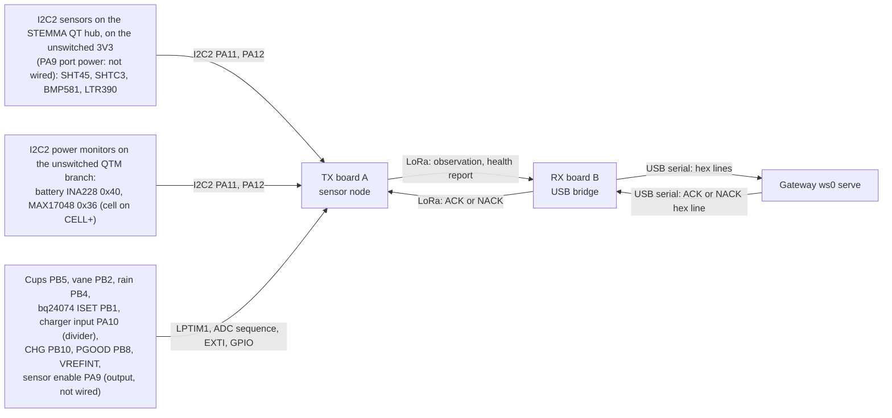
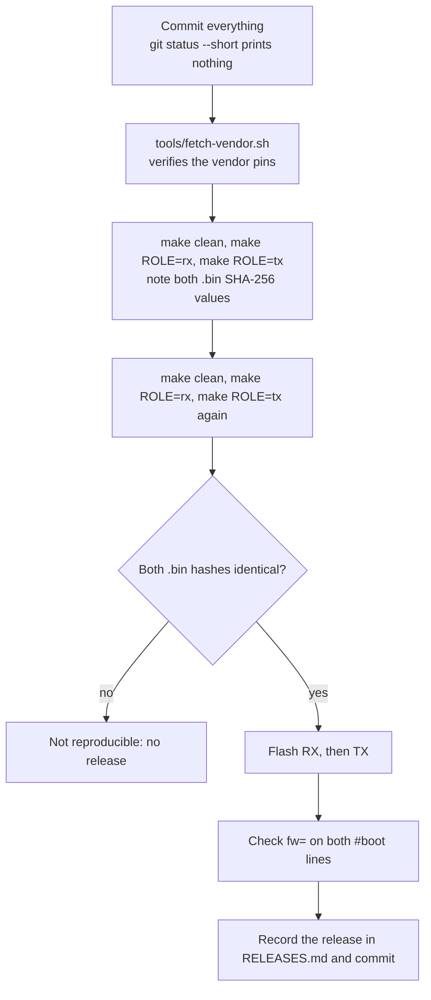
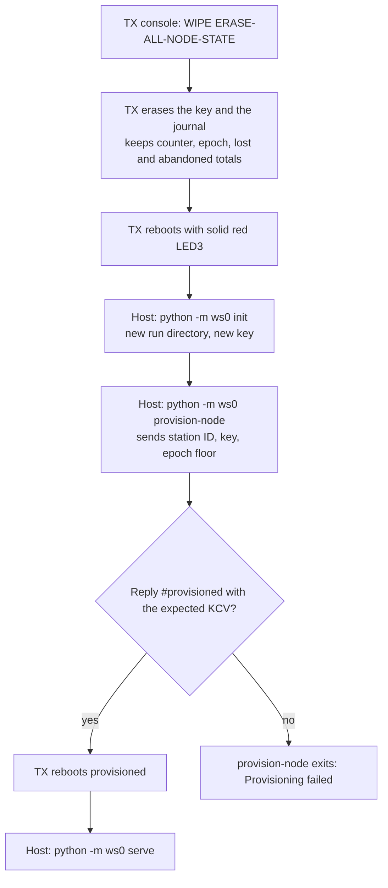
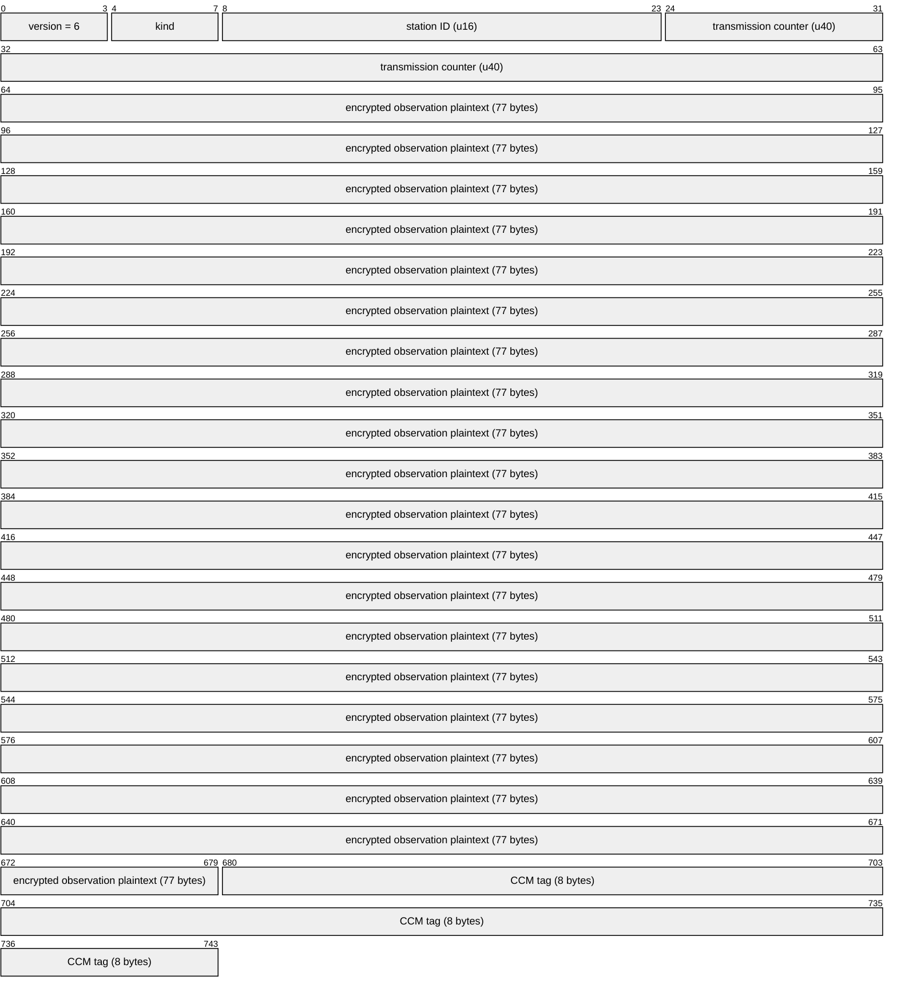
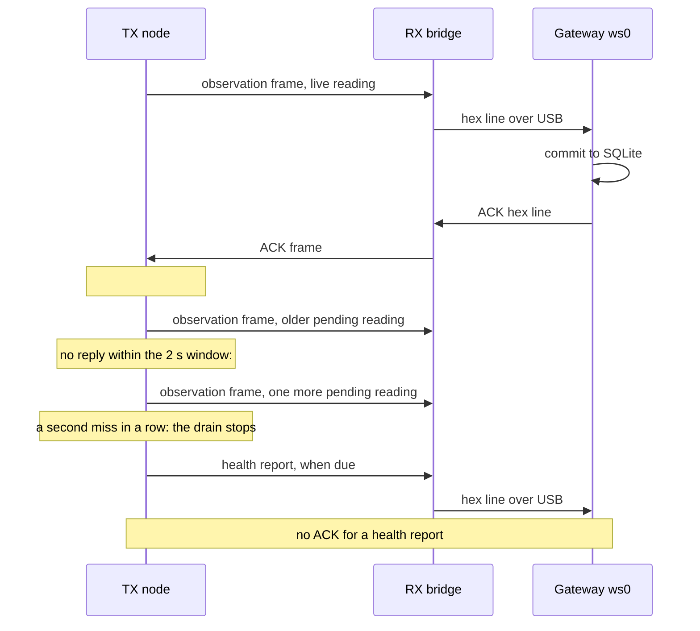
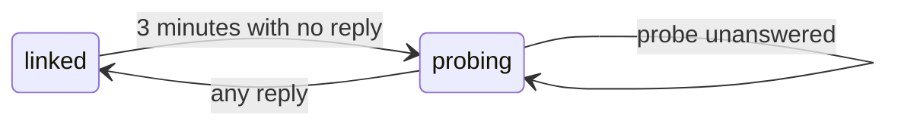
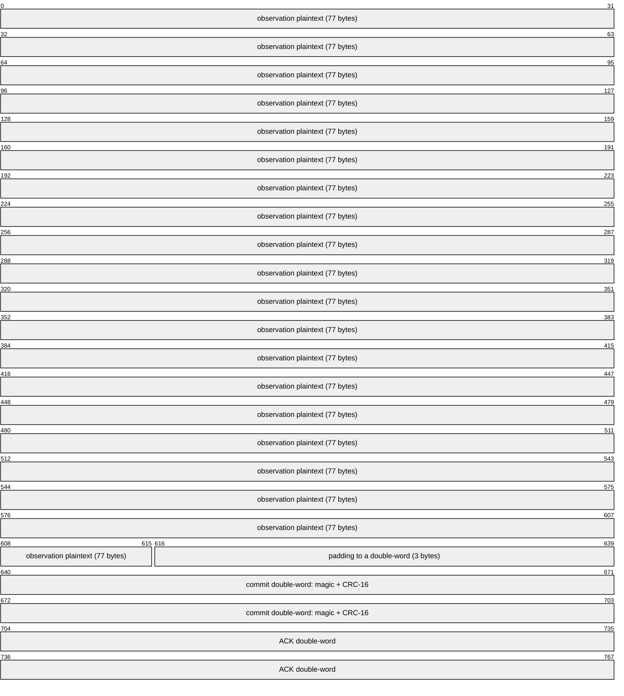

# Node firmware for the bench prototype (NUCLEO-WL55JC1)

This directory holds one source tree with two roles:

- **TX**, the transmitter: the sensor node, board A `003B00194142500E20353451`.
- **RX**, the receiver: the USB bridge to the gateway, board B `0016001E4142500E20353451`.

The firmware uses ST's SubGHz_Phy_PingPong board support (STM32CubeWL v1.6.0). That board support lives in [`../board/nucleo-wl55jc`](../board/nucleo-wl55jc/board.mk). The bench tools (`firmware/rangetest`, `firmware/i2cscan`, `firmware/benchlink`) share it. It holds `Core/`, `startup/`, `SubGHz_Phy/Target/`, the linker script and the common build rules (`board.mk`). This project keeps only two board files of its own:

- `Core/Src/stm32wlxx_it.c`: the flash error-correction (ECC) hook in the non-maskable interrupt (NMI) handler, and the HardFault record.
- `Core/Inc/utilities_def.h`: the sequencer tasks.

The wire protocol is in [`docs/protocol.md`](../../docs/protocol.md), protocol version 6 (observation catalog version 2, the 64-byte health report). The power telemetry that version 6 carries is designed in [`docs/superpowers/specs/2026-10-29-power-telemetry-design.md`](../../docs/superpowers/specs/2026-10-29-power-telemetry-design.md) ("the power spec"). See also [`protocol-stack.md`](../../docs/protocol-stack.md). The design notes are in [`docs/protocol-design.md`](../../docs/protocol-design.md).



**Status (2026-10-19):**

- The TX runs release `04fcc656938d` ([`RELEASES.md`](RELEASES.md)), flashed on 2026-10-19. The RX runs release `cc2766a38c61`. The RX code did not change between the two releases. The gateway runs on the run directory `run-d7` (key check value `6e30cf`).
- **This branch builds protocol version 6** (power telemetry, not yet released). It does not talk to the version 5 boards or a version 5 gateway: flash both boards from the same release, run a version 6 gateway (`RECORD_VERSION` 6, `gateway.py:26`) on a new run directory, and follow the format-change steps in [`RELEASES.md`](RELEASES.md), "How to cut a release".
- A release that changes the frame format needs a **fresh key**. Run `WIPE ERASE-ALL-NODE-STATE` on the TX, create a new run directory, then run `provision-node` (protocol.md section 2).
- Always flash **both** boards. Boards with different protocol versions drop each other's frames.
- The SHT45 is wired to the morpho pins. It gave valid readings on 2026-10-14 ([`docs/hardware/nucleo-wl55jc-bringup.md`](../../docs/hardware/nucleo-wl55jc-bringup.md), "SHT45 first light").
- **The 24-hour delivery test (H01, [`docs/H01-checklist.md`](../../docs/H01-checklist.md)) has NOT RUN.**

## Build and flash

```sh
tools/fetch-vendor.sh                       # pinned STM32CubeWL + submodules, Mbed TLS 3.6.6
cd firmware/stage0-node
make ROLE=rx flash SERIAL=0016001E4142500E20353451
make ROLE=tx flash SERIAL=003B00194142500E20353451
```

Flashing rewrites only the firmware region (pages 0–94). Provisioning, counters and the journal (pages 95–127) survive a reflash that keeps the flash layout (verified 2026-10-12 on the previous layout). A release that changes the layout loses them: follow [`docs/runbook-moving-boards.md`](../../docs/runbook-moving-boards.md), "Changing the flash layout". Each build prints the binary SHA-256 at the end.

A release follows the procedure in [`RELEASES.md`](RELEASES.md), "How to cut a release":



Makefile variables and targets:

| Name | Default | Meaning |
|---|---|---|
| `ROLE` | `tx` | `tx` or `rx`. The output goes to `build/<role>/stage0-<role>.{elf,bin,map}`. |
| `SERIAL` | none | ST-LINK serial number of the board to program (`flash` target only). |
| `CUBE` | `../../vendor/STM32CubeWL` | The STM32CubeWL checkout that `tools/fetch-vendor.sh` creates. |
| `TOOLCHAIN` | `~/.local/opt/xpack-arm-none-eabi-gcc-15.2.1-1.1/bin` | The directory that holds `arm-none-eabi-gcc`. |
| `BUILD` | `build/<role>` | The build directory (`build/tx-oled` for `WS_BENCH_OLED=1`). CI uses separate ones for the analyzer builds. |
| `WS_BENCH_OLED` | `0` | `1` is the bench build: the TX drives the bench OLED (`App/oled_app.h`; `App/oled_dma.h`, SPI1 by DMA on PA4, PA5, PA7, PC1, PC2) and reads the buttons B1–B3 (see "Bench OLED" below). `0`, the field build, compiles no display code and leaves the OLED pins alone; PA0, PA1 and PC6 are still the pull-up falling-edge inputs that the board's GPIO setup makes them (`MX_GPIO_Init`), and their presses do nothing. TX only. |
| `WS_POWER_PROFILE` | empty | Sets the `WS_POWER_PROFILE` constant below (`make ROLE=tx WS_POWER_PROFILE=2`); empty keeps its default. The same as passing it through `OPT`. |
| `FLASH_BUDGET_PCT` | `90` | The link fails when code and initialized data use more than this percentage of the 194,560 B firmware region ([`docs/firmware-budget.md`](../../docs/firmware-budget.md)). |
| `ANALYZE` | unset | `1` adds GCC's static analyzer (`-fanalyzer`) to our own C. Our C always builds with a strict warning set and `-Werror`. |
| `OPT` | `-Os` | The optimisation flags. The build constants below go here, for example `make ROLE=tx OPT='-Os -DWS_POWER_PROFILE=2'`. |
| `all` (default target) | | Builds the `.elf` and `.bin`. Then prints the size, the flash budget line and the `.bin` SHA-256. The budget line names the role and the flags that change the image: `flash budget (tx, profile 2, bench OLED): N of 194560 B`. |
| `flash` | | Builds if necessary. Then OpenOCD programs the `.elf` (connect under reset) and verifies it. `WS_BENCH_OLED` and `WS_POWER_PROFILE` are not remembered: give `flash` the same flags as the build you mean (`make ROLE=tx WS_BENCH_OLED=1 WS_POWER_PROFILE=2 flash SERIAL=…`), or it builds and programs the default image. Without `SERIAL` it prints the usage line with those flags. |
| `stack` | | Computes the worst-case stack bound from the GCC call graphs (`tools/stack_report.py`). Fails above the linker's 8 KB reservation. |
| `waits` | | Checks that nothing busy-waits at run time (`tools/blocking_report.py`). Fails if an interrupt, task, callback or the main loop can reach a banned wait (`HAL_Delay`, blocking HAL I2C/UART/SPI, ...) or an unclassified `HAL_GetTick` poller. Lists the allowed hardware stalls with their bounds, the boot waits and the test-only waits. |
| `clean` | | Removes `build/` for **both** roles. |
| `field-check` | | Builds `ROLE=tx` with `WS_BENCH_OLED=0` and the default power profile into its own `build/tx-fieldcheck` (so it never replaces a build in `build/tx`) and fails if the `.elf` has any `oled_`, `scr_`, `ssd1325_` or `font5x7` symbol. |

Build constants (C macros with a default; pass them through `OPT`):

| Constant | Default | Meaning |
|---|---|---|
| `WS_POWER_PROFILE` | `1` (phase A) | The power phase (`App/power_config.h`, power spec sections 2 and 9.3). `1`: phase A, the bq24074 with the battery INA228 (0x40, VBUS on OUT) and the MAX17048 (0x36) on the cell; the load current, solar and USB-C slots are not fitted. `2`: phase B, plus the load (0x41), solar (0x45) and USB-C (0x48) INA228s. `3` is reserved for a later charger and stops the build with `#error`. Every profile keeps the same field set, so the journal slot and the page magic do not change between phases. |
| `WS_I2C_MUX` | `0` (hub) | The I2C bus topology (`App/i2c_bus.h:19-21`, `App/i2c_bus.lit.md` section 11, power spec section 9.1). `0`: the official phase A wiring, a passive STEMMA QT hub: every client upstream, no mux boot, no deselect plan, no phantom check; port modules are admitted without a record (`NO_RECORD`). `1`: the ports board with the TCA9548A at 0x71 (the host tests of the records and the mux use it). |
| `WS_NODE_FIELDS` | `WS_F_WSMP_BENCH` | The catalog fields this build can send (`App/node_fields.h`, see "Field set of a build"). |

The firmware version string (`fw=` in `#boot`/`#status`) is `git describe --always --dirty --abbrev=12` at build time. A build from a modified tree reports `…-dirty`. Every commit changes the binary. The firmware build ID in the health report is that string's first 8 hex digits, and **0 ("not identified") for a dirty tree** (`Makefile` `FW_BUILD_ID`): the commit then names every power constant a nonzero ID used, and the observation's power fields name the profile (profile 2 sends the load, solar and USB-C fields; power spec section 8.6). Commit a measured constant before flashing the build that carries it.

### Bench OLED (`WS_BENCH_OLED=1`)

`make ROLE=tx WS_BENCH_OLED=1` builds the TX with the bench OLED (Adafruit #2674, SSD1325) into `build/tx-oled`; flash it with the same flag. Design: [`docs/superpowers/specs/2026-11-04-node-oled-and-e2e-design.md`](../../docs/superpowers/specs/2026-11-04-node-oled-and-e2e-design.md). The display shows the LGTM SYSTEMS boot splash, the module checklist (each port's state, held until every port has its verdict or 60 s from boot), HACK THE PLANET, then HOME (big temperature digits, a weather icon, RH, pressure, wind and rain, the link) for 15 s and one detail screen for 15 s in turn (AIR, PRESSURE, POWER, RADIO, SCOPE, VANE, RAIN, SYSTEM), an interlude from HOME about every 2 minutes (FORTUNE, SCOPE, FROG, VANE, MATRIX, RAIN, PINBALL, SYSTEM, HACK), and the packet burst and banner for each minute's live reading. The 1 h air and 3 h pressure histories and the last 30 frames' RSSI and SNR are the display's own (`oled_view.c`, `oled_app.c`, in RAM2), sampled from the live values; the field build has none of them. The build keeps `LOW_POWER_DISABLE` 1 (sleep only): `App/oled_dma.c` does not compile with Stop 2, which would stall SPI1 and its DMA mid-frame.

| Button | Pin | Press |
|---|---|---|
| B1 | PA0 | The next screen, through every one: HOME, AIR, PRESSURE, POWER, RADIO, SCOPE, VANE, RAIN, SYSTEM, FORTUNE, FROG, MATRIX, PINBALL, HACK, HOME again. It does not move the HOME/detail cycle on. |
| B2 | PA1 | Pause or resume. Paused, the screen stays where B1 put it (a detail screen keeps being redrawn; an interlude plays again from its first frame), stays through a packet (no burst or banner: it goes on where it was, redrawn with the new link line), and B1 moves it on. Resumed, it runs to its end, then HOME, and the next interlude is 2 minutes away. |
| B3 | PC6 | The display off (the display-off command, then no SPI traffic) or on, with the current screen redrawn at its next step. After `#oled fault` (an SPI or DMA error, or a DMA that never ends) B3 off and on starts the display again. While the display is off, B1 and B2 do nothing. |

A press counts once: the interrupt drops edges within 50 ms of the last one, and a press needs a 125 ms step to have read the button up since the press before, so a release that bounces is no second press.

- **A missing panel is silent.** SPI1 only transmits (the SSD1325 has no read-back on this wiring), so the TX cannot tell an unplugged or dead panel from a working one: the frames go out, nothing lights, and the console says nothing. Check the wiring ([`docs/hardware/bench-station-wiring.md`](../../docs/hardware/bench-station-wiring.md)) and the 3.3 V at the panel.
- **After `#oled fault`** (a DMA transfer error or an SPI error) the display stays dark and no frames are drawn. Press B3 twice (off, then on): the second press runs the panel's start-up again from the reset pulse. A reboot does the same.

## Source files

`App/` holds this project's own code. The board support is in `../board/nucleo-wl55jc`. Portable logic (no HAL) lives in `firmware/common/` and `firmware/stage0.c`, so the host tests run it unchanged. `firmware/host/` builds the role modules over a simulated board. One shared core, `sim_core.c`, supplies the clock, ST's timer server and sequencer, and the event loop. The tests are `tests/test_tx_machine.py`, `tests/test_rx_machine.py`, for the local modules `tests/test_i2c_bus.py`, `tests/test_modules.py`, `tests/test_wsmp_host.py`, `tests/test_wsmp_map.py` and `tests/test_board_inputs.py`, and for the power telemetry `tests/test_power_acq.py` and `tests/test_fault.py` (the boot counter and the last crash PC).

[`docs/firmware-event-model.md`](../../docs/firmware-event-model.md) tells how the code runs: interrupts, timers, tasks and the exchange state machine. [`docs/power-of-ten.md`](../../docs/power-of-ten.md) tells how the code meets NASA/JPL's Power of Ten rules, and where it does not.

| File | Role | What it does |
|---|---|---|
| `App/app_tx.c` | TX | Boot (`SubghzApp_Init`), the 250 ms module tick, the 15-s ticks and the minute's report (the 4th tick latches every module). The report is encoded, then journaled. While an exchange runs, the report waits in RAM (`held_flush`). Also the watchdog health test. |
| `App/tx_exchange.c` | TX | The minute's radio exchange. One state machine (`idle`, `gap`, `sending`, `ack-wait`, `diag-sending`) with one handler per state. Sealing, ACK/NACK handling and the health report. The node's key is private to this file. |
| `App/tx_policy.c` | TX | Energy and link state, what a minute may send, strikes, the health-report schedule. The decisions are in `firmware/common/ws_policy.c`. |
| `App/tx_time.c` | TX | Time trust. The clock is set from the ACK for the frame just sent. Trust survives a warm reset (RTC backup registers). |
| `App/tx_console.c` | TX | Console commands (a table: `STATUS`, `KAT`, `MODULES`, `PROVISION`, `WIPE`, `SENSOR rain on/off`, `TEST-SENSOR-POWER`, `TEST-FLASH-STORM`), `#status`/`#counts`/`#timing`, the storm load, the PA9 port power-cycle test and commanded reboots. |
| `App/selftest.c` | TX | The boot known-answer test (`selftest_kat`) and its vectors. `tests/test_frame.py` reads the same vectors. |
| `App/tx_node.h` | TX | The interface of `app_tx.c`: this boot's identity and run state, read-only to the other modules (`node_state()`). The key and station live in `tx_exchange.c` (`exchange_load_identity`). That is the only module that seals and opens frames. |
| `App/node_store.c` | TX | Flash: provisioning, the monotonic epoch and counter log, the observation journal. |
| `App/flash_stm32wl.c` | TX | The internal-flash driver behind `node_store.c`. |
| `App/i2c_bus.c` | TX | The shared I2C2 bus of the local modules: one transfer at a time in submission order, a 30 ms guard, the stuck-bus recovery when the bus may be stuck. Only an acknowledge failure is a NACK. A bus error, lost arbitration or a HAL refusal is `I2C_EBUS` (-7), a bus fault (`App/i2c_bus.h`). Literate source `i2c_bus.lit.md`. |
| `App/wsmp_host.c` | TX | The station side of DATAVANE5K (WSMP, [`docs/module-protocol.md`](../../docs/module-protocol.md)): presence, admission against the registry and the radio budget, the minute latch, the flap limit. Literate source `wsmp_host.lit.md`. |
| `App/wsmp_local.c` | TX | The local module dispatch: one `switch` on the port for each operation. |
| `App/mod_th.c`, `mod_reg.c`, `mod_wind.c`, `mod_rain.c`, `mod_mean.c` | TX | The modules: SHT45 and SHTC3; BMP581 and LTR390; cups and vane; rain. `mod_mean.c` is their shared minute window. |
| `App/mod_power.c` | TX | The WSMP face of the power telemetry: the base-board **battery** module (port 5, type 8: battery voltage, current, energy in and out, charge in and out) and **rails** module (port 8, type 9: load voltage and current, charger input voltage, solar and USB-C voltage and current), made at each latch from `power_acq`'s closed window. Both are present in every power profile, whatever their parts answer; a slot the profile has no source for is "not fitted". It caches the slow values for the health report (`mod_power_health`: SOC, SOC rate, charger status, the hottest INA228 die temperature, VDDA, the charger-reported charge current). Power spec sections 8.5 and 9.6. |
| `App/power_acq.c` | TX | Power acquisition, one step machine per part, no blocking: each INA228 rail of the profile's table every 1 s (SHUNT_CAL check, VBUS, CHARGE; DIETEMP every 60 s), the MAX17048 every 15 s (VCELL, SOC, CRATE), the board ADC every 1 s, CHG and PGOOD every 250 ms with the CHG edge count (a 2 Hz flash is a fault). Rail current is the CHARGE delta over the window's time from `clock_ms()`, signed by the rail table (battery: −1, so + is into the cell); battery energy is each step's charge × the latest VCELL (at most 20 s old, else that minute's energy is INVALID). Power spec section 9.4. |
| `App/power_config.h` | TX | The power build: `WS_POWER_PROFILE`, the rail table (client, address, shunt, current step, sign, slots), the INA228 addresses with build-time checks (distinct, never a reserved address), the nominal shunt (15,000 µΩ, verified by the build sheet against a series reference and replaced only on a fail), `POWER_R_ISET_OHM` (1000 Ω: R9 behind the closed 1A jumper, confirmed by build-sheet check 2), `POWER_ISET_GAIN_PPM` (990099, the 10 kΩ and 1 MΩ ISET network, nominal until the per-board fit) and `POWER_VIN_DIVIDER_PPM` (3000000, the divider ratio in ppm, nominal until the resistors are measured); the three adopted with change A, read by this workflow from the [build-progression record](../../docs/superpowers/specs/2026-10-29-build-progression-decisions.md) 7.1 P3 (M2), Clint to confirm (power spec D4/D5). Power spec sections 8.6, 9.2 and 9.3. |
| `firmware/common/power_regs.c` | TX | The INA228, MAX17048, ISET, divider and VREFINT conversions, integer only, one copy shared with `firmware/i2cscan` and `firmware/benchlink` (`tests/test_i2cscan.py` checks them against the datasheets). |
| `App/wsmp_catalog_map.c` | TX | The interim map from the module snapshots to today's observation catalog (until WSMP reaches the radio). |
| `App/board_inputs.c` | TX | The board inputs, the same pins on the bench and in the field (the pin list, `board_inputs.c:3-21`): the cup counter (LPTIM1, PB5 = D4, CN9.5); one interrupt-driven ADC sequence (no conversion poll), IN4 the vane (PB2), IN5 the bq24074 ISET (PB1, CN8.1), IN6 the charger input through the 20 kΩ / 10 kΩ divider (PA10, CN8.3) and VREFINT, 160.5 cycles each, oversampling ×16, started again by its readers, `board_vane_mv` (the 250 ms tick) and `board_power_adc` (the 1 s power step, which also gives VDDA from VREFINT_CAL, taken at 3.3 V); the rain interrupt (EXTI4, PB4 = A3, CN8.4); the charger pins PGOOD (PB8 = D5, CN9.6; morpho CN10.27) and CHG (PB10 = D6, CN9.7; morpho CN10.25) with internal pull-ups, CHG edges counted on EXTI10 (`board_charger_edges`). With the pull-ups on, PB8 and PB10 must stay below VDD + 0.3 V (measured at most 2.9 V). The vane stays ratiometric (fixed 3300 "ratio mV"). Remap: cups PC0 → PB5 and rain PB5 → PB4 at change B, approved 2026-10-30 ([build-progression decision record](../../docs/superpowers/specs/2026-10-29-build-progression-decisions.md) N2, section 7.1). Wiring: [`docs/hardware/bench-station-wiring.md`](../../docs/hardware/bench-station-wiring.md), [`../benchlink/README.md`](../benchlink/README.md) "Wiring". |
| `App/oled_app.c`, `oled_view.c`, `scr_sched.c`, `oled_hooks.h` | TX bench | The bench OLED (`WS_BENCH_OLED=1` only): a 125 ms timer posts the step task, which asks the scheduler (`scr_sched.c`: boot splash, the module checklist, HACK THE PLANET, HOME and a detail screen 15 s each, an interlude every 2 minutes, the packet burst and banner) what to show, fills the view from the modules' live values and the node (`oled_view.c`), draws it (`scr_view.c` the text and big-digit helpers, `scr_home.c` HOME and the banner, `scr_detail.c` AIR, PRESSURE, POWER and RADIO, `scr_interludes.c`, `scr_boot.c` the boot splash and the module checklist (`scr_mark.c` its wordmark from `tools/make_scr_mark.py`), `scr_rain.c`, `scr_silly.c` the fortune cookie, frog, digital rain and pinball; `scr_calc.c` their arithmetic, pure and host-tested; `scr_font.c` the 10 × 16 digits from `tools/make_scr_font.py`; `scr_kana.c` the digital rain's mirrored katakana-style glyphs from `tools/make_scr_kana.py`, drawn in gray straight into the send buffer) and sends it by DMA (`oled_dma.c`). A step that finds a frame still going out waits for the next tick. The exchange calls the hooks in `oled_hooks.h`, which are empty inline functions in the field build. |
| `App/node_fields.h` | TX | The catalog fields that this build can send (`WS_F_WSMP_BENCH`, 77 B with every module and power field); a reading carries those of its modules and of its power profile. |
| `App/app_rx.c` | RX | The keyless radio-to-USB bridge: forwarding, failed-reception logs, host ACK/NACK transmission, relisten, `#alive`. |
| `App/events.c` | both | Interrupt-safe event bits for the process task (`events_post`, `events_take`), and `irq_lock`/`irq_unlock`. |
| `App/clock.c` | both | The RTC clock, `clock_ms`/`clock_s`. The firmware never uses `HAL_GetTick`, which counts 1/1024 s ticks. |
| `App/bench.c` | both | `TEST-FAULT` and `TEST-HANG`. A field build (`-DWS_FIELD_BUILD`) leaves them out. |
| `App/console.c` | both | The USB console: line assembly from the UART interrupt, and `hex_print`. |
| `App/watchdog.c`, `App/fault.c` | both | The supervised independent watchdog (IWDG) and the reset cause. Crash records, the last crash PC (`fault_last_pc`) and the boot counter (DR12, `fault_boot_note`, see Crash records). |
| `App/busymon.c`, `App/stackmon.c` | both | Run-time timing of tasks, interrupts and flash stalls. The stack peak. |
| `App/leds.c`, `App/radio_cfg.c` | both | The LEDs. The radio settings that both roles share. |
| `firmware/common/wsmp.c` | TX | The WSMP core: the module blocks, their checks against the registry (`wsmp_registry.h`, generated from `wsmp_registry.toml`), CRC-32C. |
| `firmware/common/ws_frame.c`, `ws_obs.c` | TX | The frames (AES-CCM seal and open, the 64-byte health report) and the observation encoder (catalog version 2: 33 fields in 34 bitmap positions, bit 31 of the bitmap = EXT, the 2-byte extension bitmap for fields 32 and up). |
| `firmware/common/ws_policy.c` | TX | The transmission policy as pure functions: LoRa airtime, link state, the minute's backlog (with the health report's airtime reserved in a minute whose report is due), strikes (`firmware/test_tx_policy.c`). |
| `firmware/common/ws_console.c` | both | Line assembly, hex, command lookup (`ws_cmd_find`), and the RX frame checks in both directions. |
| `firmware/common/ws_check.c` | both | `WS_CHECK`: run-time checks with a recovery at the call site. Keeps the failure count and the first site (`docs/power-of-ten.md`). |
| `firmware/stage0.c` | TX | SHT45 parsing and its CRC-8, the I2C recovery waveform, the link gate, `PROVISION` parsing, failure runs. |

## Provision and run (host)

```sh
python -m ws0 init --hardware --station station-01 --station-id 1 --directory run-hw
python -m ws0 provision-node --directory run-hw --serial /dev/cu.usbmodem<TX port>
python -m ws0 serve --directory run-hw --serial /dev/cu.usbmodem<RX port>
```

`provision-node` sends the station ID and the key to an **unprovisioned** TX board over USB. The station ID is 1 to 65,535, because the frame header holds 2 bytes for it. Then `provision-node` checks the reply against the key check value (KCV). The KCV is the first 3 bytes of AES(key, 0¹⁶). `provision-node` refuses to overwrite a provisioned board.

It also sends an **epoch floor** (`PROVISION <id> <key> <epoch_floor>`). The floor is one above the highest boot epoch that the gateway stored for this station in `observations`, `rejections` and `diagnostics` (`ws0/__main__.py`, `epoch_floor`). For an empty database the floor is 0 (no floor). The node raises its stored epoch to the floor (`store_epoch_floor`). So every later boot epoch is above the floor. The observation identities (epoch, seq) of a wiped and re-provisioned node then never collide with stored history. **The floor raises only the epoch, not the transmission counter.**



To re-provision a board, send `WIPE ERASE-ALL-NODE-STATE` on the TX console. From release `0f456040fe54`, this command erases the key and the journal. It keeps the counter, the epoch and the `lost`/`abandoned` totals. Earlier releases erased those too. The board then reboots with solid red LED3.

**Re-keying rule:** the AES-CCM nonce is kind + station + transmission counter (`firmware/common/ws_frame.c`). From release `0f456040fe54`, WIPE erases only the key and the journal and keeps the counter and epoch. Earlier releases reset the counter to 1. So a key used before `0f456040fe54`, or on another board, can repeat nonces. **After a WIPE, `init` a new run directory (a new key).** [`docs/runbook-moving-boards.md`](../../docs/runbook-moving-boards.md) tells how to move the boards between gateways.

For a long run such as the 24-hour delivery test, install the gateway as a LaunchAgent. The agent restarts the gateway if it exits. After a replug, the gateway finds the RX board by its ST-LINK serial number:

```sh
tools/deploy/macos/install.sh install run-hw 0016001E4142500E20353451
tools/deploy/macos/install.sh status      # uninstall: tools/deploy/macos/install.sh uninstall
```

The Linux equivalent is `tools/deploy/linux/ws0-gateway.service`. Keep the Mac awake during the 24-hour delivery test.

### End-to-end check

With the TX, the RX and `ws0 serve` running, `tools/e2e_check.py` asks the gateway's API for the latest observation and checks every station field (present, valid, in range) and its age:

```sh
export WS0_API_TOKEN=<api_token from the run directory's gateway.json>
.venv/bin/python tools/e2e_check.py --power-pending   # until the power rails are wired
```

It prints one line for the age and one a field, then a summary. A line starts with its status:

- `ok`: present and in range (a power field: valid); `ok (fitted)` for a power field that is valid while `--power-pending` is given (the rail is wired already).
- `FAIL`: missing, out of range, a gust below the speed, a power field not valid without `--power-pending`; for the age, an observation the gateway holds untimely (`untimely (no effective time)`) or one older than `--max-age` (`stale`).
- `pending (INVALID, expected)`: a power field not yet valid, with `--power-pending` (`pending (absent, expected)` if the record lacks it).

The power fields are the 13 a version 6 build sends (`WS_F_WSMP_POWER`): `batt_mv`, `batt_current_ma`, `energy_in_mwh`, `energy_out_mwh`, `charge_in_mah`, `charge_out_mah`, `load_mv`, `load_current_ma`, `charger_input_mv`, `solar_mv`, `solar_current_ma`, `usb_mv` and `usb_current_ma` (the USB-C pair). Exit 0 means no FAIL, 1 a FAIL or an error, 2 a usage error or no `WS0_API_TOKEN`. An error (no observation yet, a refused token, an unreachable gateway, a reply that is not JSON) is one line, never a traceback. `--url` (default `http://127.0.0.1:8088`) and `--max-age` (default 180 s) are options. The token is read only from `WS0_API_TOKEN`.

`run-hw/` holds secrets and live data. Git ignores it. `serve` appends receiver diagnostics and every frame/ACK pair to `run-hw/receiver.log`.

## Console (USB serial through the ST-LINK virtual COM port, 115200 8N1)

| Board | Output | Commands |
|---|---|---|
| TX | Lines that start with `#` (glossary below). | `STATUS`, `KAT`, `MODULES` (each local module's state), `SENSOR rain on` / `SENSOR rain off` (the rain gauge cannot be detected: this stores in flash whether it is fitted, so it waits for the radio as WIPE does), `PROVISION <station_id> <32 hex key> [epoch_floor]` (decimal ID 1–65535, only when unprovisioned, reboots on success), `WIPE ERASE-ALL-NODE-STATE` (reboots), `TEST-HANG` (bench: proves the watchdog), `TEST-FAULT` (bench: proves crash recording), `TEST-SENSOR-POWER` (bench: the PA9 port power-cycle test of change C, step 1's exit criterion 9 until 2026-11-02, when change C left the breadboard build (build-progression record 4.6 dated note); on the breadboard PA9 is unconnected. Ten cycles of PA9 low for 16 s (`WSMP_SAMPLE_MS` + 1 s, so every part is addressed in each half), then high for 16 s, paced by a timer while sampling goes on: the switched sensors drop off and are found again, and the power monitors on the unswitched branch must read throughout. Prints `#test sensor-power cycle=N pa9=0\|1 recoveries=R stuck=S ack=0xAAA fail=0xFFF` at each edge, then `#test sensor-power done cycles=10 pa9=1 recoveries=R stuck=S ack=0xAAA fail=0xFFF`; R and S are the I2C recoveries and stuck recoveries since the command, AAA and FFF the parts that answered and failed in the half that ended at the line (bit c for `enum i2c_client` c, from `i2c_bus_outcomes`; the first line's half is empty). A second request during the 320 s run gets `#error busy (sensor-power test in progress); retry`. PA9 ends high.), `TEST-FLASH-STORM` (bench: continuous flash writes for power-cut tests. Pauses sampling. Ends at reboot.) |
| RX | One lowercase hex line per received observation frame (39–110 bytes, any canonical catalog version 2 record; at most 93 for the version 6 node field set) **or health-report** frame (80 bytes). Also `#` diagnostics (below). | `STATUS`, `TEST-HANG`, `TEST-FAULT`, or one hex **ACK or NACK** line from the host (exactly 33 bytes = 66 hex digits). The RX ignores lines that start with `#`. The RX discards these lines whole: a line with a byte outside printable ASCII, a line longer than 256 characters, and a line that lost a character (a receive error, or a line that arrived while the previous line still waited). |

### Frame layout

Every frame has an 8-byte header in clear text, the encrypted plaintext and an 8-byte tag ([`docs/protocol.md`](../../docs/protocol.md) section 1, `firmware/common/ws_frame.h`). Byte 0 holds the protocol version (6) in its high nibble and the kind in its low nibble. So byte 0 is `0x61` (observation), `0x62` (ACK), `0x63` (NACK) or `0x64` (health report). This diagram shows the largest observation frame of the version 6 node field set (every module and every power field, 93 bytes), in bit offsets:



### TX console glossary (`App/tx_console.c`, `App/app_tx.c`, `App/tx_exchange.c`)

`STATUS` prints three lines: `#status`, `#counts`, then `#timing`. Every boot that reaches provisioning prints them too. The console's print buffer (`UTIL_ADV_TRACE_TMP_BUF_SIZE`) is now 640 bytes. The old 256-byte buffer cut off one line.

`#status` shows identity and state. `ws0 provision-node` reads it. Fields:

| Field | Meaning |
|---|---|
| `fw` | The firmware version string (git commit, see Build and flash). |
| `reset` | The last reset cause: `watchdog`, `power`, `software`, `lowpower`, `option-bytes`, `pin` or `unknown`. |
| `provisioned`, `station`, `kcv` | The provisioning state, the station ID, and the key check value. |
| `kat` | The result of the boot known-answer test (KAT), `pass` or `FAIL`. |
| `epoch`, `next_seq` | This boot's epoch, and the next observation sequence number. |
| `ctr` | The next transmission counter (the nonce counter). The counter is 40 bits on the wire. The console prints it in full, in decimal. |
| `ecc` | Flash reads with a double ECC error since boot. |
| `link`, `silent` | The link state (`linked` or `probing`), and the consecutive minutes with no reply. |
| `energy` | The energy state. `normal` in this phase: the node measures its battery and charger, but the thresholds that would move it to `conserve` or `critical` are deferred (power spec section 9.9, open decision D1; `App/tx_policy.c:31-34`). |
| `time`, `utc` | `synchronized` or `unknown`, and the UTC seconds (0 when unknown). |
| `uptime` | RTC seconds since boot. |
| `meter_link` | The counter link probe's verdict (build-progression record M7), the worst of: `ok`; `cups-suspect` (the cups link read low on 3 probes in a row with no cup pulse since: an open link, or calm air with the reed held closed); `vane-out-of-table` (the last vane reading was outside every position's band, the open vane pair at the pull-up rail included: the wind cable or jack); `cups-open` (suspect, and the vane moved to another position meanwhile, or 24 h of such probes); `rain-open` (the rain link read low on 3 probes in a row with no tip since, while `SENSOR rain on`). The wind and rain slots carry the same verdict as their quality (suspect or fault). The probe runs at boot and every 15 minutes (`App/board_inputs.c`): PB5 and PB4 swap their internal pull-ups for pull-downs for about 1 ms on a timer (no wait), then are read. The 10 kΩ pull-ups sit at the jack end, so an intact link reads high and an open one low; an open beyond the pull-up (the cable, the jack contacts) is not seen, and for rain cannot be. The probe's own pulse on an open cups link is taken out of the count, and EXTI4 is masked through it, so a probe never counts. A real cup pulse or rain tip inside the 1 ms window is lost (at most one pulse a probe at 75 m/s). Not `link`, which is the radio link state. |

`#counts` fields:

| Field | Meaning |
|---|---|
| `pending` | Journaled readings that have no acknowledgement yet. |
| `lost` | Total readings that a journal overflow dropped. Persists across resets. |
| `burned` | Journal slots found torn or unusable since boot. |
| `abandoned` | Total records given up after a NACK or the strike limit. Persists across resets. |
| `sent`, `acked`, `no_ack`, `ack_rejects`, `sensor_faults` | Counters since boot. `acked` counts ACKs that matched a journal record. `ack_rejects` counts replies that failed authentication, plus NACKs for a frame other than the frame just sent. `sensor_faults` counts minutes without a valid outside-air mean, for any reason: a failing SHT45, an absent air module, or the first window after it joins. A dead sensor keeps it rising after its module goes absent. `MODULES` tells the reasons apart. |
| `held_lost` | Readings dropped since boot because RAM already held two readings during a hung exchange ([`docs/firmware-event-model.md`](../../docs/firmware-event-model.md)). 0 in normal operation. |
| `tx_fail_run` | Consecutive journal-append failures. |
| `tx_air_run` | Consecutive transmission failures: a refused counter, a refused `Radio.Send`, or a TxTimeout. Only a TxDone clears it. When either run goes above 10, the watchdog resets the board. |
| `stack_peak` | The most stack bytes used since boot. At start-up the firmware fills the stack with a pattern. On demand it finds the deepest overwritten byte (`App/stackmon.c`). The linker reserves 8192 B. `make stack` gives the worst-case estimate. |
| `tx_timeouts` | Radio transmissions that ended in a TxTimeout since boot, in the observation and the health-report paths, saturating at 65,535. Also in the health report. |
| `i2c_recoveries` | Stuck-bus recoveries that the I2C bus started since boot, saturating. Also in the health report. |
| `i2c_stuck`, `mux_resets` | Recoveries that ended with SDA still low, and mux RESET pulses (always 0 on the hub, `WS_I2C_MUX` 0). On this line only. |
| `check_fails`, `check_first` | Run-time checks that failed since boot (`WS_CHECK`, `firmware/common/ws_check.h`, [`docs/power-of-ten.md`](../../docs/power-of-ten.md) rule 5), and the site of the first one. The site is `file:line`, with the file given by its number in the table in `ws_check.h`. For example, `5:322` is line 322 of `App/node_store.c`. `0:0` means no check failed. The caller of each check recovers on the spot: it refuses the step, ends the exchange or clamps a value. Report any nonzero count as a firmware bug. |

`#timing` shows how the event-driven firmware really runs (`App/busymon.h`, [`docs/firmware-event-model.md`](../../docs/firmware-event-model.md)):

| Field | Meaning |
|---|---|
| `state` | The radio exchange state: `idle`, `gap`, `sending`, `ack-wait` or `diag-sending`. |
| `task_peak_us`, `task_peak` | The longest time that one main-loop task ran since boot (µs, cycle counter), **without the interrupts that ran meanwhile**. The name is the task's slowest timed step when it has steps (`report.journal`, `report.send`). Otherwise the name is the task. |
| `task_wall_us` | The same task from start to end, interrupts included. This is how long the main loop waited. |
| `isr_peak_us`, `isr_peak` | The longest time that one interrupt handler ran since boot, and its name. |
| `erase_peak_us`, `prog_peak_us` | The longest flash page erase and the longest double-word program. The CPU stalls during these. |
| `trace_drops` | Console lines dropped because the output queue was full. The firmware never waits for the queue. |
| `unexpected` | Events that arrived in a state that does not expect them. The firmware counts them, prints `#error unexpected` and ignores them. |

Other lines:

| Line | Meaning |
|---|---|
| `#boot role=tx fw= reset= kat= freq= bw= sf= power=` | Printed at every boot. `bw` is an index (2 = 500 kHz). `sf` is the LoRa spreading factor. |
| `#sample epoch= seq= uptime= valid= rc= n= t= rh= time= utc= journal= pending= lost=` | One line per minute, at the latch of every module (the 4th 15-s tick). `n` is the outside-air module's number of valid 15-s samples, `t`/`rh` their mean in 0.01 °C and 0.01 % (0 when `valid=0`, which also means the module is not in the layout). `rc` is always 0: the latch does not wait for a sensor. The reading carries the catalog fields of every module in the layout ([`docs/hardware/bench-station-wiring.md`](../../docs/hardware/bench-station-wiring.md), `App/wsmp_catalog_map.c`). |
| `#fault kind= pc= lr= cfsr= hfsr= bfar= count=` | Both roles, after `#boot`, only if the previous run crashed (see Crash records). |
| `#modules air_th= pressure= uva= encl_th= battery= wind= rain= rails=` | Each local module's state (`battery` is port 5 and `rails` port 8, the base-board power modules: present in every power profile) (`absent`, `probing`, `admitted`, `active`, `suspect`, `quarantined`, `refused`). Printed once with the first report, and by `MODULES`. |
| `#ident port= type= serial= source= status= crc=` | `MODULES` only: one line for each module of the descriptor set (WSMP section 11.1), in port order. The serial (16 hex digits; its top byte is its namespace), its source (`port`, `record`, `sensor`, `adapter`), the record status (`applied`, the `NO_RECORD` reason, `CAL_REJECTED`, `SENSOR_CHANGED`, or `none` for a module that never has a record: source `port` with status 0) and the applied record's CRC-32C (`00000000` when no record is applied). `#ident dropped=N` reports modules of the layout left out because their blocks did not unpack (a bug). This is what the gateway will receive once the radio carries the set (WSMP-E9). |
| `#sensor rain=on` / `#sensor rain=off` | `SENSOR rain on/off` stored the setting. The station host admits the rain module after two probes. `#error sensor rc=` means that the store refused the setting. |
| `#watchdog N journal failures in a row` / `#watchdog N transmit failures in a row` | TX: more than 10 consecutive journal-append failures (`tx_fail_run`) or transmission failures (`tx_air_run`). The watchdog then resets the board. |
| `#boot-retry: reset in 600 s` | TX: the storage init or the epoch reservation failed at boot. The board resets one time after 10 minutes, only if the self-test passed. |
| `#ack epoch= seq= found= time_sync= rssi= snr= pending=` | An authentic ACK. `rssi` is the received signal strength and `snr` the signal-to-noise ratio. `time_sync=1`: the firmware set the clock from this ACK. |
| `#ack none epoch= seq=` | No reply came within the 2 s window. The reading stays journaled. The drain sends one more frame, then stops. A second miss in a row stops it at once. |
| `#ack damaged payload; still listening` / `#ack damaged header; still listening` | A packet in the ACK window failed its payload CRC or its header CRC. The node listens until the window ends ([`docs/firmware-event-model.md`](../../docs/firmware-event-model.md)). |
| `#ack reject len= rssi= snr=` | A reply failed authentication. |
| `#nack epoch= seq= reason= abandoned=` | An authentic NACK for the frame just sent. The node abandons the record. Reason 1 = collision, 2 = invalid (`ws_frame.h`). |
| `#nack ignored: …` | A NACK for a frame other than the frame just sent. |
| `#abandon epoch= seq= after 10 unanswered tries …` | The strike limit: the node abandoned the record. |
| `#link probing: …`, `#link probe unanswered; …`, `#link linked after N silent minutes` | Link-state changes (see Transmission policy). |
| `#diag sent pending= lost= torn= abandoned= no_ack= crash_pc= boots= tx_timeouts= i2c_recoveries= vdda_mv= monitor_temp= soc= soc_rate= charger_status= chg_input_mv= chg_input_ma= chg_batt_mv= chg_batt_ma= chg_temp= pack_temp= fitted=` | The node sent a health report (kind 4, version 6, 64-byte plaintext; `App/tx_exchange.c:186-194`). The first five keys are unchanged, so scripts that read them keep working. `torn` is `burned`. Then the slow values, raw as packed, with their none codes (power spec section 6.1): `crash_pc` the PC of the last crash since power-up (`00000000` none, `ffffffff` untrusted frame); `boots` boots since power-up (DR12); `tx_timeouts`, `i2c_recoveries` as on `#counts`; `vdda_mv` the MCU supply from VREFINT (65535 none); `monitor_temp` the hottest INA228 die, 0.1 °C (−32768 none); `soc` the gauge SOC in 1/256 % (65535 none); `soc_rate` 0.1 %/h, + while charging; `charger_status` the charger status byte (bit 0 input power good, bit 1 charging, bit 2 fault, bits 3–5 stage, bits 6–7 active input: 0 not reported, 1 solar, 2 USB-C, 3 no input; 255 none); `chg_input_mv`, `chg_input_ma`, `chg_batt_mv` (phase C only, none in phases A and B); `chg_batt_ma` the charger-reported charge current (phase A: ISET while PGOOD is asserted, 0 while it is not); `chg_temp`, `pack_temp` (phase C only); `fitted` the fitted byte (byte 51, power spec section 6.1), one bit per group of slots this build has a source for: bit 0 `vdda_mv`, 1 `monitor_temp`, 2 `soc` and `soc_rate`, 3 the charger status bits 0–2, 4 the charger-reported registers (stage, active input, `chg_input_mv`, `chg_input_ma`, `chg_batt_mv`, `chg_temp`), 5 `chg_batt_ma`, 6 `pack_temp`, 7 reserved 0. Phases A and B print `fitted=47` (0x2F). A none code under a set bit is a sensor fault; under a clear bit it means "not measured in this build". The report also carries the rejected-reply count, the reset cause, the link state, the firmware build ID, the RSSI/SNR of the last authentic ACK, the crash count and the energy state (protocol.md section 4); this line does not print them. Every value reads a cache: nothing in the radio path touches I2C or the ADC. The gateway shows them in `/v1/status` (`node_diagnostics`). |
| `#time restored utc= sync_age=` | The node kept time trust across a warm reset. |
| `#busy previous exchange still running; reading held until it ends` | The minute's reading waits in RAM and is not sent this minute. The firmware writes flash only while the radio is idle. |
| `#held journaled seq= rc= pending=` | The firmware journaled a held reading when the radio went idle (`rc=0`: ok). The next minute sends it as backlog. |
| `#kat pass\|FAIL`, `#wipe ok\|ERROR`, `#provisioned station= kcv= epoch_floor=`, `#unprovisioned: …`, `#test-hang: …` | Command replies. |
| `#storm start ctr=`, `#storm writes= ctr= burned=`, `#storm done writes=`, `#storm-scrub dropped=` | TEST-FLASH-STORM progress (every 256 writes), the end at the write cap, and the boot cleanup of storm slots. |
| `#error <what>` | `journal-read`, `counter-reserve`, `seal`, `radio-busy`, `journal-ack`, `tx-timeout`, `unexpected event= state=`, `held-lost seq=` (a third reading during a hung exchange replaced the oldest held reading), `busy (radio exchange or reboot in progress); retry` (WIPE, PROVISION, SENSOR rain or TEST-FLASH-STORM during an exchange), `store-init`, `epoch-reserve`, `self-test failed; not transmitting`. Also the command errors `already-provisioned`, `journal-not-empty` (pending records from an old key or flash layout: WIPE first), `usage: …` (also for a malformed key), `epoch-floor`, `provision rc=`, `sensor rc=`, `unknown command`. |

### Crash records (`App/fault.c`, both roles)

A crash is a Cortex-M4 HardFault, or an NMI other than a flash ECC error. The fault handler saves some registers in the RTC backup registers DR5–DR11. These registers survive a reset while the board keeps power. Then the handler resets the board at once (`reset=software`). The next boot prints a line such as this one. `TEST-FAULT` on TX with release `45f43e78fe91` gave it. `pc` and `lr` depend on the build:

`#fault kind=hard pc=0800109a lr=080008a7 cfsr=00008200 hfsr=40000000 bfar=20040000 count=1`

| Field | Meaning |
|---|---|
| `kind` | `hard` (HardFault: bus, usage and memory faults all end here) or `nmi`. |
| `pc` | The instruction that faulted. Find it with `arm-none-eabi-addr2line -e build/<role>/stage0-<role>.elf <pc>` on the exact release, or in `objdump -d`. `ffffffff` means that the stack pointer was not in RAM (probably a stack overflow), or that the fault was an NMI. |
| `lr` | The link register at the fault: the return address of the most recent call (bit 0 set, Thumb). Often this is the caller, but not always. In the line above it points into `TIMER_IF_DelayMs`, which `fault_test` had just called. |
| `cfsr`, `hfsr` | The configurable fault status register and the HardFault status register (Armv7-M Architecture Reference Manual, system control block). Common `cfsr` values: `00008200` precise bus error with `bfar` valid. `00010000` undefined instruction. `00020000` invalid state, for example a call through a corrupted function pointer. `hfsr=40000000` (FORCED) means that a bus, usage or memory fault escalated to HardFault. |
| `bfar` | The faulting data address. It has a meaning only when `cfsr` bit 15 is set. |
| `count` | Crashes since the board last lost power. |

`TEST-FAULT` reads address `0x20040000`, where no memory is mapped. So the expected record is `cfsr=00008200 hfsr=40000000 bfar=20040000`, with `pc` inside `fault_test`.

**Last crash PC and the boot counter** (power spec sections 6.2 and 9.8). `fault_report` clears only the record's magic, so DR6 keeps the latest crash's PC until the next crash or a power loss: `fault_last_pc()` (`App/fault.c:58`) returns it, or 0 when the crash count is 0. **DR12 is the boot counter**: `fault_boot_note(int power_on)` (`App/fault.c:60-64`) is its only writer. It zeroes DR12 when the reset cause is power-on, then adds one, saturating at 65,535. It runs exactly once a boot, before `fault_report`: in `app_tx.c:321`, `app_rx.c:348` and benchlink's `bl_guard.c:59`, so the node and benchlink count the same way and never twice. `fault_boots()` reads it. Both values go in the health report (`last_crash_pc`, `boots_since_power_up`). The NUCLEO has no backup battery, so a power loss clears them; the durable boot count since provisioning is the epoch. A brown-out reads as a power-on (`watchdog.h`), a known limitation.

### RX console glossary (`App/app_rx.c`)

| Line | Meaning |
|---|---|
| `<hex>` | A received frame for the host (observation or health report). |
| `#rx obs rssi= snr=` | Follows each forwarded frame. |
| `#rx drop len= rssi= snr=` | The RX received something that is not an observation or health report of the current protocol version. |
| `#rx crc len= rssi= snr= data=` | A bad reception: the header decoded but the payload CRC failed. `data` is the lowercase hex of all `len` (0–255) bytes that the radio kept (empty when `len=0`). The gateway stores each one in `rx_faults` and counts them. `tools/rx_faults.py` classifies the captures. |
| `#rx hdr rssi=` | A bad reception: the header CRC failed and no payload came. `rssi` is the channel RSSI, read immediately after the failure. |
| `#host reject len=` | A host line that is not a valid ACK/NACK hex line. |
| `#tx timeout`, `#tx busy` | `#tx timeout`: an ACK/NACK did not finish within 3 s. The RX puts the radio in standby, then listens. `#tx busy`: a host line arrived while an ACK was still on air (only one at a time), or the radio refused it. The RX does not send it. The node retries. |
| `#alive uptime= forwarded= dropped= acks= diag= listening= relistens= uart_errors= stack_peak= crc_errors= hdr_errors= fault_overruns= task_peak_us= task_peak= isr_peak_us= isr_peak= trace_drops= frames_lost=` | Every 60 s. `stack_peak`: as on TX (`#counts`). `crc_errors`/`hdr_errors`: bad receptions since boot (`#rx crc`/`#rx hdr`). `fault_overruns`: the bad receptions that were counted but not logged. They came before the previous capture was printed, or above the budget of 20 failure lines a minute. `frames_lost`: valid frames replaced before they were forwarded (real loss, also `#rx frame-lost`). `forwarded` counts only frames whose hex line was queued. `task_peak_us`/`isr_peak_us`: the longest task (its own time, without interrupts) and the longest interrupt since boot. `task_peak` and `isr_peak` name the one that set the peak, with words such as `process.alive`, `console_task`, `SUBGHZ_Radio`. `process` is timed per step: `.alive`, `.relisten`, `.listen`, `.forward`, `.crc`. STATUS adds `task_wall_us=`/`task_wall=`, the longest task with interrupts included. `trace_drops`: console lines dropped because the output queue was full. The firmware never waits for the queue. The gateway marks the receiver silent after 180 s without `#alive` or `#boot`. `relistens`: the number of radio restarts after 16 minutes without any radio event. 16 minutes is longer than the node's longest silence. Two relistens in a row with no radio event between them fail the health check, and the watchdog resets the board. `uart_errors`: console receive errors. A re-arm follows each one. |
| `#watchdog radio not listening; re-arming`, `#watchdog console not receiving; re-arming` | A self-heal attempt before the watchdog can reset the board. `#watchdog radio silent after N relistens; reset`: no radio event across two relistens. The health check now fails. A console whose output stopped for 3 s also fails it. |
| `#relisten after N s without a radio event` | After 16 minutes of silence, the RX put the radio in standby and restarted listening. |
| `#rx frame-lost total=` | The next frame replaced a valid frame before the RX could forward it. The node retries it. |
| `#status role=rx forwarded= dropped= acks= relistens= uart_errors= check_fails= check_first=` | The reply to `STATUS`. `acks` counts ACK/NACK lines handed to the radio. `check_fails`, `check_first`: failed run-time checks, as on TX `#counts`. They are not on `#alive`, because the gateway stores the `#alive` fields. |
| `#boot role=rx fw= reset= freq= bw= sf= power=`, `#test-hang: …`, `#test-fault: …` | The boot line and the command replies. An empty line comes before the boot line. It ends anything that a reset cut off. A field build (`-DWS_FIELD_BUILD`) leaves out TEST-HANG and TEST-FAULT. |
| `#fault …` | As on TX: the previous run crashed (see Crash records). |

### Transmission policy (TX)

This section summarizes `App/tx_policy.c` and `firmware/common/ws_policy.c`. The approved policy is in [`docs/radio-energy-policy.md`](../../docs/radio-energy-policy.md).

- **Each minute:** the live reading goes first. Then at most 5 older pending readings go (energy state NORMAL). A cap of about 5 s of estimated radio time per minute also limits the total. In a minute whose health report is due, the health frame's airtime is reserved from that cap first (power spec section 6.4): at SF7 nothing changes; at SF12 the backlog falls from 2 to 1 frame in that minute. Each frame gets one 2 s ACK window. After a missed reply the drain sends one more frame. A second miss in a row, or a transmit failure, ends the drain (`App/tx_exchange.c`, `FRAMES_AFTER_MISS`).
- **Link probing:** after 3 minutes with no reply, the link state becomes `probing`. Then the node sends only the live reading, with no backlog. In SURPLUS and NORMAL (always NORMAL in this phase: the energy thresholds are deferred, power spec section 9.9), the live reading still goes every minute. Only CONSERVE probes at 2, 4 and 8 minutes, then every 15 minutes (since `0f456040fe54`, `ws_link_may_send()` in `firmware/stage0.c`). All other readings stay journaled. Any reply returns the link to `linked`.
- **Health report** (kind 4): the node sends it every 15 minutes and at each link-state change, also while probing (since `0f456040fe54`). The node sends it one time only. It has no journal entry and no ACK.
- **Strike limit:** the node abandons a record (`#abandon`) after 10 unanswered tries, when the gateway answers other frames in the same exchange.

One minute with an answered reading, two lost replies and a health report:





**Watchdog:** the independent watchdog (IWDG) resets the board after about 8 s without a refresh. Only the main loop refreshes it, and only while the role shows real progress:

- TX: a sample came within the last 150 s, and no exchange outlasts its bound ([`docs/firmware-event-model.md`](../../docs/firmware-event-model.md)). For a stuck exchange, the check first calls `sampling_stop()`, which stops the 15-s sample timer and the 250 ms module timer. Then it puts the radio in standby and journals the held readings. Then it lets the watchdog reset the board (`#watchdog radio exchange stuck; …`).
- RX: the radio listens, or it finishes a transmission in less than 5 s. The RX makes one re-arm attempt first.

Every boot prints the reset cause.

TX runs a boot self-test (`kat=pass`, also on demand with `KAT`, `selftest_kat` in `App/selftest.c`). `tests/test_frame.py` and `tests/test_obs.py` share its vectors. The `cryptography` library made the vectors directly from the specified header and nonce. The test does these steps:

- It encodes the known-answer observation (T −12.34 °C, RH 45.67 %) with the encoder `ws_obs_encode`. It seals the observation with counter 0x100000002 and compares all 42 bytes with the vector. This covers the encoder, the 8-byte header, the nonce and the 8-byte tag.
- It opens a known ACK and a known NACK and checks every field. It checks that an ACK with a changed tag fails.
- It checks that `ws_seal_kind` refuses counter 2^40 and does not truncate it.

If the self-test fails, the board refuses to transmit.

## LEDs

| LED | TX | RX |
|---|---|---|
| LED1 blue | 400 ms: sending a reading. 40 ms blip every 2 s: alive. | 400 ms: frame forwarded to the host. 40 ms blip every 2 s: alive. |
| LED2 green | ACK received (the host committed the reading). | Host ACK or NACK handed to the radio. |
| LED3 red | 400 ms flash: no ACK, a rejected ACK, or a transmit timeout (the reading stays queued). 1 s flash: a NACK or an abandoned record. **Solid**: not running (unprovisioned, self-test failed, flash error). | 400 ms flash: radio error, transmit timeout, unusable frame, bad host line. |
| LED6 (COM) | ST-LINK status, not this firmware (red = idle). | Same. |

## Flash layout and outage capacity (TX)

The STM32WL55JC has 256 KB of flash in 128 pages of 2 KB (`App/flash_layout.h`):


| Pages | Use |
|---|---|
| 0–94 (190 KB) | The firmware. The linker script enforces this limit. Release 04fcc656938d (built for the 110 KB region): TX image 74,464 B (66.1 % of 110 KB), RX 34,832 B (30.9 % of 110 KB). The protocol version 6 build (power telemetry, 2026-10-29, not yet released): TX 88,160 B, RX 34,904 B; in the 190 KB region of layout v3 (2026-11-04) the current default-profile build is TX 90,264 B (46.4 %; the same code is 80.1 % of the old 110 KB region), RX 34,904 B (17.9 %) ([`RELEASES.md`](RELEASES.md), [`docs/firmware-budget.md`](../../docs/firmware-budget.md)). |
| 95–124 | The journal ring: 30 pages × 21 slots of 96 bytes (the version 6 node field set; 25 slots of 80 bytes up to protocol version 5). |
| 125–126 | The monotonic log, pages A and B: boot epoch, counter reservations (blocks of 256), the `lost`/`abandoned` totals. Recovery takes the maximum. Compaction writes its header last. |
| 127 | Config: station ID, key, KCV. The firmware writes the magic double-word last. |

**Slot:** the observation plaintext rounded up to whole 8-byte double-words, then a commit double-word (magic + CRC-16 of the plaintext) and an ACK double-word (`App/node_store.h`). For the version 6 node field set (`WS_F_WSMP_BENCH`): 77 → 80 + 8 + 8 = **96 bytes**. After the 8-byte page header, a page holds (2048 − 8) / 96 = **21 slots**. Bit offsets of one slot:



**Capacity: at least 29 × 21 = 609 observations, about 10.15 hours** of one-minute readings without an ACK (version 5 records on today's 30-page ring would give 725 and 12.08 hours; the version 5 release itself ran a 70-page journal: 1,725 records, 28.75 hours). One of the 30 pages is always being recycled, so it does not count. When the journal is full, the firmware erases the oldest page and counts its unacknowledged records in `lost`. The layout keeps 9.5 hours of the build's widest record (a compile-time check, `App/node_store.c`): a field set above 80 B of plaintext (a 96 B frame) does not compile. That is the per-build ceiling (power spec sections 5.4 and 7); every catalog version 2 field (94 B) is not a build. Each slot needs a separately programmed ACK double-word, which costs space. The 30-day storage requirement (H11, 16 MB of external SPI NOR flash) remains future work.

**Page magic:** `"WSJ"` + the slot size in the low byte (`0x57534A60` for 96-byte slots, `0x57534A50` for the 80-byte slots of protocol version 5; `App/node_store.c:51`). The first boot of a version 6 image therefore recycles every version 5 page: drain the journal first. At boot the firmware ignores a page with any other magic, for example a page from a build with another field set or another protocol version. Later it recycles that page. It never misreads it.

### Field set of a build (`App/node_fields.h`)

One constant names the catalog fields that this build can measure. The default is every field that the WSMP local modules can fill (`App/wsmp_catalog_map.c`), **for every power phase**. A reading carries only the fields of the modules in the layout and of the power slots its profile fits (its own bitmap). The journal slot fits the widest reading:

```c
#ifndef WS_NODE_FIELDS
#define WS_NODE_FIELDS WS_F_WSMP_BENCH   /* T/RH, pressure, wind, rain, UVA, enclosure T/RH, WS_F_WSMP_POWER */
#endif
```

**The version 6 field set is 77 B** (`node_fields.h` asserts it; power spec section 5.4): the version 5 bench set (61 B) without the retired fields 17 (`soc_gauge_pct`) and 18 (`charger_pins`), plus `WS_F_WSMP_POWER`:

| Field | Bytes | Phase A | Phase B |
|---|---:|---|---|
| 11 `batt_mv` (the cell, from the gauge) | 2 | sent | sent |
| 12 `batt_current_ma` (1 mA, + into the cell) | 2 | sent | sent |
| 13, 14 `energy_in_mwh`, `energy_out_mwh` | 3 + 3 | sent | sent |
| 15, 16 `charge_in_mah`, `charge_out_mah` | 3 + 3 | sent | sent |
| 26 `load_mv` (the charger OUT) | 2 | sent | sent |
| 27 `load_current_ma` | 2 | absent | sent |
| 28 `charger_input_mv` (the source is not identified) | 2 | sent | sent |
| 29, 30 `solar_mv`, `solar_current_ma` | 2 + 2 | absent | sent |
| 32, 33 `usb_mv`, `usb_current_ma` (extension fields) | 2 + 2 | absent | sent |
| extension bitmap (bit 31 = EXT) | 2 | absent | sent |

A phase A record with every module in the layout is 65 B; a phase B record 77 B. A dead INA228 or gauge makes its fields INVALID, never absent: the battery and rails modules are always in the layout. SOC, SOC rate and the charger status moved to the health report.

Everything else follows at compile time:

- `WS_OBS_PLAIN_MAX`, the record length: 22 + 2 if any field is 32 or above (the extension bitmap) + the field widths. 77 B for the version 6 node field set.
- The frame length: the record length + 16 B (93 B).
- The journal slot size and the slots per page (`App/node_store.h`): 96 B, 21 a page. A field set above 80 B does not compile (the 9.5-hour rule, `App/node_store.c`).
- The page magic.
- The airtime estimate per exchange.

To add a sensor, add a WSMP local module, add its fields' `WS_F_…` bits here, and fill their codes in `App/wsmp_catalog_map.c`. The catalog (`firmware/common/ws_obs.c`, `ws0/fields.py`) defines 33 fields in catalog version 2 (bitmap positions 0-33; position 31 is EXT, not a field) (the power spec section 5.2). **The gateway must run protocol version 6** (`RECORD_VERSION` 6, `gateway.py:26`; `VERSION` 6, `ws0/protocol.py:24`): a version 5 gateway drops version 6 frames as another version, and the records wait in the journal until both ends match. A field set inside catalog version 2 then needs no gateway change.

What a different field set does to the journal:

- If the slot size changes, the page magic changes. So at the first boot the firmware **ignores every journal page of the old build and recycles it**. It never sends the records that were still pending in those pages. The move from the version 5 set (80-byte slots) to the version 6 set (96-byte slots) is such a change.
- If the slot size stays the same, the firmware reads the old pages. An example is a small addition: one 1-byte field makes 78 bytes, which still rounds up to a 96-byte slot. But the firmware checks each old record's CRC over the new record length. That check almost always fails. The firmware then counts the record as `burned` and does not send it.
- In both cases, drain the journal (`pending=0` in `STATUS`) before you flash a build with another field set.
- Capacity falls as records grow. The version 6 node field set (77-byte record) gives 96-byte slots, 21 per page, 609 records, about 10.15 hours. The version 5 bench field set (61 bytes) gave 80-byte slots, 25 per page: 1,725 records, about 28.75 hours on the 70-page journal of that release (725 records, 12.08 hours on today's 30-page ring). Every catalog version 2 field (94 bytes) would need 112-byte slots, 18 per page, 522 records, 8.7 hours: it does not compile.
- The static asserts in `node_store.c` stop the build if a slot no longer fits a page or the low byte of the page magic (under 256 B), or if the ring keeps less than 9.5 hours.

Power-fail behaviour: a test ran 70 reset cycles during flash writes and passed (`evidence/g7-reset-during-write-2026-10-13/`). **Nobody has tested a true power removal yet.** That test is deferred (see `docs/failure-modes.md`).

- A final CRC double-word commits each slot.
- A torn write reads back as erased, as uncommitted, or as a double ECC error. `NMI_Handler` catches the ECC error. The firmware counts the slot as `burned` and never uses it. Exception: a torn **ACK** word counts as acknowledged, because the host had already committed the record.
- The firmware reserves the epoch before the first sample of each boot.
- The firmware reserves counters in blocks before use, so a reset skips the rest of the block. Observed: counter 8 → 257 after a reboot (`docs/hardware/nucleo-wl55jc-bringup.md`, "Reboot behaviour").

## Known limits

[`docs/failure-modes.md`](../../docs/failure-modes.md) holds the full failure analysis, the loss budget and the ranked gap list.

- The key is in plain internal flash at readout protection (RDP) level 0. Anyone with access to the Serial Wire Debug (SWD) port can read it. This is acceptable only on the bench.
- Time-sync accuracy: the node takes the host's commit time, up to about 1 s late. The node trusts it for 6 h, then marks it unknown.
- Time across resets: a warm reset keeps time trust (RTC backup registers DR3/DR4. ST's SysTime uses DR0–DR2). A test cleared the backup domain with a backup-domain reset (`docs/hardware/nucleo-wl55jc-bringup.md`). The gateway then reconstructed times from the `uptime` field, which every record carries. Open question: does a real power loss clear the backup domain on this board (`docs/protocol-stack.md` §11.3.1)?
- `LOW_POWER_DISABLE=1` (sleep only, no Stop 2), so the console UART keeps receiving and the timing stays simple. The node already measures its power (phase A of the power telemetry): battery, load and charger input every minute, the slow values every 15 minutes. Still open: the energy-state thresholds and Stop 2 (deferred, power spec section 9.9 and D1: the 1S3P pack, about 24.4 Wh, against the PRD reserve), phase B (step 1b: the load, solar and USB-C monitors), and the phase A exit criteria 3 and 4 (the acceptance drill and a 1 A charge with the shunt in the battery path, power spec sections 2 and 12.2).
- The I2C modules share I2C2 on PA11/PA12 at 100 kHz, with stuck-bus recovery (`App/i2c_bus.c`).
- **INA228 bench check: open.** On 2026-10-28/29 benchlink found the battery current sign of release `04fcc656938d` reversed (a discharge counted as a charge, [`RELEASES.md`](RELEASES.md), addendum of that release); the version 6 rail table fixes the sign (battery −1, `App/power_config.h`). The INA228's charge, energy and current are still **not proven with the shunt in the battery path**: on the bench the cell sat in the charger's LIPO socket, so the shunt carried no current. Phase A exit criteria 3 and 4 prove it (power spec sections 2 and 12.2). R_ISET is 1000 Ω (`POWER_R_ISET_OHM`, build-sheet check 2), the ISET gain (`POWER_ISET_GAIN_PPM`, 990099) is nominal until the per-board fit, and the divider ratio (`POWER_VIN_DIVIDER_PPM`, 3000000 ppm) is nominal until the resistors are measured (build-progression record M2; adopted with change A, read by this workflow from 7.1 P3, Clint to confirm); the shunt value (15 mΩ) is nominal and verified against a series reference (power check 3), replaced only on a fail. The vane ADC calibration and the cup bounce filter (release `04fcc656938d`) also still need their bench checks.
