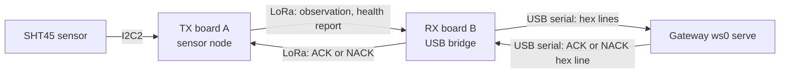
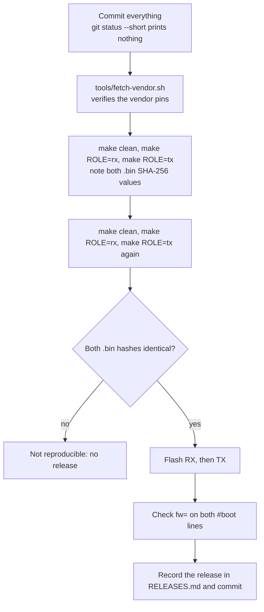
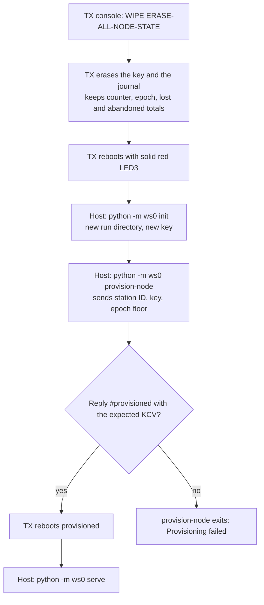
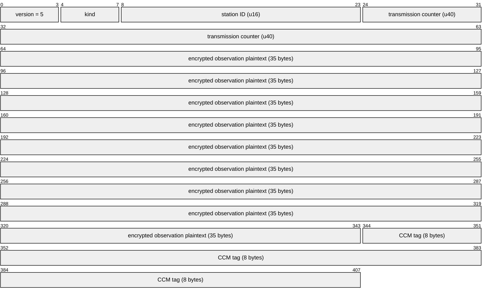
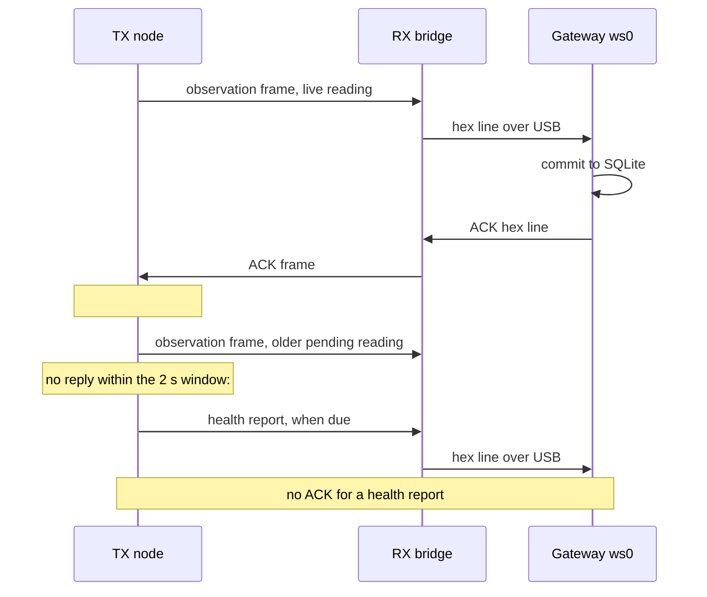
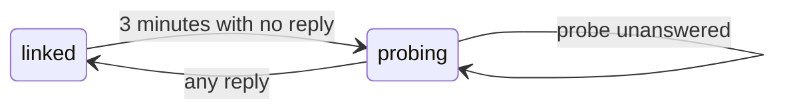
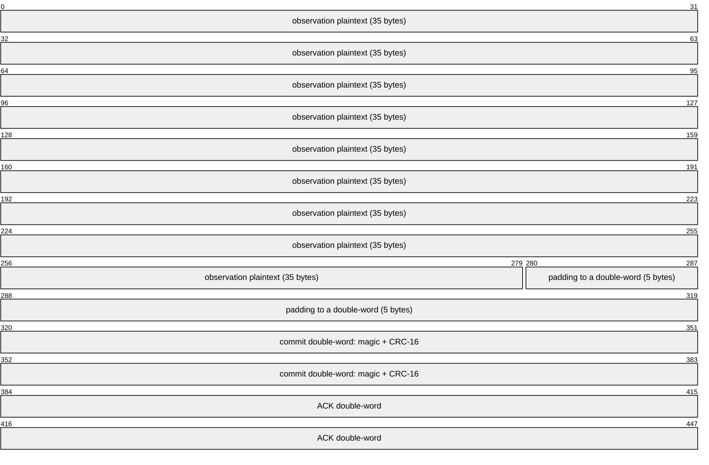

# Node firmware for the bench prototype (NUCLEO-WL55JC1)

This directory holds one source tree with two roles:

- **TX**, the transmitter: the sensor node, board A `003B00194142500E20353451`.
- **RX**, the receiver: the USB bridge to the gateway, board B `0016001E4142500E20353451`.

The firmware uses ST's SubGHz_Phy_PingPong board support (STM32CubeWL v1.6.0). That board support lives in [`../board/nucleo-wl55jc`](../board/nucleo-wl55jc/board.mk). The bench tools (`firmware/rangetest`, `firmware/pingpong`) share it. It holds `Core/`, `startup/`, `SubGHz_Phy/Target/`, the linker script and the common build rules (`board.mk`). This project keeps only two board files of its own:

- `Core/Src/stm32wlxx_it.c`: the flash error-correction (ECC) hook in the non-maskable interrupt (NMI) handler, and the HardFault record.
- `Core/Inc/utilities_def.h`: the sequencer tasks.

The wire protocol is in [`docs/protocol.md`](../../docs/protocol.md), protocol version 5. See also [`protocol-stack.md`](../../docs/protocol-stack.md). The design notes are in [`docs/protocol-design.md`](../../docs/protocol-design.md).



**Status (2026-10-16):**

- Release `260c9ccbe938` ([`RELEASES.md`](RELEASES.md)) is on both boards since 2026-10-16. The gateway runs on the run directory `run-d6` (key check value `e03059`).
- A release that changes the frame format needs a **fresh key**. Run `WIPE ERASE-ALL-NODE-STATE` on the TX, create a new run directory, then run `provision-node` (protocol.md section 2).
- Always flash **both** boards. Boards with different protocol versions drop each other's frames.
- The SHT45 is wired to the morpho pins. It gave valid readings on 2026-10-14 ([`docs/hardware/nucleo-wl55jc-bringup.md`](../../docs/hardware/nucleo-wl55jc-bringup.md), "SHT45 first light").
- **The 24-hour delivery test (H01, [`docs/H01-checklist.md`](../../docs/H01-checklist.md)) has NOT RUN.**

## Build and flash

```sh
tools/fetch-vendor.sh                       # pinned STM32CubeWL + submodules, Mbed TLS 3.6.6
cd firmware/stage0-node
make ROLE=rx flash SERIAL=0016001E4142500E20353451
make ROLE=tx flash SERIAL=003B00194142500E20353451
```

Flashing rewrites only the firmware region (pages 0–54). Provisioning, counters and the journal (pages 55–127) survive a reflash that keeps the flash layout (verified 2026-10-12 on the previous layout). A release that changes the layout loses them: follow [`docs/runbook-moving-boards.md`](../../docs/runbook-moving-boards.md), "Changing the flash layout". Each build prints the binary SHA-256 at the end.

A release follows the procedure in [`RELEASES.md`](RELEASES.md), "How to cut a release":



Makefile variables and targets:

| Name | Default | Meaning |
|---|---|---|
| `ROLE` | `tx` | `tx` or `rx`. The output goes to `build/<role>/stage0-<role>.{elf,bin,map}`. |
| `SERIAL` | none | ST-LINK serial number of the board to program (`flash` target only). |
| `CUBE` | `../../vendor/STM32CubeWL` | The STM32CubeWL checkout that `tools/fetch-vendor.sh` creates. |
| `TOOLCHAIN` | `~/.local/opt/xpack-arm-none-eabi-gcc-15.2.1-1.1/bin` | The directory that holds `arm-none-eabi-gcc`. |
| `BUILD` | `build/<role>` | The build directory. CI uses separate ones for the analyzer builds. |
| `ANALYZE` | unset | `1` adds GCC's static analyzer (`-fanalyzer`) to our own C. Our C always builds with a strict warning set and `-Werror`. |
| `all` (default target) | | Builds the `.elf` and `.bin`. Then prints the size, the flash budget line and the `.bin` SHA-256. |
| `flash` | | Builds if necessary. Then OpenOCD programs the `.elf` (connect under reset) and verifies it. |
| `stack` | | Computes the worst-case stack bound from the GCC call graphs (`tools/stack_report.py`). Fails above the linker's 8 KB reservation. |
| `waits` | | Checks that nothing busy-waits at run time (`tools/blocking_report.py`). Fails if an interrupt, task, callback or the main loop can reach a banned wait (`HAL_Delay`, blocking HAL I2C/UART/SPI, ...) or an unclassified `HAL_GetTick` poller. Lists the allowed hardware stalls with their bounds, the boot waits and the test-only waits. |
| `clean` | | Removes `build/` for **both** roles. |

The firmware version string (`fw=` in `#boot`/`#status`) is `git describe --always --dirty --abbrev=12` at build time. A build from a modified tree reports `…-dirty`. Every commit changes the binary.

## Source files

`App/` holds this project's own code. The board support is in `../board/nucleo-wl55jc`. Portable logic (no HAL) lives in `firmware/common/` and `firmware/stage0.c`, so the host tests run it unchanged. `firmware/host/` builds the role modules over a simulated board. One shared core, `sim_core.c`, supplies the clock, ST's timer server and sequencer, and the event loop. The tests are `tests/test_tx_machine.py`, `tests/test_rx_machine.py` and `tests/test_sensor_machine.py`.

[`docs/firmware-event-model.md`](../../docs/firmware-event-model.md) tells how the code runs: interrupts, timers, tasks and the exchange state machine. [`docs/power-of-ten.md`](../../docs/power-of-ten.md) tells how the code meets NASA/JPL's Power of Ten rules, and where it does not.

| File | Role | What it does |
|---|---|---|
| `App/app_tx.c` | TX | Boot (`SubghzApp_Init`), the 15-s samples and the minute's report. The report is encoded, then journaled. While an exchange runs, the report waits in RAM (`held_flush`). Also the watchdog health test. |
| `App/tx_exchange.c` | TX | The minute's radio exchange. One state machine (`idle`, `gap`, `sending`, `ack-wait`, `diag-sending`) with one handler per state. Sealing, ACK/NACK handling and the health report. The node's key is private to this file. |
| `App/tx_policy.c` | TX | Energy and link state, what a minute may send, strikes, the health-report schedule. The decisions are in `firmware/common/ws_policy.c`. |
| `App/tx_time.c` | TX | Time trust. The clock is set from the ACK for the frame just sent. Trust survives a warm reset (RTC backup registers). |
| `App/tx_console.c` | TX | Console commands (a table: `STATUS`, `KAT`, `PROVISION`, `WIPE`, `TEST-FLASH-STORM`), `#status`/`#counts`/`#timing`, the storm load and commanded reboots. |
| `App/selftest.c` | TX | The boot known-answer test (`selftest_kat`) and its vectors. `tests/test_frame.py` reads the same vectors. |
| `App/tx_node.h` | TX | The interface of `app_tx.c`: this boot's identity and run state, read-only to the other modules (`node_state()`). The key and station live in `tx_exchange.c` (`exchange_load_identity`). That is the only module that seals and opens frames. |
| `App/node_store.c` | TX | Flash: provisioning, the monotonic epoch and counter log, the observation journal. |
| `App/flash_stm32wl.c` | TX | The internal-flash driver behind `node_store.c`. |
| `App/sensor.c` | TX | The SHT45 over I2C2, interrupt driven, with stuck-bus recovery. |
| `App/node_fields.h` | TX | The catalog fields that this build measures. |
| `App/app_rx.c` | RX | The keyless radio-to-USB bridge: forwarding, failed-reception logs, host ACK/NACK transmission, relisten, `#alive`. |
| `App/events.c` | both | Interrupt-safe event bits for the process task (`events_post`, `events_take`), and `irq_lock`/`irq_unlock`. |
| `App/clock.c` | both | The RTC clock, `clock_ms`/`clock_s`. The firmware never uses `HAL_GetTick`, which counts 1/1024 s ticks. |
| `App/bench.c` | both | `TEST-FAULT` and `TEST-HANG`. A field build (`-DWS_FIELD_BUILD`) leaves them out. |
| `App/console.c` | both | The USB console: line assembly from the UART interrupt, and `hex_print`. |
| `App/watchdog.c`, `App/fault.c` | both | The supervised independent watchdog (IWDG) and the reset cause. Crash records. |
| `App/busymon.c`, `App/stackmon.c` | both | Run-time timing of tasks, interrupts and flash stalls. The stack peak. |
| `App/leds.c`, `App/radio_cfg.c` | both | The LEDs. The radio settings that both roles share. |
| `firmware/common/ws_frame.c`, `ws_obs.c` | TX | The frames (AES-CCM seal and open, health report) and the observation encoder. |
| `firmware/common/ws_policy.c` | TX | The transmission policy as pure functions: LoRa airtime, link state, the minute's backlog, strikes (`firmware/test_tx_policy.c`). |
| `firmware/common/ws_console.c` | both | Line assembly, hex, command lookup (`ws_cmd_find`), and the RX frame checks in both directions. |
| `firmware/common/ws_check.c` | both | `WS_CHECK`: run-time checks with a recovery at the call site. Keeps the failure count and the first site (`docs/power-of-ten.md`). |
| `firmware/stage0.c` | TX | SHT45 parsing, the temperature and humidity window, the I2C recovery waveform, the link gate, `PROVISION` parsing, failure runs. |

## Provision and run (host)

```sh
python -m ws0 init --hardware --station station-01 --station-id 1 --directory run-hw
python -m ws0 provision-node --directory run-hw --serial /dev/cu.usbmodem<TX port>
python -m ws0 serve --directory run-hw --serial /dev/cu.usbmodem<RX port>
```

`provision-node` sends the station ID and the key to an **unprovisioned** TX board over USB. The station ID is 1 to 65,535, because the frame header holds 2 bytes for it. Then `provision-node` checks the reply against the key check value (KCV). The KCV is the first 3 bytes of AES(key, 0¹⁶). `provision-node` refuses to overwrite a provisioned board.

It also sends an **epoch floor** (`PROVISION <id> <key> <epoch_floor>`). The floor is one above the highest boot epoch that the gateway stored for this station in `observations`, `rejections` and `diagnostics` (`ws0/__main__.py`, `epoch_floor`). For an empty database the floor is 0 (no floor). The node raises its stored epoch to the floor (`store_epoch_floor`). So every later boot epoch is above the floor. The observation identities (epoch, seq) of a wiped and re-provisioned node then never collide with stored history. **The floor raises only the epoch, not the transmission counter.**



To re-provision a board, send `WIPE ERASE-ALL-NODE-STATE` on the TX console. From release `0f456040fe54`, this command erases the key and the journal. It keeps the counter, the epoch and the `lost`/`abandoned` totals. Earlier releases erased those too. The board then reboots with solid red LED3.

**Re-keying rule:** the AES-CCM nonce is kind + station + transmission counter (`firmware/common/ws_frame.c`). From release `0f456040fe54`, WIPE erases only the key and the journal and keeps the counter and epoch. Earlier releases reset the counter to 1. So a key used before `0f456040fe54`, or on another board, can repeat nonces. **After a WIPE, `init` a new run directory (a new key).** [`docs/runbook-moving-boards.md`](../../docs/runbook-moving-boards.md) tells how to move the boards between gateways.

For a long run such as the 24-hour delivery test, install the gateway as a LaunchAgent. The agent restarts the gateway if it exits. After a replug, the gateway finds the RX board by its ST-LINK serial number:

```sh
tools/deploy/macos/install.sh install run-hw 0016001E4142500E20353451
tools/deploy/macos/install.sh status      # uninstall: tools/deploy/macos/install.sh uninstall
```

The Linux equivalent is `tools/deploy/linux/ws0-gateway.service`. Keep the Mac awake during the 24-hour delivery test.

`run-hw/` holds secrets and live data. Git ignores it. `serve` appends receiver diagnostics and every frame/ACK pair to `run-hw/receiver.log`.

## Console (USB serial through the ST-LINK virtual COM port, 115200 8N1)

| Board | Output | Commands |
|---|---|---|
| TX | Lines that start with `#` (glossary below). | `STATUS`, `KAT`, `PROVISION <station_id> <32 hex key> [epoch_floor]` (decimal ID 1–65535, only when unprovisioned, reboots on success), `WIPE ERASE-ALL-NODE-STATE` (reboots), `TEST-HANG` (bench: proves the watchdog), `TEST-FAULT` (bench: proves crash recording), `TEST-FLASH-STORM` (bench: continuous flash writes for power-cut tests. Pauses sampling. Ends at reboot.) |
| RX | One lowercase hex line per received observation frame (39–94 bytes, 51 for the temperature and humidity build) **or health-report** frame (48 bytes). Also `#` diagnostics (below). | `STATUS`, `TEST-HANG`, `TEST-FAULT`, or one hex **ACK or NACK** line from the host (exactly 33 bytes = 66 hex digits). The RX ignores lines that start with `#`. The RX discards these lines whole: a line with a byte outside printable ASCII, a line longer than 256 characters, and a line that lost a character (a receive error, or a line that arrived while the previous line still waited). |

### Frame layout

Every frame has an 8-byte header in clear text, the encrypted plaintext and an 8-byte tag ([`docs/protocol.md`](../../docs/protocol.md) section 1, `firmware/common/ws_frame.h`). Byte 0 holds the protocol version (5) in its high nibble and the kind in its low nibble. So byte 0 is `0x51` (observation), `0x52` (ACK), `0x53` (NACK) or `0x54` (health report). This diagram shows an observation frame of the temperature and humidity build, in bit offsets:



### TX console glossary (`App/tx_console.c`, `App/app_tx.c`, `App/tx_exchange.c`)

`STATUS` prints three lines: `#status`, `#counts`, then `#timing`. Every boot that reaches provisioning prints them too. The console's print buffer (`UTIL_ADV_TRACE_TMP_BUF_SIZE`) is now 640 bytes. The old 256-byte buffer cut off one line.

`#status` shows identity and state. `ws0 provision-node` reads it. Fields:

| Field | Meaning |
|---|---|
| `fw` | The firmware version string (git commit, see Build and flash). |
| `reset` | The last reset cause: `watchdog`, `power`, `software`, `lowpower`, `option-bytes`, `pin` or `unknown`. |
| `provisioned`, `station`, `kcv` | The provisioning state, the station ID, and the key check value. |
| `kat` | The result of the boot known-answer test (KAT), `pass` or `FAIL`. |
| `epoch`, `next_seq` | This boot's epoch, and the next observation sequence number. |
| `ctr` | The next transmission counter (the nonce counter). The counter is 40 bits on the wire. The console prints it in full, in decimal. |
| `ecc` | Flash reads with a double ECC error since boot. |
| `link`, `silent` | The link state (`linked` or `probing`), and the consecutive minutes with no reply. |
| `energy` | The energy state. Always `normal` on the USB-powered bench prototype. |
| `time`, `utc` | `synchronized` or `unknown`, and the UTC seconds (0 when unknown). |
| `uptime` | RTC seconds since boot. |

`#counts` fields:

| Field | Meaning |
|---|---|
| `pending` | Journaled readings that have no acknowledgement yet. |
| `lost` | Total readings that a journal overflow dropped. Persists across resets. |
| `burned` | Journal slots found torn or unusable since boot. |
| `abandoned` | Total records given up after a NACK or the strike limit. Persists across resets. |
| `sent`, `acked`, `no_ack`, `ack_rejects`, `sensor_faults` | Counters since boot. `acked` counts ACKs that matched a journal record. `ack_rejects` counts replies that failed authentication, plus NACKs for a frame other than the frame just sent. |
| `held_lost` | Readings dropped since boot because RAM already held two readings during a hung exchange ([`docs/firmware-event-model.md`](../../docs/firmware-event-model.md)). 0 in normal operation. |
| `tx_fail_run` | Consecutive journal-append failures. |
| `tx_air_run` | Consecutive transmission failures: a refused counter, a refused `Radio.Send`, or a TxTimeout. Only a TxDone clears it. When either run goes above 10, the watchdog resets the board. |
| `stack_peak` | The most stack bytes used since boot. At start-up the firmware fills the stack with a pattern. On demand it finds the deepest overwritten byte (`App/stackmon.c`). The linker reserves 8192 B. `make stack` gives the worst-case estimate. |
| `check_fails`, `check_first` | Run-time checks that failed since boot (`WS_CHECK`, `firmware/common/ws_check.h`, [`docs/power-of-ten.md`](../../docs/power-of-ten.md) rule 5), and the site of the first one. The site is `file:line`, with the file given by its number in the table in `ws_check.h`. For example, `5:322` is line 322 of `App/node_store.c`. `0:0` means no check failed. The caller of each check recovers on the spot: it refuses the step, ends the exchange or clamps a value. Report any nonzero count as a firmware bug. |

`#timing` shows how the event-driven firmware really runs (`App/busymon.h`, [`docs/firmware-event-model.md`](../../docs/firmware-event-model.md)):

| Field | Meaning |
|---|---|
| `state` | The radio exchange state: `idle`, `gap`, `sending`, `ack-wait` or `diag-sending`. |
| `task_peak_us`, `task_peak` | The longest time that one main-loop task ran since boot (µs, cycle counter), **without the interrupts that ran meanwhile**. The name is the task's slowest timed step when it has steps (`report.journal`, `report.send`). Otherwise the name is the task. |
| `task_wall_us` | The same task from start to end, interrupts included. This is how long the main loop waited. |
| `isr_peak_us`, `isr_peak` | The longest time that one interrupt handler ran since boot, and its name. |
| `erase_peak_us`, `prog_peak_us` | The longest flash page erase and the longest double-word program. The CPU stalls during these. |
| `trace_drops` | Console lines dropped because the output queue was full. The firmware never waits for the queue. |
| `unexpected` | Events that arrived in a state that does not expect them. The firmware counts them, prints `#error unexpected` and ignores them. |

Other lines:

| Line | Meaning |
|---|---|
| `#boot role=tx fw= reset= kat= freq= bw= sf= power=` | Printed at every boot. `bw` is an index (2 = 500 kHz). `sf` is the LoRa spreading factor. |
| `#sample epoch= seq= uptime= valid= rc= n= t= rh= time= utc= journal= pending= lost=` | One line per minute, from four 15-s samples. `n` is the number of valid samples. `t`/`rh` is their mean, in 0.01 °C and 0.01 % (0 when `valid=0`). `rc` is the result of the last sample. The encoder (`ws_obs_encode`) makes the journaled record. It sends a `t` outside −40.00…125.00 °C as INVALID and clamps `rh` to 0–100 %. With `valid=0` it sends both fields as INVALID, never omitted. `rc` values (`App/sensor.h`): 0 ok. −1 the previous measurement had not finished. −2 the command write failed (address NACK: sensor absent or wiring fault, or a bus error or busy bus). −3 the reply read failed. −4 CRC mismatch. −5 the bus is still stuck after recovery. −6 a transfer never completed. `journal=ERROR`: the firmware could not encode or journal the record. `journal=held`: the previous exchange still runs, so the record waits in RAM. The firmware journals it when the radio goes idle (`#held journaled`). |
| `#fault kind= pc= lr= cfsr= hfsr= bfar= count=` | Both roles, after `#boot`, only if the previous run crashed (see Crash records). |
| `#sensor ok t= rh=` / `#sensor fault rc=` | Once after boot, from the first sample (taken at boot). |
| `#watchdog N journal failures in a row` / `#watchdog N transmit failures in a row` | TX: more than 10 consecutive journal-append failures (`tx_fail_run`) or transmission failures (`tx_air_run`). The watchdog then resets the board. |
| `#boot-retry: reset in 600 s` | TX: the storage init or the epoch reservation failed at boot. The board resets one time after 10 minutes, only if the self-test passed. |
| `#ack epoch= seq= found= time_sync= rssi= snr= pending=` | An authentic ACK. `rssi` is the received signal strength and `snr` the signal-to-noise ratio. `time_sync=1`: the firmware set the clock from this ACK. |
| `#ack none epoch= seq=` | No reply came within the 2 s window. The reading stays journaled. This minute's backlog drain stops. |
| `#ack damaged payload; still listening` / `#ack damaged header; still listening` | A packet in the ACK window failed its payload CRC or its header CRC. The node listens until the window ends ([`docs/firmware-event-model.md`](../../docs/firmware-event-model.md)). |
| `#ack reject len= rssi= snr=` | A reply failed authentication. |
| `#nack epoch= seq= reason= abandoned=` | An authentic NACK for the frame just sent. The node abandons the record. Reason 1 = collision, 2 = invalid (`ws_frame.h`). |
| `#nack ignored: …` | A NACK for a frame other than the frame just sent. |
| `#abandon epoch= seq= after 10 unanswered tries …` | The strike limit: the node abandoned the record. |
| `#link probing: …`, `#link probe unanswered; …`, `#link linked after N silent minutes` | Link-state changes (see Transmission policy). |
| `#diag sent pending= lost= torn= abandoned= no_ack=` | The node sent a health report (kind 4, 32-byte plaintext). `torn` is `burned`. The report also carries the rejected-reply count, the reset cause, the link state, the firmware build ID, the RSSI/SNR of the last authentic ACK, the crash count and the energy state (protocol.md section 4). This line does not print them. The gateway shows them in `/v1/status` (`node_diagnostics`). |
| `#time restored utc= sync_age=` | The node kept time trust across a warm reset. |
| `#busy previous exchange still running; reading held until it ends` | The minute's reading waits in RAM and is not sent this minute. The firmware writes flash only while the radio is idle. |
| `#held journaled seq= rc= pending=` | The firmware journaled a held reading when the radio went idle (`rc=0`: ok). The next minute sends it as backlog. |
| `#kat pass\|FAIL`, `#wipe ok\|ERROR`, `#provisioned station= kcv= epoch_floor=`, `#unprovisioned: …`, `#test-hang: …` | Command replies. |
| `#storm start ctr=`, `#storm writes= ctr= burned=`, `#storm-scrub dropped=` | TEST-FLASH-STORM progress (every 256 writes), and the boot cleanup of storm slots. |
| `#error <what>` | `journal-read`, `counter-reserve`, `seal`, `radio-busy`, `journal-ack`, `tx-timeout`, `unexpected event= state=`, `held-lost seq=` (a third reading during a hung exchange replaced the oldest held reading), `busy (radio exchange or reboot in progress); retry` (WIPE, PROVISION or TEST-FLASH-STORM during an exchange), `store-init`, `epoch-reserve`, `self-test failed; not transmitting`. Also the command errors `already-provisioned`, `journal-not-empty` (pending records from an old key or flash layout: WIPE first), `usage: …` (also for a malformed key), `epoch-floor`, `provision rc=`, `unknown command`. |

### Crash records (`App/fault.c`, both roles)

A crash is a Cortex-M4 HardFault, or an NMI other than a flash ECC error. The fault handler saves some registers in the RTC backup registers DR5–DR11. These registers survive a reset while the board keeps power. Then the handler resets the board at once (`reset=software`). The next boot prints a line such as this one. `TEST-FAULT` on TX with release `45f43e78fe91` gave it. `pc` and `lr` depend on the build:

`#fault kind=hard pc=0800109a lr=080008a7 cfsr=00008200 hfsr=40000000 bfar=20040000 count=1`

| Field | Meaning |
|---|---|
| `kind` | `hard` (HardFault: bus, usage and memory faults all end here) or `nmi`. |
| `pc` | The instruction that faulted. Find it with `arm-none-eabi-addr2line -e build/<role>/stage0-<role>.elf <pc>` on the exact release, or in `objdump -d`. `ffffffff` means that the stack pointer was not in RAM (probably a stack overflow), or that the fault was an NMI. |
| `lr` | The link register at the fault: the return address of the most recent call (bit 0 set, Thumb). Often this is the caller, but not always. In the line above it points into `TIMER_IF_DelayMs`, which `fault_test` had just called. |
| `cfsr`, `hfsr` | The configurable fault status register and the HardFault status register (Armv7-M Architecture Reference Manual, system control block). Common `cfsr` values: `00008200` precise bus error with `bfar` valid. `00010000` undefined instruction. `00020000` invalid state, for example a call through a corrupted function pointer. `hfsr=40000000` (FORCED) means that a bus, usage or memory fault escalated to HardFault. |
| `bfar` | The faulting data address. It has a meaning only when `cfsr` bit 15 is set. |
| `count` | Crashes since the board last lost power. |

`TEST-FAULT` reads address `0x20040000`, where no memory is mapped. So the expected record is `cfsr=00008200 hfsr=40000000 bfar=20040000`, with `pc` inside `fault_test`.

### RX console glossary (`App/app_rx.c`)

| Line | Meaning |
|---|---|
| `<hex>` | A received frame for the host (observation or health report). |
| `#rx obs rssi= snr=` | Follows each forwarded frame. |
| `#rx drop len= rssi= snr=` | The RX received something that is not an observation or health report of the current protocol version. |
| `#rx crc len= rssi= snr= data=` | A bad reception: the header decoded but the payload CRC failed. `data` is the lowercase hex of all `len` (0–255) bytes that the radio kept (empty when `len=0`). The gateway stores each one in `rx_faults` and counts them. `tools/rx_faults.py` classifies the captures. |
| `#rx hdr rssi=` | A bad reception: the header CRC failed and no payload came. `rssi` is the channel RSSI, read immediately after the failure. |
| `#host reject len=` | A host line that is not a valid ACK/NACK hex line. |
| `#tx timeout`, `#tx busy` | `#tx timeout`: an ACK/NACK did not finish within 3 s. The RX puts the radio in standby, then listens. `#tx busy`: a host line arrived while an ACK was still on air (only one at a time), or the radio refused it. The RX does not send it. The node retries. |
| `#alive uptime= forwarded= dropped= acks= diag= listening= relistens= uart_errors= stack_peak= crc_errors= hdr_errors= fault_overruns= task_peak_us= task_peak= isr_peak_us= isr_peak= trace_drops= frames_lost=` | Every 60 s. `stack_peak`: as on TX (`#counts`). `crc_errors`/`hdr_errors`: bad receptions since boot (`#rx crc`/`#rx hdr`). `fault_overruns`: the bad receptions that were counted but not logged. They came before the previous capture was printed, or above the budget of 20 failure lines a minute. `frames_lost`: valid frames replaced before they were forwarded (real loss, also `#rx frame-lost`). `forwarded` counts only frames whose hex line was queued. `task_peak_us`/`isr_peak_us`: the longest task (its own time, without interrupts) and the longest interrupt since boot. `task_peak` and `isr_peak` name the one that set the peak, with words such as `process.alive`, `console_task`, `SUBGHZ_Radio`. `process` is timed per step: `.alive`, `.relisten`, `.listen`, `.forward`, `.crc`. STATUS adds `task_wall_us=`/`task_wall=`, the longest task with interrupts included. `trace_drops`: console lines dropped because the output queue was full. The firmware never waits for the queue. The gateway marks the receiver silent after 180 s without `#alive` or `#boot`. `relistens`: the number of radio restarts after 16 minutes without any radio event. 16 minutes is longer than the node's longest silence. Two relistens in a row with no radio event between them fail the health check, and the watchdog resets the board. `uart_errors`: console receive errors. A re-arm follows each one. |
| `#watchdog radio not listening; re-arming`, `#watchdog console not receiving; re-arming` | A self-heal attempt before the watchdog can reset the board. `#watchdog radio silent after N relistens; reset`: no radio event across two relistens. The health check now fails. A console whose output stopped for 3 s also fails it. |
| `#relisten after N s without a radio event` | After 16 minutes of silence, the RX put the radio in standby and restarted listening. |
| `#rx frame-lost total=` | The next frame replaced a valid frame before the RX could forward it. The node retries it. |
| `#status role=rx forwarded= dropped= acks= relistens= uart_errors= check_fails= check_first=` | The reply to `STATUS`. `acks` counts ACK/NACK lines handed to the radio. `check_fails`, `check_first`: failed run-time checks, as on TX `#counts`. They are not on `#alive`, because the gateway stores the `#alive` fields. |
| `#boot role=rx fw= reset= freq= bw= sf= power=`, `#test-hang: …`, `#test-fault: …` | The boot line and the command replies. An empty line comes before the boot line. It ends anything that a reset cut off. A field build (`-DWS_FIELD_BUILD`) leaves out TEST-HANG and TEST-FAULT. |
| `#fault …` | As on TX: the previous run crashed (see Crash records). |

### Transmission policy (TX)

This section summarizes `App/tx_policy.c` and `firmware/common/ws_policy.c`. The approved policy is in [`docs/radio-energy-policy.md`](../../docs/radio-energy-policy.md).

- **Each minute:** the live reading goes first. Then at most 5 older pending readings go (energy state NORMAL). A cap of about 5 s of estimated radio time per minute also limits the total. Each frame gets one 2 s ACK window. A missed reply ends that minute's drain.
- **Link probing:** after 3 minutes with no reply, the link state becomes `probing`. Then the node sends only the live reading, with no backlog. In SURPLUS and NORMAL (always on the bench prototype), the live reading still goes every minute. Only CONSERVE probes at 2, 4 and 8 minutes, then every 15 minutes (since `0f456040fe54`, `ws_link_may_send()` in `firmware/stage0.c`). All other readings stay journaled. Any reply returns the link to `linked`.
- **Health report** (kind 4): the node sends it every 15 minutes and at each link-state change, also while probing (since `0f456040fe54`). The node sends it one time only. It has no journal entry and no ACK.
- **Strike limit:** the node abandons a record (`#abandon`) after 10 unanswered tries, when the gateway answers other frames in the same exchange.

One minute with an answered reading, a lost reply and a health report:





**Watchdog:** the independent watchdog (IWDG) resets the board after about 8 s without a refresh. Only the main loop refreshes it, and only while the role shows real progress:

- TX: a sample came within the last 150 s, and no exchange outlasts its bound ([`docs/firmware-event-model.md`](../../docs/firmware-event-model.md)).
- RX: the radio listens, or it finishes a transmission in less than 5 s. The RX makes one re-arm attempt first.

Every boot prints the reset cause.

TX runs a boot self-test (`kat=pass`, also on demand with `KAT`, `selftest_kat` in `App/selftest.c`). `tests/test_frame.py` and `tests/test_obs.py` share its vectors. The `cryptography` library made the vectors directly from the specified header and nonce. The test does these steps:

- It encodes the known-answer observation (T −12.34 °C, RH 45.67 %) with the encoder `ws_obs_encode`. It seals the observation with counter 0x100000002 and compares all 42 bytes with the vector. This covers the encoder, the 8-byte header, the nonce and the 8-byte tag.
- It opens a known ACK and a known NACK and checks every field. It checks that an ACK with a changed tag fails.
- It checks that `ws_seal_kind` refuses counter 2^40 and does not truncate it.

If the self-test fails, the board refuses to transmit.

## LEDs

| LED | TX | RX |
|---|---|---|
| LED1 blue | 400 ms: sending a reading. 40 ms blip every 2 s: alive. | 400 ms: frame forwarded to the host. 40 ms blip every 2 s: alive. |
| LED2 green | ACK received (the host committed the reading). | Host ACK or NACK handed to the radio. |
| LED3 red | 400 ms flash: no ACK, a rejected ACK, or a transmit timeout (the reading stays queued). 1 s flash: a NACK or an abandoned record. **Solid**: not running (unprovisioned, self-test failed, flash error). | 400 ms flash: radio error, transmit timeout, unusable frame, bad host line. |
| LED6 (COM) | ST-LINK status, not this firmware (red = idle). | Same. |

## Flash layout and outage capacity (TX)

The STM32WL55JC has 256 KB of flash in 128 pages of 2 KB (`App/flash_layout.h`):


| Pages | Use |
|---|---|
| 0–54 (110 KB) | The firmware. The linker script enforces this limit. Release 260c9ccbe938: TX image 58,264 B, RX 34,832 B ([`RELEASES.md`](RELEASES.md), [`docs/firmware-budget.md`](../../docs/firmware-budget.md)). |
| 55–124 | The journal ring: 70 pages × 36 slots of 56 bytes (temperature and humidity build). |
| 125–126 | The monotonic log, pages A and B: boot epoch, counter reservations (blocks of 256), the `lost`/`abandoned` totals. Recovery takes the maximum. Compaction writes its header last. |
| 127 | Config: station ID, key, KCV. The firmware writes the magic double-word last. |

**Slot:** the observation plaintext rounded up to whole 8-byte double-words, then a commit double-word (magic + CRC-16 of the plaintext) and an ACK double-word (`App/node_store.h`). For the temperature and humidity build: 35 → 40 + 8 + 8 = **56 bytes**. After the 8-byte page header, a page holds (2048 − 8) / 56 = **36 slots**. Bit offsets of one slot:



**Capacity: at least 69 × 36 = 2,484 observations, about 41 hours** of one-minute readings without an ACK. One of the 70 pages is always being recycled, so it does not count. When the journal is full, the firmware erases the oldest page and counts its unacknowledged records in `lost`. The layout keeps 24 hours for a station with every catalog field (a compile-time check in `node_store.c`). Each slot needs a separately programmed ACK double-word, which costs space. The 30-day storage requirement (H11, 16 MB of external SPI NOR flash) remains future work.

**Page magic:** `"WSJ"` + the slot size in the low byte (`0x57534A38` for 56-byte slots, `App/node_store.c`). At boot the firmware ignores a page with any other magic, for example a page from a build with another field set or another protocol version. Later it recycles that page. It never misreads it.

### Field set of a build (`App/node_fields.h`)

One constant names the catalog fields that this build measures:

```c
#define WS_NODE_FIELDS (WS_F_TEMPERATURE_C | WS_F_HUMIDITY_PCT | WS_F_TH_SUMMARY)  /* T/RH: 15-s samples, minute mean + extrema */
```

Everything else follows at compile time:

- `WS_OBS_PLAIN_MAX`, the record length: 22 + the field widths. 35 B with the temperature and humidity summary.
- The frame length: the record length + 16 B.
- The journal slot size and the slots per page (`App/node_store.h`).
- The page magic.
- The airtime estimate per exchange.

To add a sensor, add its `WS_F_…` bit here and fill its `o.code[…]` in `obs_codes()` (`App/app_tx.c`). The catalog (`firmware/common/ws_obs.c`, `ws0/fields.py`) already defines all 26 fields. The gateway needs no change.

What a different field set does to the journal:

- If the slot size changes, the page magic changes. So at the first boot the firmware **ignores every journal page of the old build and recycles it**. It never sends the records that were still pending in those pages.
- If the slot size stays the same, the firmware reads the old pages. An example is a small addition: one 1-byte field makes 36 bytes, which still rounds up to a 56-byte slot. But the firmware checks each old record's CRC over the new record length. That check almost always fails. The firmware then counts the record as `burned` and does not send it.
- In both cases, drain the journal (`pending=0` in `STATUS`) before you flash a build with another field set.
- Capacity falls as records grow. For example, the full proof-of-concept field set (62-byte record) gives 80-byte slots, 25 per page, 1,725 records, about 28.8 hours. Every catalog field gives 96-byte slots, 21 per page, 1,449 records, 24.2 hours.
- The static asserts in `node_store.c` stop the build if a slot no longer fits a page or the low byte of the page magic (under 256 B).

Power-fail behaviour: a test ran 70 reset cycles during flash writes and passed (`evidence/g7-reset-during-write-2026-10-13/`). **Nobody has tested a true power removal yet.** That test is deferred (see `docs/failure-modes.md`).

- A final CRC double-word commits each slot.
- A torn write reads back as erased, as uncommitted, or as a double ECC error. `NMI_Handler` catches the ECC error. The firmware counts the slot as `burned` and never uses it. Exception: a torn **ACK** word counts as acknowledged, because the host had already committed the record.
- The firmware reserves the epoch before the first sample of each boot.
- The firmware reserves counters in blocks before use, so a reset skips the rest of the block. Observed: counter 8 → 257 after a reboot (`docs/hardware/nucleo-wl55jc-bringup.md`, "Reboot behaviour").

## Known limits

[`docs/failure-modes.md`](../../docs/failure-modes.md) holds the full failure analysis, the loss budget and the ranked gap list.

- The key is in plain internal flash at readout protection (RDP) level 0. Anyone with access to the Serial Wire Debug (SWD) port can read it. This is acceptable only on the bench.
- Time-sync accuracy: the node takes the host's commit time, up to about 1 s late. The node trusts it for 6 h, then marks it unknown.
- Time across resets: a warm reset keeps time trust (RTC backup registers DR3/DR4. ST's SysTime uses DR0–DR2). A test cleared the backup domain with a backup-domain reset (`docs/hardware/nucleo-wl55jc-bringup.md`). The gateway then reconstructed times from the `uptime` field, which every record carries. Open question: does a real power loss clear the backup domain on this board (`docs/protocol-stack.md` §11.3.1)?
- `LOW_POWER_DISABLE=1`, because the bench prototype has USB power. Power work belongs to the battery and solar build (Stage 1 of the staged plan, [`docs/next-stages-plan.md`](../../docs/next-stages-plan.md)).
- The SHT45 driver uses I2C2 on PA11/PA12 at 100 kHz with stuck-bus recovery.
