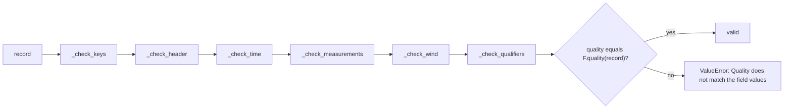
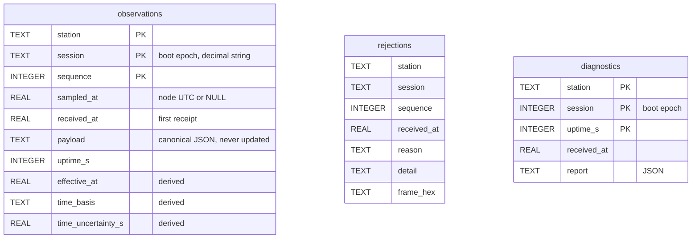
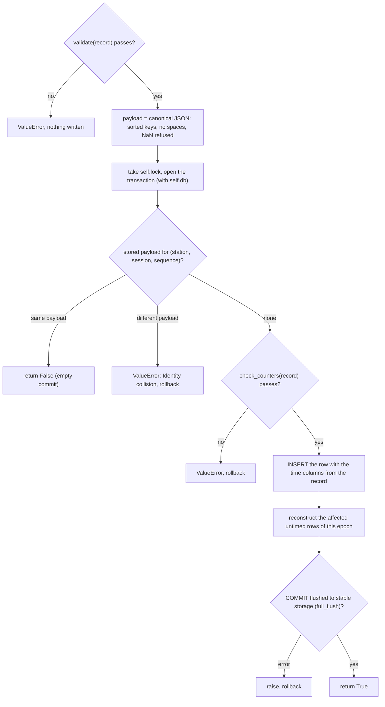
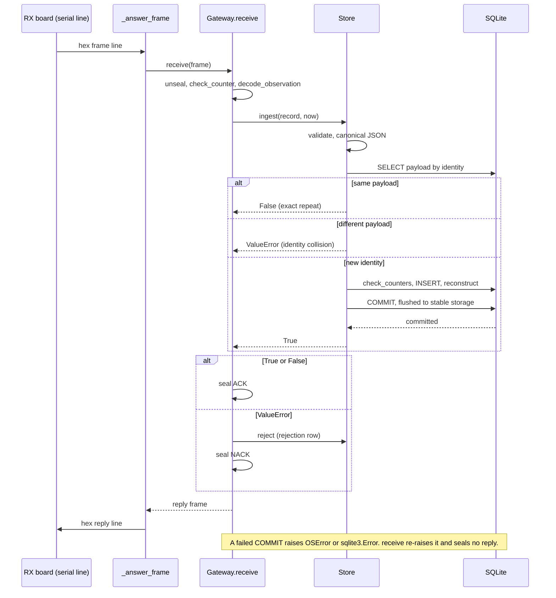
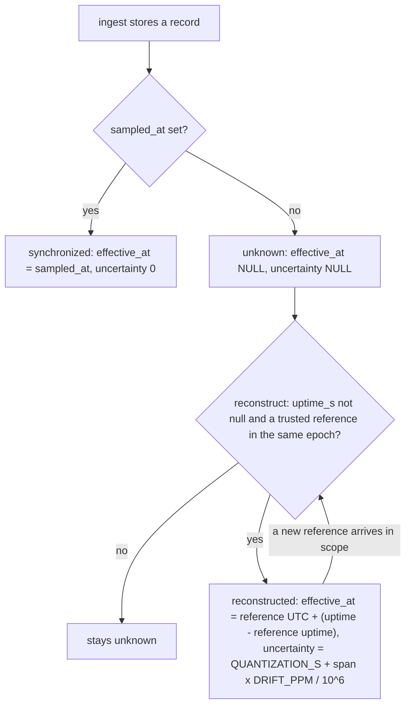
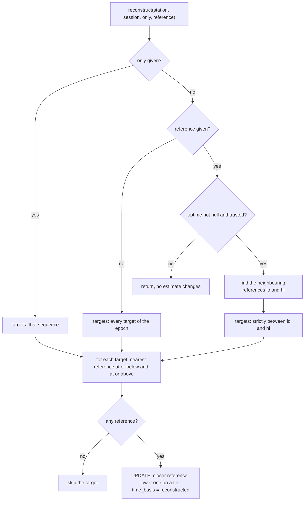
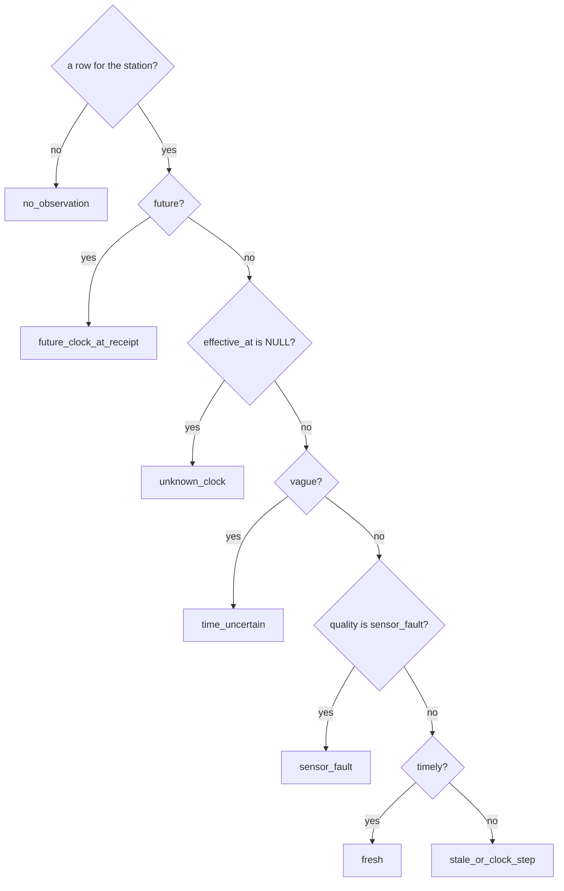

# gateway: the observation store

`gateway.py` keeps the gateway's observations in one SQLite database. It does four things:

- It validates each decoded record against a closed schema.
- It commits the record to stable storage before the caller sends an ACK (acknowledgement).
- It tells you if the latest reading is current. If it isn't, it gives a reason.
- It gives a UTC time with an error bound to samples that the node took without a synchronized
  clock.

This document is the source. `tools/tangle.py` generates `gateway.py` from the code chunks below.
The repository holds the generated file too, so `import gateway`, ruff and the tests read ordinary Python.
Edit this file, then regenerate and check:

```sh
python3 tools/tangle.py gateway.lit.md                          # write gateway.py
python3 tools/tangle.py --check gateway.lit.md                  # committed .py == tangle
python3 tools/tangle.py --weave /tmp/gateway.html gateway.lit.md   # render
```

`--check` without a document checks every `*.lit.md` under `firmware/` and `ws0/`, plus those at the
repository root, which includes this one. Name this document if you want to check only it.

A chunk is a fenced ` ```python {#name} ` block. A line `<<name>>` inside a chunk includes chunk
`name` at that line's indentation. This document writes the `Store` methods without their class
indentation. The root chunk (section 11) puts every chunk in file order.

## 1. Guarantees

| Property | Guarantee | Checked by |
|---|---|---|
| Durability | `ingest` returns only after its transaction is on stable storage (write-ahead log, `synchronous=FULL`, `F_FULLFSYNC` on macOS) | `tests/test_gateway.py` `DurabilityTests.test_full_flush_pragmas_are_on` |
| No ACK without a commit | a failed commit raises an error, and the service sends no reply | `tests/test_stage0.py` `PipelineTests.test_commit_failure_no_ack`, `NackTests.test_commit_failure_still_gets_no_reply` |
| Closed schema | `validate` refuses a record with an unknown key, an out-of-range value or a value that the catalog cannot encode exactly. The error names the rule | `SchemaTests.test_valid_records_pass`, `SchemaTests.test_each_rule_and_its_message`, `GatewayTests.test_fault_and_invalid_values` |
| Immutable identity | an exact repeat of (station, session, sequence) changes nothing. A different payload under the same identity is an error | `GatewayTests.test_replay_and_restart`, `GatewayTests.test_collision`, `NackTests.test_collision_is_nacked_recorded_and_dropped_by_node` |
| Counters | a since-boot counter never decreases in sequence order within an epoch | `GatewayTests.test_counters_never_decrease_in_sequence_order` |
| Reconstructed time | an untimed sample gets the time of the nearest trusted reference of its epoch, with an error bound. A bounded update gives the same result as a full rescan | `ReconstructionTests.test_bounded_update_matches_a_full_rescan`, `TimeReconstruction` (all four tests) |
| Freshness | the latest reading is current only with a known, bounded, not-future time younger than its report interval plus 120 s: 180 s, 420 s in CONSERVE, 3720 s in CRITICAL (the energy state the record carries) | `LatestReasonTests.test_reasons`, `GatewayTests.test_backfill_does_not_replace_live`, `GatewayTests.test_unknown_clock_and_future` |
| Read-only access | a command-line read of the database of a stopped gateway creates no files | `ReadOnlyOpen.test_reading_a_stopped_gateways_database_leaves_no_files` |

Test classes without a file name are in one of two files. `tests/test_gateway.py` holds the unit
tests of `Store`. `tests/test_stage0.py` holds `PipelineTests`, `TimeReconstruction` and
`NackTests`, which run the full gateway with a simulated node.

## 2. Module header

```python {#module-docstring}
"""SQLite observation store. The authenticated gateway and the regression tests use it."""
```

`ws0/fields.py` (imported as `F`) is the field catalog. It defines the field names, their encoding,
which fields are counters, and the quality of a record.

```python {#imports}
import contextlib
import json
import os
import math
import re
import sqlite3
import threading
import time
from pathlib import Path

from ws0 import fields as F
```

Limits and units that the file uses:

| Constant | Value | Use |
|---|---|---|
| `MINUTE_S`, `HOUR_S`, `DAY_S` | 60, 3600, 86400 | `ws0/__main__.py` and `ws0/harness.py` import `MINUTE_S`. `ws0/web.py` imports all three (and `FAR_FUTURE`) |
| `RECORD_VERSION` | 6 | the only accepted `version`. It equals `VERSION` in `ws0/protocol.py`. A run directory belongs to one record version. A version 5 database stays with the version 5 release, with no migration (`docs/protocol-design.md` section 5.7) |
| `CURRENT_MAX_AGE_S` | 180 | a latest reading of this age or older is not current, in `SURPLUS` and `NORMAL` |
| `REPORT_INTERVAL_S`, `CURRENT_SLACK_S` | 60 s (`surplus`, `normal`), 300 s (`conserve`), 3600 s (`critical`); 120 s | `current_max_age`: the station's live interval by the energy state its record carries, plus the slack. `docs/radio-energy-policy.md` section 5 sets the intervals |
| `FUTURE_SLACK_S` | 5 | a sample time more than this after its receipt shows a wrong clock |
| `UTC_LIMIT` | 2^32 | the UTC field of the observation is a u32 |
| `SQLITE_INT_MAX` | 2^63 - 1 | the open upper end of an uptime range in `reconstruct` |
| `FAR_FUTURE` | 253402300800 | 10000-01-01T00:00:00Z, the open end of a `history` range |

```python {#limits}
MINUTE_S, HOUR_S, DAY_S = 60, 3600, 86400
RECORD_VERSION = 6          # the protocol version (VERSION in ws0/protocol.py)
CURRENT_MAX_AGE_S = 180     # a latest reading older than this is not current (SURPLUS, NORMAL)
CURRENT_SLACK_S = 120       # past the station's live interval before its reading stops being current
REPORT_INTERVAL_S = {'surplus': 60, 'normal': 60, 'conserve': 300, 'critical': 3600}   # the TX's live interval
FUTURE_SLACK_S = 5          # a sample time this far after receipt is a wrong clock, not jitter
UTC_LIMIT = 2**32           # the UTC field of the observation is u32
SQLITE_INT_MAX = 2**63 - 1
FAR_FUTURE = 253402300800   # 10000-01-01T00:00:00Z: the open end of a time range
```

## 3. Durability

`full_flush` configures a connection so that each commit reaches stable storage. `Store`, `Nonces`
in `ws0/protocol.py` and `ws0/simulator.py` call it on every connection that they open to write.
The read-only connections of `reader` and `open_read_only` (section 10) don't need it.

SQLite has two journal modes that matter here. The rollback journal is the default. The
write-ahead log (WAL) appends each commit to a separate `-wal` file. `fsync` is the system call that
asks the operating system to write a file to the drive.

| Pragma | Value | Why |
|---|---|---|
| `journal_mode` | `WAL` | one flush per commit. The rollback journal needs several |
| `synchronous` | `FULL` | the commit waits for the flush |
| `fullfsync` | `ON` | on macOS, `fsync()` does not flush the drive cache. `F_FULLFSYNC` does |
| `checkpoint_fullfsync` | `ON` | the WAL checkpoint also uses `F_FULLFSYNC` |

The `full_flush` docstring gives these numbers from the bench Mac:

| Commit | Latency |
|---|---|
| without the flush (not durable) | 0.06 ms |
| with the flush | 5.3 ms median, 16 ms max |
| a nonce commit, rollback journal then WAL | 14 ms then 5 ms (not recorded, see below) |

The nonce-commit row comes only from the docstring. It went in with commit 6c29345, and there's no
recorded measurement behind it. That commit's message gives a different number: the median of
`Gateway.receive` with real fsync went from 31.6 ms to 13.0 ms. Treat 14 ms and 5 ms as unconfirmed
until someone times a nonce commit on the bench Mac.

`WS0_UNSAFE_FAST_FSYNC=1` sets `synchronous`, `fullfsync` and `checkpoint_fullfsync` to `OFF`.
WAL stays on. Simulations and unit tests set it (for example `tests/test_gateway.py` line 3). A run
with this variable set doesn't claim durability across power loss.

In WAL mode the `-wal` file holds committed data. So when you copy the database, take the main
file, `-wal` and `-shm` together, or none of them.

```python {#full-flush}
def full_flush(db):
    """Use a write-ahead log, and make each commit reach stable storage. On macOS, fsync() does
    not flush the drive cache. F_FULLFSYNC does. Measured on the bench Mac: a commit takes
    0.06 ms without the flush (not durable), and 5.3 ms median, 16 ms max with it. WAL needs one
    flush per commit. The rollback journal needs several (a nonce commit: 14 ms with the
    rollback journal, 5 ms with WAL). The WAL file is part of the database: copy all of name,
    name-wal and name-shm, or none of them. Linux ignores the fullfsync pragmas. WAL and
    synchronous=FULL apply on every platform. Simulations and unit tests can turn the flush off
    with WS0_UNSAFE_FAST_FSYNC=1. Those runs never claim durability across power loss."""
    fast = os.environ.get('WS0_UNSAFE_FAST_FSYNC') == '1'
    db.execute('PRAGMA journal_mode=WAL')
    db.execute(f"PRAGMA synchronous={'OFF' if fast else 'FULL'}")
    db.execute(f"PRAGMA fullfsync={'OFF' if fast else 'ON'}")
    db.execute(f"PRAGMA checkpoint_fullfsync={'OFF' if fast else 'ON'}")
```

## 4. Record validation

`validate` checks a decoded record (a `dict`) before the store writes anything. `ws0/protocol.py`
calls it in `decode_observation` and `encode_observation`. `Store.ingest` calls it again. Every
failure raises `ValueError` with a message that names the rule. The service then sends a NACK
(negative acknowledgement, section 6).

### Key set

The base keys are always present. Every other key must be a catalog field name (`F.BY_NAME`) or
`wind_calm`. `wind_calm` is present exactly when `wind_dir_deg` is present. A derived value such as
`dew_point_c` is not a catalog field. So `validate` refuses a record that carries it.

```python {#base-keys}
BASE_KEYS = frozenset({'version','station','session','sequence','sampled_at','uptime_s','time_quality',
                       'energy_state','calibration_revision','quality'})
```

### Identity and counters

`station` and `session` are 1 to 64 characters of `[A-Za-z0-9_-]`. The counters are integers in
`0 <= value < top`:

| Field | Exclusive top |
|---|---|
| `sequence` | 2^32 |
| `uptime_s` | 2^32 |
| `calibration_revision` | 256 |

```python {#identity-counters}
IDENTITY = re.compile(r'[A-Za-z0-9_-]{1,64}')
COUNTERS = (('sequence',2**32),('uptime_s',2**32),('calibration_revision',256))   # name, exclusive top
```

`_require` raises the message when the condition is false. `_finite_number` accepts only `int` and
`float` by exact type. So `True` and `'40'` are not numbers. It also refuses NaN and infinity.

```python {#require}
def _require(ok, message):
    if not ok:
        raise ValueError(message)
```

```python {#finite-number}
def _finite_number(value):
    return type(value) in (int,float) and math.isfinite(value)
```

### Checks in order

`validate` calls the check functions in this order. The first failing check names the error.



Each function raises `ValueError` at its first failed condition. The table lists every condition
in order. `SchemaTests.test_each_rule_and_its_message` pins every message and the order.

| # | Function | Condition | Message |
|---|---|---|---|
| 1 | `_check_keys` | a `dict` whose `version` is the `int` 6 (`True` and `6.0` fail) | `Unsupported version` |
| 2 | `_check_keys` | every base key present | `Missing record fields` |
| 3 | `_check_keys` | no key outside the base keys, the catalog and `wind_calm` | `Unexpected record fields` |
| 4 | `_check_keys` | `wind_calm` present exactly when `wind_dir_deg` is | `wind_calm goes with wind_dir_deg` |
| 5 | `_check_header` | `station`, `session` match `IDENTITY` | `Invalid identity` |
| 6 | `_check_header` | each counter is an `int` in range | `Invalid sequence`, `Invalid uptime_s`, `Invalid calibration_revision` |
| 7 | `_check_header` | `energy_state` in `F.ENERGY` (`surplus`, `normal`, `conserve`, `critical`) | `Invalid energy state` |
| 8 | `_check_time` | `time_quality` is `synchronized` or `unknown` | `Invalid time quality` |
| 9 | `_check_time` | `unknown` has `sampled_at` null | `Unknown clock must have null time` |
| 10 | `_check_time` | `synchronized` has a finite `sampled_at` with `0 < t < 2^32` | `Invalid UTC timestamp` |
| 11 | `_check_measurements` | each measured field is null or an exact catalog value | `<name>: not an exact catalog value` |
| 12 | `_check_wind` | `wind_calm` is a `bool`, and not true with a direction | `Invalid wind_calm` |
| 13 | `_check_wind` | no direction or calm when `wind_speed_ms` is null | `Wind direction without a valid speed` |
| 14 | `_check_qualifiers` | `qualifiers` is a `dict` from qualifiable fields to `suspected_icing`, `delayed_melt` or `outside_envelope` | `Invalid qualifiers` |
| 15 | `validate` | `quality` equals `F.quality(record)` | `Quality does not match the field values` |

`F.quality` itself raises `No measurements` when the record holds no measurement. The meta field
`th_samples` does not count as a measurement.

```python {#check-keys}
def _check_keys(record):
    """Check the version, then the closed key set. Return the catalog keys beyond the base keys."""
    _require(isinstance(record, dict) and type(record.get('version')) is int and record['version'] == RECORD_VERSION,
             'Unsupported version')
    _require(BASE_KEYS <= set(record), 'Missing record fields')
    extra = set(record) - BASE_KEYS
    _require(not extra - set(F.BY_NAME) - {'wind_calm'}, 'Unexpected record fields')
    _require(('wind_calm' in record) == ('wind_dir_deg' in record), 'wind_calm goes with wind_dir_deg')
    return extra
```

```python {#check-header}
def _check_header(record):
    """Check the identity, the counters and the energy state."""
    for name in ('station','session'):
        _require(isinstance(record[name], str) and IDENTITY.fullmatch(record[name]), 'Invalid identity')
    for name, top in COUNTERS:
        _require(type(record[name]) is int and 0 <= record[name] < top, f'Invalid {name}')
    _require(record['energy_state'] in F.ENERGY, 'Invalid energy state')
```

```python {#check-time}
def _check_time(record):
    _require(record['time_quality'] in ('synchronized','unknown'), 'Invalid time quality')
    stamp = record['sampled_at']
    if record['time_quality'] == 'unknown':
        _require(stamp is None, 'Unknown clock must have null time')
    else:
        _require(_finite_number(stamp) and 0 < stamp < UTC_LIMIT, 'Invalid UTC timestamp')
```

An exact catalog value survives the encoding of its field unchanged. `f.code(value)` is not the
INVALID code of the field, and `f.value` of that code returns the same value. `40.001` %RH fails
this check, because the catalog cannot represent it. So the store never holds a value that the node
could not send.

```python {#exact-catalog-value}
def _exact_catalog_value(f, value):
    return _finite_number(value) and f.code(value) != f.invalid and f.value(f.code(value)) == value
```

```python {#check-measurements}
def _check_measurements(record, extra):
    for name in extra & set(F.MEASURED):
        value = record[name]
        _require(value is None or _exact_catalog_value(F.BY_NAME[name], value), f'{name}: not an exact catalog value')
```

```python {#check-wind}
def _check_wind(record):
    if 'wind_calm' in record:
        calm = record['wind_calm']
        _require(type(calm) is bool and not (calm and record['wind_dir_deg'] is not None), 'Invalid wind_calm')
    has_direction = record.get('wind_dir_deg') is not None or record.get('wind_calm')
    _require(not (record.get('wind_speed_ms', 0) is None and has_direction), 'Wind direction without a valid speed')
```

```python {#check-qualifiers}
def _check_qualifiers(record):
    if 'qualifiers' in record:
        q = record['qualifiers']
        _require(isinstance(q, dict) and all(n in F.QUALIFIABLE and v in F.QUALIFIER[1:] for n, v in q.items()),
                 'Invalid qualifiers')
```

```python {#validate}
def validate(record):
    """Check a record against the closed schema (docs/protocol-design.md section 5.7): identity,
    time, catalog fields with exact representable values, and a quality that matches them. The
    checks run in this order. The first failure names the error."""
    extra = _check_keys(record)
    _check_header(record)
    _check_time(record)
    _check_measurements(record, extra)
    _check_wind(record)
    _check_qualifiers(record)
    _require(record['quality'] == F.quality(record), 'Quality does not match the field values')
```

## 5. Storage schema

One `Store` owns one connection (`check_same_thread=False`) and one `threading.RLock`. Every write,
`latest` and `latest_diagnostic` take the lock. The service calls the store from its receive path
and from its HTTP and MQTT handlers.

```python {#store-class}
class Store:
    """Serialize concurrent access from HTTP and ingestion. Immutable identities survive a restart."""
```

### Tables

The three tables have no foreign keys. `station` and `session` (the boot epoch) connect them
logically.



### `observations`

| Column | Type | Contents |
|---|---|---|
| `station` | TEXT | station name from the gateway config |
| `session` | TEXT | boot epoch, as a decimal string |
| `sequence` | INTEGER | sample sequence within the epoch |
| `sampled_at` | REAL | the node's UTC, or NULL when its clock was unknown |
| `received_at` | REAL | gateway time of the first receipt |
| `payload` | TEXT | the record as canonical JSON (section 6). Never updated |
| `uptime_s` | INTEGER | node uptime at the sample, the reconstruction key |
| `effective_at` | REAL | the UTC that queries use: `sampled_at`, a reconstructed time, or NULL |
| `time_basis` | TEXT | `synchronized`, `unknown` or `reconstructed` (section 7) |
| `time_uncertainty_s` | REAL | error bound of `effective_at`: 0, a reconstruction bound, or NULL |

The primary key is (`station`, `session`, `sequence`), the observation identity. The payload
decides if a record is a duplicate. The gateway derives the three time columns, and
`reconstruct` rewrites them.

### Indexes

| Index | Columns | Serves |
|---|---|---|
| `obs_latest` | `station, CAST(session AS INTEGER) DESC, sequence DESC, received_at DESC` | `latest`. Without it each call sorted the whole table (337 ms at a year of readings, under the lock) |
| `obs_basis` | `station, session, time_basis, uptime_s` | `reconstruct`, when it looks up references and targets |
| `obs_effective_order` | `station, effective_at, session, sequence` | `history` in its output order, with no temporary sort |

### `rejections` and `diagnostics`

| Table | Columns | Key |
|---|---|---|
| `rejections` | `station, session, sequence, received_at, reason, detail, frame_hex` | none: every rejection is a row |
| `diagnostics` | `station, session` (the epoch, INTEGER), `uptime_s, received_at, report` (JSON) | (`station`, `session`, `uptime_s`) |

The store creates every table with `IF NOT EXISTS`, so a restart opens the existing data.
`epoch_floor` in `ws0/__main__.py` reads the highest epoch from all three tables.

```python {#store-init}
def __init__(self, path):
    self.lock = threading.RLock()
    self.path = Path(path).resolve()   # reader() opens it by URI
    self.db = sqlite3.connect(path, check_same_thread=False)
    full_flush(self.db)
    # The JSON payload never changes and decides whether a record is a duplicate. reconstruct
    # recomputes the derived time columns when references arrive.
    self.db.execute('''CREATE TABLE IF NOT EXISTS observations (
        station TEXT, session TEXT, sequence INTEGER, sampled_at REAL, received_at REAL, payload TEXT,
        uptime_s INTEGER, effective_at REAL, time_basis TEXT, time_uncertainty_s REAL,
        PRIMARY KEY(station,session,sequence))''')
    # latest() orders by identity. Without this index every call sorted the whole table: 337 ms
    # at a year of readings, under the store lock, on every ingest and every MQTT tick.
    self.db.execute('CREATE INDEX IF NOT EXISTS obs_latest ON observations'
                    '(station, CAST(session AS INTEGER) DESC, sequence DESC, received_at DESC)')
    # reconstruct() looks up the readings of a boot epoch by time basis and uptime.
    self.db.execute('CREATE INDEX IF NOT EXISTS obs_basis ON observations(station, session, time_basis, uptime_s)')
    # history reads a time range in identity order. This index gives that order, so SQLite needs
    # no sort in a temporary B-tree. The payload still comes from the table.
    self.db.execute('CREATE INDEX IF NOT EXISTS obs_effective_order ON observations'
                    '(station,effective_at,session,sequence)')
    # The store keeps authentic frames that the gateway rejected permanently (and NACKed). It
    # never loses them silently.
    self.db.execute('''CREATE TABLE IF NOT EXISTS rejections (station TEXT, session TEXT, sequence INTEGER,
        received_at REAL, reason TEXT, detail TEXT, frame_hex TEXT)''')
    # Node health reports (kind 4). They are ordered by (epoch, uptime), not by arrival, so a
    # delayed or replayed report never replaces a newer one.
    self.db.execute('''CREATE TABLE IF NOT EXISTS diagnostics (station TEXT, session INTEGER, uptime_s INTEGER,
        received_at REAL, report TEXT, PRIMARY KEY(station,session,uptime_s))''')
    self.db.commit()
```

## 6. Ingest

### Order of operations

`ingest(record, received_at)` returns `True` for a new record and `False` for an exact repeat. It
raises `ValueError` for an invalid record or an identity collision.



The canonical payload makes "the same record" a string comparison. The key order and float format
of the sender cannot turn a repeat into a collision.

The insert writes the initial time columns:

| Record | `effective_at` | `time_basis` | `time_uncertainty_s` |
|---|---|---|---|
| `sampled_at` set | `sampled_at` | `synchronized` | 0 |
| `sampled_at` null | NULL | `unknown` | NULL |

`received_at` defaults to `time.time()`. The service passes its own `now`.

```python {#store-ingest}
def ingest(self, record, received_at=None):
    """Return only after the commit. An exact repeat is harmless. A collision is an error."""
    validate(record)
    payload = json.dumps(record, sort_keys=True, separators=(',',':'), allow_nan=False)
    key = (record['station'],record['session'],record['sequence'])
    with self.lock, self.db:
        old = self.db.execute('SELECT payload FROM observations WHERE station=? AND session=? AND sequence=?',key).fetchone()
        if old:
            if old[0] != payload:
                raise ValueError('Identity collision')
            return False
        self.check_counters(record)
        received = time.time() if received_at is None else received_at
        synced = record['sampled_at'] is not None
        self.db.execute('INSERT INTO observations (station,session,sequence,sampled_at,received_at,payload,'
                        'uptime_s,effective_at,time_basis,time_uncertainty_s) VALUES (?,?,?,?,?,?,?,?,?,?)',
                        (*key,record['sampled_at'],received,payload,record.get('uptime_s'),record['sampled_at'],
                         'synchronized' if synced else 'unknown',0 if synced else None))
        # A new untimed reading needs only its own estimate. A new reference can change only the
        # readings between its neighbouring references.
        if synced:
            self.reconstruct(record['station'],record['session'],reference=(record.get('uptime_s'),
                             record['sampled_at'] <= received+FUTURE_SLACK_S))
        else:
            self.reconstruct(record['station'],record['session'],only=record['sequence'])
    return True
```

### The caller sends the ACK after the commit

`Gateway.receive` in `ws0/service.py` calls `ingest`. It seals the ACK only after `ingest` returns.
The path of one observation frame from the receiver board to the reply:



The exceptions decide the reply:

| Outcome of `ingest` | Service action | Reply |
|---|---|---|
| `True` | count it, publish telemetry | ACK |
| `False` (exact repeat) | `last_outcome = 'duplicate'` | ACK again, so a node that lost the first ACK stops retrying |
| `ValueError('Identity collision')` | `reject(..., 'identity_collision', ...)` | NACK with `NACK_COLLISION` |
| other `ValueError` | `reject(..., 'invalid_record', ...)` | NACK with `NACK_INVALID` |
| `OSError`, `sqlite3.Error` | re-raise | none. The node keeps the record and retries |

An excerpt of `ws0/service.py`:

```python
            try:
                record = decode_observation(payload,self.cfg['station'])
                inserted = self.store.ingest(record,now)
            except ValueError as exc:
                # Authentic but permanently unacceptable: record it, then tell the node to stop
                # retrying it. Commit failures (OSError) still propagate with no reply.
                reason = NACK_COLLISION if str(exc) == 'Identity collision' else NACK_INVALID
                ...
            except (OSError, sqlite3.Error):
                # Commit failed (disk full, I/O error, database locked): no ACK, the node keeps the
                # record and retries. sqlite3 raises its own errors, not OSError.
                self.rejected += 1
                raise
            try:
                ...
                ack = seal(self.key,self.cfg['station_id'],KIND_ACK,self.nonces,
                           pack_reply(int(record['session']),record['sequence'],host_utc,
                                      frame_counter(frame)))
```

The node deletes a record from its journal when the ACK arrives. Suppose a commit returned before
the data was on disk. Then a power cut could lose a record that neither side holds. The service
matches the collision by its message text. So the string `'Identity collision'` is part of the
interface.

### Counters within an epoch

`check_counters` covers every catalog field with `counter=True`: `rain_tips`, `energy_in_mwh`,
`energy_out_mwh`, `charge_in_mah` and `charge_out_mah`. These fields count since boot.

For each such field that is present and not null, `check_counters` finds two stored neighbours.
Both are of the same station and session, and both carry the field. They are the nearest lower and
the nearest higher sequence. The new value must be at least the lower value and at most the higher
value. The comparison is by sequence, not by arrival, so a backfilled older record passes.

A violation raises `ValueError('<name> decreased within epoch <session>')`. The service sends a
NACK for it as `invalid_record`. The counters of a new epoch start again.

```python {#store-check-counters}
def check_counters(self, record):
    """Since-boot counters (rain tips, energy, charge) never decrease in sequence order within an
    epoch (docs/protocol-design.md section 5.3). The check compares with the stored neighbours by
    sequence, not by arrival, so a backfilled older record passes. A decrease is an invalid record."""
    for f in F.FIELDS:
        value = record.get(f.name)
        if not f.counter or value is None:
            continue
        path = f'$.{f.name}'
        args = (path, record['station'], record['session'], path)
        before = self.db.execute('SELECT json_extract(payload,?) FROM observations WHERE station=? AND session=? '
                                 'AND json_extract(payload,?) IS NOT NULL AND sequence<? ORDER BY sequence DESC LIMIT 1',
                                 (*args, record['sequence'])).fetchone()
        after = self.db.execute('SELECT json_extract(payload,?) FROM observations WHERE station=? AND session=? '
                                'AND json_extract(payload,?) IS NOT NULL AND sequence>? ORDER BY sequence LIMIT 1',
                                (*args, record['sequence'])).fetchone()
        if (before and before[0] > value) or (after and after[0] < value):
            raise ValueError(f'{f.name} decreased within epoch {record["session"]}')
```

## 7. Time model

### Time bases



| `time_basis` | Set by | `effective_at` | `time_uncertainty_s` |
|---|---|---|---|
| `synchronized` | `ingest`, `sampled_at` set | `sampled_at` | 0 |
| `unknown` | `ingest`, `sampled_at` null | NULL | NULL |
| `reconstructed` | `reconstruct` | reference UTC + (uptime − reference uptime) | `QUANTIZATION_S + span × DRIFT_PPM / 10^6` |

The payload never changes. A reconstructed row keeps `sampled_at` null in its JSON
(`TimeReconstruction.test_boot_sample_reconstructed_after_first_sync`).

### Error bound

`uptime_s` and the UTC of the reference are whole seconds. Each adds up to 1 s of quantization
error, so `QUANTIZATION_S` is 2. The node has a 32.768 kHz tuning-fork crystal. It drifts about
20 ppm at room temperature and about 120 ppm at -35 °C. `DRIFT_PPM` is 150. The bound grows with
the span between the sample and its reference:

| Span | Bound |
|---|---|
| 0 (the reference itself) | 0 (it is `synchronized`) |
| 60 s | 2 + 60 × 150e-6 = 2.009 s |
| 3 days + 60 s | about 41 s |

`CURRENT_MAX_UNCERTAINTY_S` is 10 s. The store never presents a time with a larger bound as a
current measurement (section 9). By the formula, a reconstruction passes that limit at a span of
about 53 333 s. `TimeReconstruction.test_uncertainty_grows_with_distance` pins the 60 s and 3-day
values.

```python {#time-constants}
# Reconstructed time: an unsynchronized sample gets UTC from the nearest synchronized sample of
# the same boot epoch: utc = ref_utc + (uptime - ref_uptime). The error bound is 1 s of
# quantization on each of the two whole-second fields, plus crystal drift. The 32.768 kHz
# tuning-fork crystal drifts about 20 ppm at room temperature. Its drift grows quadratically with
# temperature (about 120 ppm at -35 degC), so the bound uses 150 ppm.
DRIFT_PPM = 150
QUANTIZATION_S = 2
# The store never presents a time with a larger error bound as a current measurement.
CURRENT_MAX_UNCERTAINTY_S = 10
```

### References

A reference is a row that meets four conditions:

- the same station and session as the target,
- `time_basis = 'synchronized'`,
- a non-null `uptime_s`,
- `sampled_at <= received_at + FUTURE_SLACK_S` (5 s).

The session is the boot epoch. So a reference shares the uptime counter of its targets. The store
quarantines a synchronized sample whose time was ahead of its own receipt. It keeps the sample, but
never uses it as a reference (`TimeReconstruction.test_quarantined_reference_is_never_used`).

A target is a row with `time_basis` `unknown` or `reconstructed` and a non-null `uptime_s`. For each
target, `reconstruct` takes the nearest reference at or below its uptime and the nearest at or
above. It uses the closer one. At equal distance it uses the lower one (`min` returns the first).

### Scope of one call

`ingest` calls `reconstruct` inside its transaction, on every record. The scope keeps the cost
bounded:



| Call | Targets recomputed |
|---|---|
| `only=sequence` (a new untimed record) | that record |
| `reference=(uptime, trusted)` (a new synchronized record) | targets strictly between its neighbouring references `lo` and `hi`. None if `uptime` is null or the reference is not trusted |
| neither | every target of the epoch |

A target at or below `lo` has a reference at or below `lo` that is closer than the new one. The
same holds at or above `hi`. So only targets strictly between them can change. The bounded scope
replaced a rescan of the whole epoch. That rescan cost 14 ms per frame at 1440 untimed readings.

`ReconstructionTests.test_bounded_update_matches_a_full_rescan` ingests 120 records in random
order, with quarantined references and untimed readings. After each record it compares the time
columns with a full rescan.

For a new untimed record (`only=`) and for a full rescan, `reconstruct` reads the targets first.
Most epochs have none, and then it reads no reference. For a new trusted reference it first reads
the two neighbouring references `lo` and `hi`, then the targets between them. The docstring below
still says the targets come first. That's out of date for the `reference=` case.

```python {#store-reconstruct}
def reconstruct(self, station, session, only=None, reference=None):
    """Give the unsynchronized samples of one boot epoch a UTC time. The time comes from the
    nearest trusted synchronized sample of the same epoch, which shares the monotonic uptime
    counter. A reference whose clock was ahead of its own receipt (quarantined) is never used.
    The targets are looked up first. Most epochs have none, and then nothing else is read. Every
    ingest calls this method.

    only: only this sequence (a new untimed reading). reference: (uptime, trusted) of a newly
    stored synchronized reading. Only the readings strictly between its neighbouring references
    can have it as their nearest reference, so only those are recomputed. An epoch can hold
    thousands of untimed readings. A rescan of all of them on every frame cost 14 ms at 1440.
    Neither: all targets."""
    ref_sql = ('SELECT uptime_s,sampled_at FROM observations WHERE station=? AND session=? '
               "AND time_basis='synchronized' AND uptime_s IS NOT NULL AND sampled_at<=received_at+? "
               'AND uptime_s {} ? ORDER BY uptime_s {} LIMIT 1')
    where, args = '', (station, session)
    if only is not None:
        where, args = ' AND sequence=?', (station, session, only)
    elif reference is not None:
        uptime, trusted = reference
        if uptime is None or not trusted:
            return   # not usable as a reference: no estimate changes
        lo = self.db.execute(ref_sql.format('<','DESC'),(station,session,FUTURE_SLACK_S,uptime)).fetchone()
        hi = self.db.execute(ref_sql.format('>','ASC'),(station,session,FUTURE_SLACK_S,uptime)).fetchone()
        where = ' AND uptime_s>? AND uptime_s<?'
        args = (station, session, lo[0] if lo else -1, hi[0] if hi else SQLITE_INT_MAX)
    targets = self.db.execute('SELECT sequence,uptime_s FROM observations WHERE station=? AND session=? '
                              "AND time_basis IN ('unknown','reconstructed') AND uptime_s IS NOT NULL" + where,
                              args).fetchall()
    for sequence, uptime in targets:
        near = [r for r in (self.db.execute(ref_sql.format('<=','DESC'),(station,session,FUTURE_SLACK_S,uptime)).fetchone(),
                            self.db.execute(ref_sql.format('>=','ASC'),(station,session,FUTURE_SLACK_S,uptime)).fetchone()) if r]
        if not near:
            continue
        ref_uptime, ref_utc = min(near, key=lambda r: abs(r[0]-uptime))
        span = abs(uptime-ref_uptime)
        self.db.execute("UPDATE observations SET effective_at=?,time_basis='reconstructed',time_uncertainty_s=? "
                        'WHERE station=? AND session=? AND sequence=?',
                        (ref_utc+(uptime-ref_uptime),QUANTIZATION_S+span*DRIFT_PPM/1e6,station,session,sequence))
```

## 8. Rejections and diagnostics

### `reject`

`reject` stores an authentic frame that the service refuses permanently. It stores the frame
before the service sends its NACK. For a replay the service sends no reply. The insert commits with
the same durability as `ingest`.

| `reason` | Caller in `ws0/service.py` | `once` |
|---|---|---|
| `replay` | `check_counter`, an identical copy of an accepted frame | `True` |
| `counter_regression` | `check_counter`, a counter at or below the high-water mark | `False` |
| `identity_collision` | `receive`, after `ingest` raised the collision | `False` |
| `invalid_record` | `receive`, after any other `ValueError` | `False` |

With `once=True`, `reject` skips the insert when a row with the same station, reason and frame bytes
exists. Anyone can resend a captured frame any number of times. One row per distinct frame keeps
the evidence. The store never stores an unauthenticated frame
(`NackTests.test_unauthenticated_frame_gets_no_reply`).

```python {#store-reject}
def reject(self, station, session, sequence, reason, detail, frame_hex, received_at=None, once=False):
    """Durably record a permanently rejected authentic frame before the NACK is sent. once: skip
    the insert if these exact bytes were already recorded for this reason. Anyone can resend a
    captured frame thousands of times. One row per frame keeps the evidence, not the flood."""
    received = time.time() if received_at is None else received_at
    with self.lock, self.db:
        if once and self.db.execute('SELECT 1 FROM rejections WHERE station=? AND reason=? AND frame_hex=?',
                                    (station, reason, frame_hex)).fetchone():
            return
        self.db.execute('INSERT INTO rejections VALUES (?,?,?,?,?,?,?)',
                        (station,session,sequence,received,reason,detail,frame_hex))
```

### `diagnostic` and `latest_diagnostic`

`diagnostic` stores a node health report (kind 4) under (`station`, epoch, uptime). `INSERT OR
IGNORE` keeps the first report for a key. `latest_diagnostic` orders by epoch, then uptime, not by
arrival. So a delayed or replayed older report never replaces a newer one
(`DiagnosticsAndEpochFloor.test_report_is_stored_unanswered_and_ordered_by_epoch_uptime`). It
returns the report with `received_at` added, or `None`.

```python {#store-diagnostic}
def diagnostic(self, station, report, received_at=None):
    with self.lock, self.db:
        self.db.execute('INSERT OR IGNORE INTO diagnostics VALUES (?,?,?,?,?)',
                        (station,report['epoch'],report['uptime_s'],
                         time.time() if received_at is None else received_at,json.dumps(report,sort_keys=True)))
```

```python {#store-latest-diagnostic}
def latest_diagnostic(self, station):
    with self.lock:
        row = self.db.execute('SELECT report,received_at FROM diagnostics WHERE station=? '
                              'ORDER BY session DESC,uptime_s DESC LIMIT 1',(station,)).fetchone()
    return None if row is None else json.loads(row[0]) | {'received_at':row[1]}
```

## 9. The latest reading

### Which row

`latest` takes the row with the highest (`CAST(session AS INTEGER)`, `sequence`, `received_at`).
The sample identity defines the order. The arrival time and the clock do not. A backfilled older
record that arrives after a live one does not replace it
(`GatewayTests.test_backfill_does_not_replace_live`). The age is `now − effective_at`, so replayed
or late traffic cannot reset the age.

### Freshness

`_freshness` computes three conditions:

| Condition | Definition |
|---|---|
| `future` | `effective_at > received_at + FUTURE_SLACK_S` (5 s) |
| `vague` | `time_uncertainty_s > CURRENT_MAX_UNCERTAINTY_S` (10 s) |
| `timely` | `0 <= age < current_max_age(record)`, not `future`, not `vague` |

The reason is the first one that applies, in this order:



| # | Reason | Applies when |
|---|---|---|
| — | `no_observation` | no row for the station (`latest` returns before it calls `_freshness`) |
| 1 | `future_clock_at_receipt` | `future` |
| 2 | `unknown_clock` | `effective_at` is NULL |
| 3 | `time_uncertain` | `vague` |
| 4 | `sensor_fault` | `quality == 'sensor_fault'` |
| 5 | `fresh` | `timely` |
| 6 | `stale_or_clock_step` | none of the above: age `current_max_age(record)` or more, or negative |

`future` compares with the receipt time, not with `now`. A sample that was in the future when it
arrived stays quarantined after the wall clock passes it. `sensor_fault` comes before `fresh`. So
a timely reading with every field faulty reports the fault. `LatestReasonTests.test_reasons` pins
each reason and its boundary values:

- age: 179 s is fresh, 180 s is stale (in `NORMAL`; 419 and 420 s in `CONSERVE`, 3719 and 3720 s in `CRITICAL`),
- uncertainty: 10 s is fresh, 11 s is uncertain,
- clock: 5 s ahead is fresh, 6 s ahead is future.

The age limit follows the station. A station reports its energy state in every reading (flags
bits 1-2, `docs/protocol-design.md`), and the state sets how often a live reading comes: every
minute in `SURPLUS` and `NORMAL`, every 5 minutes in `CONSERVE`, and an hourly beacon in
`CRITICAL` (`docs/radio-energy-policy.md` section 5). A reading stays current for that interval
plus 120 s, so a `CONSERVE` station is not shown as down between its reports (power design risk
R9). A record without a known state gets the `NORMAL` limit. `LatestReasonTests.test_age_follows_the_energy_state`
pins the limits.

```python {#current-max-age}
def current_max_age(record):
    """The age (s) at which this station's latest reading stops being current: its live interval for
    the energy state the record carries, plus CURRENT_SLACK_S. 180 s in SURPLUS and NORMAL."""
    return REPORT_INTERVAL_S.get(record.get('energy_state'), MINUTE_S) + CURRENT_SLACK_S
```

```python {#freshness}
def _freshness(record, received_at, effective, age, uncertainty):
    """Return (timely, reason) for the latest record. A sample that was in the future at receipt
    stays quarantined. Waiting does not validate its clock. The reasons are checked in this order."""
    future = effective is not None and effective > received_at+FUTURE_SLACK_S
    vague = uncertainty is not None and uncertainty > CURRENT_MAX_UNCERTAINTY_S
    timely = age is not None and 0 <= age < current_max_age(record) and not future and not vague
    for reason, applies in (('future_clock_at_receipt', future), ('unknown_clock', age is None),
                            ('time_uncertain', vague), ('sensor_fault', record['quality'] == 'sensor_fault'),
                            ('fresh', timely)):
        if applies:
            return timely, reason
    return timely, 'stale_or_clock_step'
```

### Result

| Key | Value |
|---|---|
| `available` | `timely` and `quality != 'sensor_fault'` |
| `reason` | from `_freshness` |
| `fields_available` | per measured field in the record: `timely` and the value is not null. `wind_dir_deg` also counts when `wind_calm` is true |
| `age_seconds` | `now − effective_at`, or `None` |
| `received_at`, `effective_sampled_at`, `time_basis`, `time_uncertainty_s` | the row's columns |
| `observation` | the stored payload |
| `derived` | `F.derived(record)`, for example `dew_point_c`. Never stored |
| `units`, `labels` | from the catalog, for the fields in `fields_available` |

Availability is per field. One dead sensor sets its own entry to false and leaves the others
unchanged (`GatewayTests.test_one_dead_field_does_not_hide_the_others`).

```python {#store-latest}
def latest(self, station, now=None):
    """Fail closed on bad clocks. Old replayed traffic cannot reset the age timer."""
    now = time.time() if now is None else now
    with self.lock:
        # The immutable sample identity defines the order, also across clock corrections.
        row = self.db.execute('''SELECT payload,received_at,effective_at,time_basis,time_uncertainty_s
            FROM observations WHERE station=?
            ORDER BY CAST(session AS INTEGER) DESC,sequence DESC,received_at DESC LIMIT 1''',(station,)).fetchone()
    if row is None:
        return {'available':False,'reason':'no_observation'}
    record = json.loads(row[0])
    effective, basis, uncertainty = row[2], row[3], row[4]
    age = None if effective is None else now-effective
    timely, reason = _freshness(record, row[1], effective, age, uncertainty)
    # Availability is per field (docs/protocol-design.md section 5.7). One dead sensor never
    # hides the others.
    fields = {name: timely and (record[name] is not None or (name == 'wind_dir_deg' and record.get('wind_calm', False)))
              for name in F.MEASURED if name in record}
    available = timely and record['quality'] != 'sensor_fault'
    return {'available':available,'reason':reason,'fields_available':fields,'age_seconds':age,'received_at':row[1],
            'observation':record,'derived':F.derived(record),'effective_sampled_at':effective,'time_basis':basis,
            'time_uncertainty_s':uncertainty,'units':{n: F.BY_NAME[n].unit for n in fields if F.BY_NAME[n].unit},
            'labels':{n: F.LABELS[n] for n in fields}}
```

## 10. Read-only access

### `open_read_only`

`ws0/__main__.py` reads a gateway database from the command line. It reads `epoch_floor` and the
node counter mark for `provision-node`. That command can run as another user, for example root.

| State | `-wal` file | URI | Why |
|---|---|---|---|
| gateway running | exists | `mode=ro` | the reader must use the live WAL to see committed data |
| gateway stopped, log checkpointed | absent | `mode=ro&immutable=1` | `mode=ro` alone would create `-wal` and `-shm`. The command-line user would own them, and they can lock the service out later |

`ReadOnlyOpen.test_reading_a_stopped_gateways_database_leaves_no_files` checks both states.

```python {#open-read-only}
def open_read_only(path):
    """Read a gateway database without writing anything. While a gateway has the database open,
    its -wal and -shm files exist, and a mode=ro reader uses them. Without a -wal file (gateway
    stopped, log checkpointed), mode=ro would still create -wal and -shm. The user who runs the
    command would own them. For root, that locks the service out later. immutable=1 reads the
    file as it is."""
    path = Path(path).resolve()
    live = path.with_name(path.name + '-wal').exists()
    return sqlite3.connect(path.as_uri() + ('?mode=ro' if live else '?mode=ro&immutable=1'), uri=True)
```

### `reader` and `history`

`reader` opens a second, read-only connection to the same file and starts a transaction. So one
long query sees one snapshot. `reader` does not take `self.lock`. In WAL mode a reader does not
block the writer. So a history export of one year cannot delay an ingest and its ACK.

```python {#store-reader}
@contextlib.contextmanager
def reader(self):
    """Give a read-only connection with one consistent snapshot, for long reads (dashboard
    history and tables). It never takes self.lock. In WAL mode readers do not block the writer,
    so a history query of one year cannot delay an ACK. Before this change, that query held the
    lock for up to about 1 s."""
    db = sqlite3.connect(self.path.as_uri() + '?mode=ro', uri=True, check_same_thread=False)
    try:
        db.execute('BEGIN')
        yield db
    finally:
        db.close()
```

`history` returns rows with `start <= effective_at < end`, ordered by (`effective_at`, `session`,
`sequence`). `LIMIT` and `OFFSET` select a page. The order is total, so pages are stable. A row with
a NULL `effective_at` stays in the database but matches no range. Each row is the payload with
`received_at`, `effective_sampled_at`, `time_basis` and `time_uncertainty_s` added.

```python {#store-history}
def history(self, station, start=0, end=FAR_FUTURE, limit=100, offset=0):
    """Return pages in a stable order. Records with unknown UTC stay in the database but match no
    time range. The read goes through reader(), so an export never waits for the ingest lock and
    never delays it."""
    with self.reader() as db:
        rows = db.execute('''SELECT payload,received_at,effective_at,time_basis,time_uncertainty_s
            FROM observations WHERE station=? AND effective_at>=? AND effective_at<?
            ORDER BY effective_at,session,sequence LIMIT ? OFFSET ?''',
            (station,start,end,limit,offset)).fetchall()
    return [json.loads(r[0]) | {'received_at':r[1],'effective_sampled_at':r[2],'time_basis':r[3],
                                'time_uncertainty_s':r[4]} for r in rows]
```

## 11. The file

The root chunk puts the chunks in file order: the module header, the constants, `full_flush`, the
validation functions, `open_read_only`, `_freshness`, then `Store` with its methods at class
indentation.

```python {#gateway.py}
<<module-docstring>>
<<imports>>

<<time-constants>>
<<limits>>


<<full-flush>>


<<base-keys>>


<<identity-counters>>


<<require>>


<<finite-number>>


<<check-keys>>


<<check-header>>


<<check-time>>


<<exact-catalog-value>>


<<check-measurements>>


<<check-wind>>


<<check-qualifiers>>


<<validate>>


<<open-read-only>>


<<current-max-age>>

<<freshness>>


<<store-class>>
    <<store-init>>

    <<store-reader>>

    <<store-ingest>>

    <<store-check-counters>>

    <<store-reconstruct>>

    <<store-reject>>

    <<store-diagnostic>>

    <<store-latest-diagnostic>>

    <<store-latest>>

    <<store-history>>
```

## 12. Tests

`tests/test_gateway.py` tests `Store` and `validate` directly. It sets `WS0_UNSAFE_FAST_FSYNC=1`,
except in `DurabilityTests`:

| Class | What it checks |
|---|---|
| `GatewayTests` | repeat and restart, collision, backfill order, unknown and future clocks, invalid values, per-field availability, 15-s summary fields, derived dew point, counters in sequence order |
| `ReconstructionTests` | bounded reconstruction equals a full rescan, 6 seeds × 120 records |
| `SchemaTests` | every validation rule, its message and its order |
| `LatestReasonTests` | every freshness reason and its boundaries, from rows inserted directly |
| `ReadOnlyOpen` | `open_read_only` with the gateway stopped and running |
| `DurabilityTests` | `fullfsync`, `synchronous=FULL` and WAL on `Store` and `Nonces`. `checkpoint_fullfsync` on `Store` |

`tests/test_stage0.py` runs the gateway with a simulated node:

| Class | Store behaviour it checks |
|---|---|
| `PipelineTests` | commit before ACK, no ACK on a commit failure, a replay stores nothing |
| `TimeReconstruction` | reconstruction after the first synchronization, a whole backlog after an outage, quarantined references, the growing bound |
| `NackTests` | collision NACKed and recorded in `rejections`, invalid record NACKed, unauthenticated frames not stored, no reply on a commit failure |
| `DiagnosticsAndEpochFloor` | diagnostics ordered by (epoch, uptime), and the epoch floor above the epochs seen in observations and diagnostics. The code reads all three tables, but the test doesn't cover rejections |

```sh
.venv/bin/python -m unittest tests.test_gateway tests.test_stage0 tests.test_tangle
```
