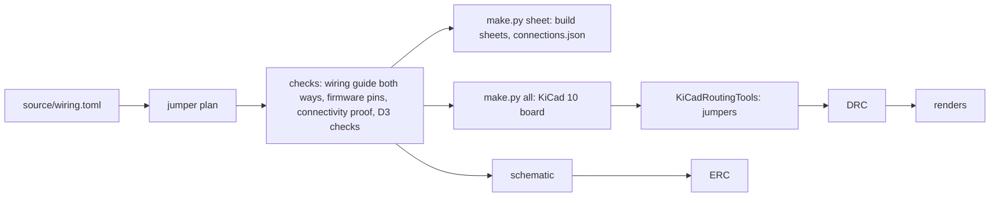

# Bench breadboard map (r0)

This is the bench station's sensor suite on three 830-point breadboards, wired to the TX board
(NUCLEO-WL55JC1, board A). It's a KiCad 10 model of the breadboard build, the first step of
[`docs/hardware/bench-station-wiring.md`](../../docs/hardware/bench-station-wiring.md). That guide is the
electrical source of truth for the signals.

The model describes the **step 1 v2 target** of the build-progression record,
[`docs/superpowers/specs/2026-10-29-build-progression-decisions.md`](../../docs/superpowers/specs/2026-10-29-build-progression-decisions.md).
That target is changes A and B and the second QT cable (sections 4.4-4.6), and it's revision `bench-bb-r0.3` in `source/wiring.toml`. Here's what it looks like:

- Every battery, charge and load current runs on leads between lever connectors, JST PH sockets and
  screw terminals, never through a breadboard contact (record P1). The one exception is the regulator's
  mode-B supply chain, which P1 allows and the model tags `P1 regulator`.
- The breadboards carry only signals and sense taps, plus the regulator's supply chain in mode B, which
  record P1 allows.
- The NUCLEO's station signals land on its Arduino headers. The bench OLED on board C uses the morpho
  headers: its signals on CN10, its supply from CN7.16 and CN10.20.
- The mode-B supply enters at CN6.4.
- The hub's sensors and the power monitors are on two QT cables, both on the unswitched 3V3.

Change C, the PA9 sensor switch, isn't part of the breadboard build (record 4.6 dated note, 2026-11-02).
The bench has no sensor power switch. The power design is
[`docs/superpowers/specs/2026-10-29-power-telemetry-design.md`](../../docs/superpowers/specs/2026-10-29-power-telemetry-design.md)
sections 11.1 and 11.2, as the record amends them.

**To build, open [`build-sheet.md`](build-sheet.md)** and the renders. That's the current revision,
`bench-bb-r0.3`. You build the bench one change at a time from the r0 bench (record 4.4-4.6):

- change A from [`revisions/bench-bb-r0.1/build-sheet.md`](revisions/bench-bb-r0.1/build-sheet.md)
- change B from [`revisions/bench-bb-r0.2/build-sheet.md`](revisions/bench-bb-r0.2/build-sheet.md)
- the second QT cable (QTM) from `build-sheet.md`

Each sheet has a "Changes from the previous revision" section. It says what comes out and what goes in,
compared with the sheet before. Before you place a wire, tick the wiring guide's section 6 checklist
against UM2592. Then work through the build sheet in this order: the bench checks before you connect
power, the pre-run checklist (C1-C23), and power checks 1-10 in order.

| Render | Shows |
|---|---|
| [`renders/board-a.png`](renders/board-a.png) | board A, signals: both RJ11 breakouts with the meter pull-ups and filters at the jack end, the STEMMA QT cable to the hub (QT) and the one to the power monitors (QTM), both unswitched |
| [`renders/board-b.png`](renders/board-b.png) | board B: the bq24074 charger's header with its ISET network (R_ISER, C_ISET, R_IPD) and the 20 kΩ/10 kΩ input divider (R4-R6), the INA228, the fuel gauge, the regulator, the BATTERY POWER shunt. Off the breadboard: the pack, the 100 Ω load, the NTC, the wall adapter and the four WAGO joints with their leads |
| [`renders/overview.png`](renders/overview.png) | the boards and the jumpers to the NUCLEO headers (not to scale) |
| [`renders/3d-top.png`](renders/3d-top.png), [`renders/3d-angle.png`](renders/3d-angle.png) | KiCad 10's 3D view |
| [`renders/schematic.pdf`](renders/schematic.pdf) | the wiring schematic, drawn as circuits with KiCad's own symbols. The meter's reed switches and vane resistors sit across the RJ11 breakout pins their cables reach |

The build sheet prints the `wiring.toml` git blob that the renders came from. If that differs from the
model's blob, the sheet says the renders lag the model. In that case, go by the sheet.

The third breadboard stays spare (for the W25Q128 flash later).



So `wiring.toml` feeds the jumper plan. Then the checks run in this order: the wiring guide both ways,
the firmware pins, the connectivity proof, then the D3 checks. Every check has to pass before any file
gets written.

## What each check proves

| Check | Proves |
|---|---|
| `check_guide` | each NUCLEO pin the map uses is in the wiring guide's section 2 table, on a header the guide lists |
| `check_guide_reverse` | the other way round (record D3 check 7): each guide row that names a station pin has a model net with that `mcu` pin, unless the row says "protoboard only" or "carrier only" |
| `check_firmware` | each pin matches the constants in the bench link's `App/benchlink.c`, in i2cscan's `App/i2cscan.c`, and, for the node, in the generated header `firmware/board/nucleo-wl55jc/gen/board_pins.h` (BOARD_CUPS/VANE/ISET/VIN/RAIN/PGOOD/CHG_PIN, BOARD_I2C_SDA/SCL_PIN and the five BOARD_OLED_*_PIN). `tools/boardgen.py` generates that header from `board.toml`. The OLED's five SPI and control pins (BOARD_OLED_CS, SCK, MOSI, RST and DC) come from that header too. `oled_spi1.h`, which i2cscan and the node's bench build share, takes its pins from it, and `check_firmware` doesn't read `oled_spi1.h`. PA9 (POWER_PIN) isn't checked, because the model has no SENS_EN (change C isn't built). An ADC input (vane, ISET, VIN_SENSE) uses its pin's ADC1 channel (D3 check 8) |
| `prove` | the strips, the jumpers, the leads, the joints, the ties inside parts and the NUCLEO's own ties join every net, with no short and no stray pin |
| `checks.check_force_off_breadboard` | D3 check 1: no force lead or force-net member in a breadboard hole, except the P1 regulator chain, tagged member by member |
| `checks.check_sense_landings` | D3 check 2: no sense lead shares a clamp position with a force lead, and each lands on its declared joint |
| `checks.check_single_tie` | D3 check 3: one conductor (L_TIE) joins the power and logic grounds, and no logic-supply current flows on the board-B ground rail |
| `checks.check_gauge_upstream` | D3 check 4: the gauge's sense lead is on CELL_POS, upstream of the shunt |
| `checks.check_shunt_only` | D3 check 5: nothing but the shunt joins INA VIN+ and VIN- |
| `checks.check_test_point_strips` | D3 check 6: each breakout test-point pin is alone in its strip |
| `checks.check_meter_at_jack` | record M7's placement rule: each meter pull-up and filter (R1 and C_CUPS, R2 and C_RAIN, R3) has its line-side lead in its BOB-14021 pin's own strip. So no jumper sits between the jack pin and its pull-up, out of the counter link probe's sight |
| `checks.check_iset` | D3 check 8's ISET constants (record step 1 exit 7): `POWER_R_ISET_OHM` in `power_config.h` equals the charger's `iset_ohms` (R9, 1 kOhm), `POWER_ISET_GAIN_PPM` equals R_IPD / (R_ISER + R_IPD) in ppm (990099), and `tools/benchlink_log.py`'s `R_ISET_OHM` and `ISET_GAIN` defaults carry the same two values |
| `checks.check_divider` | D3 check 9: the firmware's divider ratio equals the model's R4-R6 |
| `checks.check_lead_lengths`, `checks.check_lead_geometry` | record H7's lead lengths, and each lead at least as long as its drawn span |
| KiCad DRC | every jumper runs between its two planned holes, clear of every other hole: 0 errors, 0 unconnected |
| KiCad ERC | the schematic has 0 errors, and a test checks that its nets equal the model's |

Every check except DRC and ERC runs without KiCad, in both regeneration tiers.

## Regenerate

There are two tiers (record D4). Both stamp their output with the `wiring.toml` git blob hash.

```sh
.venv/bin/python hardware/bench-breadboard-r0/source/make.py sheet    # no KiCad: every model commit
tools/fetch-router.sh                                                  # once: KiCadRoutingTools v0.23.1, pinned (macOS arm64 only)
tools/fetch-cad.sh                                                     # once: the makers' 3D models of board B's parts, pinned
.venv/bin/python hardware/bench-breadboard-r0/source/make.py all      # KiCad: step exits and net changes
.venv/bin/python -m unittest tests.test_breadboard tests.test_breadboard_checks
```

- **`make.py sheet`** loads the model, plans the jumpers and runs the checks (the table above). Then it
  writes `build-sheet.md` and `connections.json`. It also writes the same two files for each frozen
  earlier revision into `revisions/<revision>/` (below). Run it on every commit that changes
  `wiring.toml`. Every bench rewire is one commit with the model and the regenerated sheet.
- **`make.py all`** does the same, then draws the KiCad board, routes it and runs DRC. It also draws the
  schematic (with ERC), the 3D view and the renders. Run it at every step exit and whenever nets change.
  `layout.json` records the model hash it drew (`model_hash`). The build sheet prints it beside the
  model's own hash, so you can see when a render lags.
- **`connections.json`** sits beside each sheet (generated). It lists every jumper, link and lead by net and
  ends, with its stable id where it has one. It also keeps the baseline the sheet compared against.

  The sheet's **"Changes from the previous revision"** section lists what to remove, then what to add. It
  names each wire by net and endpoints, never by W-number. Each regeneration reassigns W-numbers in build order, so any model change can renumber them. The same model always gives the same numbers.
- **Revisions and tags.** There are three revisions:
  - `bench-bb-r0.1` (change A)
  - `bench-bb-r0.2` (change B, the meter pin remap)
  - `bench-bb-r0.3` (the second QT cable). *2026-11-02:* we redefined it in place before anyone built
    it, without change C, the PA9 sensor switch, which isn't part of the breadboard build.

  `source/wiring.toml` is the current one (r0.3). The earlier ones are **frozen models**,
  `source/revisions/bench-bb-r0.1.toml` and `bench-bb-r0.2.toml` (`make.py`'s `HISTORY`). Each one is the
  whole bench as its change leaves it. Their regenerated sheets live in `revisions/<revision>/` (record
  6.1 dated note). Each sheet's baseline is the revision before it, regenerated from its model. For r0.1
  that's `source/baseline-2026-10-29.json`, the r0 sheet the bench was built from (parsed once from its
  committed jumper table).

  A frozen model gets the connectivity proof and the D3 checks. The wiring guide and the firmware
  describe the current revision, so only `wiring.toml` gets checked against them. A frozen model has no
  renders. `tools/preflight.py` checks a preflight block against the frozen model and sheet that its
  `revision` names. If a model change applies to the bench at every revision (say, a part moved before
  anything is built), it goes into all three models.

  To start a new revision, copy `wiring.toml` to `source/revisions/<its revision>.toml` and add it to
  `HISTORY`. Then bump `wiring.toml`'s `revision`. Clint makes the matching git tags. Step 1b's INA228
  rails aren't in the model yet.

KiCad 10 comes from `KICAD_APP` (default: the 10.0.6 disk image on the bench Mac,
`tools/kicad_env.py`). The router's prebuilt binary is for macOS arm64, so `tools/fetch-router.sh`
skips on other hosts. Without KiCad or the router, `make.py all` stops and says so. The KiCad tests
skip and say what's missing. `make.py sheet` and the model tests still run.

Without `vendor/cad` (`tools/fetch-cad.sh`), the 3D view draws plain boxes for the breakouts and the pack
instead of the makers' models. The committed renders use the makers' models.
Two `make.py all` builds give a byte-identical routed board (`bench-breadboard.kicad_pcb`), and
`test_generation_is_deterministic` tests that. `test_sheet_runs_without_kicad` compares the build sheet
across two runs.

## How the model works

- A jumper is one wire between two free holes. The model picks the holes, never one a part uses, and
  puts one wire in each hole. In KiCad each jumper is its own two-pad net (`W1`, `W2`, ...). Every other
  hole is a pad with no net, so the router only finds the path. The model proves the wiring itself.

  A `[[link]]` is a jumper the wiring guide requires, with a stable id (`LK_REG_SHUNT`, `LK_3V3_CN6_4`,
  `LK_QT_GND_CN6_6`). The build sheet names it beside its W-number.
- Jumpers show up as copper traces, because KiCad has no flying wires. The two copper layers are only
  drawing layers, since the wires cross freely.
- The 3D view is `bench-breadboard-3d.kicad_pcb`, a copy of the routed board with 3D models only. It
  uses KiCad's own models where its library has one: the resistors, the capacitors, the pin headers and
  the NUCLEO's headers (pin sockets for CN5, CN6 and CN8, pin headers for the morpho rows). KiCad has no
  breadboard, so `source/models.py` writes one: an 830-point body 8.5 mm tall with its holes and rail
  stripes.
- Each jumper in 3D is a wire 2 to 3.2 mm above the breadboard, staggered in 0.4 mm steps. It follows
  the layout's path where there is one (between boards and to the NUCLEO), otherwise its routed copper.
  It has legs into its two holes.
- The committed 3D view uses the makers' own models (`vendor/cad`) for the charger, INA228, gauge,
  regulator and pack. The RJ11 breakouts with their jacks, the OLED, the NTC, the adapter and the WAGO
  joints are boxes at their real outlines. Without `vendor/cad`, the breakouts and the pack fall back to
  boxes.
- Each breakout's header sits on row a, and its board overhangs outward, over the rails and off the
  edge. No jumper or part uses a hole under a breakout (`test_no_jumper_lands_under_a_breakout`).
- A **joint** (`[[joint]]`) is a WAGO 222 lever connector off the breadboard, beside board B. It's one
  node, with its positions numbered from 1 (CELL+, BATT, OUT and STAR, record P3-P6). The build sheet
  lists what lands in each position (section 4).
- A **lead** (`[[lead]]`) is a wire off the breadboard with a role (force, sense, signal or supply), a
  gauge, a kind (pigtail, solid, cable or dupont) and a length (record D2). Outside the P1 regulator
  chain, no force lead ends in a breadboard hole or on a NUCLEO pin (`checks.check_force_off_breadboard`).
  A force lead ends in a lever clamp, a screw terminal, a JST socket, the charger's USB-C receptacle or an
  off-board part's own terminal, or it's insulated. Only sense leads, the OLED's supply pair and the P1
  regulator chain end in a breadboard hole or on a NUCLEO pin.

  The proof joins a lead's two ends. The build sheet lists leads separately (section 3). The schematic draws each one as a heavy line with a
  note, and the renders and the 3D view draw it straight between its ends.
- An off-board part (the pack PACK, the 100 Ω load RLOAD, the thermistor NTC, the wall adapter ADAPTER)
  sits beside board B at its `place_mm`. It has terminals only, so leads join it and no strip does.
- The charger's BATT and SYSOUT sockets and the INA228's X1 are terminals too. Each one connects inside
  the part to the header pins it shares, and those pins stay zero-current test points (record P2). The
  gauge's BAT1 socket is a terminal as well, but its header carries no battery pin, so it has no
  internal tie.
- A part pin left open (a breakout pin in no net) owns its strip.
- The drawings show mode A, the daily mode: the BATTERY POWER shunt is open and the 100 Ω load is
  fitted. The build sheet gives the steps to mode B and back, with ground untouched (section 7).

## Decisions

- **PA9 is unconnected** on the breadboard build (*2026-11-02*, record 4.6 dated note), because change C,
  the PA9 sensor load switch, isn't built. The firmware may still drive PA9, and that's harmless here.
  We redefined `bench-bb-r0.3` in place (nobody had built it yet). r0.1 and r0.2 stay frozen. The second
  cable QTM still takes the battery INA228 (0x40) and the MAX17048 (0x36) from the same unswitched 3V3 as
  the hub's cable QT. That's redundant now, but harmless, and QTM carries the step 1b INA228 daisy chain
  (record 4.6).
- **PGOOD and CHG** jumper from the charger's header on board B to the NUCLEO's Arduino header:
  CHG to CN9.7 (D6, PB10), PGOOD to CN9.6 (D5, PB8). Their morpho aliases CN10.25 and CN10.27 stay
  empty (record N1, N3).
- **The regulator output feeds the NUCLEO's 3V3 at CN6.4.** It goes through the SHUNT, L_REG_3V3 and the
  QT.V+ strip (A:c41), where L_REG_3V3 and LK_3V3_CN6_4 both land. That strip is on the board-A 3V3 net,
  the same net as CN7.16. The chain never goes through the A:L+ rail: it has no planner jumper and no
  rail contact. There's no link to CN7.16. Each member of this P1 regulator chain (L_REG_VIN, L_TIE,
  L_NUC_RET, LK_REG_SHUNT, SHUNT, L_REG_3V3, LK_3V3_CN6_4) carries `exception = "P1 regulator"` in
  `wiring.toml`.
- **The bench OLED** takes its supply on its own pair straight from the NUCLEO: VCC from CN7.16, GND to
  CN10.20 (L_OLED_VCC, L_OLED_GND, record N3). It never goes through a breadboard rail. You unplug its
  VCC lead in mode B.
- **RJ11** is the weather meter's own cable connector (SparkFun SEN-15901). The BOB-14021 breakouts are
  its sockets. You solder their PRT-00132 jack and header pins on as module preparation (record H5,
  7.1 Q6), then check each conductor (build sheet, bench checks). The v1 sensor ports are RJ11 per the
  ports spec, and v1 has no RJ45 (H6).
- **The meter's reed switches and vane resistors** are inside the SEN-15901. The meter circuits on
  board A add only R1-R3, C_CUPS and C_RAIN, at the jack end. Each one has its line-side lead in its
  BOB-14021 pin's own strip (record M7, `checks.check_meter_at_jack`).
- **ISET and the input divider** go to the ARDUINO header CN8 (solid 22 AWG):
  - ISET goes through R_ISER (10 kΩ 1 % at the charger) to the PB1 node, on CN8.1 (A0, ADC1_IN5). C_ISET
    (100 nF) and R_IPD (1 MΩ) go from that node to logic ground (record M2).
  - VBUS goes through R4 + R5 (20 kΩ) over R6 (10 kΩ) to PA10 (CN8.3, A2, ADC1_IN6).
  - You measure each divider resistor. The readings go into `wiring.toml` first, as R4-R6's
    `measured_ohms`. Then the ratio goes into `POWER_VIN_DIVIDER_PPM` (power check 4, record M2).
  - Only R4's microamp tap uses the VBUS header pin's strip.
- **The battery path is leads and joints**, never strips and never solder (record P3):
  - The pack's own plug goes into the pack-mating half of a cut #1131, red to CELL+ and black to STAR.
  - Solid 22 AWG runs from CELL+ to the INA228's X1.3 (VIN+) screw terminal, and from X1.1 (VIN-) to BATT.
  - The board-mating half of the same #1131 runs from BATT and STAR into the charger's BATT socket.
  - The pack never plugs into the charger's BATT socket while the INA228 meters the battery.
  - OUT leaves by the charger's SYSOUT socket into the OUT joint. That joint takes the 100 Ω load (its
    return to STAR), the INA228's VBUS sense lead and the regulator's input (record P6).
  - The spans keep to record P8's limits (power check 7, the build sheet's power-path table).
  - The charger input is a floating wall adapter on the breakout's own USB-C (record D2).
- **Ground** meets at the STAR joint at pack negative. L_TIE runs from STAR into the regulator GND strip,
  and it's the only conductor between the power and logic grounds (record P4). The NUCLEO's mode-B return
  has its own lead from CN6.7 (record N4).
- **The gauge senses CELL+**, the cell side of the shunt. The board-mating half of a cut #1131 goes in its
  BAT1 socket. Its red lead goes to CELL+ position 3, and its black lead is insulated and folded back. Its
  ground comes over STEMMA QT (record P4, P5).
- **The INA228's VBUS** comes over its own sense lead L_VBUS from X1.2 to the OUT joint (`load_mv`).
  SJ1, its back VBUS-to-VIN+ jumper, stays open (pre-run checklist row C1, power checks 1 and 9).
- **THERM** carries the 10 kΩ NTC (#372, B = 3950), off the breadboard and taped to the pack, on its own
  leads. First you cut the breakout's THERM jumper, R10, to remove its fixed 10 kΩ TS
  resistor (power check 5). The NTC's return goes to the board-B logic ground rail, not STAR (record D2).
  It sets a charge window of about +3.5 to +47 °C.
- **TMR** connects to GND on #4755 (Adafruit's schematic). That disables the safety timers, so there's no
  RTMR (record P9). If TMR floats on the board in hand, write that down and start the charge at 3.85 V or
  more (power check 10).
- **CHG and PGOOD** keep the internal pull-ups while their high level stays at or below VDD + 0.3 V
  (record N4, 2.9 V measured on 2026-10-28/29). Their LEDs' anodes are on OUT (schematic), so a released
  pin sits near OUT - Vf. Power check 6 re-measures it at each step.
- **R_ISET**: the closed 1A jumper selects R9 = 1 kΩ on the schematic (about 0.89 A).
  `power_config.h` holds `POWER_R_ISET_OHM 1000` (R9 on Adafruit's schematic). Power check 2 measures it
  on the board in hand. There's no recorded reading yet.

## History

**2026-10-28/29, as run (record D1, a deviation from the sheet of the day).** The bench ran with the
pack plugged straight into the charger's BATT socket, the LIPO node. That bypassed the INA228 shunt, so
`ishunt` and the charge counters of those runs are invalid.

The gauge sensed OUT until 14:50:08 on 2026-10-28 and the LIPO column from then on. So vcell_v, soc_pct and rate_pct_h before 14:50:08 describe
OUT, not the cell. The INA228's VBUS was on OUT.

We kept the runs as evidence, with `ishunt` and the
charge counters marked invalid by time window. We won't repeat them (step 1's exit needs new runs). The
sheet of that day is `source/baseline-2026-10-29.json`, the first baseline of the build sheet's changes
section. These deviations live here, not in that baseline.

## Parts still to get

The step 1 list is the build-progression record's section 5, "Buy now (step 1)". Compared with that list:

- No meter to buy: we already own the Fluke 87V (record 7.1 Q2).
- No screw-terminal RJ11 breakout: we use the BOB-14021s directly, prepared as above (record 7.1 Q6).
- No RTMR: TMR connects to GND (record P9).
- No soldered pigtails: the #1131 halves go into the WAGO joints stripped and twisted (record P7).

You don't need a second BOB-14021. One product is a panel of two boards (SparkFun's design files),
one for the wind cable and one for the rain cable.
