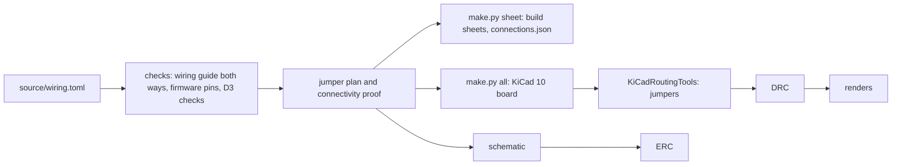

# Bench breadboard map (r0)

The bench station's sensor suite on three 830-point breadboards, wired to the TX board
(NUCLEO-WL55JC1, board A). It is a KiCad 10 model of the breadboard build, the first step of
[`docs/hardware/bench-station-wiring.md`](../../docs/hardware/bench-station-wiring.md). That guide is the
electrical source of truth for the signals. The model describes the **step 1 v2 target** of the
build-progression record
([`docs/superpowers/specs/2026-10-29-build-progression-decisions.md`](../../docs/superpowers/specs/2026-10-29-build-progression-decisions.md),
changes A and B and the second QT cable, sections 4.4-4.6; revision `bench-bb-r0.3` in `source/wiring.toml`): every battery, charge and load
current runs on leads between lever connectors, JST PH sockets and screw terminals, never through a
breadboard contact (record P1); the breadboards carry only signals and sense taps; the NUCLEO's signals
land on its Arduino headers; the mode-B supply enters at CN6.4; the hub's sensors and the power monitors
are on two QT cables, both on the unswitched 3V3. Change C, the PA9 sensor switch, is not part of the
breadboard build (record 4.6 dated note, 2026-11-02): the bench has no sensor power switch. The power design is
[`docs/superpowers/specs/2026-10-29-power-telemetry-design.md`](../../docs/superpowers/specs/2026-10-29-power-telemetry-design.md)
sections 11.1 and 11.2, as the record amends them.

**To build, open [`build-sheet.md`](build-sheet.md)** and the renders. That is the current revision,
`bench-bb-r0.3`. The bench is built one change at a time from the r0 bench, so change A builds from
[`revisions/bench-bb-r0.1/build-sheet.md`](revisions/bench-bb-r0.1/build-sheet.md), change B from
[`revisions/bench-bb-r0.2/build-sheet.md`](revisions/bench-bb-r0.2/build-sheet.md) and the second QT cable
(QTM) from `build-sheet.md` (record 4.4-4.6). Each sheet's "Changes from the previous revision" section says what
comes out and what goes in, starting from the sheet before. Before you place a wire, tick the wiring
guide's section 6 checklist against UM2592. Then do the build sheet's bench checks before you connect
power, its pre-run checklist (C1-C23), and its power checks 1-10 in order.

| Render | Shows |
|---|---|
| [`renders/board-a.png`](renders/board-a.png) | board A, signals: both RJ11 breakouts with the meter pull-ups and filters at the jack end, the STEMMA QT cable to the hub (QT) and the one to the power monitors (QTM), both unswitched |
| [`renders/board-b.png`](renders/board-b.png) | board B: the bq24074 charger's header with its ISET network (R_ISER, C_ISET, R_IPD) and the 20 kΩ/10 kΩ input divider (R4-R6), the INA228, the fuel gauge, the regulator, the BATTERY POWER shunt; off the breadboard, the pack, the 100 Ω load, the NTC, the wall adapter and the four WAGO joints with their leads |
| [`renders/overview.png`](renders/overview.png) | the boards and the jumpers to the NUCLEO headers (not to scale) |
| [`renders/3d-top.png`](renders/3d-top.png), [`renders/3d-angle.png`](renders/3d-angle.png) | KiCad 10's 3D view |
| [`renders/schematic.pdf`](renders/schematic.pdf) | the wiring schematic, drawn as circuits with KiCad's own symbols. The meter's reed switches and vane resistors are drawn across the RJ11 breakout pins their cables reach |

The build sheet prints the `wiring.toml` git blob the renders were drawn from: when it differs from the
model's, the sheet says the renders lag the model, and the sheet rules.

The third breadboard stays spare (for the W25Q128 flash later).



## What each check proves

| Check | Proves |
|---|---|
| `check_guide` | each NUCLEO pin the map uses is in the wiring guide's section 2 table, on a header the guide lists |
| `check_guide_reverse` | the other way round (record D3 check 7): each guide row that names a station pin has a model net with that `mcu` pin, unless the row says "protoboard only" or "carrier only" |
| `check_firmware` | each pin matches the constants in the node's `App/board_inputs.c` and `App/i2c_bus.lit.md`, in the bench link's `App/benchlink.c`, and in i2cscan's `App/i2cscan.c` and `App/oled.c` (the OLED's five SPI and control pins); PA9 (POWER_PIN) is not checked, as the model has no SENS_EN (change C is not built); an ADC input (vane, ISET, VIN_SENSE) uses its pin's ADC1 channel (D3 check 8) |
| `prove` | the strips, the jumpers, the leads, the joints, the ties inside parts and the NUCLEO's own ties join every net, with no short and no stray pin |
| `checks.check_force_off_breadboard` | D3 check 1: no force lead or force-net member in a breadboard hole, except the P1 regulator chain, tagged member by member |
| `checks.check_sense_landings` | D3 check 2: no sense lead shares a clamp position with a force lead; each lands on its declared joint |
| `checks.check_single_tie` | D3 check 3: one conductor (L_TIE) joins the power and logic grounds; no logic-supply current on the board-B ground rail |
| `checks.check_gauge_upstream` | D3 check 4: the gauge's sense lead is on CELL_POS, upstream of the shunt |
| `checks.check_shunt_only` | D3 check 5: nothing but the shunt joins INA VIN+ and VIN- |
| `checks.check_test_point_strips` | D3 check 6: each breakout test-point pin is alone in its strip |
| `checks.check_meter_at_jack` | record M7's placement rule: each meter pull-up and filter (R1 and C_CUPS, R2 and C_RAIN, R3) has its line-side lead in its BOB-14021 pin's own strip, so no jumper sits between the jack pin and its pull-up, out of the counter link probe's sight |
| `checks.check_iset` | D3 check 8's ISET constants (record step 1 exit 7): `POWER_R_ISET_OHM` in `power_config.h` equals the charger's `iset_ohms` (R9, 1 kOhm), `POWER_ISET_GAIN_PPM` equals R_IPD / (R_ISER + R_IPD) in ppm (990099), and `tools/benchlink_log.py`'s `R_ISET_OHM` and `ISET_GAIN` defaults carry the same two values |
| `checks.check_divider` | D3 check 9: the firmware's divider ratio equals the model's R4-R6 |
| `checks.check_lead_lengths`, `checks.check_lead_geometry` | record H7's lead lengths; each lead at least as long as its drawn span |
| KiCad DRC | every jumper is routed between its two planned holes, clear of every other hole: 0 errors, 0 unconnected |
| KiCad ERC | the schematic has 0 errors; a test checks that its nets equal the model's |

Every check but DRC and ERC runs without KiCad, in both regeneration tiers.

## Regenerate

Two tiers (record D4), both stamped with the `wiring.toml` git blob hash:

```sh
.venv/bin/python hardware/bench-breadboard-r0/source/make.py sheet    # no KiCad: every model commit
tools/fetch-router.sh                                                  # once: KiCadRoutingTools v0.23.1, pinned (macOS arm64 only)
tools/fetch-cad.sh                                                     # once: the makers' 3D models of board B's parts, pinned
.venv/bin/python hardware/bench-breadboard-r0/source/make.py all      # KiCad: step exits and net changes
.venv/bin/python -m unittest tests.test_breadboard tests.test_breadboard_checks
```

- **`make.py sheet`** loads the model, checks it (the table above), plans and proves the jumpers, and
  writes `build-sheet.md` and `connections.json`, and the same two files for each frozen earlier revision
  into `revisions/<revision>/` (below). Run it on every commit that changes `wiring.toml`;
  every bench rewire is one commit with the model and the regenerated sheet.
- **`make.py all`** does the same, then draws: the KiCad board, routing, DRC, the schematic (ERC), the 3D
  view and the renders. Run it at every step exit and whenever nets change. `layout.json` records the
  model hash it drew (`model_hash`); the build sheet prints it beside the model's own hash, so a lagging
  render is visible.
- **`connections.json`** (generated, beside each sheet) lists every jumper, link and lead by net and
  ends, with its stable id where it has one, and keeps the baseline the sheet compared against. The
  sheet's **"Changes from the previous revision"** section lists what to remove, then what to add, by net
  and endpoints, never by W-number (W-numbers change on every regeneration).
- **Revisions and tags.** The revisions are `bench-bb-r0.1` (change A), `bench-bb-r0.2` (change B, the
  meter pin remap) and `bench-bb-r0.3` (the second QT cable; *2026-11-02:* redefined in place before it was
  built, without change C, the PA9 sensor switch, which is not part of the breadboard build). `source/wiring.toml` is the
  current one (r0.3). The earlier ones are **frozen models**, `source/revisions/bench-bb-r0.1.toml` and
  `bench-bb-r0.2.toml` (`make.py`'s `HISTORY`), each the whole bench as its change leaves it, with their
  regenerated sheets in `revisions/<revision>/` (record 6.1 dated note). Each sheet's baseline is the
  revision before it, regenerated from its model: r0.1's is `source/baseline-2026-10-29.json`, the r0
  sheet the bench was built from (parsed once from its committed jumper table). A frozen model gets the
  connectivity proof and the D3 checks; the wiring guide and the firmware describe the current revision,
  so only `wiring.toml` is held to them. A frozen model has no renders. `tools/preflight.py` checks a
  preflight block against the frozen model and sheet its `revision` names. A model change that applies to
  the bench at every revision (a part moved before anything is built) goes into all three models.
  To start a new revision: copy `wiring.toml` to `source/revisions/<its revision>.toml`, add it to
  `HISTORY`, then bump `wiring.toml`'s `revision`. Clint makes the matching git tags. Step 1b's
  INA228 rails are not in the model yet.

KiCad 10 comes from `KICAD_APP` (default: the 10.0.6 disk image on the bench Mac,
`tools/kicad_env.py`). The router's prebuilt binary is for macOS arm64, so `tools/fetch-router.sh`
skips on other hosts. Without KiCad or the router, `make.py all` stops and says so, and the KiCad tests
skip and say what is missing; `make.py sheet` and the model tests still run.
Without `vendor/cad` (`tools/fetch-cad.sh`), the 3D view draws plain boxes for the breakouts and the pack
instead of the makers' models; the committed renders use the makers' models.
Two builds give identical files (`test_generation_is_deterministic`).

## How the model works

- A jumper is one wire between two free holes. The model picks the holes, never one a part uses,
  and one wire a hole. In KiCad each jumper is its own two-pad net (`W1`, `W2`, ...), and every other
  hole is a pad with no net, so the router only finds the path. The model proves the wiring itself.
  A `[[link]]` is a jumper the wiring guide requires, with a stable id (`LK_REG_SHUNT`, `LK_3V3_CN6_4`,
  `LK_QT_GND_CN6_6`); the build sheet names it beside its W-number.
- Jumpers are drawn as copper traces: KiCad has no flying wires. The two copper layers are only
  drawing layers, as wires cross freely.
- The 3D view (`bench-breadboard-3d.kicad_pcb`, a copy of the routed board with 3D models only)
  uses KiCad's own models where its library has one (resistors, capacitors, pin headers, the JST
  plug, the NUCLEO's headers). KiCad has no breadboard, so `source/models.py` writes one: an
  830-point body 8.5 mm tall with its holes and rail stripes. Each jumper is a wire 2 mm above it
  along its routed path, with legs into its two holes. Breakout boards, the RJ11 jacks and the
  battery are boxes at their real outlines, from the parts' design files.
- Each breakout's header sits on row a, and its board overhangs outward, over the rails and off the
  edge. No jumper or part uses a hole under a breakout (`test_no_jumper_lands_under_a_breakout`).
- A **joint** (`[[joint]]`) is a WAGO 222 lever connector off the breadboard, beside board B: one node,
  its positions numbered from 1 (CELL+, BATT, OUT and STAR; record P3-P6). The build sheet lists what
  lands in each position (section 4).
- A **lead** (`[[lead]]`) is a wire off the breadboard with a role (force, sense, signal or supply), a
  gauge, a kind (pigtail, solid, cable or dupont) and a length (record D2). A force lead ends in a lever
  clamp, a screw terminal or a JST socket; only sense leads, the OLED's supply pair and the P1 regulator
  chain end in a breadboard hole or on a NUCLEO pin. The proof joins its two ends; the build sheet lists
  it apart (section 3); the schematic draws it as a heavy line and notes it; the renders and the 3D view
  draw it straight between its ends.
- An off-board part (the pack PACK, the 100 Ω load RLOAD, the thermistor NTC, the wall adapter ADAPTER)
  is placed by `place_mm` beside board B and has terminals only: leads join it, no strip does. A
  breakout's sockets and screw terminals (the charger's BATT and SYSOUT, the gauge's BAT1, the INA228's
  X1) are terminals too, tied inside the part to the header pins they share, which stay zero-current
  test points (record P2). A part pin left open (a breakout pin in no net) owns its strip.
- Mode A, the daily mode, is drawn: the BATTERY POWER shunt is open and the 100 Ω load is fitted. The
  build sheet gives the steps to mode B and back, ground untouched (section 7).

## Decisions

- **PA9 is unconnected** on the breadboard build (*2026-11-02*, record 4.6 dated note): change C, the PA9
  sensor load switch, is not built.
  The firmware may still drive PA9: harmless here. `bench-bb-r0.3` was redefined in place (it was never
  built); r0.1 and r0.2 stay frozen. The second cable QTM still takes the battery INA228 (0x40) and the
  MAX17048 (0x36) from the same unswitched 3V3 as the hub's cable QT: redundant now, but harmless, and it
  carries the step 1b INA228 daisy chain (record 4.6).
- **PGOOD and CHG** jumper from the charger's header on board B to the NUCLEO's Arduino header:
  CHG to CN9.7 (D6, PB10), PGOOD to CN9.6 (D5, PB8); their morpho aliases CN10.25 and CN10.27 stay
  empty (record N1, N3).
- **The regulator output feeds the NUCLEO's 3V3 at CN6.4** through the SHUNT, L_REG_3V3 and the QT.V+ strip
  (A:c41), where L_REG_3V3 and LK_3V3_CN6_4 both land: the board-A 3V3 net, but never through
  the A:L+ rail (no planner jumper and no rail contact in the chain; the
  P1 regulator chain; same 3V3 net as CN7.16); there is no link to CN7.16. Each member of
  the chain (L_REG_VIN, L_TIE, L_NUC_RET, LK_REG_SHUNT, SHUNT, L_REG_3V3, LK_3V3_CN6_4) carries
  `exception = "P1 regulator"` in `wiring.toml`.
- **The bench OLED** takes its supply on its own pair straight from the NUCLEO: VCC from CN7.16, GND to
  CN10.20 (L_OLED_VCC, L_OLED_GND; record N3), never through a breadboard rail. Its VCC lead is unplugged
  in mode B.
- **RJ11** is the weather meter's own cable connector (SparkFun SEN-15901). The BOB-14021 breakouts are
  its sockets: their PRT-00132 jack and header pins are soldered on as module preparation (record H5,
  7.1 Q6), then each conductor is checked (build sheet, bench checks). The v1 sensor ports are RJ11 per
  the ports spec; no RJ45 in v1 (H6).
- **The meter's reed switches and vane resistors** are inside the SEN-15901. The meter circuits on
  board A add only R1–R3, C_CUPS and C_RAIN, at the jack end: each one's line-side lead in its BOB-14021
  pin's own strip (record M7, `checks.check_meter_at_jack`).
- **ISET and the input divider** go to the ARDUINO header CN8 (solid 22 AWG): ISET through R_ISER
  (10 kΩ 1 % at the charger) to the PB1 node with C_ISET (100 nF) and R_IPD (1 MΩ) to logic ground
  (record M2), on CN8.1 (A0, ADC1_IN5); VBUS through R4 + R5 (20 kΩ) over R6 (10 kΩ) to PA10 (CN8.3,
  A2, ADC1_IN6). Each divider resistor is measured; the readings go into `wiring.toml` first, as R4-R6's
  `measured_ohms`, then the ratio into `POWER_VIN_DIVIDER_PPM` (power check 4; record M2). Only R4's microamp tap uses the VBUS header pin's strip.
- **The battery path is leads and joints**, never strips and never solder (record P3): the pack's own
  plug into the pack-mating half of a cut #1131, red to CELL+ and black to STAR; solid 22 AWG from CELL+
  to the INA228's X1.3 (VIN+) screw terminal and from X1.1 (VIN-) to BATT; the board-mating half of the
  same #1131 from BATT and STAR into the charger's BATT socket. The pack never plugs into the charger's
  BATT socket while the INA228 meters the battery. OUT leaves by the charger's SYSOUT socket into the OUT
  joint, which takes the 100 Ω load (its return to STAR), the INA228's VBUS sense lead and the
  regulator's input (record P6). The spans keep record P8's limits (power check 7, the build sheet's
  power-path table). The charger input is a floating wall adapter on the breakout's own USB-C (record D2).
- **Ground** meets at the STAR joint at pack negative; L_TIE, from STAR into the regulator GND strip, is
  the only conductor between the power and logic grounds (record P4). The NUCLEO's mode-B return has its
  own lead from CN6.7 (record N4).
- **The gauge senses CELL+**, the cell side of the shunt: the board-mating half of a cut #1131 in its
  BAT1 socket, red lead to CELL+ position 3, black lead insulated and folded back; its ground comes over
  STEMMA QT (record P4, P5).
- **The INA228's VBUS** comes over its own sense lead L_VBUS from X1.2 to the OUT joint (`load_mv`);
  SJ1, its back VBUS-to-VIN+ jumper, stays open (pre-run checklist row C1; power checks 1 and 9).
- **THERM** carries the 10 kΩ NTC (#372, B = 3950), off the breadboard and taped to the pack, on its own
  leads, after the breakout's fixed 10 kΩ TS resistor is removed (its THERM jumper, R10, cut; power
  check 5). Its return goes to the board-B logic ground rail, not STAR (record D2). It sets a charge
  window of about +3.5 to +47 °C.
- **TMR** is tied to GND on #4755 (Adafruit's schematic): the safety timers are disabled, so no RTMR
  (record P9). If a board in hand has it floating, record it and start the charge at 3.85 V or more
  (power check 10).
- **CHG and PGOOD** keep the internal pull-ups while their high level stays at or below VDD + 0.3 V
  (record N4; 2.9 V measured on 2026-10-28/29). Their LEDs' anodes are on OUT (schematic), so a
  released pin sits near OUT - Vf; power check 6 re-measures it at each step.
- **R_ISET**: the closed 1A jumper selects R9 = 1 kΩ on the schematic (about 0.89 A);
  `power_config.h` holds `POWER_R_ISET_OHM 1000`, confirmed by power check 2.

## History

**2026-10-28/29, as run (record D1, a deviation from the sheet of the day).** The bench ran with the
pack plugged straight into the charger's BATT socket, the LIPO node, so the INA228 shunt was bypassed:
`ishunt` and the charge counters of those runs are invalid. The gauge sensed the LIPO column, and the
INA228's VBUS was on OUT. The runs are kept as evidence, with `ishunt` and the charge counters marked
invalid by time window; they are not repeated (step 1's exit needs new runs). The sheet of that day is
recorded as `source/baseline-2026-10-29.json`, the first baseline of the build sheet's changes section;
these deviations are recorded here, not in that baseline.

## Parts still to get

The step 1 list is the build-progression record's section 5, "Buy now (step 1)". Against it:

- no meter is bought: the Fluke 87V is owned (record 7.1 Q2);
- no screw-terminal RJ11 breakout: the BOB-14021s are used directly, prepared as above (record 7.1 Q6);
- no RTMR: TMR is tied to GND (record P9);
- no soldered pigtails: the #1131 halves go into the WAGO joints stripped and twisted (record P7).

You do not need a second BOB-14021. One product is a panel of two boards (SparkFun's design files):
one for the wind cable, one for the rain cable.
