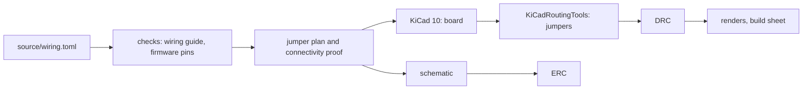

# Bench breadboard map (r0)

The bench station's sensor suite on three 830-point breadboards, wired to the TX board
(NUCLEO-WL55JC1, board A). It is a KiCad 10 model of the breadboard build, the first step of
[`docs/hardware/bench-station-wiring.md`](../../docs/hardware/bench-station-wiring.md). That guide is the
electrical source of truth. This package adds no circuit.

**To build, open [`build-sheet.md`](build-sheet.md)** and the renders:

| Render | Shows |
|---|---|
| [`renders/board-a.png`](renders/board-a.png) | board A, signals: both RJ11 breakouts, the cups, vane and rain circuits, the STEMMA QT cable to the hub |
| [`renders/board-b.png`](renders/board-b.png) | board B, power: charger, INA228, fuel gauge, regulator, battery, test load, the BATTERY POWER shunt |
| [`renders/overview.png`](renders/overview.png) | both boards and the jumpers to the NUCLEO headers (not to scale) |
| [`renders/3d-top.png`](renders/3d-top.png), [`renders/3d-angle.png`](renders/3d-angle.png) | KiCad 10's 3D view |
| [`renders/schematic.pdf`](renders/schematic.pdf) | the wiring schematic |

The third breadboard stays spare (for the W25Q128 flash later).



## What each check proves

| Check | Proves |
|---|---|
| `check_guide` | each NUCLEO pin the map uses is in the wiring guide's section 2 table, on a header the guide lists |
| `check_firmware` | each pin matches the constants in `App/board_inputs.c` and `App/i2c_bus.lit.md` |
| `prove` | the strips, the 38 jumpers and the NUCLEO's own ties join every net, with no short and no stray pin |
| KiCad DRC | every jumper is routed between its two planned holes, clear of every other hole: 0 errors, 0 unconnected |
| KiCad ERC | the schematic has 0 errors; a test checks that its nets equal the model's |

## Regenerate

```sh
tools/fetch-router.sh                                       # once: KiCadRoutingTools v0.23.1, pinned
.venv/bin/python hardware/bench-breadboard-r0/source/make.py all
.venv/bin/python -m unittest tests.test_breadboard
```

KiCad 10 comes from `KICAD_APP` (default: the 10.0.6 disk image on the bench Mac). Without KiCad or
the router, the KiCad tests skip and say what is missing. Two builds give identical files.

## How the model works

- A jumper is one wire between two free holes. The model picks the holes, never one a part uses,
  and one wire a hole. In KiCad each jumper is its own two-pad net (`W1`…`W38`), and every other
  hole is a pad with no net, so the router only finds the path. The model proves the wiring itself.
- Jumpers are drawn as copper traces: KiCad has no flying wires. The two copper layers are only
  drawing layers, as wires cross freely.
- The 3D view uses KiCad's own models where its library has one (resistors, capacitors, pin
  headers, the JST plug). Breakout boards, the RJ11 jack and the battery are boxes at their real
  outlines, from the parts' design files.
- Mode A, the daily mode, is drawn: the BATTERY POWER shunt is open and the 100 Ω load is fitted.

## Decisions

- **PA9** (sensor power switch) is not on the breadboard. The wiring guide and `App/i2c_bus.lit.md`
  use it on the protoboard only.
- **PGOOD and CHG** jumper from board B straight to the NUCLEO.
- **The regulator output** goes through the shunt to the NUCLEO's 3V3 pin CN7.16, as the wiring
  guide's section 5 says (a `[[link]]` in `wiring.toml`).
- **RJ11** is the weather meter's own cable connector (SparkFun SEN-15901). The BOB-14021 breakouts
  are its sockets. Your RJ45 module cables are a later step (`docs/module-protocol.md`).

## Parts still to get

Not ordered:

- three 10 kΩ resistors, two 100 nF capacitors, one 100 Ω ½ W resistor;
- jumper wires (male-male for the boards, male-female for the NUCLEO's morpho pins);
- a STEMMA QT to male header cable;
- a JST PH 2-pin pigtail for the battery.

You do not need a second BOB-14021. One product is a panel of two boards (SparkFun's design files).
