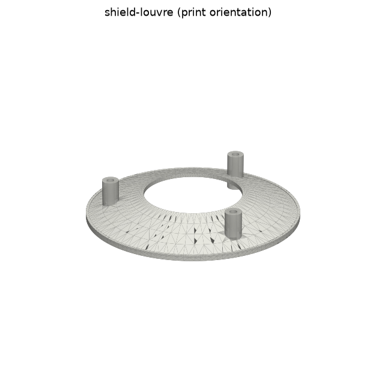
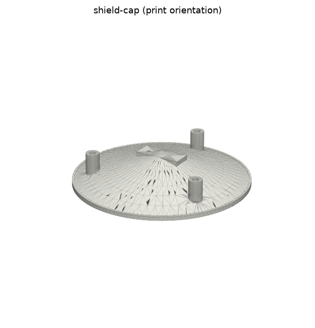
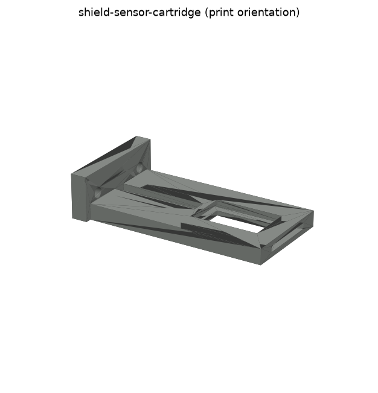
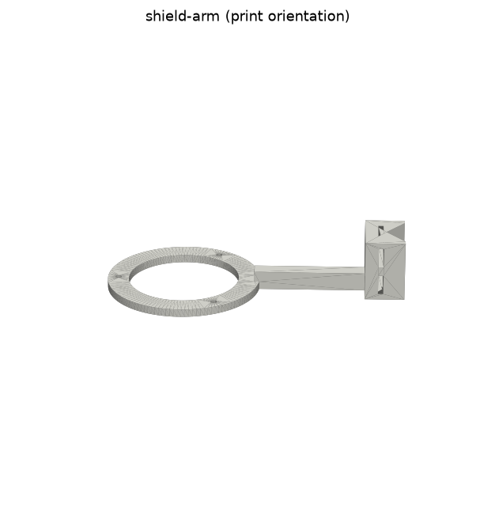
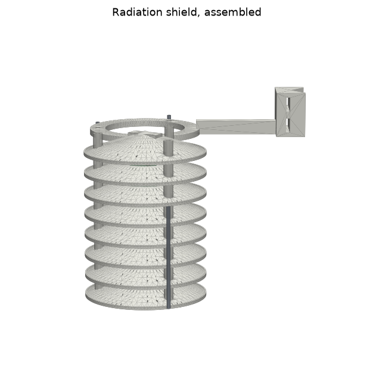
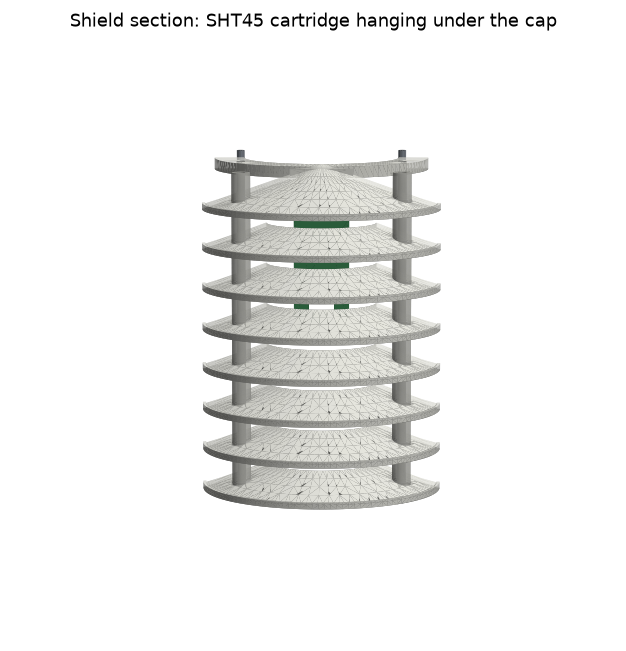
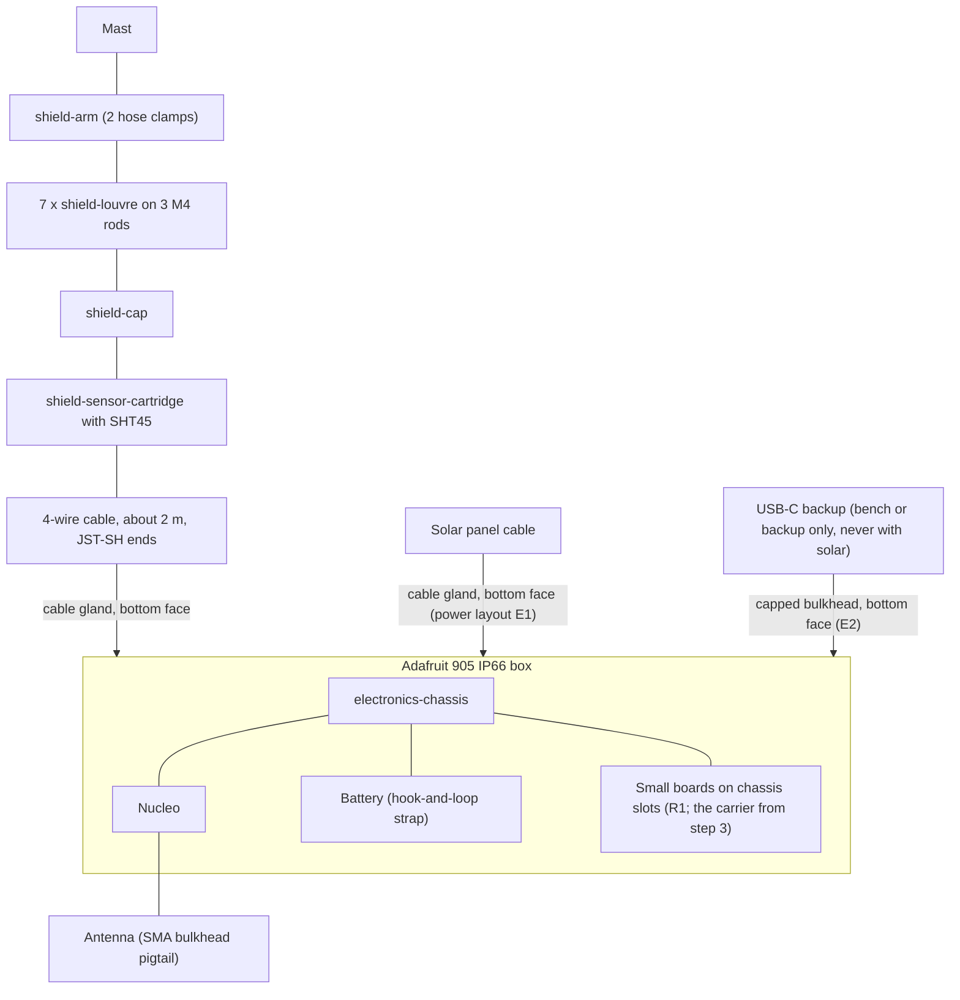

# Proof-of-concept enclosure parts R1

> **Parked 2026-11-02.** The enclosure is step 4. It is not maintained until step 1 (the breadboard prototype on its printed base plate) is done: do not build from it or update it to match step 1 changes.

These are printed parts for the proof-of-concept station built from off-the-shelf parts (2026-10-14). The electronics live in a **bought** IP66 box (Adafruit 905). Everything else is printed:

- a radiation shield for the SHT45, with a replaceable sensor cartridge
- an arm that clamps the shield to the mast
- a chassis that drops into the box and holds the Nucleo, the battery and the small boards (R1 geometry; it is redrawn once, for the step 3 carrier: see "Power layout requirements").

These parts are not the qualified housing that the product requirements document (PRD) describes. Nobody has done the spray, freeze or UV tests for them (PRD test H08). The R0 package (`../chicago-test-hardware-r0/`) covers indoor bench fixtures only.

| Part | Qty | Preview |
|---|---:|---|
| `shield-louvre` | 7 |  |
| `shield-cap` | 1 |  |
| `shield-sensor-cartridge` | 1 |  |
| `shield-arm` | 1 |  |
| `electronics-chassis` | 1 |  |
| `nucleo-rail-coupon` | 1 (print first) |  |

Assembled shield:  Section: 

`parts/` holds the STEP files (for editing) and the STL files (for the slicer). `validation/parts.json` holds the sizes and volumes.



## Printing

- **Material:** print the shield parts in **white ASA**, or in white PETG for a first try. White reflects sunlight, so the sensor reads the air temperature and not plastic that the sun heats. ASA survives UV outdoors. PETG turns yellow and brittle over a season. The chassis can be PETG or PLA of any colour, because it is inside the box.
- **Orientation:** as exported. Every part prints flat with no supports. The shield plates print rim down, so each layer is smaller than the layer below it.
- **Settings:** 0.2 mm layers, 3 perimeters, 20 % infill (40 % for the arm).
- **Bed size:** the arm is 215 × 161 mm. Every other part is 160 mm or smaller.
- **Print the rail coupon first** (about 15 minutes). Slide the Nucleo into it. The coupon must grip the board edges without bending the board.

## Hardware to buy

| Item | Qty | For |
|---|---:|---|
| M4 stainless threaded rod, 250 mm | 3 | Shield stack (cut to length after assembly) |
| M4 stainless nuts + washers | 6 + 6 | Clamp the stack: one nut under the bottom louvre, one above the arm |
| M3 brass heat-set inserts (M3 × 5.7) | 2 | Cap boss, for the cartridge |
| M3 × 8 stainless screws | 2 | Cartridge to cap |
| Stainless hose clamps sized for your mast | 2 | Arm to mast |
| Hook-and-loop strap, 20 mm | 1 | Battery |
| M3 nylon screws/nuts or small zip ties | ~16 | Small boards on the chassis slots |
| SMA male-to-female bulkhead pigtail, about 15 cm | 1 | Antenna through the box wall (the Nucleo antenna does not fit inside a 70 mm-tall box) |
| PG-7 and PG-9 cable glands (Adafruit 762, 761) | 2 + 2 | Box entries, all on the **bottom** face |
| 4-wire cable, about 2 m, plus JST-SH (STEMMA QT) ends | 1 | SHT45 cartridge to the box (the 4397 lead is only 150 mm) |

## Measure when the parts arrive

The parameters marked `MEASURE` at the top of `source/build.py` are estimates. `BATTERY` comes from the product page and is not marked, but check it too. Check them and rebuild:

| Parameter | Now | Check against |
|---|---|---|
| `CHASSIS` | 160 × 110 mm | Inside floor of the Adafruit 905 box, and its boss positions (the corner slots allow ±4 mm) |
| `NUCLEO_UNDER` | 14 mm | Height of the pins and parts on the Nucleo's underside |
| `SENSOR_PCB` | 25.4 × 17.8 × 1.6 mm | Adafruit 6174 board |
| `MAST_D` | 33.4 mm (1 in pipe) | Your mast |
| `BATTERY` | 69 × 54 × 18 mm | Adafruit 353 pack (from its product page) |

## Rebuild

```sh
uv venv .venv-cad --python 3.12 && uv pip install --python .venv-cad/bin/python cadquery==2.7.0 matplotlib numpy-stl
.venv-cad/bin/python hardware/poc-enclosure-r1/source/build.py    # STEP, STL, validation/parts.json
.venv-cad/bin/python hardware/poc-enclosure-r1/source/render.py   # docs/*.png
```

The build checks that each part is one valid solid.

## Design notes

- **Shield:** 7 louvres, 130 mm in diameter, at a 22 mm pitch. The air gaps are about 20 mm.
  - The louvres slope down 12 mm towards the rim, so rain runs off. Each louvre has a drip lip.
  - The central 60 mm openings let air rise past the sensor. The cap is solid.
  - The plates stack on their own posts, on three M4 rods, so no glue is needed.
- **Sensor cartridge:** it hangs about 40–60 mm below the cap. It holds the SHT45 board edge-on in an open window, so air reaches both faces. Two screws release it for replacement (PRD §8).
- **Chassis:** it holds the Nucleo by its edges. ST's drawing shows no mounting holes. The morpho pins sit 3.5 mm in from each edge, so the rail lip grips only 1.5 mm of each edge. Small boards fix to slots, not to guessed hole patterns.

## Power layout requirements

**What goes in the box (build-progression record H9).** No breadboard, Dupont lead, lever connector or
bench module goes into this enclosure: not the step 1 breadboards, not the step 2 shield and module
board, not the step 1b or 2c power boards. The first electronics in the box are the carrier PCB under
the NUCLEO (step 3), first used in the field at step 4. The record's build order is
1 → 2 (H01) → 1b → 2c → 3 → 4 → 5 (decided 2026-10-30, record section 7.1 Q8;
[`2026-10-29-build-progression-decisions.md`](../../docs/superpowers/specs/2026-10-29-build-progression-decisions.md)).

**The work now** is only:

1. print `nucleo-rail-coupon` and check it on a real NUCLEO-WL55JC1 ("Printing");
2. confirm the `MEASURE` parameters `CHASSIS` (160 × 110 mm) and `NUCLEO_UNDER` ("Measure when the
   parts arrive").

**The chassis is redrawn once, for the carrier outline** (step 3). OQ-14 of the sensor-module-ports
spec is decided (2026-10-30, record 7.1 Q7): the v1 base board is a carrier under the NUCLEO, mated to
the morpho CN7/CN10 underside pins through two 2 × 19 female sockets (record N7, S4). The carrier
stays 1S3P (7.1 Q3). Its layout waits for the measured underside pin length and part clearance, the
morpho grid and an outline that fits the redrawn chassis (record S4), so `NUCLEO_UNDER` feeds both.
*Dated note (2026-10-30, record 7.1 N7):* the pin-length and clearance condition is satisfied by a fit
test: a cut-down standard 2.54 mm female header took the morpho pins fully seated, with no underside
part touching. The layout now waits only for the morpho grid and the chassis outline. The fit test
gave no height figure, so `NUCLEO_UNDER` (14 mm) is still to be confirmed.

The official power design (spec [`2026-10-29-power-telemetry-design.md`](../../docs/superpowers/specs/2026-10-29-power-telemetry-design.md),
sections 2, 3 and 11) needs room and entries this R1 geometry does not have yet. These are the
requirements for that redraw. **The geometry is not changed here**: it needs a CadQuery session (the
`.venv-cad` of "Rebuild"), new STEP/STL files, renders and `validation/parts.json` (spec section 16).

The pack is the 1S3P Li-ion pack the cradle already holds (`BATTERY`, Adafruit 353: three 2,200 mAh cells
in parallel, 6,600 mAh, 3.0-4.2 V, 3.7 V nominal). It stays 1S3P in every phase (record 7.1 Q3).

The ids are E1-E10 (enclosure), so they do not read as the record's P1-P10 decisions.

| # | Requirement | Why | Step |
|---|---|---|---|
| E1 | **Solar entry:** one cable gland on the bottom face for the panel's two-core cable (a PG-7 of "Hardware to buy" fits a 3-6.5 mm cable), with a strain relief inside, reaching the carrier's cold-rated solar connector (chosen at the carrier schematic, record H6) | the panel feeds the carrier's charger input (the BQ25798's VAC1, behind the solar fuse and the solar INA228, record P10) | 3, 4 |
| E2 | **USB-C backup entry:** a sealed, capped USB-C bulkhead (or a gland for a stored lead) on the bottom face, labelled "bench or backup only, never with solar" | USB-C is for bench work and occasional backup charging only, never connected together with solar (spec section 1). On the carrier it reaches the carrier's USB-C receptacle (record H6), then the USB-C INA228 and VAC2 (record P10) | 3, 4 |
| E3 | **Entry count:** the bottom-face entries hold the SHT45 cable, the solar cable and the USB-C entry, plus the wind and rain cables; check that the 2 + 2 glands of "Hardware to buy" still cover them and add one if not. The meter cables keep their RJ11 plugs and are never cut (record H5): their entry must pass the plug or close around the cable (sensor-module-ports spec section 6.8, the sealing Clint chooses) | the glands were sized before the power and meter entries | 4 |
| E4 | **The pack next to the carrier's battery connector:** the cradle sits so the pack lead into the carrier's pack connector (XT60 from step 3, record H6) stays as short as the bench's; the battery path itself is copper on the carrier (pack fuse, BAT shunt, BQ25798 BAT) | the carrier's step 3 bring-up test holds the battery connector, fuse, shunt and copper at ≤ 30 mΩ at 1 A (record step 3 exit); a long pack lead in the box adds resistance outside that test | 3, 4 |
| E5 | **Gauge and shunt sensing stay on the carrier:** no sense lead runs through the chassis | on the carrier sense runs on separate Kelvin traces from the shunts' inner pads, force on pours (record step 3), so the chassis carries none of the bench's sense leads | 3 |
| E6 | **Carrier outline (replaces "slots for four INA228s"):** a mounting area for the carrier PCB with the NUCLEO on its morpho sockets; the four INA228s (battery 0x40, load 0x41, solar 0x45, USB-C 0x48) are on the carrier, not separate boards. The outline comes from the carrier layout, after the underside measurement | the four-rail goal (battery signed, solar, USB-C, load; spec sections 3 and 9.2) is met in copper on the carrier (record P10, S4), so the chassis needs the carrier's outline and fixings, not four module slots | 3 |
| E7 | **Source leads:** the solar and USB-C leads end at the carrier's own connectors (E1, E2), with room for the about 3 A solar fuse the carrier schematic sizes | the bench's step 1b adapters (the #369 barrel plug, the #368 jack adapter, the inline USB-C pair) and the bq24074's D2/D4 join never go into the box (H9); on the carrier the BQ25798 takes VAC1 and VAC2 (record P10) | 3, 4 |
| E8 | **The charger's heat away from the temperature sensors:** place the carrier so its charger end is away from the in-box SHTC3 reading and from the pack's wall, with an air gap | a warm charger would read as box temperature on the SHTC3 and warm the pack; the bench bq24074 is a linear charger (up to about 2.5-3 W from a panel into a low cell); the carrier's charger heat is checked at the carrier schematic, and the placement rule stays | 3, 4 |
| E9 | **No extra slots for bench modules:** the R1 slotted strip (eight 3.2 mm slots, `source/build.py:175-181`) is not extended for bench boards; the redraw sizes slots only for what the carrier does not hold | no bench module goes in the box (H9); the carrier holds the power boards' functions | 3 |
| E10 | **Test points reachable:** the carrier's bring-up test points stay reachable after assembly, so the step 3 checks can be repeated in the box | the record's step 3 numbers are re-checked at step 4 in the box (spec sections 11.1, 11.3) | 3, 4 |
