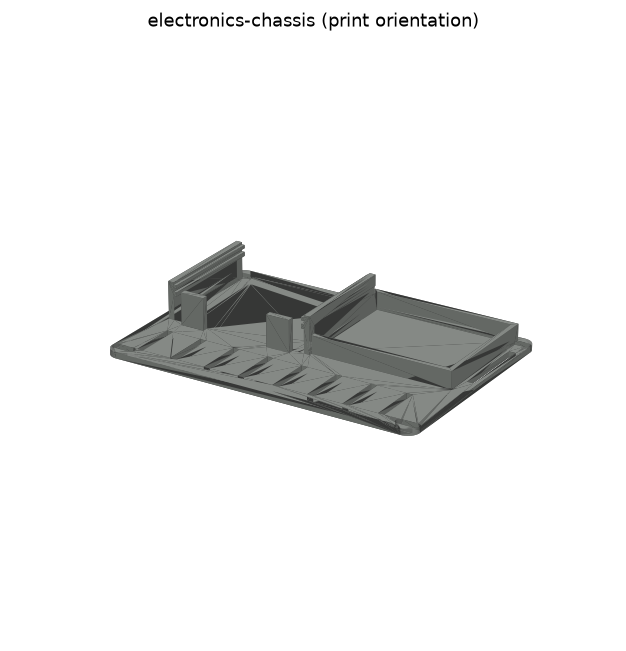
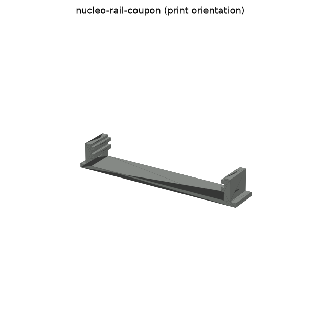

# Proof-of-concept enclosure parts R1

Printed parts for the off-the-shelf proof-of-concept station (2026-10-14). The electronics live in a
**bought** IP66 box (Adafruit 905). Everything else is printed:
- a radiation shield for the SHT45, with a replaceable sensor cartridge;
- an arm that clamps the shield to the mast;
- a chassis that drops into the box and holds the Nucleo, battery and small boards.

These are proof-of-concept parts, not the PRD's qualified housing: there's no spray, freeze or UV
testing (H08). The R0 package (`../chicago-test-hardware-r0/`) covers indoor bench fixtures only.

| Part | Qty | Preview |
|---|---:|---|
| `shield-louvre` | 7 |  |
| `shield-cap` | 1 |  |
| `shield-sensor-cartridge` | 1 |  |
| `shield-arm` | 1 |  |
| `electronics-chassis` | 1 |  |
| `nucleo-rail-coupon` | 1 (print first) |  |

Assembled shield:  Section: 

STEP (editable) and STL (slicer) files are in `parts/`. Sizes and volumes are in `validation/parts.json`.

## Printing

- **Material:** shield parts in **white ASA**, or white PETG for a first try. White reflects sunlight, so
  the sensor reads air temperature rather than plastic heated by the sun. ASA survives UV outdoors;
  PETG yellows and gets brittle over a season. The chassis can be any colour of PETG or PLA (it's
  indoors in the box).
- **Orientation:** as exported. Every part prints flat with no supports. Shield plates print rim
  down, so each layer is smaller than the one below it.
- **Settings:** 0.2 mm layers, 3 perimeters, 20 % infill (40 % for the arm).
- **Bed size:** the arm is 215 × 161 mm. Every other part is 160 mm or smaller.
- **Print the rail coupon first** (about 15 minutes) and slide the Nucleo into it. It should grip
  the board edges without bending the board.

## Hardware to buy

| Item | Qty | For |
|---|---:|---|
| M4 stainless threaded rod, 250 mm | 3 | Shield stack (cut to length after assembly) |
| M4 stainless nuts + washers | 6 + 6 | Clamp the stack: one nut under the bottom louvre, one above the arm |
| M3 brass heat-set inserts (M3 × 5.7) | 2 | Cap boss, for the cartridge |
| M3 × 8 stainless screws | 2 | Cartridge to cap |
| Stainless hose clamps sized for your mast | 2 | Arm to mast |
| Hook-and-loop strap, 20 mm | 1 | Battery |
| M3 nylon screws/nuts or small zip ties | ~16 | Small boards on the chassis slots |
| SMA male-to-female bulkhead pigtail, about 15 cm | 1 | Antenna through the box wall (the Nucleo antenna doesn't fit inside a 70 mm-tall box) |
| PG-7 and PG-9 cable glands (Adafruit 762, 761) | 2 + 2 | Box entries, all on the **bottom** face |
| 4-wire cable, about 2 m, plus JST-SH (STEMMA QT) ends | 1 | SHT45 cartridge to the box (the 4397 lead is only 150 mm) |

## Measure when the parts arrive

The parameters marked `MEASURE` at the top of `source/build.py` are estimates. Check them and rebuild:

| Parameter | Now | Check against |
|---|---|---|
| `CHASSIS` | 160 × 110 mm | Inside floor of the Adafruit 905 box, and its boss positions (the corner slots allow ±4 mm) |
| `NUCLEO_UNDER` | 14 mm | Height of the pins and parts on the Nucleo's underside |
| `SENSOR_PCB` | 25.4 × 17.8 × 1.6 mm | Adafruit 6174 board |
| `MAST_D` | 33.4 mm (1 in pipe) | Your mast |
| `BATTERY` | 69 × 54 × 18 mm | Adafruit 353 pack (from its product page) |

## Rebuild

```sh
uv venv .venv-cad --python 3.12 && uv pip install --python .venv-cad/bin/python cadquery==2.7.0 matplotlib numpy-stl
.venv-cad/bin/python hardware/poc-enclosure-r1/source/build.py    # STEP, STL, validation/parts.json
.venv-cad/bin/python hardware/poc-enclosure-r1/source/render.py   # docs/*.png
```

The build checks that each part is one valid solid.

## Design notes

- **Shield:** 7 louvres with a 130 mm diameter at a 22 mm pitch, giving about 20 mm air gaps.
  - The louvres slope down 12 mm towards the rim, so rain runs off, and each has a drip lip.
  - The central 60 mm openings let air rise past the sensor. The cap is solid.
  - The plates stack on their own posts, threaded on three M4 rods, so no glue is needed.
- **Sensor cartridge:** hangs about 40–60 mm below the cap. It holds the SHT45 board edge-on, in an
  open window, so air reaches both faces. Two screws release it for replacement (PRD §8).
- **Chassis:** holds the Nucleo by its edges. ST's drawing shows no mounting holes, and the rail lip
  grips only 1.5 mm of each edge because the morpho pins sit 3.5 mm in. Small boards fix to slots
  rather than guessed hole patterns.
