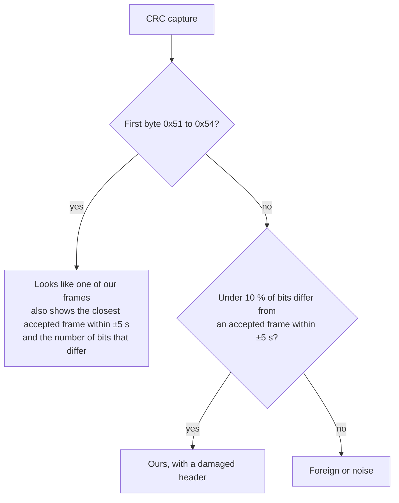
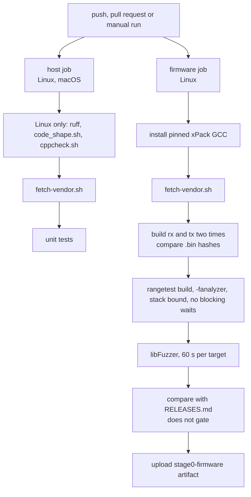

# Tools

Run the tools from the repository root with the project virtualenv (`.venv/bin/python`). Where a tool supports it, it finds a board by its ST-LINK serial number. The `/dev/cu.usbmodem*` names change between USB sockets and machines.

| File | Purpose | Usage | More |
|---|---|---|---|
| `fetch-vendor.sh` | Clones the pinned STM32CubeWL v1.6.0 and its submodules (HAL, CMSIS, BSP, SubGHz_Phy, Mbed TLS) into `vendor/`. A second run verifies the pinned commits. Firmware builds need it. 7 C-vs-Python crypto tests also need it. | `sh tools/fetch-vendor.sh` | `docs/CONTEXT-PACK.md` §5 |
| `status.py` | Prints the `/v1/status` JSON of the gateway. It does not show the API token. | `.venv/bin/python tools/status.py --directory run-office` (default `run-demo`) | `README.md` |
| `h01_report.py` | The scorer for the 24-hour delivery test (H01). It computes the verdict for a time window from a gateway database, opened read-only. With `--output`, it writes `report.json` and `report.md` to a new directory. | `.venv/bin/python tools/h01_report.py --db run-office/observations.sqlite3 --station station-01 --start 2026-10-15T00:00:00Z --hours 24 --output evidence/h01-2026-10-15` (`--db` defaults to `run-hw/observations.sqlite3`) | `docs/H01-checklist.md` |
| `rx_faults.py` | Lists the bad receptions that the RX board (the receiver) reported, from a gateway database opened read-only. These are `#rx crc` lines with the received bytes, and `#rx hdr` lines. It adds a summary. It puts each CRC capture in one of three classes (below). For a database whose tables are older than the gateway version, it names the remedy and does not print a traceback. | `.venv/bin/python tools/rx_faults.py --db run-hw/observations.sqlite3 [--since 2026-10-15T00:00:00Z] [--until 2026-10-16T00:00:00Z] [--limit 50] [--json]` | `docs/web-dashboard.md` |
| `power_cut_test.py` | Power-loss test of the flash state of the TX board (the transmitter). It starts `TEST-FLASH-STORM`, then cuts power (`--method power`, uhubctl) or pulses the reset pin NRST (`--method reset`). It checks each boot for a monotonic counter and epoch. `--check` does one cut to verify that the hub really removes the USB supply (VBUS). | `.venv/bin/python tools/power_cut_test.py --method reset --serial-number 003B00194142500E20353451 --cycles 200 --gateway-db run-office/observations.sqlite3 --output evidence/power-cut-<date>` | `docs/failure-modes.md` §6 (power events), §10 (power-removal test not done), `evidence/g7-reset-during-write-2026-10-13/` |
| `code_shape.sh` | Checks the shape of our C (`firmware/stage0-node/App`, `firmware/common`, `firmware/stage0.c`, `firmware/host`). Every function has a cyclomatic complexity of at most 10 and at most 60 lines (lizard). No code is copied (jscpd, 5+ lines or 40+ tokens). It also runs `tangle.py --check`, `wsmp_registry.py --check` and `loop_bounds.py`. It fails on any finding. CI runs it. | `.venv/bin/pip install -r requirements-dev.txt; tools/code_shape.sh` (needs Node.js for `npx`) | `docs/firmware-budget.md` |
| `tangle.py` | Literate sources: each `*.lit.md` under `firmware/` and `ws0/`, and `gateway.lit.md`, is the source of its generated files. For example, `firmware/stage0-node/App/node_store.lit.md` is the source of `node_store.c`. The generated file is committed. Never edit it by hand. The tool tangles the code out. `--check` verifies that every committed file matches (used in `code_shape.sh` and `tests/test_tangle.py`). `--weave` writes a standalone HTML page. `--lines` writes a `#line` build, only for a debugger. It needs only the Python standard library. | `python3 tools/tangle.py firmware/stage0-node/App/node_store.lit.md`; `python3 tools/tangle.py --weave /tmp/node_store.html firmware/stage0-node/App/node_store.lit.md` | the docstring in `tools/tangle.py` |
| `rangetest_log.py` | Logs the console of a `firmware/rangetest` board to CSV: both link directions, the settings and the spot marks. It reconnects after USB dropouts. | `.venv/bin/python tools/rangetest_log.py 0016001E4142500E20353451 evidence/<run>/rangetest.csv` | `firmware/rangetest/README.md` |
| `console.py` | Sends one console line (for example `STATUS` or `WIPE ERASE-ALL-NODE-STATE`) to a board found by its ST-LINK serial number and prints the replies. It refuses `PROVISION`, so a key never goes on a command line: use `ws0 provision-node`. It opens the port exclusively. While `ws0 serve` holds the RX port, the open fails and the gateway loses no bytes. `--seconds` sets how long it prints replies (default 4). | `.venv/bin/python tools/console.py 003B00194142500E20353451 STATUS` | `docs/runbook-moving-boards.md` |
| `gates.sh` | Runs the CI gates locally, one line per gate: ruff, `code_shape.sh`, `cppcheck.sh`, two clean firmware builds with identical `.bin` hashes, the range-test build, `-fanalyzer`, the stack bound, no blocking waits, the unit tests, a 1,000,000-input standalone fuzz of every target and the Power of Ten rule 1 check. It does not run libFuzzer. Exit status 0 only if every gate passes. Works on macOS and Linux. | `tools/gates.sh` | `.github/workflows/ci.yml` |
| `cppcheck.sh` | Runs Cppcheck over our firmware C. Any finding fails. CI runs it. | `tools/cppcheck.sh` (cppcheck from `requirements-dev.txt`) | `docs/power-of-ten.md` |
| `loop_bounds.py` | Checks that every firmware loop is a counting loop or has a `bound:` comment (Power of Ten rule 2). `code_shape.sh` runs it. | `python3 tools/loop_bounds.py [paths...]` | `docs/power-of-ten.md` |
| `stack_report.py` | Computes the worst-case stack from the GCC call graphs. `make stack` runs it. | `python3 tools/stack_report.py firmware/stage0-node/build/tx [--limit 2048]` | `docs/firmware-budget.md` |
| `blocking_report.py` | Checks that no busy-wait is reachable after boot, from the same call graphs. `make waits` runs it. | `python3 tools/blocking_report.py firmware/stage0-node/build/tx` | `docs/firmware-budget.md` §Blocking waits |
| `wsmp_registry.py`, `wsmp_registry.lock` | Generates the WSMP registry (`firmware/common/wsmp_registry.h`, `ws0/wsmp_registry.py`) from `firmware/common/wsmp_registry.toml`. The lock file keeps every code once given (append-only). `--check` fails on a stale file or a changed code. | `tools/wsmp_registry.py`; `tools/wsmp_registry.py --check` | `docs/module-protocol.md` §4 |
| `fetch-router.sh` | Fetches the pinned KiCadRoutingTools v0.23.1 and its prebuilt router into `vendor/`, with its own Python environment. A second run verifies the pins. The router binary is for macOS arm64 only. On other hosts the script skips. CI does not need it. | `tools/fetch-router.sh` | `hardware/bench-breadboard-r0/README.md` |
| `kicad_env.py` | Finds KiCad 10 (`KICAD_APP`) and the router of `fetch-router.sh` for the breadboard map build. It says which part is missing. | Imported by `hardware/bench-breadboard-r0/source/` and its tests | `hardware/bench-breadboard-r0/README.md` |
| `nucleo/at.py` | Sends AT commands to a board that runs ST's factory Concentrator firmware (console 9600 8N1). | `python3 tools/nucleo/at.py /dev/cu.usbmodemXXXX "AT+VER=?"` | `docs/hardware/nucleo-wl55jc-bringup.md` |
| `nucleo/trace-swd-disable.tcl` | An OpenOCD script. It sets a watchpoint on writes to `GPIOA_MODER`, to find where the factory firmware turns off the Serial Wire Debug (SWD) port. The script runs `init` itself. | `openocd -f interface/stlink.cfg -f target/stm32wlx.cfg -f tools/nucleo/trace-swd-disable.tcl` | `docs/hardware/nucleo-wl55jc-bringup.md` (SWD) |
| `deploy/macos/install.sh` | Installs, removes or inspects the launchd agent `com.clintecker.weatherstation.gateway`. The agent runs `ws0 serve --serial-number <RX>` and restarts it if it exits. It logs to `<state-dir>/serve.out`. The gateway rotates that file at 50 MB and keeps 10. `serve.err` holds only the failures before that file opens. | `tools/deploy/macos/install.sh install [state-dir] [rx-stlink-serial]` \| `uninstall` \| `status` (defaults: `run-hw`, `0016001E4142500E20353451`) | `docs/CONTEXT-PACK.md` §4 |
| `deploy/macos/com.clintecker.weatherstation.gateway.plist.in` | The launchd template. `install.sh` fills in `@REPO@`, `@STATE@` and `@RX_SERIAL@`. | Do not run it directly. | |
| `deploy/linux/ws0-gateway.service` | The systemd unit for an always-on Linux gateway. | Copy it to `/etc/systemd/system/`, set `User` and the paths, then `systemctl daemon-reload && systemctl enable --now ws0-gateway` | `firmware/stage0-node/README.md` |

`rx_faults.py` puts each CRC capture in one of these classes:

## CI

`.github/workflows/ci.yml` runs on every push and pull request. You can also start it by hand (`workflow_dispatch`, with an optional commit to build).

- **host**: runs on Linux and macOS with Python 3.12 (Windows is not supported). On Linux the job first runs ruff, `tools/code_shape.sh` and `tools/cppcheck.sh`. Then it runs `sh tools/fetch-vendor.sh` (cached, always verified again), then `WS_REQUIRE_VENDOR=1 WS_REQUIRE_CC=1 WS0_UNSAFE_FAST_FSYNC=1 python -m unittest discover -s tests`. With `WS_REQUIRE_VENDOR=1` and `WS_REQUIRE_CC=1`, a missing `vendor/` or a missing C compiler fails the C tests and does not skip them.
- **firmware**: installs xPack arm-none-eabi-gcc 15.2.1-1.1 (linux-x64, SHA-256 pinned in the workflow). It builds `ROLE=rx` and `ROLE=tx` two times from `make clean` and fails if the `.bin` hashes differ. The flash budget check of the Makefile runs at each link. The job uploads the bins and maps as the `stage0-firmware` artifact.
- The firmware job can find a section for the built commit in `firmware/stage0-node/RELEASES.md`, read from the default branch. It then compares the `.bin` hashes with the recorded ones and reports a match or a mismatch. This check never fails the job. To check an old release again, run the workflow by hand with that commit.

