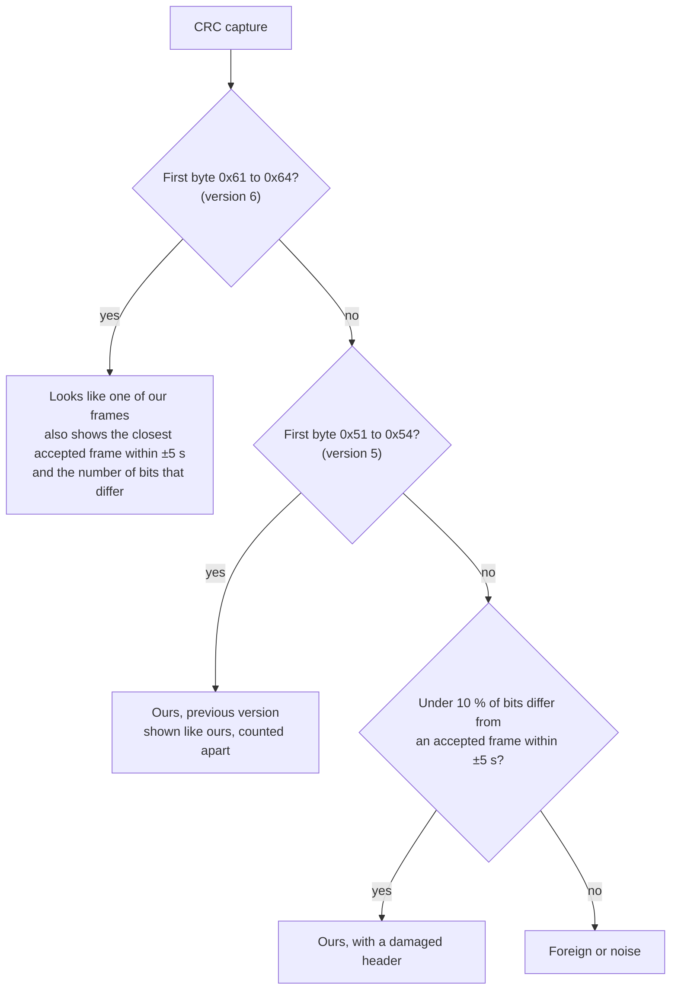
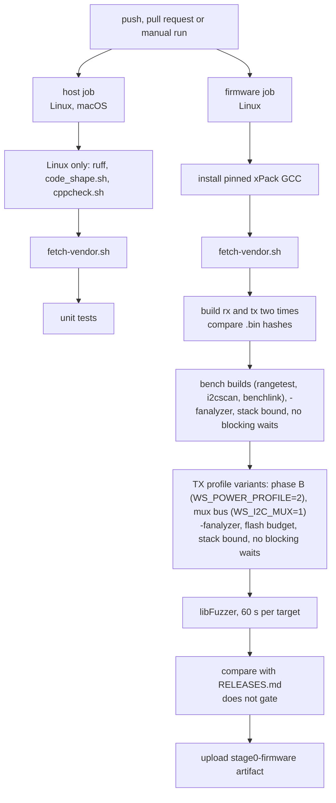

# Tools

Run the tools from the repository root with the project virtualenv (`.venv/bin/python`). Where a tool supports it, it finds a board by its ST-LINK serial number. The `/dev/cu.usbmodem*` names change between USB sockets and machines.

| File | Purpose | Usage | More |
|---|---|---|---|
| `fetch-vendor.sh` | Clones the pinned STM32CubeWL v1.6.0 and its submodules (HAL, CMSIS, BSP, SubGHz_Phy, Mbed TLS) into `vendor/`. A second run verifies the pinned commits. Firmware builds need it. 7 C-vs-Python crypto tests also need it. | `sh tools/fetch-vendor.sh` | `docs/CONTEXT-PACK.md` §5 |
| `status.py` | Prints the `/v1/status` JSON of the gateway. It does not show the API token. | `.venv/bin/python tools/status.py --directory run-office` (default `run-demo`) | `README.md` |
| `h01_report.py` | The scorer for the 24-hour delivery test (H01). It computes the verdict for a time window from a gateway database, opened read-only. Beside the score, never in it, it lists the serial-link gaps (decision record H8) from the gateway's own `gateway_events` rows: a `serial-lost` to the next `serial-open`, a `serial-reopen` over its `silent_s` (the gateway's open-but-silent reopen, `ws0/link.py`: after 90 s with no byte, doubling to 400 s), a `receiver-silent` to the next RX report, and each run of missing `#alive` minutes. Gaps are clipped to the window; a gap still open at its end is marked open. So the H8(d) replug test and every H01 run show a gap or none. With `--output`, it writes `report.json` and `report.md` to a new directory. | `.venv/bin/python tools/h01_report.py --db run-office/observations.sqlite3 --station station-01 --start 2026-10-15T00:00:00Z --hours 24 --output evidence/h01-2026-10-15` (`--db` defaults to `run-hw/observations.sqlite3`) | `docs/H01-checklist.md` |
| `rx_faults.py` | Lists the bad receptions that the RX board (the receiver) reported, from a gateway database opened read-only. These are `#rx crc` lines with the received bytes, and `#rx hdr` lines. It adds a summary. It puts each CRC capture in one of four classes (below). Our frame kinds are those of the current protocol version, 6 (byte 0 = 0x61 obs, 0x62 ack, 0x63 nack, 0x64 diag), and of the previous one, 5 (0x51 to 0x54): a version 5 capture is a frame from before the upgrade or from a board not yet flashed, which the gateway drops. Both lists come from `ws0.protocol` (`VERSION`, `VERSION_SHIFT`), so they follow the next version change. The summary counts the previous-version captures apart (`ours_previous_version`). For a database whose tables are older than the gateway version, it names the remedy and does not print a traceback. | `.venv/bin/python tools/rx_faults.py --db run-hw/observations.sqlite3 [--since 2026-10-15T00:00:00Z] [--until 2026-10-16T00:00:00Z] [--limit 50] [--json]` | `docs/web-dashboard.md` |
| `power_cut_test.py` | Power-loss test of the flash state of the TX board (the transmitter). It starts `TEST-FLASH-STORM`, then cuts power (`--method power`, uhubctl) or pulses the reset pin NRST (`--method reset`). It checks each boot for a monotonic counter and epoch. `--check` does one cut to verify that the hub really removes the USB supply (VBUS). | `.venv/bin/python tools/power_cut_test.py --method reset --serial-number 003B00194142500E20353451 --cycles 200 --gateway-db run-office/observations.sqlite3 --output evidence/power-cut-<date>` | `docs/failure-modes.md` §6 (power events), §10 (power-removal test not done), `evidence/g7-reset-during-write-2026-10-13/` |
| `code_shape.sh` | Checks the shape of our C (`firmware/stage0-node/App`, `firmware/common`, `firmware/stage0.c`, `firmware/host`). Every function has a cyclomatic complexity of at most 10 and at most 60 lines (lizard). No code is copied (jscpd, 5+ lines or 40+ tokens). It also runs `tangle.py --check`, `wsmp_registry.py --check` and `loop_bounds.py`. It fails on any finding. CI runs it. | `.venv/bin/pip install -r requirements-dev.txt; tools/code_shape.sh` (needs Node.js for `npx`) | `docs/firmware-budget.md` |
| `tangle.py` | Literate sources: each `*.lit.md` under `firmware/` and `ws0/`, and `gateway.lit.md`, is the source of its generated files. For example, `firmware/stage0-node/App/node_store.lit.md` is the source of `node_store.c`. The generated file is committed. Never edit it by hand. The tool tangles the code out. `--check` verifies that every committed file matches (used in `code_shape.sh` and `tests/test_tangle.py`). `--weave` writes a standalone HTML page. `--lines` writes a `#line` build, only for a debugger. It needs only the Python standard library. | `python3 tools/tangle.py firmware/stage0-node/App/node_store.lit.md`; `python3 tools/tangle.py --weave /tmp/node_store.html firmware/stage0-node/App/node_store.lit.md` | the docstring in `tools/tangle.py` |
| `rangetest_log.py` | Logs the console of a `firmware/rangetest` board to CSV: both link directions, the settings and the spot marks. It reconnects after USB dropouts. | `.venv/bin/python tools/rangetest_log.py 0016001E4142500E20353451 evidence/<run>/rangetest.csv` | `firmware/rangetest/README.md` |
| `benchlink_log.py` | Logs the bench telemetry link (`firmware/benchlink`) from the RX board's console to a CSV, one row per packet (versions 1 to 4, CRC checked; version 4 is change A's meaning, and versions 1 to 3 keep theirs: ISET pin without the gain, no `battery_ma`), synced to disk. Derived columns: `charge_ma` from the bq24074 ISET pin (I = K × V_ISET / R_ISET, TI SLUS810 eq. 3, with V_ISET = the PB1 node ÷ `--iset-gain`), `load_ma` = OUT ÷ R_LOAD, and `battery_ma`, the INA228 shunt current with its sign turned once (+ into the cell; `ishunt_ma` stays raw). An older CSV gets `battery_ma` from its `ishunt_ma` when its header is rewritten. The constants are options: `--r-iset` (default **1000 Ω**, R9 behind the board's closed 1A jumper, 0.89 A typ; decision record 1.4. Adopted with change A, read by this workflow from 7.1 P3; Clint to confirm. Runs logged with the old 890 Ω default read 12 % high: see `benchlink_dash.py --rewrite-iset`), `--k-iset` (default 400), `--iset-gain` (default 0.990099: the PB1 node over V_ISET, 1 MΩ ÷ 1.01 MΩ for the 10 kΩ series resistor and the 1 MΩ pull-down of record M2, nominal until the per-board fit) and `--r-load` (default 100 Ω, the bench test load). `--model` (default `hardware/bench-breadboard-r0/source/wiring.toml`) and `--preflight` (the run notes holding the `toml preflight` block) tie the run to its drawing: the `logger_start` event records the constants, the git blob hashes of the model and of its `build-sheet.md`, and the preflight status (`valid`, `stale`, `failing` or `missing`; `missing` without `--preflight`). They go in the event detail, **not in the CSV header**, because the logger sets aside a live CSV whose header it does not know (record D6). Beside it, `<name>-events.csv` records what explains a gap: RX and TX boots with their reset cause, crash records, silences, missed packets, rising TX error counters, a hung or missing RX, failed opens and writes, and the Mac sleeping. The alert events also raise a macOS notification. It opens the port exclusively, reopens it after 25 s without a line, prepares the CSV first (rewrites an older header, keeping a copy; sets aside one it cannot use) and never exits on its own. | `.venv/bin/python tools/benchlink_log.py --serial-number 0016001E4142500E20353451 --out evidence/<run>/benchlink.csv [--r-iset 1000] [--k-iset 400] [--iset-gain 0.990099] [--r-load 100] [--model <wiring.toml>] [--preflight evidence/<run>/notes.md]` | `firmware/benchlink/README.md` |
| `benchlink_console.py` | Records a board's console to a text file, each line prefixed with the local time and its UTC offset, by ST-LINK serial number. For the bench link's TX while it is on a Mac. It opens the port exclusively, reopens it after 25 s without a line and never exits on its own. | `.venv/bin/python tools/benchlink_console.py --serial-number 003B00194142500E20353451 --out evidence/<run>/tx-console.log` | `firmware/benchlink/README.md` |
| `benchlink_dash.py`, `benchlink_dash.html` | A live local dashboard of a `benchlink_log.py` CSV at `http://127.0.0.1:8099/`: the energy flow, tiles, and charts with gaps shaded, and a red banner when the data is stale or cannot be loaded. It counts the cell's state of charge from `--anchor`, bridging gaps. The battery current is the measured `battery_ma` for rows at or after `--shunt-from` (the moment the cell went through the INA228 shunt), and ISET minus load, marked as an estimate, before it, without it and for a CSV without that column. `--gauge-valid-from` hides VCELL before the gauge sensed the cell. **The step 1 flags** (decision record M4, M6, M7, P9), computed by the server and drawn by the page, each from the measured battery current only (off without `--shunt-from`): the **drop form** of the path metric (PATH_CELL_OUT: drop = VCELL − VOUT − dV0, valid only with PGOOD inactive and a discharge of 30 mA or more; flagged above 20 mV or on a step over 10 mV at constant load; it covers CELL+ to OUT only, not the pack mating); the **VCELL step flag** (a gauge VCELL step over 8 mV between consecutive samples with \|ΔI\| < 2 mA, which catches a contact at the pack mating); the **SOC-suspect band** (from a drop or step flag until 30 minutes pass with no further flag); VCELL labelled as the **CELL+ node**, which includes the pack-lead drop, with the estimate VCELL − I × R_pack beside it; the **M7 checks** (PGOOD against the divider input, CHG against V_ISET, the ISET current against the INA228 current in CC above 200 mA, outside 10 % + 20 mA, which also catches a bypassed shunt); and P9's termination check at each CHG release (INA228 current 0.20–0.40 A, VCELL − I × R_pack ≥ 4.12 V). `--dv0` (mV) and `--r-pack` (mΩ) set dV0 and R_pack; `--preflight` reads both from the run's preflight block (dV0 for `--power-mode` A or B) and shows its status (a stale block is a warning, its values still used); `--dv0` and `--r-pack` override it. `--rewrite-iset OLD --events <out>-events.csv` rescales `charge_ma` only for the rows logged with OLD: those after a `logger_start` whose detail says `r_iset=OLD`, up to the next `logger_start` (for runs logged with the old 890 Ω, `--rewrite-iset 890`); the CSV on disk is not changed. Not here: step 1b's current balance, whose currents the one-INA228 benchlink packet does not carry. It skips and counts unreadable CSV rows and unreadable `logger_start` rows of `--events`, shows both counts in the status line and prints each once to stderr. No external libraries. | `.venv/bin/python tools/benchlink_dash.py --csv evidence/<run>/benchlink.csv [--sources <csv>] [--anchor "YYYY-MM-DD HH:MM:SS"] [--gauge-valid-from "YYYY-MM-DD HH:MM:SS"] [--shunt-from "YYYY-MM-DD HH:MM:SS"] [--dv0 <mV>] [--r-pack <mOhm>] [--power-mode A\|B] [--preflight <notes.md>] [--events <out>-events.csv --rewrite-iset 890]` | `firmware/benchlink/README.md` |
| `preflight.py` | Checks a run's preflight block (decision record D6, M5, P8, section 4.3) against the breadboard model and the pass limits of `hardware/bench-breadboard-r0/source/checklist.py`. The block is the first fenced block in the run notes whose info string is `toml preflight`: top keys `model_hash` and `sheet_hash` (the git blob hashes of `wiring.toml` and `build-sheet.md`), `revision`, `power_mode` (A or B), `meter`, `date`, `photo`, `wiggle`, **`rewire`** and **`step_exit`** (booleans), `deviations`, `dv0_mv` and `r_pack_mohm`, then one `[[reading]]` per section 4.3 row (C1–C23) by joint, lead, link or path-segment id. Mode A needs C1–C11 and C19, mode B C15 and C20–C23; `rewire = true` or `step_exit = true` adds the 1 A rows C12–C14 and C16–C18. It prints one line per problem, then the status, which is also the exit code: **valid (0)** every check passes; **failing (1)** a reading outside its limit, an unknown id, a missing required row or top key; **missing (2)** no block, or it does not parse; **stale (3)** a hash differs from the current model or sheet: the model changed since the run (the readings are still held to their limits; a failing block outranks a stale one). It never blocks a run. Only `valid` counts as verified wiring: a `failing` or `missing` block prints "run marked wiring unverified" (record D6), and a `stale` one prints "the model changed since the run" (the H01 preconditions accept only `valid`). `benchlink_log.py --preflight` records the status in `logger_start`; `benchlink_dash.py --preflight` shows it. Standard library only. | `.venv/bin/python tools/preflight.py evidence/<run>/notes.md [--model hardware/bench-breadboard-r0/source/wiring.toml] [--sheet hardware/bench-breadboard-r0/build-sheet.md]` | the docstring in `tools/preflight.py`; `docs/H01-checklist.md` (precondition 2) |
| `console.py` | Sends one console line (for example `STATUS` or `WIPE ERASE-ALL-NODE-STATE`) to a board found by its ST-LINK serial number and prints the replies. It refuses `PROVISION`, so a key never goes on a command line: use `ws0 provision-node`. It opens the port exclusively. While `ws0 serve` holds the RX port, the open fails and the gateway loses no bytes. `--seconds` sets how long it prints replies (default 4). | `.venv/bin/python tools/console.py 003B00194142500E20353451 STATUS` | `docs/runbook-moving-boards.md` |
| `gates.sh` | Runs the CI gates locally, one line per gate: ruff, `code_shape.sh`, `cppcheck.sh`, two clean firmware builds with identical `.bin` hashes, the bench firmware builds (range test, I2C tool, bench link), `-fanalyzer`, the stack bound, no blocking waits, the unit tests, a 1,000,000-input standalone fuzz of every target and the Power of Ten rule 1 check. It does not run libFuzzer. Exit status 0 only if every gate passes. Works on macOS and Linux. | `tools/gates.sh` | `.github/workflows/ci.yml` |
| `cppcheck.sh` | Runs Cppcheck over our firmware C. Any finding fails. CI runs it. | `tools/cppcheck.sh` (cppcheck from `requirements-dev.txt`) | `docs/power-of-ten.md` |
| `loop_bounds.py` | Checks that every firmware loop is a counting loop or has a `bound:` comment (Power of Ten rule 2). `code_shape.sh` runs it. | `python3 tools/loop_bounds.py [paths...]` | `docs/power-of-ten.md` |
| `stack_report.py` | Computes the worst-case stack from the GCC call graphs. `make stack` runs it. | `python3 tools/stack_report.py firmware/stage0-node/build/tx [--limit 2048]` | `docs/firmware-budget.md` |
| `blocking_report.py` | Checks that no busy-wait is reachable after boot, from the same call graphs. `make waits` runs it. Its bounded HAL waits (`ALLOWED`) include the ADC enable handshake and the one offset calibration of the board ADC sequence (vane, ISET, charger input, VREFINT; `App/board_inputs.c`); the sequence itself completes by interrupt. | `python3 tools/blocking_report.py firmware/stage0-node/build/tx` | `docs/firmware-budget.md` §Blocking waits |
| `wsmp_registry.py`, `wsmp_registry.lock` | Generates the WSMP registry (`firmware/common/wsmp_registry.h`, `ws0/wsmp_registry.py`) from `firmware/common/wsmp_registry.toml`. The lock file keeps every code once given (append-only). `--check` fails on a stale file or a changed code. | `tools/wsmp_registry.py`; `tools/wsmp_registry.py --check` | `docs/module-protocol.md` §4 |
| `fetch-router.sh` | Fetches the pinned KiCadRoutingTools v0.23.1 and its prebuilt router into `vendor/`, with its own Python environment. A second run verifies the pins. The router binary is for macOS arm64 only. On other hosts the script skips. CI does not need it. | `tools/fetch-router.sh` | `hardware/bench-breadboard-r0/README.md` |
| `fetch-cad.sh` | Fetches the manufacturers' 3D models of board B's parts into `vendor/cad` (git-ignored), pinned by SHA-256; a second run verifies the pins. Without them, `make.py` draws plain boxes in their place. CI does not need it. | `sh tools/fetch-cad.sh` | `hardware/bench-breadboard-r0/README.md` |
| `kicad_env.py` | Finds KiCad 10 (`KICAD_APP`) and the router of `fetch-router.sh` for the breadboard map build. It says which part is missing. | Imported by `hardware/bench-breadboard-r0/source/` and its tests | `hardware/bench-breadboard-r0/README.md` |
| `nucleo/at.py` | Sends AT commands to a board that runs ST's factory Concentrator firmware (console 9600 8N1). | `python3 tools/nucleo/at.py /dev/cu.usbmodemXXXX "AT+VER=?"` | `docs/hardware/nucleo-wl55jc-bringup.md` |
| `nucleo/trace-swd-disable.tcl` | An OpenOCD script. It sets a watchpoint on writes to `GPIOA_MODER`, to find where the factory firmware turns off the Serial Wire Debug (SWD) port. The script runs `init` itself. | `openocd -f interface/stlink.cfg -f target/stm32wlx.cfg -f tools/nucleo/trace-swd-disable.tcl` | `docs/hardware/nucleo-wl55jc-bringup.md` (SWD) |
| `deploy/macos/install.sh` | Installs, removes or inspects the launchd agent `com.clintecker.weatherstation.gateway`. The agent runs `ws0 serve --serial-number <RX>` and restarts it if it exits. It logs to `<state-dir>/serve.out`. The gateway rotates that file at 50 MB and keeps 10. The gateway reopens an open but silent RX port in place after 90 s with no byte (doubling to 400 s, reset on any line; decision record H8(f), `ws0/link.py`) and logs each reopen as a `serial-reopen` event; `h01_report.py` lists them as gaps. `serve.err` holds only the failures before that file opens. | `tools/deploy/macos/install.sh install [state-dir] [rx-stlink-serial]` \| `uninstall` \| `status` (defaults: `run-hw`, `0016001E4142500E20353451`) | `docs/CONTEXT-PACK.md` §4 |
| `deploy/macos/com.clintecker.weatherstation.gateway.plist.in` | The launchd template. `install.sh` fills in `@REPO@`, `@STATE@` and `@RX_SERIAL@`. | Do not run it directly. | |
| `deploy/linux/ws0-gateway.service` | The systemd unit for an always-on Linux gateway. | Copy it to `/etc/systemd/system/`, set `User` and the paths, then `systemctl daemon-reload && systemctl enable --now ws0-gateway` | `firmware/stage0-node/README.md` |

`rx_faults.py` puts each CRC capture in one of these classes:

## CI

`.github/workflows/ci.yml` runs on every push and pull request. You can also start it by hand (`workflow_dispatch`, with an optional commit to build).

- **host**: runs on Linux and macOS with Python 3.12 (Windows is not supported). On Linux the job first runs ruff, `tools/code_shape.sh` and `tools/cppcheck.sh`. Then it runs `sh tools/fetch-vendor.sh` (cached, always verified again), then `WS_REQUIRE_VENDOR=1 WS_REQUIRE_CC=1 WS0_UNSAFE_FAST_FSYNC=1 python -m unittest discover -s tests`. With `WS_REQUIRE_VENDOR=1` and `WS_REQUIRE_CC=1`, a missing `vendor/` or a missing C compiler fails the C tests and does not skip them.
- **firmware**: installs xPack arm-none-eabi-gcc 15.2.1-1.1 (linux-x64, SHA-256 pinned in the workflow). It builds `ROLE=rx` and `ROLE=tx` two times from `make clean` and fails if the `.bin` hashes differ. The flash budget check of the Makefile runs at each link. It then builds the bench firmware (rangetest, i2cscan, benchlink), and both node roles again with `ANALYZE=1` (`-fanalyzer`), the stack bound (`stack_report.py`) and the blocking-wait report (`blocking_report.py`). The step "TX profile variants (phase B, mux bus)" does the same for the two other TX build profiles: phase B's four INA228 rails (`OPT="-Os -DWS_POWER_PROFILE=2"`) and the ports board's mux bus (`OPT="-Os -DWS_I2C_MUX=1"`), each with `ANALYZE=1`, the flash budget, `stack` and `waits`, into `build/variant-phase-b` and `build/variant-mux` (see `docs/firmware-budget.md`). So a phase B or mux build that stops compiling, overflows flash or stack, or gains a blocking wait fails CI. These builds use their own directories and never touch the release bins. Then libFuzzer runs each target for 60 s. The job uploads the bins and maps as the `stage0-firmware` artifact.
- The firmware job can find a section for the built commit in `firmware/stage0-node/RELEASES.md`, read from the default branch. It then compares the `.bin` hashes with the recorded ones and reports a match or a mismatch. This check never fails the job. To check an old release again, run the workflow by hand with that commit.

