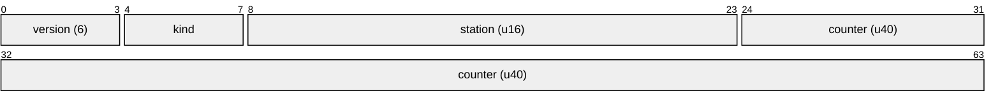
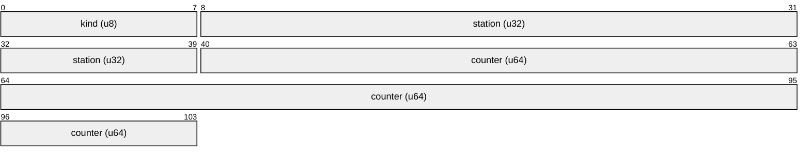
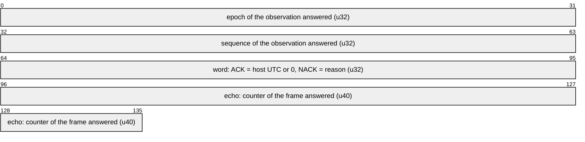
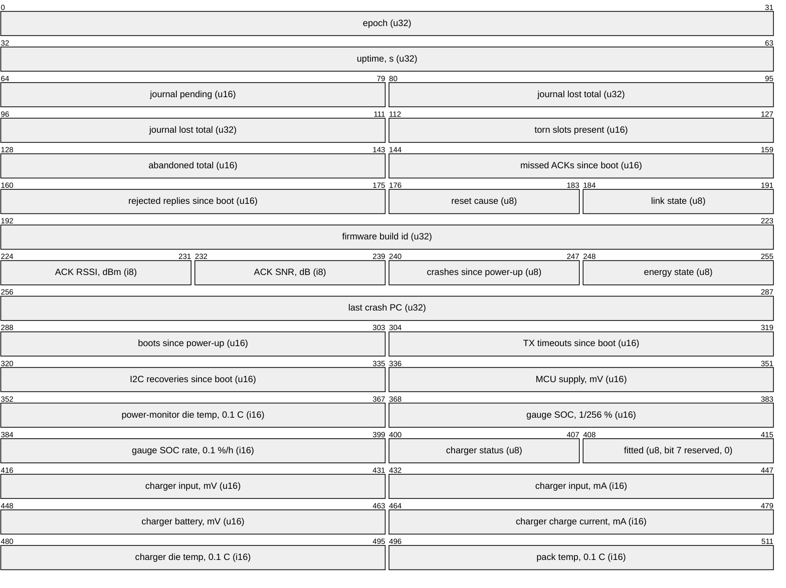
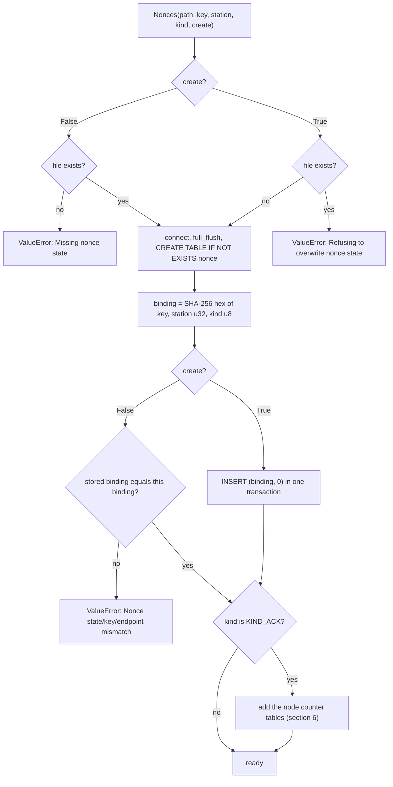
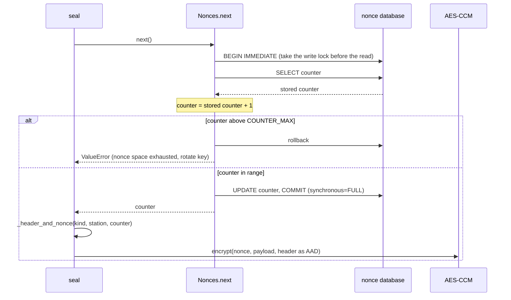
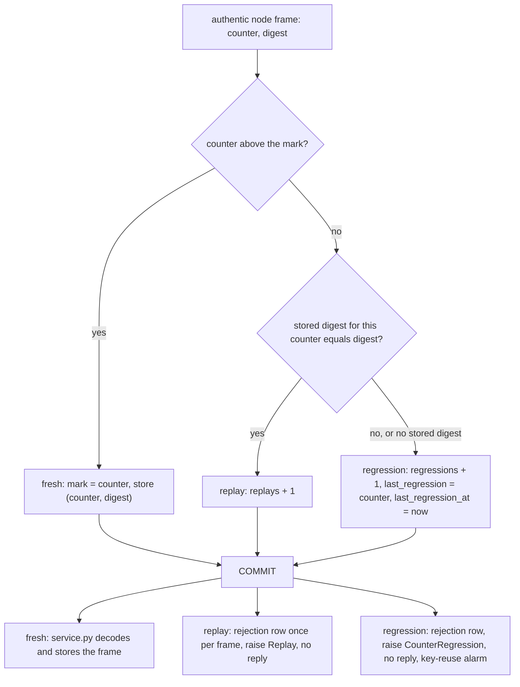
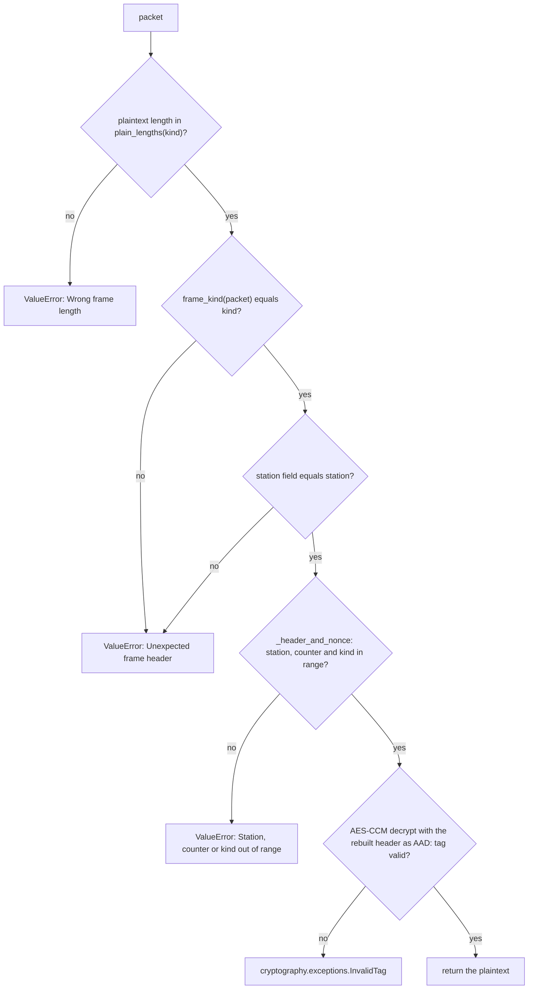

# protocol: the radio frame on the gateway side

`protocol.py` builds and opens the radio frames of protocol version 6. The design notes for this
format are in `docs/protocol-design.md`; version 6 (catalog version 2 observations and the 64-byte
health report) is defined by the power telemetry design,
`docs/superpowers/specs/2026-10-29-power-telemetry-design.md` sections 4–6.

The module builds four parts of a frame:

- the clear header,
- the nonce for AES-128 in CCM mode (counter with CBC-MAC, an authenticated encryption mode),
- the plaintexts of the fixed-size kinds: ACK (acknowledgement), NACK (negative acknowledgement) and
  DIAG (the node's health report),
- the observation plaintext, through `ws0/fields.py`.

The module also holds `Nonces`, the durable counter allocator. The gateway reserves every nonce
from it. The simulator's node does too. For the gateway, `Nonces` also keeps the highest node
counter seen so far (the high-water mark). The gateway uses that mark to detect replays and
repeated nonces.

This document is the source. `tools/tangle.py` generates `protocol.py` from the code chunks below.
The repository also holds the generated file, so imports, ruff and the tests read ordinary Python.
Edit this file, then regenerate and check:

```sh
python3 tools/tangle.py ws0/protocol.lit.md                          # write protocol.py
python3 tools/tangle.py --check ws0/protocol.lit.md                  # committed .py == tangle
python3 tools/tangle.py --weave /tmp/protocol.html ws0/protocol.lit.md   # render
```

A chunk is a fenced ` ```python {#name} ` block. A line `<<name>>` inside a chunk includes chunk
`name` at that line's indentation. Chunks appear in reading order. The root chunk (section 9) puts
them in file order.

## 1. Guarantees

| Property | Guarantee | Checked by |
|---|---|---|
| Wire format | Python and `firmware/common/ws_frame.c` produce and accept the same bytes for every kind | `tests/test_frame.py`: `test_known_answer_vectors`, `test_random_agreement_both_directions`, `test_diagnostic_frame_agreement`, `test_diag_plaintext_matches_python` |
| Field limits | the code refuses a station or counter that its header field cannot hold. It never truncates the value | `test_counter_and_station_limits` |
| Gateway counter | `Nonces.next` commits a counter before it returns it. It refuses a counter above `COUNTER_MAX` | `test_gateway_allocator_stops_at_the_limit` |
| Nonce state | a missing state file raises an error. The code never recreates the file | `tests/test_stage0.py`: `test_nonce_restart_and_missing_state` |
| Durability | the nonce database uses a write-ahead log (WAL), `synchronous=FULL` and `fullfsync` | `tests/test_gateway.py`: `test_full_flush_pragmas_are_on` |
| Node counter mark | the gateway commits the mark before it acts on the frame. The mark survives restarts. An unauthenticated frame never moves it | `tests/test_counter_regression.py`: `test_mark_is_raised_before_commit`, `test_mark_survives_gateway_restart`, `test_unauthenticated_frame_never_moves_the_mark` |
| Replay | the gateway counts an exact copy of an accepted frame. It raises no alarm | `test_replayed_obs_gets_no_reply_and_is_not_stored`, `test_exact_duplicate_of_latest_frame_is_not_answered` |
| Regression | any other authentic frame at or below the mark raises the key-reuse alarm | `test_same_counter_different_bytes_alarms`, `test_older_frame_never_seen_still_alarms`, `test_wipe_and_reuse_alarms_on_first_frame` |
| Unseal | `unseal` refuses the wrong length, version, kind or station before it decrypts | `test_reply_rejections`, `test_diagnostic_frame_agreement`, `test_version_6_byte0` |
| Health report by name | `pack_diag` and `unpack_diag` use the C member names; no caller depends on the tuple order of `DIAG`. `diag_problems` names every broken canonical rule | `test_pack_diag_by_name`, `test_diag_layout_matches_the_spec`, `test_diag_canonical_rules` |

The counter is the AES-CCM nonce. Two different plaintexts under one key and one nonce lose their
confidentiality and their authenticity. The allocator rules in section 5 and the mark in section 6
prevent that.

## 2. Module header

The generated file opens with its docstring and imports. AES-CCM comes from the `cryptography`
package (OpenSSL). `gateway.py` supplies `full_flush` (the SQLite durability settings) and
`validate` (the gateway record schema).

```python {#module-docstring}
"""Binary radio protocol, version 6, gateway side. All integers are big-endian (network byte order).

AES-CCM comes from cryptography (OpenSSL). This module does not implement it.
The firmware reserves each counter durably before use (firmware/stage0-node/App/node_store.c).
The firmware never resets the counter, not even on WIPE. A flash-layout change does reset it,
and always comes with a new key (docs/runbook-moving-boards.md). So one key never sees a
repeated nonce on one board.
"""
```

```python {#imports}
import hashlib
import sqlite3
import struct
from pathlib import Path
from gateway import full_flush, validate
from cryptography.hazmat.primitives.ciphers.aead import AESCCM

from . import fields
```

## 3. Envelope

### Header

The layout is in `docs/protocol-design.md` section 3.1. `firmware/common/ws_frame.c` builds the
same bytes. `tests/test_frame.py` compiles that file with Mbed TLS and compares the bytes (section
10).

A frame is the 8-byte header, then the ciphertext (n bytes), then the 8-byte CCM tag. The header
travels in clear. It is the additional authenticated data (AAD): the tag covers it, but the cipher
does not encrypt it. The header in bits:



| Offset | Bytes | Constant | Contents |
|---:|---:|---|---|
| 0 | 1 | `VERSION_SHIFT`, `KIND_MASK` | `VERSION` (6) in the high nibble, kind in the low nibble: 0x61 OBS, 0x62 ACK, 0x63 NACK, 0x64 DIAG |
| 1 | 2 | `STATION_AT`, `STATION_BYTES` | station id, 1 to `STATION_MAX` (65535) |
| 3 | 5 | `COUNTER_AT`, `COUNTER_BYTES` | transmission counter, 1 to `COUNTER_MAX` (2^40 − 1) |
| 8 | n | `HEADER_LEN` | AES-128-CCM ciphertext of the kind's plaintext |
| 8 + n | 8 | `TAG_LEN` | CCM tag |

The tag length is a fixed constant. The code never infers it from the frame length.

```python {#envelope}
# Envelope (docs/protocol-design.md section 3): byte 0 = version << 4 | kind, then station u16
# and counter u40. The ciphertext and an 8-byte CCM tag follow. firmware/common/ws_frame.c builds
# the same bytes. tests/test_frame.py compares them byte for byte. Version 6: catalog v2
# observations and the 64-byte health report. Both node roles and the gateway must match.
VERSION = 6
```

The key, the key check value and two reserved values that other modules use:

| Constant | Value | Use |
|---|---|---|
| `KEY_LEN` | 16 | AES-128 key |
| `KCV_LEN` | 3 | key check value (KCV): the first 3 bytes of AES-ECB(key, 0). ECB is the electronic codebook mode |
| `SIGNAL_NONE` | −128 | health-report RSSI (received signal strength) and SNR (signal-to-noise ratio) before the node heard an authentic ACK |
| `EPOCH_RESERVED` | 2^32 − 1 | the epoch of the bench storm test. A real boot never gets it |

```python {#key-and-markers}
KEY_LEN, KCV_LEN = 16, 3                   # AES-128 key. Key check value = AES-ECB(key, 0)[:3]
SIGNAL_NONE = -128                         # health report RSSI and SNR: no authentic ACK heard yet
EPOCH_RESERVED = 2**32 - 1                 # the bench storm test's epoch. A real boot never gets it
```

```python {#header-layout}
VERSION_SHIFT, KIND_MASK = 4, 0x0F          # byte 0: version in the high nibble, kind in the low
STATION_AT, STATION_BYTES = 1, 2
COUNTER_AT, COUNTER_BYTES = STATION_AT + STATION_BYTES, 5
HEADER_LEN = COUNTER_AT + COUNTER_BYTES
TAG_LEN = 8
STATION_MAX = 2**(8 * STATION_BYTES) - 1
COUNTER_MAX = 2**(8 * COUNTER_BYTES) - 1   # a larger counter would truncate and repeat a nonce
```

A counter above `COUNTER_MAX` does not fit in the 5-byte field. A truncated counter would put a
small counter on air, and that repeats a nonce. So every path refuses such a counter (sections 5
and 7).

### Nonce

The 13-byte nonce is the kind as u8, the station as u32 and the counter as u64, big-endian. The code
builds the nonce from the integers. It never copies the nonce from the header bytes. `ws_frame.c`
uses the same construction (`NONCE_LEN` 13).



The kind byte keeps two counter spaces apart under one key. The node's flash counter seals
observations (OBS) and health reports (DIAG). The gateway's `Nonces` database seals ACK and NACK.
The same counter value in both spaces gives two different nonces.

```python {#nonce-layout}
NONCE = struct.Struct('>BIQ')               # kind, station u32, counter u64: 13 bytes
```

### Header and nonce from the integers

`_header_and_nonce` checks the ranges first. It raises `ValueError` for each of these values:

- a station outside 1 to `STATION_MAX`,
- a counter outside 1 to `COUNTER_MAX`,
- a kind outside `KIND_OBS` to `KIND_DIAG`.

`to_bytes` raises on a value that its field cannot hold. So the code never masks or truncates a
value.

```python {#header-and-nonce}
def _header_and_nonce(kind, station, counter):
    """Return the header (also the AAD) and the 13-byte nonce. Both come from the integers: kind,
    station u32, counter u64. to_bytes raises on a value that its field cannot hold, so no value
    is truncated."""
    if not 1 <= station <= STATION_MAX or not 1 <= counter <= COUNTER_MAX or not KIND_OBS <= kind <= KIND_DIAG:
        raise ValueError('Station, counter or kind out of range')
    header = (bytes([VERSION << VERSION_SHIFT | kind]) + station.to_bytes(STATION_BYTES, 'big') +
              counter.to_bytes(COUNTER_BYTES, 'big'))
    return header, NONCE.pack(kind, station, counter)
```

### Reading the header

`frame_kind` returns the kind only when the high nibble is `VERSION`. It returns `None` for an
empty packet or another version. A version 5 frame starts with `0x51` to `0x54`, and a frame of the
older version 4 format with `0x57`: both read as version 5, so `frame_kind` returns `None`. A
mismatched end therefore drops the frames as another version and never NACKs them; the node keeps
the records in its journal until both ends match (power telemetry design section 4).

`frame_counter` reads the counter field. It checks nothing. Callers use it on a frame that `unseal`
authenticated. `unseal` also uses it to rebuild the nonce.

```python {#frame-kind}
def frame_kind(packet):
    """Return the kind of a frame of this protocol version. Return None for an empty packet or
    another version."""
    return packet[0] & KIND_MASK if packet and packet[0] >> VERSION_SHIFT == VERSION else None
```

```python {#frame-counter}
def frame_counter(packet):
    """Return the transmission counter from the header of an authenticated frame."""
    return int.from_bytes(packet[COUNTER_AT:HEADER_LEN], 'big')
```

## 4. Kinds and fixed plaintexts

| Kind | Name | Sender | Counter space | Plaintext |
|---:|---|---|---|---|
| 1 | `KIND_OBS` | node | node | observation, 23 to 94 bytes (section 8) |
| 2 | `KIND_ACK` | gateway | gateway | reply, 17 bytes |
| 3 | `KIND_NACK` | gateway | gateway | reply, 17 bytes |
| 4 | `KIND_DIAG` | node | node | health report (`DIAG`), 64 bytes |

```python {#kinds}
KIND_OBS, KIND_ACK, KIND_NACK, KIND_DIAG = 1, 2, 3, 4
```

### ACK and NACK

Both replies use one 17-byte layout (`docs/protocol-design.md` section 4). `reply_unpack` in
`ws_frame.c` reads the same fields.



| Offset | Bytes | Field |
|---:|---:|---|
| 0 | 4 | epoch of the observation answered |
| 4 | 4 | sequence of the observation answered |
| 8 | 4 | word. In an ACK: the host UTC at commit, or 0 when the gateway measured its own clock as wrong. In a NACK: the reason |
| 12 | 5 | echo: the counter of the observation frame answered |

The echo ties the reply to one frame. The node accepts the time only from the reply to the frame
that it just sent. So a replayed ACK cannot set the node's clock.

```python {#reply-layout}
# ACK and NACK plaintexts (17 bytes): epoch u32, sequence u32, word u32, then the u40 counter of
# the observation frame answered. The word of an ACK is the host UTC at commit, or 0 if the
# gateway measured its clock as wrong. The word of a NACK is the reason. The node accepts the
# time only from the reply to the frame that it just sent, so a replayed ACK cannot set its
# clock. NACKs share the gateway's ACK counter space. The kind byte keeps the nonces distinct.
REPLY_HEAD = struct.Struct('>III')
REPLY_LEN = REPLY_HEAD.size + COUNTER_BYTES
```

`pack_reply` writes the echo with `to_bytes(COUNTER_BYTES)`. That call raises for a value above 40
bits. `unpack_reply` raises `ValueError('Wrong reply length')` for any length other than
`REPLY_LEN`. It returns `(epoch, sequence, word, echo)`.

```python {#pack-reply}
def pack_reply(epoch, sequence, word, echo):
    return REPLY_HEAD.pack(epoch, sequence, word) + echo.to_bytes(COUNTER_BYTES, 'big')
```

```python {#unpack-reply}
def unpack_reply(plain):
    """(epoch, sequence, word, echo)"""
    if len(plain) != REPLY_LEN:
        raise ValueError('Wrong reply length')
    return (*REPLY_HEAD.unpack(plain[:REPLY_HEAD.size]), int.from_bytes(plain[REPLY_HEAD.size:], 'big'))
```

NACK reasons. `ws0/service.py` picks one when an authentic observation fails to decode or to store:

| Constant | Value | Cause in `service.py` |
|---|---|---|
| `NACK_COLLISION` | 1 | `ValueError('Identity collision')`: another record holds this (epoch, sequence) |
| `NACK_INVALID` | 2 | any other `ValueError` from `decode_observation` or the store |

```python {#nack-reasons}
NACK_COLLISION, NACK_INVALID = 1, 2
```

### Health report (DIAG)

The health report tells the gateway the node's state. The node sends it once and expects no reply.
The node does not keep it in its journal, and the gateway does not answer it. Version 6 makes it a
fixed 64 bytes (power telemetry design section 6.1): the first 32 bytes keep their version 5
layout, and bytes 32–63 carry the slow power and station items. The struct is
`>IIHIHHHHBBIbbBBIHHHHhHhBBHhHhhh`:



| Offset | Bytes | Name (`DIAG_FIELDS`, the C member) | Field | None code |
|---:|---:|---|---|---|
| 0 | 4 | `epoch` | epoch | — |
| 4 | 4 | `uptime` | uptime (s) | — |
| 8 | 2 | `pending` | journal pending | — |
| 10 | 4 | `lost` | journal lost total (cumulative, persisted) | — |
| 14 | 2 | `torn` | torn slots present | — |
| 16 | 2 | `abandoned` | abandoned total (cumulative, persisted) | — |
| 18 | 2 | `no_ack` | missed ACKs since boot | — |
| 20 | 2 | `rejects` | rejected replies since boot | — |
| 22 | 1 | `reset_cause` | reset cause, an index into `RESET_CAUSES` | — |
| 23 | 1 | `link` | link state, an index into `LINK_STATES` | — |
| 24 | 4 | `build` | firmware build id: the first 4 bytes of the release commit | — |
| 28 | 1 | `rssi` | RSSI of the last authentic ACK, signed dBm | `SIGNAL_NONE` (−128) |
| 29 | 1 | `snr` | SNR of the last authentic ACK, signed dB | `SIGNAL_NONE` (−128) |
| 30 | 1 | `crashes` | crashes since power-up | — |
| 31 | 1 | `energy` | energy state, an index into `fields.ENERGY` | — |
| 32 | 4 | `crash_pc` | PC of the last crash since power-up; 0xFFFFFFFF = the stacked frame was not trusted | `CRASH_PC_NONE` (0) |
| 36 | 2 | `boots` | boots since power-up, saturating | — |
| 38 | 2 | `tx_timeouts` | radio TX timeouts since boot, saturating | — |
| 40 | 2 | `i2c_recoveries` | I2C bus recoveries started since boot, saturating | — |
| 42 | 2 | `vdda_mv` | MCU supply VDDA, mV | `U16_NONE` (0xFFFF) |
| 44 | 2 | `monitor_temp` | power-monitor die temperature, 0.1 °C (the hottest fitted monitor) | `I16_NONE` (−32768) |
| 46 | 2 | `soc` | gauge state of charge, 1/256 % | `U16_NONE` |
| 48 | 2 | `soc_rate` | gauge state-of-charge rate, 0.1 %/h, + while charging | `I16_NONE` |
| 50 | 1 | `charger_status` | charger status byte (below) | `CHARGER_NONE` (0xFF) |
| 51 | 1 | `fitted` | the sources this build has (`FIT_*` bits, below) | — |
| 52 | 2 | `chg_input_mv` | charger-reported input voltage, mV | `U16_NONE` |
| 54 | 2 | `chg_input_ma` | charger-reported input current, 1 mA, + into the charger | `I16_NONE` |
| 56 | 2 | `chg_batt_mv` | charger-reported battery voltage, mV | `U16_NONE` |
| 58 | 2 | `chg_batt_ma` | charger-reported charge current, 1 mA, + into the cell | `I16_NONE` |
| 60 | 2 | `chg_temp` | charger die temperature, 0.1 °C | `I16_NONE` |
| 62 | 2 | `pack_temp` | pack temperature, 0.1 °C | `I16_NONE` |

The fields say what is measured, not which part measures it, so a later phase fills a slot without
a format change. A slot that a build or phase cannot fill carries its none code; the gateway maps
every none code to `null`. Byte 51, the fitted byte, says why a slot is `null`: its bit for the slot
set means the build has a source, so the none code is a sensor fault; clear means the slot is not
measured in this build (design section 6.1).

| Bit | Constant | Slots |
|---|---|---|
| 0 | `FIT_MCU_SUPPLY` | `vdda_mv` |
| 1 | `FIT_MONITOR_TEMP` | `monitor_temp` |
| 2 | `FIT_GAUGE` | `soc`, `soc_rate` |
| 3 | `FIT_CHARGER_STATUS` | `charger_status` bits 0–2 (power good, charging, fault) |
| 4 | `FIT_CHARGER_REGS` | `charger_status` stage and active input, `chg_input_mv`, `chg_input_ma`, `chg_batt_mv`, `chg_temp` |
| 5 | `FIT_CHARGE_CURRENT` | `chg_batt_ma` |
| 6 | `FIT_PACK_TEMP` | `pack_temp` |
| 7 | — | reserved, must be 0 |

`ws_frame.h` defines the same bits as `WS_FIT_*`. Phases A and B send 0x2F (bits 0, 1, 2, 3, 5).

`ws_diag_pack` in the firmware writes the same bytes (`test_diag_plaintext_matches_python`). The
order of `RESET_CAUSES` follows `ws_reset_t` in `watchdog.h` (`test_reset_cause_numbering`).
`service.py` maps an index past the end of a table to `'unknown'`.

```python {#diag-layout}
# Health report (kind 4, docs/protocol-design.md section 4; power telemetry design section 6.1).
# The node sends it once: no journal, no ACK. 64 bytes; DIAG_FIELDS names each value by its C
# member in ws_diag_t (firmware/common/ws_frame.h). Callers use pack_diag and unpack_diag, never
# the tuple order of DIAG.
DIAG = struct.Struct('>IIHIHHHHBBIbbBBIHHHHhHhBBHhHhhh')
DIAG_FIELDS = ('epoch', 'uptime', 'pending', 'lost', 'torn', 'abandoned', 'no_ack', 'rejects', 'reset_cause',
               'link', 'build', 'rssi', 'snr', 'crashes', 'energy',
               'crash_pc', 'boots', 'tx_timeouts', 'i2c_recoveries', 'vdda_mv', 'monitor_temp', 'soc', 'soc_rate',
               'charger_status', 'fitted', 'chg_input_mv', 'chg_input_ma', 'chg_batt_mv', 'chg_batt_ma',
               'chg_temp', 'pack_temp')
RESET_CAUSES = ('unknown','power','pin','brownout','software','watchdog','lowpower','option-bytes')
LINK_STATES = ('linked','probing')
```

The none codes and the defaults of the version 6 fields. A signed none code is the type's minimum,
an unsigned one is all ones. The three station counts have no none code (the firmware fills them in
every phase); their default is 0. `CRASH_PC_UNTRUSTED` is a value, not a none code: the gateway
shows it as a PC.

```python {#diag-none}
U16_NONE, I16_NONE, CHARGER_NONE = 0xFFFF, -0x8000, 0xFF     # no value; the fitted byte says why
FIT_MCU_SUPPLY, FIT_MONITOR_TEMP, FIT_GAUGE, FIT_CHARGER_STATUS = 0x01, 0x02, 0x04, 0x08
FIT_CHARGER_REGS, FIT_CHARGE_CURRENT, FIT_PACK_TEMP, FIT_RESERVED = 0x10, 0x20, 0x40, 0x80
CRASH_PC_NONE, CRASH_PC_UNTRUSTED = 0, 0xFFFFFFFF            # no crash since power-up; frame not trusted
DIAG_DEFAULTS = dict(crash_pc=CRASH_PC_NONE, boots=0, tx_timeouts=0, i2c_recoveries=0, vdda_mv=U16_NONE,
                     monitor_temp=I16_NONE, soc=U16_NONE, soc_rate=I16_NONE, charger_status=CHARGER_NONE,
                     fitted=0, chg_input_mv=U16_NONE, chg_input_ma=I16_NONE, chg_batt_mv=U16_NONE,
                     chg_batt_ma=I16_NONE, chg_temp=I16_NONE, pack_temp=I16_NONE)
```

`pack_diag(**fields)` packs by name. The fifteen version 5 fields are required. A version 6 field
that the caller leaves out gets its default from `DIAG_DEFAULTS` (its none code; `fitted` 0, nothing
fitted).
An unknown or missing name raises `TypeError`; a value its field cannot hold raises `struct.error`.
`unpack_diag(payload)` returns a `dict` of the raw values by `DIAG_FIELDS` name. It raises
`ValueError('Wrong health report length')` for any length other than `DIAG.size`. It applies no
rule: `diag_problems` does.

```python {#pack-diag}
def pack_diag(**values):
    """Health report plaintext from named values (DIAG_FIELDS). Missing version 6 fields get their
    none codes, fitted gets 0."""
    unknown = set(values) - set(DIAG_FIELDS)
    missing = set(DIAG_FIELDS) - set(values) - set(DIAG_DEFAULTS)
    if unknown or missing:
        raise TypeError(f'pack_diag: unknown {sorted(unknown)}, missing {sorted(missing)}')
    merged = {**DIAG_DEFAULTS, **values}
    return DIAG.pack(*(merged[name] for name in DIAG_FIELDS))
```

```python {#unpack-diag}
def unpack_diag(payload):
    """Raw health report values by C member name (DIAG_FIELDS). No rule is applied."""
    if len(payload) != DIAG.size:
        raise ValueError('Wrong health report length')
    return dict(zip(DIAG_FIELDS, DIAG.unpack(payload), strict=True))
```

The charger status byte (power telemetry design section 6.3):

| Bits | Constant | Meaning |
|---|---|---|
| 0 | `CHG_POWER_GOOD` | input power good |
| 1 | `CHG_CHARGING` | charging |
| 2 | `CHG_FAULT` | fault |
| 3–5 | `CHG_STAGE_SHIFT`, `CHARGER_STAGES` | 0 not reported, 1 `precharge` (pre-charge or trickle), 2 `cc`, 3 `cv`, 4 `topoff`, 5 `terminated`, 6 `not_charging`, 7 reserved |
| 6–7 | `CHG_INPUT_SHIFT`, `CHARGER_INPUTS` | active input: 0 not reported, 1 `solar`, 2 `usb_c`, 3 `no_input` (the charger reports that no input powers it) |

`ws_frame.h` defines the same bits as `WS_CHG_*`. Phase A fills bits 0–2 from the PGOOD and CHG
pins, with stage 0 and input 0. The stage and the active input are for a charger that reports them
(none is fitted today); the active input would attribute the charger's input current to the solar or
the USB-C rail. Input 3, `no_input`, is a reading, not a gap: the charger has neither input (every
night on solar with USB-C unplugged), so both source rails carry 0 mA (design section 3.2). It is canonical; "not
reported" stays 0.

```python {#charger-bits}
CHG_POWER_GOOD, CHG_CHARGING, CHG_FAULT = 0x01, 0x02, 0x04
CHG_STAGE_SHIFT, CHG_INPUT_SHIFT, CHG_FIELD_MASK = 3, 6, 0x07
CHARGER_STAGES = (None, 'precharge', 'cc', 'cv', 'topoff', 'terminated', 'not_charging')   # 7: reserved
CHARGER_INPUTS = (None, 'solar', 'usb_c', 'no_input')                                     # all four codes valid
```

**Canonical rules** (power telemetry design section 6.1). The node never sends a non-canonical
report. A health report is never answered, so the gateway keeps every other value of a report that
breaks a rule:

| Rule | Problem string | Gateway action |
|---|---|---|
| fitted bit 7 is 0 | `'fitted bit 7 set'` | log a warning, store the report (the bit carries no meaning) |
| a status byte other than `CHARGER_NONE` has a stage of 0–6 | `'charger stage 7'` | log a warning, store the five charger keys as `null` |

Every active input code (0–3) is canonical. Code 3 was reserved until 2026-10-29 (design section
6.3); it now means "no input", so phase C needs no change to these rules.

`diag_problems(d)` takes the `dict` of `unpack_diag` and returns the broken rules as a tuple of
these strings, empty when the report is canonical. `charger_keys(status)` returns the five
gateway charger keys: all `None` for `CHARGER_NONE` or a non-canonical byte, otherwise the three
booleans, the stage name (`None` for "not reported") and the input name (`None` for "not
reported", `'no_input'` for code 3).

```python {#diag-problems}
def diag_problems(d):
    """The canonical rules that an unpacked health report breaks; empty when it is canonical."""
    status = d['charger_status']
    problems = ('fitted bit 7 set',) if d['fitted'] & FIT_RESERVED else ()
    if status != CHARGER_NONE and status >> CHG_STAGE_SHIFT & CHG_FIELD_MASK >= len(CHARGER_STAGES):
        problems += ('charger stage 7',)
    return problems
```

```python {#charger-keys}
def charger_keys(status):
    """The five gateway charger keys of a status byte. All None for no status or an invalid byte."""
    stage, source = status >> CHG_STAGE_SHIFT & CHG_FIELD_MASK, status >> CHG_INPUT_SHIFT
    if status == CHARGER_NONE or stage >= len(CHARGER_STAGES):
        return dict(charger_input_power_ok=None, charger_charging=None, charger_fault=None, charger_stage=None,
                    charger_active_input=None)
    return dict(charger_input_power_ok=bool(status & CHG_POWER_GOOD), charger_charging=bool(status & CHG_CHARGING),
                charger_fault=bool(status & CHG_FAULT), charger_stage=CHARGER_STAGES[stage],
                charger_active_input=CHARGER_INPUTS[source])
```

## 5. Nonces: the durable counter allocator

`Nonces` owns one SQLite file per (key, station, kind). The gateway opens one for `KIND_ACK`. The
simulator's node opens one for `KIND_OBS`. A hardware node keeps its counter in flash
(`node_store.c`). So provisioning a hardware station creates only the gateway file.

```python {#nonces-class}
class Nonces:
    """Reserve each counter durably before encryption. Never recreate state silently."""
    <<nonces-init>>

    <<node-counter>>

    <<advance-node-counter>>

    <<next>>
```

### Opening



| Step | Check | On failure |
|---|---|---|
| 1 | `create=False` and the file is missing | `ValueError('Missing nonce state: provision a NEW key, never reset counters')` |
| 2 | `create=True` and the file exists | `ValueError('Refusing to overwrite nonce state')` |
| 3 | connect, then `full_flush`: WAL, `synchronous=FULL`, and `F_FULLFSYNC` on macOS | — |
| 4 | binding = SHA-256 hex of key ‖ station u32 ‖ kind u8 | — |
| 5 | `create=True`: insert (binding, 0) in one transaction | — |
| 6 | otherwise the stored binding must equal this one | `ValueError('Nonce state/key/endpoint mismatch')` |

**Why the code never recreates the state.** A new file starts at counter 0, so its first counter
is 1. The key already used counter 1 and every counter up to the lost value. A silent new file
would repeat nonces under the same key. Two callers pass `create=True`. `provision` in
`ws0/__main__.py` (the `init` command) generates a new key in the same step. The error text names
that remedy. The simulation harness (`ws0/harness.py`) creates fresh state in a new state
directory for each scenario. It uses a fixed public test key, never a deployment key.

**Why the binding.** The binding is a hash of the key, station and kind. Step 6 fails in three
cases: the file was copied from another station, the key is different, or the kind is wrong. So
the file never hands out counters for another nonce space. The file stores the hash, not the key.

`WS0_UNSAFE_FAST_FSYNC=1` turns the durability settings off for simulations and unit tests
(`gateway.full_flush`). Those runs claim no durability across power loss.

```python {#nonces-init}
def __init__(self, path, key, station, kind, create=False):
    path = Path(path)
    if not create and not path.exists():
        raise ValueError('Missing nonce state: provision a NEW key, never reset counters')
    if create and path.exists():
        raise ValueError('Refusing to overwrite nonce state')
    self.db = sqlite3.connect(path)
    try:
        full_flush(self.db)  # WAL and synchronous=FULL. On macOS, also flush the drive cache
        self.db.execute('CREATE TABLE IF NOT EXISTS nonce (binding TEXT, counter INTEGER)')
        binding = hashlib.sha256(key + struct.pack('>IB', station, kind)).hexdigest()
        row = self.db.execute('SELECT binding FROM nonce').fetchone()
        if create:
            with self.db:
                self.db.execute('INSERT INTO nonce VALUES (?,0)', (binding,))
        elif not row or row[0] != binding:
            raise ValueError('Nonce state/key/endpoint mismatch')
        self.station, self.kind = station, kind
        <<node-counter-tables>>
    except BaseException:   # the caller never gets self.db: close it, or the file stays locked (Windows)
        self.db.close()
        raise
```

### Reserving a counter

`next` reserves the counter and commits it before `seal` encrypts with it. It runs in a
`BEGIN IMMEDIATE` transaction:



| Event | Result |
|---|---|
| Crash before the commit | `next` did not return the counter, so no frame used it. The next call returns it |
| Crash after the commit | the file stores the counter as used. A frame may or may not have gone out. The next call returns the counter after it |
| Two processes on one file | `BEGIN IMMEDIATE` takes the write lock before the read, so they never read the same value |
| Any exception | rollback, then re-raise. The stored counter does not change |

So a crash can skip a counter. It never repeats one.

```python {#next}
def next(self):
    """Reserve and commit the next counter. The immediate transaction also stops two allocators
    on one file from reading the same counter."""
    self.db.execute('BEGIN IMMEDIATE')
    try:
        counter = self.db.execute('SELECT counter FROM nonce').fetchone()[0] + 1
        if counter > COUNTER_MAX:
            raise ValueError('Nonce space exhausted; rotate key')
        self.db.execute('UPDATE nonce SET counter=?', (counter,))
        self.db.commit()
    except Exception:
        self.db.rollback()
        raise
    return counter
```

## 6. The node counter high-water mark

The node seals observations and health reports from one strictly increasing counter. Every
transmission takes a new counter, retries included. WIPE keeps the counter (`store_next_counter`
in `node_store.c`). So an authentic node frame at or below the highest counter seen so far is a
copy or a repeated nonce. The gateway keeps that mark in its `KIND_ACK` nonce file.

### Tables

When `Nonces` opens a `KIND_ACK` file, it adds two tables and sets the mark to 0. Both tables use
`node_binding` as the key: the binding of (key, station, `KIND_OBS`).

| Table | Columns | Contents |
|---|---|---|
| `node_counter` | `binding`, `max_counter`, `regressions`, `last_regression`, `last_regression_at`, `replays` | the mark, the regression count with the counter and time of the last one, the replay count |
| `node_frames` | `binding`, `counter`, `digest` | SHA-256 of each frame accepted as fresh, by counter |

The mark lives in the nonce file, not in the observation database. An operator can restore the
observation database from a backup. Nobody restores the nonce file, so a restore cannot lower the
mark.

```python {#node-counter-tables}
if kind == KIND_ACK:
    # The gateway's high-water mark of the node's counter space. Observations and health
    # reports share that space. The mark lives here, in state that is never restored from a
    # backup, so a restore of the observations can never lower it.
    self.node_binding = hashlib.sha256(key + struct.pack('>IB', station, KIND_OBS)).hexdigest()
    self.db.execute('CREATE TABLE IF NOT EXISTS node_counter (binding TEXT PRIMARY KEY, '
                    'max_counter INTEGER NOT NULL, regressions INTEGER NOT NULL, '
                    'last_regression INTEGER, last_regression_at REAL, replays INTEGER NOT NULL DEFAULT 0)')
    # SHA-256 of every authentic node frame accepted as fresh, by counter. A later frame with the
    # same counter and the same bytes is a replay (harmless). Different bytes under one counter
    # are a repeated nonce (docs/protocol-design.md section 6).
    self.db.execute('CREATE TABLE IF NOT EXISTS node_frames (binding TEXT, counter INTEGER, digest TEXT, '
                    'PRIMARY KEY(binding, counter))')
    with self.db:
        self.db.execute('INSERT OR IGNORE INTO node_counter (binding,max_counter,regressions) VALUES (?,0,0)',
                        (self.node_binding,))
```

### Verdicts

`service.py` calls `advance_node_counter(counter, now, digest)` only for a frame that `unseal`
authenticated. `digest` is the SHA-256 hex of the whole frame. The method runs in one
`BEGIN IMMEDIATE` transaction:



| Condition | Verdict | Change | What `service.py` does |
|---|---|---|---|
| `counter > mark` | `fresh` | mark = counter, store (counter, digest) | decodes and stores the frame |
| `counter <= mark`, the stored digest for this counter equals `digest` | `replay` | `replays + 1` | writes a rejection row (once per frame) and raises `Replay`. No reply, no alarm |
| `counter <= mark`, no stored digest or a different one | `regression` | `regressions + 1`, `last_regression` = counter, `last_regression_at` = now | writes a rejection row and raises `CounterRegression`. No reply. The status shows `'possible key reuse: re-key the node'` |

**Why a replay is not an alarm.** An exact copy reuses no nonce. It is the same ciphertext under
the same nonce, so it reveals nothing new. The gateway still does not answer or store it.

**Why a regression is an alarm.** Different bytes under a counter already seen have one cause: the
node sealed a second plaintext with a nonce that it already used. That breaks CCM for both frames.
An unknown frame below the mark is also a regression. Direct LoRa does not reorder frames. So the
gateway treats an older counter that never arrived as reuse
(`test_older_frame_never_seen_still_alarms`). A node that restarts its counter under the old key
gets this verdict on its first frame (`test_wipe_and_reuse_alarms_on_first_frame`). The remedy is a
new key.

**Why before the gateway acts on the frame.** `service.py` calls this method before
`decode_observation` and before the database commit. After a crash or a failed commit, the mark is
still at or above every counter that the gateway stored or answered. The node retries with a new
counter, so the raised mark never rejects a genuine retry (`test_mark_is_raised_before_commit`).

An exception rolls the transaction back and re-raises.

```python {#advance-node-counter}
def advance_node_counter(self, counter, now, digest):
    """Call only for an authenticated node frame, with the SHA-256 hex digest of its bytes.
    Return one of three verdicts:
    'fresh': the counter is above the mark. The mark is raised and the digest kept.
    'replay': an exact copy of a frame already accepted. Counted, no alarm.
    'regression': at or below the mark with different or unknown bytes. This is a repeated
    nonce or key reuse, counted for the alarm.
    The commit comes before the gateway acts on the frame. So after a crash the mark is never
    lower than a counter that the gateway stored or answered."""
    self.db.execute('BEGIN IMMEDIATE')
    try:
        mark = self.db.execute('SELECT max_counter FROM node_counter WHERE binding=?',
                               (self.node_binding,)).fetchone()[0]
        if counter > mark:
            verdict = 'fresh'
            self.db.execute('UPDATE node_counter SET max_counter=? WHERE binding=?', (counter, self.node_binding))
            self.db.execute('INSERT OR REPLACE INTO node_frames VALUES (?,?,?)', (self.node_binding, counter, digest))
        else:
            seen = self.db.execute('SELECT digest FROM node_frames WHERE binding=? AND counter=?',
                                   (self.node_binding, counter)).fetchone()
            if seen and seen[0] == digest:
                verdict = 'replay'
                self.db.execute('UPDATE node_counter SET replays=replays+1 WHERE binding=?', (self.node_binding,))
            else:
                verdict = 'regression'
                self.db.execute('UPDATE node_counter SET regressions=regressions+1, last_regression=?, '
                                'last_regression_at=? WHERE binding=?', (counter, now, self.node_binding))
        self.db.commit()
    except Exception:
        self.db.rollback()
        raise
    return verdict
```

`node_counter` returns the stored row as a dict for the status page, the HTTP API and MQTT. Only a
`KIND_ACK` allocator has `node_binding`, so only the gateway uses these two methods.

| Key | Column |
|---|---|
| `max_node_counter` | `max_counter` |
| `counter_regression` | `regressions` |
| `last_regression_counter` | `last_regression` |
| `last_regression_at` | `last_regression_at` |
| `replays` | `replays` |

```python {#node-counter}
def node_counter(self):
    """Return the stored node-counter high-water mark and regression record (gateway only)."""
    mark, count, last, at, replays = self.db.execute(
        'SELECT max_counter,regressions,last_regression,last_regression_at,replays FROM node_counter '
        'WHERE binding=?', (self.node_binding,)).fetchone()
    return {'max_node_counter': mark, 'counter_regression': count,
            'last_regression_counter': last, 'last_regression_at': at, 'replays': replays}
```

## 7. Seal and unseal

### seal

`seal(key, station, kind, allocator, payload)` returns header ‖ ciphertext ‖ tag. It runs these
checks in order:

| Step | Check | On failure |
|---|---|---|
| 1 | `allocator.station == station` | `ValueError('Wrong nonce allocator')` |
| 2 | `allocator.kind == kind`, or a shared space: NACK on an ACK allocator, health report on an OBS allocator | `ValueError('Wrong nonce allocator')` |
| 3 | `allocator.next()` reserves a counter durably | `ValueError('Nonce space exhausted; rotate key')` |
| 4 | `_header_and_nonce`: station, counter and kind ranges | `ValueError('Station, counter or kind out of range')` |
| 5 | AES-CCM encrypt, AAD = header, `TAG_LEN` 8 | — |

The shared spaces are safe because the nonce contains the kind byte. ACK 5 and NACK 5 use
different nonces. A failure at step 4 leaves the counter of step 3 used. The allocator never hands
out a skipped counter again.

```python {#seal}
def seal(key, station, kind, allocator, payload):
    """Authenticate the clear header and encrypt the payload with an 8-byte tag."""
    # NACKs share the gateway's ACK counter space. Health reports share the node's observation
    # counter space. The kind byte in the nonce keeps every (kind, counter) pair distinct.
    shared = (kind == KIND_NACK and allocator.kind == KIND_ACK) or (kind == KIND_DIAG and allocator.kind == KIND_OBS)
    if allocator.station != station or (allocator.kind != kind and not shared):
        raise ValueError('Wrong nonce allocator')
    header, nonce = _header_and_nonce(kind, station, allocator.next())
    return header + AESCCM(key, tag_length=TAG_LEN).encrypt(nonce, payload, header)
```

### Plaintext lengths

`unseal` checks the plaintext length before it decrypts (`docs/protocol-design.md` section 3.4).
Plaintext length = frame length − `HEADER_LEN` − `TAG_LEN`.

| Kind | Plaintext bytes | Frame bytes |
|---|---|---|
| OBS | `fields.HEAD_LEN + 1` (23) to `fields.HEAD_LEN + fields.fields_len(fields.DEFINED)` (94, every catalog version 2 field with the extension word) | 39 to 110 |
| ACK | `REPLY_LEN` (17) | 33 |
| NACK | `REPLY_LEN` (17) | 33 |
| DIAG | `DIAG.size` (64) | 80 |
| other | none | `unseal` refuses every length |

The observation range covers every field bitmap of the full catalog, not only the bitmap of one
build: `fields.fields_len` counts the 2-byte extension word when an extension field is present, so
the upper end is the record with every field (94 B; a node build sends at most 80 B, design section
5.4). The smallest field adds one byte; an extension-only record (header, extension word, one
2-byte field) is 26 B, inside the range. So `unseal` refuses an observation plaintext with no
field. The exact observation length depends on the encrypted field bitmap. So `fields.decode`
checks it after decryption.

```python {#plain-length-table}
# The plaintext lengths that a frame of each kind may have, checked before decryption
# (docs/protocol-design.md section 3.4). The exact length of an observation depends on its
# encrypted field bitmap. fields.decode checks it after decryption.
PLAIN_LENGTHS = {KIND_OBS: range(fields.HEAD_LEN + 1, fields.HEAD_LEN + fields.fields_len(fields.DEFINED) + 1),
                 KIND_ACK: (REPLY_LEN,), KIND_NACK: (REPLY_LEN,), KIND_DIAG: (DIAG.size,)}
```

```python {#plain-lengths}
def plain_lengths(kind):
    return PLAIN_LENGTHS.get(kind, ())
```

### unseal

`unseal(key, station, kind, packet)` returns the plaintext. It runs these checks in order:



| Step | Check | On failure |
|---|---|---|
| 1 | plaintext length is in `plain_lengths(kind)` | `ValueError('Wrong frame length')` |
| 2 | `frame_kind(packet) == kind`: version 6 and this kind | `ValueError('Unexpected frame header')` |
| 3 | the station field equals `station` | `ValueError('Unexpected frame header')` |
| 4 | `_header_and_nonce` from (kind, station, header counter): the counter is 1 to `COUNTER_MAX` | `ValueError('Station, counter or kind out of range')` |
| 5 | AES-CCM decrypt with the rebuilt header as AAD | `cryptography.exceptions.InvalidTag` |

Steps 1 to 4 use no cryptography. Step 5 fails for a wrong key, a changed byte anywhere, or a
changed kind. The kind is in the nonce and in the AAD. `service.py` never answers a frame that
fails here. A NACK for an unauthenticated frame would let anyone make the node drop a record.

`ws_open_reply` in `ws_frame.c` applies the same checks to ACK and NACK on the node
(`test_reply_rejections`).

```python {#unseal}
def unseal(key, station, kind, packet):
    """Reject the wrong length, version, kind or station before decryption. Then reject a bad tag."""
    if len(packet) - HEADER_LEN - TAG_LEN not in plain_lengths(kind):
        raise ValueError('Wrong frame length')
    if frame_kind(packet) != kind or int.from_bytes(packet[STATION_AT:COUNTER_AT], 'big') != station:
        raise ValueError('Unexpected frame header')
    header, nonce = _header_and_nonce(kind, station, frame_counter(packet))
    return AESCCM(key, tag_length=TAG_LEN).decrypt(nonce, packet[HEADER_LEN:], header)
```

## 8. Observations

`docs/protocol-design.md` section 5 defines the observation plaintext layout. `ws0/fields.py`
implements it. These two functions convert between that layout and the gateway record
(`docs/protocol-design.md` section 5.7).

`encode_observation` validates the record with `gateway.validate`, then calls `fields.encode`. The
simulator's node uses it. Gateway record to `fields.encode` arguments:

| Record key | Argument |
|---|---|
| `session` (string) | epoch, `int(...)` |
| `sequence` | sequence |
| `sampled_at`, `None` → 0 | UTC |
| `uptime_s` | uptime |
| `energy_state` | its index in `fields.ENERGY` |
| `calibration_revision` | calibration revision |
| present fields | codes, from `fields.codes_from_record` |

```python {#encode-observation}
def encode_observation(record):
    """Convert a gateway record to an observation plaintext (docs/protocol-design.md section 5).
    The simulator's node uses it."""
    validate(record)
    return fields.encode(int(record['session']), record['sequence'], record['sampled_at'] or 0, record['uptime_s'],
                         fields.ENERGY.index(record['energy_state']), record['calibration_revision'],
                         fields.codes_from_record(record))
```

`decode_observation` runs the canonical decode (`fields.decode`). That function raises `ValueError`
for a plaintext that is not in canonical form. `decode_observation` then builds the record:

| Record key | Source |
|---|---|
| `version` | `VERSION` |
| `station` | the station name passed in |
| `session` | `str(epoch)` |
| `sequence` | sequence |
| `sampled_at` | UTC when the time-known flag is set, else `None` |
| `uptime_s` | uptime |
| `time_quality` | `'synchronized'` when the time is known, else `'unknown'` |
| `energy_state`, `calibration_revision` | from the header |
| one key per present field | `fields.values`: an INVALID field is `None`, never a number |
| `quality` | `fields.quality(record)` |

`gateway.validate` checks the result. A `ValueError` from either step reaches `service.py`. The
service answers the authentic frame with `NACK_INVALID` (`tests/test_stage0.py`:
`test_invalid_authentic_record_is_nacked`).

```python {#decode-observation}
def decode_observation(payload, station):
    """Convert an observation plaintext to a gateway record. INVALID fields are None, never numbers."""
    head, codes = fields.decode(payload)
    record = dict(version=VERSION, station=station, session=str(head['epoch']), sequence=head['sequence'],
                  sampled_at=head['utc'] if head['time_known'] else None, uptime_s=head['uptime'],
                  time_quality='synchronized' if head['time_known'] else 'unknown',
                  energy_state=head['energy_state'], calibration_revision=head['calibration_revision'],
                  **fields.values(codes))
    record['quality'] = fields.quality(record)
    validate(record)
    return record
```

## 9. The file

The root chunk puts the chunks in the order of the committed `protocol.py`.

```python {#protocol.py}
<<module-docstring>>
<<imports>>

<<envelope>>
<<key-and-markers>>
<<header-layout>>
<<nonce-layout>>
<<reply-layout>>


<<pack-reply>>


<<unpack-reply>>


<<kinds>>
<<diag-layout>>
<<diag-none>>
<<charger-bits>>
<<nack-reasons>>


<<pack-diag>>


<<unpack-diag>>


<<diag-problems>>


<<charger-keys>>


<<nonces-class>>


<<header-and-nonce>>


<<seal>>


<<frame-kind>>


<<frame-counter>>


<<plain-length-table>>


<<plain-lengths>>


<<unseal>>


<<encode-observation>>


<<decode-observation>>
```

## 10. Tests

| File | What it checks |
|---|---|
| `tests/test_frame.py`, `FrameAgreement` | builds `firmware/common/ws_frame.c` with Mbed TLS. Known-answer vectors made from the design (`test_vectors_follow_the_spec`). Python and C on the same vectors (`test_known_answer_vectors`). 300 random keys, stations and counters in both directions (`test_random_agreement_both_directions`). Field limits on both sides (`test_counter_and_station_limits`). `Nonces.next` at `COUNTER_MAX` (`test_gateway_allocator_stops_at_the_limit`). Reply rejections (`test_reply_rejections`). Health report frames and plaintext (`test_diagnostic_frame_agreement`, `test_diag_plaintext_matches_python`). Version 6 byte 0 (`test_version_6_byte0`) |
| `tests/test_frame.py`, `FirmwareTables` | the transmitter self-test vectors in `App/selftest.c` (`test_selftest_vectors`), the `RESET_CAUSES` order (`test_reset_cause_numbering`), the 64-byte layout against the spec and `ws_diag_t` (`test_diag_layout_matches_the_spec`, `test_diag_mirror_matches_the_header`), `pack_diag`, `unpack_diag`, `diag_problems` and `charger_keys` (`test_pack_diag_by_name`, `test_diag_canonical_rules`) |
| `tests/test_counter_regression.py` | every verdict of section 6 through `Gateway.receive`, the counter space that observations and health reports share (`test_obs_and_diag_share_one_counter_space`), restart and write-ahead behaviour, and harness runs that must never raise the alarm |
| `tests/test_stage0.py` | `test_nonce_restart_and_missing_state`, `test_invalid_authentic_record_is_nacked` |
| `tests/test_gateway.py` | `test_full_flush_pragmas_are_on` |

`FrameAgreement` needs a C compiler and `vendor/`. Continuous integration (CI) sets
`WS_REQUIRE_VENDOR=1`. So a missing `vendor/` fails these tests. They do not skip.

```sh
.venv/bin/python -m unittest tests.test_frame tests.test_counter_regression tests.test_stage0 tests.test_gateway
```
